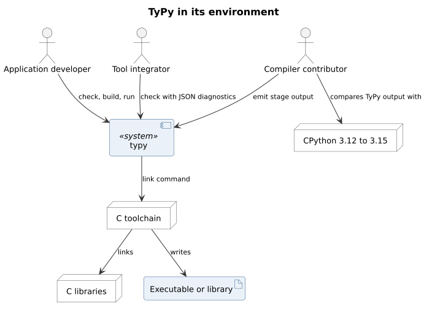
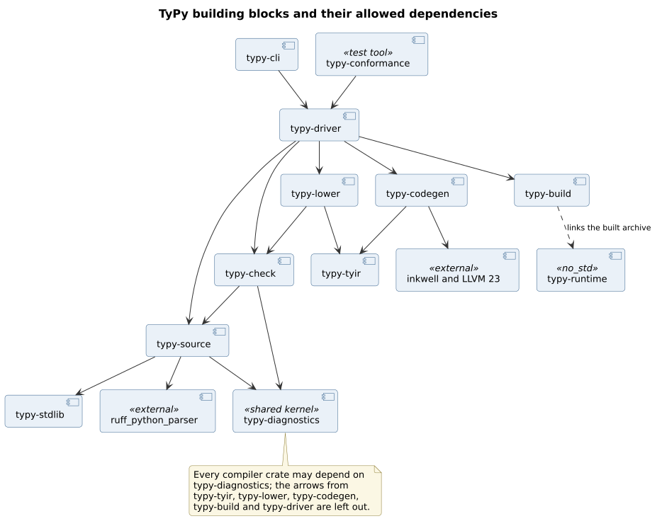
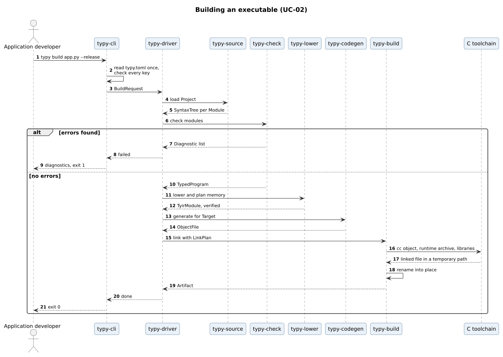
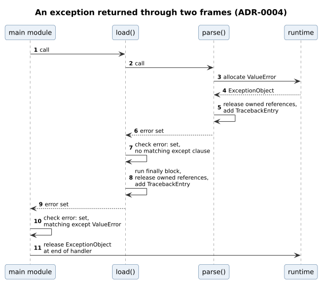
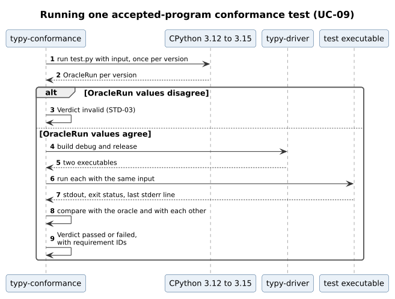
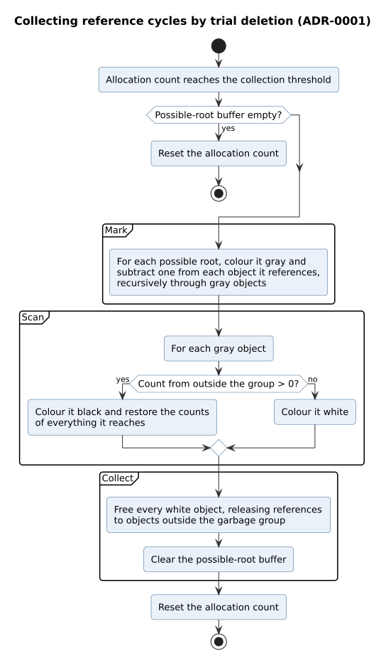
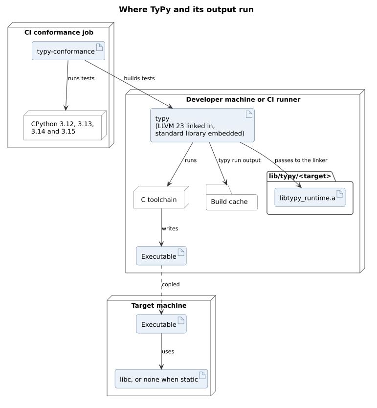

# TyPy software architecture

| Field | Value |
| --- | --- |
| Document | TyPy software architecture |
| Version | 1.2 |
| Status | Approved |
| Owner | typy-lang contributors |
| Last updated | 2026-11-06 |

## 1. Purpose

This document describes how TyPy is built: its context, its building
blocks, how they work together at run time, where they are deployed, the
concerns that cut across them, and how each quality requirement is met. It
builds on the approved [domain model](../modeling/domain-model.md),
[use case model](../modeling/use-case-model.md) and
[software requirements specification](../requirements/srs.md), and on the
[decision records](../adr/index.md). The detailed design, which comes after
the decision records, specifies each building block down to its types.

## 2. Architecture drivers

### 2.1 Quality goals

When two goals conflict, the higher one wins.

| Rank | Goal | Requirements |
| --- | --- | --- |
| 1 | An accepted program behaves as it does under CPython | STD-02, NFR-10, NFR-15 |
| 2 | Safe code is memory safe, and the compiler never crashes | NFR-07, NFR-09 |
| 3 | The same inputs give the same bytes | NFR-06 |
| 4 | Binaries and the runtime are small | NFR-01, NFR-02, NFR-12, NFR-13 |
| 5 | The compiler is fast | NFR-04, NFR-05, NFR-14 |
| 6 | Compiled programs are fast | NFR-03 |

### 2.2 Constraints and decisions

The constraints C-01 to C-05 of the specification apply. The architecture
follows these decision records:

| ADR | Decision | Status |
| --- | --- | --- |
| ADR-0001 | Optimised reference counting with selective cycle collection | Accepted |
| ADR-0002 | Only standard Python, with the meaning CPython gives it | Superseded by ADR-0008 |
| ADR-0003 | An independent implementation with no names of its own | Accepted |
| ADR-0004 | Exceptions as error values returned to the caller | Accepted |
| ADR-0005 | The compiler in Rust, with Ruff's parser and LLVM 23 | Accepted |
| ADR-0006 | The runtime in Rust without the standard library | Accepted |
| ADR-0007 | Standard library modules in Python, compiled by TyPy | Accepted |
| ADR-0008 | Each program judged by CPython from its own Python floor | Accepted |

## 3. System context

| Interface | Direction | Form |
| --- | --- | --- |
| Command line | In | `typy check`, `build`, `run`, `explain` with flags (CLI-01 to CLI-11) |
| Source files | In | `.py` files, UTF-8, at most 16 MiB each (LEX-01, LEX-09) |
| `typy.toml` | In | TOML, read once when a command starts (CLI-07) |
| Diagnostics | Out | Text on standard error, or JSON lines with `--error-format=json` (DIA-05) |
| Stage output | Out | Text or an object file on standard output or the `-o` file (CLI-04) |
| Link command | Out | An argument list for the C toolchain, run as a subprocess |
| Artifacts | Out | Executables, static and shared libraries, C headers |
| Exit status | Out | 0, 1, 2 or 101 (CLI-06) |

CPython does not take part in a build. It is used only by the conformance
suite (UC-09).

## 4. Building blocks

### 4.1 Crates

The compiler is one Cargo workspace. Each bounded context of the domain
model is one crate, plus a shared kernel, the command line, the pipeline
driver, the runtime, the standard library and the conformance suite.

| Crate | Context | Responsibility | Concepts it owns |
| --- | --- | --- | --- |
| `typy-diagnostics` | Shared kernel | Source locations and diagnostics, used by every stage | `Span`, `Position`, `Diagnostic`, `DiagnosticCode`, `Rule` |
| `typy-source` | Source | Find modules, read files, parse them with `ruff_python_parser` | `Project`, `ProjectSettings`, `Module`, `SourceFile`, `SyntaxTree` |
| `typy-stdlib` | Source | The embedded Python sources of the standard library modules and the `_typy` declarations (ADR-0007) | None of its own |
| `typy-check` | Checking | Resolve names, check types and the subset rules | `TypedProgram`, `Scope`, `Symbol`, `Type`, `ClassDefinition`, `FunctionSignature`, `TypeChecker`, `SubsetChecker` |
| `typy-tyir` | Lowering | TyIR's data types, builder, verifier and text form | `TyirModule`, `TyirFunction`, `BasicBlock`, `Instruction`, `ValueRepresentation` |
| `typy-lower` | Lowering | Lower a `TypedProgram` to TyIR, expand generics, run the memory and raise analyses | `RaiseAnalysis`, `EscapeAnalysis`, `OwnershipAnalysis`, `CycleAnalysis` |
| `typy-codegen` | Code generation | Turn TyIR into LLVM IR and an object file, and lay out each `TypeDescriptor` | `ObjectFile`, `Target` |
| `typy-build` | Build | Link, write artifacts atomically, write C headers for exports | `BuildRequest`, `BuildMode`, `EmitStage`, `LinkPlan`, `ExportSpec`, `Artifact` |
| `typy-driver` | All | Run the stages in order for a `BuildRequest`, and stop at an `EmitStage` | None of its own |
| `typy-cli` | All | Parse the command line and `typy.toml`, print diagnostics, set the exit status | None of its own |
| `typy-runtime` | Runtime | The library linked into every binary (ADR-0006) | `HeapObject`, `ObjectHeader`, `TypeDescriptor`, `ExceptionObject`, `TracebackEntry`, `Allocator`, `CycleCollector` |
| `typy-conformance` | Conformance | Run the conformance suite against the oracle (UC-09) | `ConformanceTest`, `OracleRun`, `Verdict` |

`Span` and `Position` belong to the Source context in the domain model.
Every stage reports diagnostics that carry a `Span`, so their code lives in
the shared kernel, and `typy-source` uses them from there.

### 4.2 Layering rules

- Dependencies point only in the directions the diagram shows. Every
  compiler crate may depend on `typy-diagnostics`.
- Only `typy-source` depends on `ruff_python_parser`, and its syntax types
  do not appear in the public API of `typy-source` (ADR-0005).
- Only `typy-codegen` depends on `inkwell` and LLVM.
- No crate depends on `typy-cli`. Only `typy-cli` and `typy-conformance`
  depend on `typy-driver`.
- `typy-runtime` depends on nothing but `core`. The compiler crates do not
  depend on it; `typy-build` links the archive built from it.
- A CI job reads `cargo metadata` and fails when a dependency between
  workspace crates is not in the allowed list above. Cargo already forbids
  cycles between crates.

## 5. Runtime views

### 5.1 Building an executable

`typy-cli` reads `typy.toml` once and turns it, with the flags, into a
`BuildRequest`. `typy-driver` runs each stage in turn and passes on only the
object that stage returns. When checking finds errors, the driver stops
before lowering, so no later stage ever sees a program with errors. The
linker writes to a temporary path in the output directory, and
`typy-build` renames the file into place, so a failed build never leaves a
partial artifact.

With `--emit=STAGE`, the driver stops after that stage and writes its text
form instead (UC-05).

### 5.2 An exception crossing two frames

`parse()` raises `ValueError`. It releases the references it owns, adds its
`TracebackEntry`, and returns with the error set. `load()` checks the error
after the call, finds no matching `except` clause, runs its `finally`
block, releases its references, adds its entry and returns the error. The
main module finds a matching clause and handles it. No unwinder is
involved, and nothing happens on the normal path except one compare and
branch after each call that may raise (ADR-0004, EXC-03).

### 5.3 A conformance test

The suite first runs the test under each oracle version from the test's
Python floor up (ADR-0008). If they disagree, the test depends on
behaviour Python leaves to the implementation and is reported as invalid
(STD-03). Otherwise the suite builds the test in
debug and release mode and compares both runs with the oracle and with each
other (NFR-10, NFR-15).

### 5.4 Collecting reference cycles

The collector runs only at an allocation, when the count of allocations
since the last run reaches a threshold, so it runs at the same points on
every run of the same program and needs no thread (ADR-0001). It marks the
buffered possible roots, finds which of them are held from outside, and
frees the rest. Only objects of types that `CycleAnalysis` marked as able to
form a cycle are ever buffered.

## 6. Deployment

| Item | Location | Notes |
| --- | --- | --- |
| `typy` | `<prefix>/bin/typy` | One executable. LLVM 23 is linked in statically, and the standard library sources are embedded. |
| Runtime archive | `<prefix>/lib/typy/<target>/libtypy_runtime.a` | One per supported target. `typy` checks at start-up that its version matches. |
| Build cache | `$TYPY_HOME/cache`, or the platform's user cache directory when `TYPY_HOME` is not set | Used by `typy run` only. Its location never changes a build's output (CLI-11). |
| Output | The path given by `-o`, or next to the main file | Written atomically |

The compiler needs the C toolchain only to link. `typy check`, and
`typy build --emit` for every stage before `obj`, work without it.

CI runs the conformance suite in one job per platform, inside the dev
image, which holds exact builds of CPython 3.12, 3.13, 3.14 and 3.15
installed with uv and nothing else added (A-02). The suite runs each
interpreter as a subprocess.

## 7. Cross-cutting concepts

### 7.1 Errors and diagnostics

- Each stage returns either its result or a list of `Diagnostic` values.
  Only the Source and Checking contexts report errors in the user's
  program. A stage after checking that finds a problem reports an internal
  error, `E9xxx`, because checking should have caught it (NFR-09).
- Compiler code returns errors as values and does not panic on any input.
  `typy-cli` runs the pipeline behind a guard that turns any panic into
  `E9001`, with the hint to report it, and exit status 101.
- Diagnostics are collected, deduplicated by root cause (DIA-04), sorted by
  file, line and column, and only then printed, so their order does not
  depend on which thread found them.

### 7.2 Determinism

NFR-06 requires byte-identical output, so these rules apply in every crate:

- Collections whose order reaches the output are ordered maps or sorted
  vectors. No output depends on hash map iteration order.
- Modules are processed in the order of their qualified names. Work done in
  parallel is merged in that order.
- Outputs contain no timestamps, no absolute paths and no host names. Debug
  information records paths relative to the project root.
- LLVM is driven with fixed options for each build mode and target, and the
  linker with a fixed argument list.
- CI builds every test program twice and compares the bytes.

### 7.3 Configuration

`typy.toml` is read and checked once, when a command starts, and an unknown
key or a value of the wrong type stops the command with exit status 2
before any other work (UC-11). Settings are then immutable for the rest of
the command. No environment variable changes the output, except
`TYPY_HOME` (CLI-11).

### 7.4 Logging

The compiler logs through the `tracing` crate under the target `typy`. It is
off by default and is switched on by the `--log-level` flag, not by an
environment variable (CLI-11). Logs go to standard error and record stages,
timings, paths and counts. They never contain source text.

### 7.5 Concurrency in the compiler

Parsing, checking of function bodies, lowering and code generation run in
parallel per module or per function, on a thread pool sized to the
machine. Each task works on its own data and returns a result, and results
are merged in the fixed order of section 7.2. No task shares mutable state
with another.

### 7.6 The contract between compiler and runtime

`typy-codegen` and `typy-runtime` share a contract: the 8-byte
`ObjectHeader`, the `TypeDescriptor` layout, the calling convention for
functions that may raise, and the names and signatures of the runtime
functions. The contract is internal and may change in any release, so the
compiler and the runtime archive always come from one build, and `typy`
refuses an archive with a different version at start-up.

### 7.7 Security

TyPy compiles programs that will run with the user's rights, so its job is
to keep the compiler from becoming a way into the host, and to keep the
generated code from undefined behaviour.

| Threat | Mitigation |
| --- | --- |
| Code runs while a program is compiled | TyPy runs no user code at compile time: no build scripts, no macros, no `eval` (section 6.1 of the specification). |
| Large or deeply nested input exhausts the compiler | Files over 16 MiB are refused before parsing (LEX-09). Nesting that CPython rejects is a syntax error (STD-01). Recursive passes run on a thread with a fixed large stack, and fuzzing checks that no input crashes the compiler (NFR-09). |
| `typy.toml` points outside the project | Module search paths are resolved against the project root. Library names are passed to the linker as names, not as shell text; the linker runs as a subprocess with an argument list and no shell. |
| A defect in generated code breaks memory safety | Bounds checks on every index (DAT-11), integers that do not overflow (DAT-01), reference counts that the TyIR verifier checks, and tests under AddressSanitizer (NFR-07). |
| A defect in the runtime breaks memory safety | The runtime is memory-safe Rust except for small, commented `unsafe` blocks, tested under AddressSanitizer and Miri (ADR-0006). |
| Foreign calls break memory safety | They are confined to `ctypes` declarations, which the checker verifies against FFI-02 and FFI-03. NFR-07 does not cover them, as the specification defines. |
| A dependency is compromised | `Cargo.lock` is committed, versions are pinned, and `cargo-deny` and `cargo-audit` run in CI. The compiler makes no network access (C-05). |

### 7.8 Testability

Every stage can be stopped and its output written as deterministic text
(CLI-04). These dumps are the golden files of stage tests. The conformance
suite drives `typy-driver` as a library, in process, for speed, and the
end-to-end tests run the `typy` executable as a subprocess.

## 8. Quality requirements

| Requirement | How the architecture meets it | Verified by |
| --- | --- | --- |
| NFR-01 binary under 100 KB | Small runtime, section garbage collection at link time, `-Oz` in `--release-small` | Size check in CI |
| NFR-02 runtime under 48 KB, core under 32 KB | `no_std` runtime without `core::fmt` (ADR-0006); modules in Python, not in the runtime (ADR-0007) | Archive size check in CI |
| NFR-03 within 1.5 times C | Inline values, stack allocation and count elision (ADR-0001); no unwinding (ADR-0004); LLVM `-O2` | Weekly benchmark run |
| NFR-04 and NFR-05 build time | Rust compiler, parallel stages (section 7.5), LLVM `-O0` for debug | Build-time benchmarks with budgets |
| NFR-06 identical output | Section 7.2 | Build twice and compare in CI |
| NFR-07 memory safety | Section 7.7 | AddressSanitizer runs and fuzzing |
| NFR-08 no leaks without cycles | Ownership analysis and the TyIR verifier check that every owned reference is released once | Leak checker on every run test |
| NFR-09 no compiler crash | Errors as values, panic guard, input limits (sections 7.1 and 7.7) | Nightly fuzzing |
| NFR-10 conformance | `typy-conformance` against the oracle versions from each test's floor (section 5.3) | Conformance suite in CI |
| NFR-11 coverage | One Rust workspace and one coverage tool, `cargo-llvm-cov`, for compiler and runtime | Coverage gate in CI |
| NFR-12 and NFR-13 memory use | 8-byte header and layout by element type (ADR-0001) | Layout test and memory benchmark |
| NFR-14 compiler memory | Per-module data released after code generation; input limit (LEX-09) | Benchmark with budget |
| NFR-15 debug and release alike | Optimisation never changes meaning: no fast-math, overflow-free integers, the same checks in every mode | Differential tests in CI |

## 9. Risks

| ID | Risk | Effect | Mitigation |
| --- | --- | --- | --- |
| R-01 | `ruff_python_parser` changes its API | Parser upgrades take work | One wrapper module in `typy-source`; upgrade once per minor release (C-02) |
| R-02 | `float` text differs from CPython | Run tests fail across the board | Port the shortest round-trip algorithm and CPython's formatting rules; test against CPython on a large set of values |
| R-03 | The oracle versions ship different Unicode databases: 15.1.0 in 3.13, 16.0.0 in 3.14 and 17.0.0 in 3.15 | `str` methods differ for new characters, and such tests are invalid | TyPy uses one Unicode version per release, the newest the oracle uses; tests for characters whose properties changed are marked invalid (STD-03) |
| R-04 | The runtime grows past NFR-02 | Size budget missed | Size checks in CI from 0.1; large-integer code linked only when used where the compiler can prove it |
| R-05 | Release builds with LLVM `-O2` exceed NFR-05 | Release builds too slow | Per-function parallel code generation; measure from 0.2 |
| R-06 | Cycle collection runs at different points than CPython's collector | A program that observes collection timing behaves differently | No `__del__` before 1.0, so timing cannot be observed; revisit with the decision on `__del__` |
| R-07 | Windows support arrives late, at 1.0 | Late surprises in linking and the C ABI | Cross-compile and run the conformance suite for Windows from 0.5 |
| R-08 | Rust's bundled LLVM differs from LLVM 23 | No link-time optimisation across runtime and program | Keep runtime hot paths small; measure in the benchmark suite |
