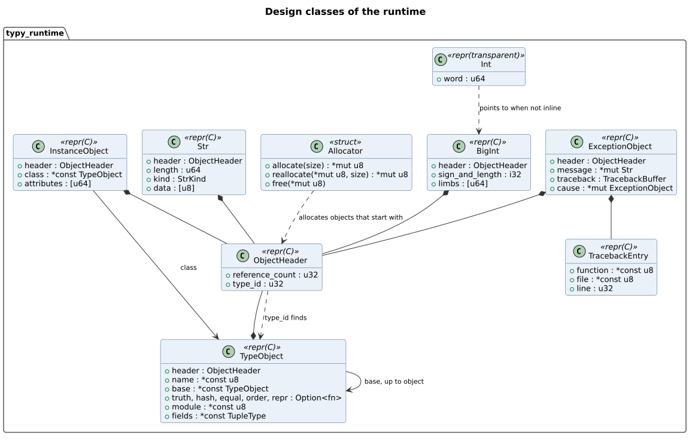
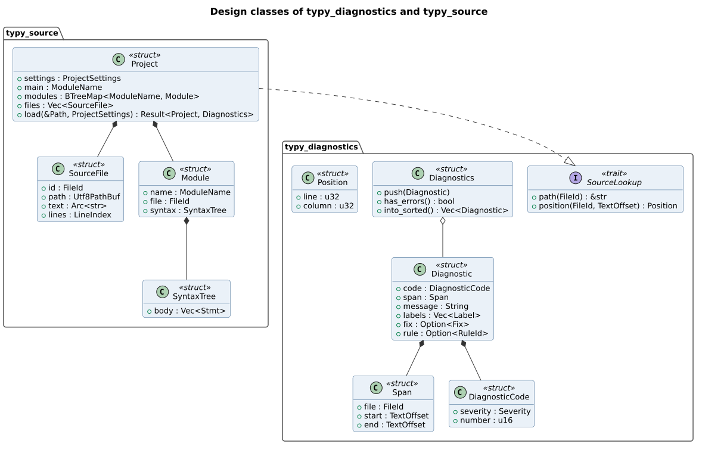
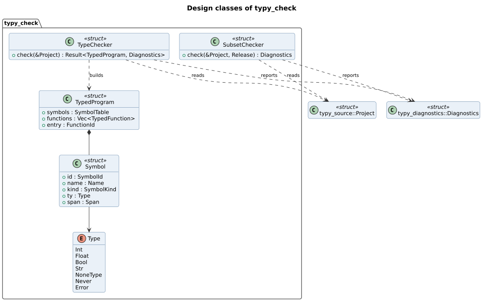
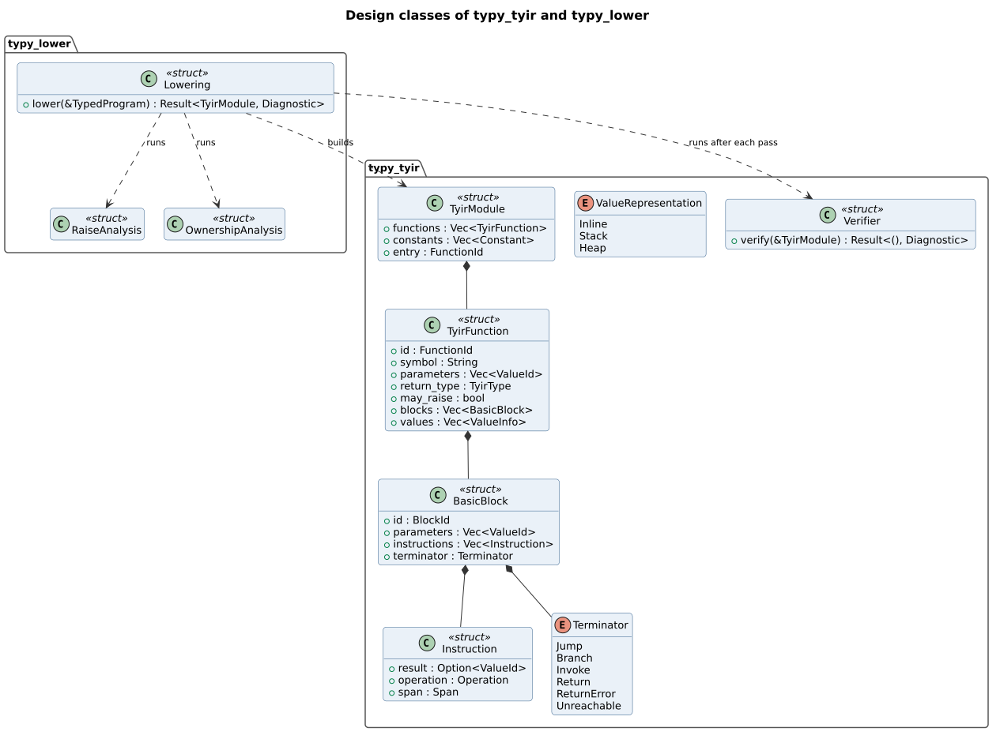
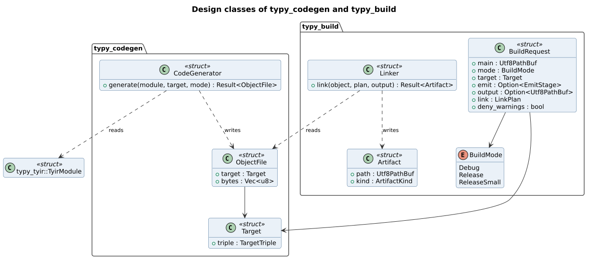

# TyPy detailed design

| Field | Value |
| --- | --- |
| Document | TyPy detailed design |
| Version | 1.36 |
| Status | Approved |
| Owner | typy-lang contributors |
| Last updated | 2026-11-09 |

## 1. Purpose and scope

This document specifies the code of TyPy: the package layout, the layering
rules, and each type with its fields, behaviour and errors, under the names
the code uses. It builds on the approved
[software architecture](../architecture/architecture.md), the
[domain model](../modeling/domain-model.md) and the decision records
ADR-0001 to ADR-0009.

It covers release 0.1, every requirement of the specification whose release
is 0.1, and the parts of release 0.2 written so far. Each later release
extends this document in the same change as its code. Where a type gains
fields or variants in a later release, the text says so with the release
number.

## 2. Workspace layout

Each crate is laid out by the rules of section 3.1: one module per kind of
object, a `name.rs` file for a module and a `name/` folder for its children.

```text
Cargo.toml                    workspace, shared lint settings
Cargo.lock                    committed
rust-toolchain.toml           Rust 1.99.1
clippy.toml                   project names allowed in documentation
crates/
  typy-diagnostics/src/       span, code, rule, registry, diagnostic,
                              diagnostics, render
  typy-source/src/            settings, module, source_file, line_index,
                              int_literal, project,
                              syntax/ (tree, statement, expression,
                              operator, node_kind, dump),
                              parse/ (statement, expression, operator)
  typy-check/src/             types, builtin, method, unprovided, check/
                              (definition, annotation, module_scope,
                              definition_order, visit), subset/ (feature,
                              statement, expression), body/ (program,
                              flow, locals, statement, expression, name,
                              operator, call, builtin_call, iterable_call,
                              list, slice, loop_source), typed/
                              (symbol, constant, signature, function,
                              program, statement, expression)
  typy-check/tests/           checker.rs, through the public API
  typy-tyir/src/              module, function, block, instruction,
                              types, verify, print
  typy-lower/src/             program, function, ownership, invoke,
                              statement, augmented, expression,
                              arithmetic, comparison, conversion, builtin,
                              iterable_builtin, tuple, list, list_method,
                              slice, loop_source, call_graph, mangle,
                              strings, types
  typy-codegen/src/           target, optimization, layout, statics, abi,
                              runtime, function, operation, constant,
                              descriptor, bits, tuple, arithmetic,
                              comparison, call, terminator, emit
  typy-build/src/             request, mode, emit_stage, runtime_archive,
                              linker, artifact
  typy-driver/src/            pipeline, emission, outcome, failure,
                              sources
  typy-cli/src/               main, arguments, command/ (check, build,
                              run), cache, output, exit_status, guard
  typy-runtime/src/           entry, cell, header, allocator, libc, libm,
                              refcount, word, compare, int, float,
                              string, list, tuple, slice, zip, message,
                              io, exception, range, stack
  typy-conformance/src/       expectation, observation, oracle, subject,
                              suite, test_case, verdict
tests/
  conformance/<area>/         <ID>_<behaviour>.py, one rule per file
  golden/<stage>/             expected --emit output
  e2e/                        tests that run the typy executable
```

The crates from `typy-tyir` on are listed with their planned modules; each
is laid out by the same rules when it is written.

## 3. Layering and code rules

The dependencies between crates are those of architecture section 4.2, and
a CI job checks them against `cargo metadata`.

### 3.1 Modules

The code is organised so that it stays easy to change as it grows:

- One module per kind of object or per responsibility: `Span` and
  `Position` in `span`, the `Diagnostics` collection apart from the single
  `Diagnostic`, operator typing apart from name resolution.
- A module with children is a `name.rs` file and a `name/` folder, without
  `mod.rs`. A type's methods may be spread over child modules by
  responsibility, as `BodyChecker`'s are under `body/`.
- Modules are private. The crate root re-exports the public API with
  `pub use`, so a type moves between modules without breaking a caller.
- Items are as private as they can be: `pub(super)` for a module family,
  `pub(crate)` for the crate, `pub` only for the API.
- A source file stays under about 400 lines. A longer file is split by
  responsibility before more is added to it.
- Unit tests sit with their module, in `#[cfg(test)] mod tests`, or in
  `name/tests.rs` when they are long. Tests that need only the public API
  are integration tests in the crate's `tests/` folder.

### 3.2 Code rules

Within the code:

- Every compiler crate starts with `#![forbid(unsafe_code)]`. Only
  `typy-runtime` contains `unsafe`, and each block carries a comment that
  starts with `SAFETY:` and says why it is sound.
- Clippy runs with `-D warnings` and the `pedantic` group. Each allowed lint
  is listed in `Cargo.toml` with its reason.
- Identifiers of compiler objects are newtypes over `u32`: `FileId`,
  `SymbolId`, `ScopeId`, `FunctionId`, `BlockId`, `ValueId`. They index a
  vector owned by the aggregate that created them and are never mixed.
- Maps whose order can reach any output are `BTreeMap` or sorted `Vec`
  (architecture section 7.2). `HashMap` is used only for lookups whose
  order never escapes.
- Functions that can fail return `Result`. Compiler code does not call
  `unwrap`, `expect` or `panic!` on a path that input can reach; a broken
  internal invariant returns an internal `Diagnostic` with code `E9001`.
- There is no process-wide mutable state in the compiler. Everything a
  command needs travels in the `BuildRequest` and the objects the stages
  return.
- Line and branch coverage is measured with `cargo-llvm-cov` over the whole
  workspace, the runtime included, and counts the `typy` executable when
  tests run it as a subprocess. CI fails below 95 percent (NFR-11).

## 4. typy-diagnostics

### 4.1 Types

`TextOffset`

| Field | Type | Default | Rule |
| --- | --- | --- | --- |
| `0` | `u32` | none | A byte offset into a `SourceFile`; LEX-09 keeps it below 2^24 |

`Span`

| Field | Type | Default | Rule |
| --- | --- | --- | --- |
| `file` | `FileId` | none | Names a file of the current `Project` |
| `start` | `TextOffset` | none | On a UTF-8 character boundary |
| `end` | `TextOffset` | none | Not before `start`; on a character boundary |

`Span::new(file, start, end)` returns `None` when `end` is before `start`.

`Position`

| Field | Type | Default | Rule |
| --- | --- | --- | --- |
| `line` | `u32` | none | From 1 |
| `column` | `u32` | none | From 1, counted in code points (DIA-01) |

`DiagnosticCode`

| Field | Type | Default | Rule |
| --- | --- | --- | --- |
| `severity` | `Severity` | none | `Error` for `E` codes, `Warning` for `W` codes |
| `number` | `u16` | none | 0 to 9999; its first two digits give the range of section 4.3 |

`DiagnosticCode::parse("E0401")` returns `Err(CodeError::Malformed)` for
any text that is not a letter `E` or `W` followed by four digits.
`Display` writes the same form back.

`RuleId` wraps a `&'static str` such as `"TYP-03"`. Only the constants in
`rules.rs` create one, and a unit test checks that each constant is an ID
in `docs/requirements/srs.md`.

`Diagnostic`

| Field | Type | Default | Rule |
| --- | --- | --- | --- |
| `code` | `DiagnosticCode` | none | Listed in the registry (section 4.3) |
| `span` | `Option<Span>` | none | The primary location; `None` for a diagnostic about no place in the source, such as a failed link |
| `message` | `String` | none | One sentence in lower case with no final period (DIA-01) |
| `labels` | `Vec<Label>` | empty | Secondary spans, each with a short text |
| `help` | `Option<String>` | `None` | A hint, shown after `help:`, when no fix is certain |
| `fix` | `Option<Fix>` | `None` | Set only when the fix is certain (DIA-02) |
| `rule` | `Option<RuleId>` | `None` | Required when the diagnostic rejects valid Python (DIA-03) |

`Diagnostic::new(code, span, message)` makes a located diagnostic and
`Diagnostic::without_location(code, message)` one without a span.

`Fix` holds a `Span` and the `replacement: String` for it. `Label` holds a
`Span` and a `text: String`.

`Diagnostics` collects diagnostics for one command.

| Method | Behaviour |
| --- | --- |
| `push(diagnostic)` | Adds it, unless one with the same code and span is already present |
| `has_errors()` | True when any diagnostic has severity `Error` |
| `iter()` | The diagnostics in the order they were added |
| `into_sorted(lookup)` | Returns them sorted by file path, line, column and code; those without a location come first |

`SourceLookup` is the trait the renderers use to turn a `Span` into text.
`typy-source::Project` implements it.

| Method | Returns |
| --- | --- |
| `path(file)` | The file's path relative to the project root |
| `position(file, offset)` | The `Position` of the offset |
| `line_text(file, line)` | The text of one line, without its line ending |

### 4.2 Rendering

`render_text(&Diagnostic, &dyn SourceLookup) -> String` writes the form
below. The source line is shown with a marker under the span, and the fix,
when present, as the corrected line.

```text
error[E0402]: `total` was declared as int and is assigned a str
 --> app.py:3:13
  |
3 |     total = "done"
  |             ^^^^^^
  = rule: TYP-03
help: assign an int, or use a new variable
```

The gutter is as wide as the line number. A span that runs past its first
line is marked to the end of that line. Each label is written as
`= LINE:COLUMN: text`. A certain fix follows as `help: write it as` and the
corrected line.

A diagnostic without a location is written as its header, then its rule and
its help:

```text
error[E0701]: the C toolchain program `cc` was not found
 = rule: A-01
help: install `cc`, which TyPy runs to link the program
```

`render_json` is planned for 0.3 (DIA-05).

### 4.3 Diagnostic codes

The registry in `registry.rs` lists every code with its summary, the rule
it enforces and its status. `typy explain` (0.3) reads the same table.

| Code | Summary | Rule |
| --- | --- | --- |
| E0101 | Source file larger than 16 MiB | LEX-09 |
| E0102 | Source file is not valid UTF-8 | LEX-01 |
| E0103 | Python syntax error, syntax newer than the Python floor, or `return`, `break` or `continue` out of place | STD-01 |
| E0104 | Imaginary literal | LEX-08 |
| E0105 | Source file cannot be read | None |
| E0106 | Output file cannot be written | None |
| E0201 | Feature planned for a later TyPy release | The feature's own rule |
| E0202 | Feature TyPy cannot compile with CPython's meaning | STD-04 |
| E0203 | Parameter without a type annotation | TYP-01 |
| E0204 | Function without a return annotation | TYP-01 |
| E0205 | Name is not defined | STD-04 |
| E0206 | Import of a module TyPy does not provide | LIB-08 |
| E0301 | `is` used on values other than `None` or class instances | EXP-08 |
| E0302 | `**` whose CPython result could be a `float` for `int ** int`, or `complex` | EXP-04 |
| E0303 | `and` or `or` with operands of different types | EXP-09 |
| E0304 | Truth test on a value of an unsupported type | EXP-10 |
| E0305 | Conditional expression with branches of different types | EXP-11 |
| E0306 | Variable read before it is assigned on every path | TYP-12 |
| E0307 | Tuple indexed other than by an integer literal inside it | DAT-08 |
| E0308 | Unpacking into a different number of targets | SMT-02 |
| E0401 | Operator not defined for these operand types | EXP-02 |
| E0402 | Assignment changes the type of a variable | TYP-03 |
| E0403 | `Any`, `cast` or an untyped value | TYP-10 |
| E0404 | Argument of the wrong type | TYP-01 |
| E0405 | Returned value of the wrong type | TYP-01 |
| E0406 | Arithmetic on `bool` | DAT-03 |
| E0407 | Comparison between unsupported types | EXP-06 |
| E0408 | `tuple`, `list`, `set` or `dict` annotation without its item types | TYP-06 |
| E0409 | List, set or dict display with items, keys or values of different types | DAT-07, DAT-09, DAT-10 |
| E0410 | Empty list or dict display, `list()`, `tuple()`, `set()` or `dict()` without an annotation | TYP-05 |
| E0411 | `for` over a value that cannot be iterated | CST-03 |
| E0412 | Method a built-in type does not have | LIB-03 |
| E0413 | Set item or dict key of a type without a hash: a list, a set, a dict, a view, or a tuple that holds one | DAT-09, DAT-10 |
| E0701 | C toolchain program not found | A-01 |
| E0702 | Link failed | A-01 |
| E0703 | Runtime archive missing, or from another TyPy version | None |
| E9001 | Internal compiler error | NFR-09 |

## 5. typy-source

### 5.1 Types

`ProjectSettings`

| Field | Type | Default | Rule |
| --- | --- | --- | --- |
| `root` | `Utf8PathBuf` | Directory of the main file | Absolute; every module path is relative to it |
| `release` | `Release` | `Release::V0_1` | The release whose feature table the subset checker uses |
| `python_floor` | `PythonFloor` | `PythonFloor::V3_12` | One of 3.12 to 3.15; the parser's target version and the lowest oracle version (ADR-0008). Read from `typy.toml` from 0.3 (CLI-12) |

Module search paths, links and exports from `typy.toml` are planned for 0.3
and 0.5 (CLI-07, FFI-04, FFI-05).

`SourceFile`

| Field | Type | Default | Rule |
| --- | --- | --- | --- |
| `id` | `FileId` | none | Unique in its `Project` |
| `path` | `Utf8PathBuf` | none | Relative to `ProjectSettings::root`, or `<stdlib>/name.py` for embedded modules |
| `text` | `Arc<str>` | none | Valid UTF-8, at most 16 MiB, without a leading byte order mark |
| `lines` | `LineIndex` | none | Byte offset of each line start, built when the file is read |

`SourceFile::read(id, root, path)` refuses a file over 16 MiB with E0101
before reading it, and a file that is not UTF-8 with E0102 at the offset of
the first invalid byte. A file that cannot be read gives E0105 with the
operating system's reason. In each case the file is still registered, with
empty text, so the diagnostic has a location. A leading byte order mark is
removed, as CPython accepts it. `LineIndex` treats LF, CRLF and a lone CR
as line endings, as LR 2.1.2 does.

`ModuleName` wraps a `String` of dotted identifiers, such as `__main__` or
`builtins`. `ModuleName::new` refuses an empty name and any part that is
not an identifier.

`Module`

| Field | Type | Default | Rule |
| --- | --- | --- | --- |
| `name` | `ModuleName` | none | `__main__` for the main file (STD-06) |
| `file` | `FileId` | none | Its `SourceFile` |
| `syntax` | `SyntaxTree` | none | Built by `parse` |

`Project`

| Field | Type | Default | Rule |
| --- | --- | --- | --- |
| `settings` | `ProjectSettings` | none | Immutable after load |
| `main` | `ModuleName` | `__main__` | A key of `modules` |
| `modules` | `BTreeMap<ModuleName, Module>` | none | The main module in 0.1; imported modules from 0.3 |
| `files` | `Vec<SourceFile>` | none | Indexed by `FileId` |

`Project::load(main_path, settings) -> Result<Project, LoadFailure>` reads
and parses the main file, and returns every diagnostic of every file
together. `LoadFailure` holds the `Diagnostics` and the files they point
into, and implements `SourceLookup`, so a failed load can still be
rendered. The checker reads the declarations of `builtins` from
`typy-stdlib` (section 6). Imports between modules are
planned for 0.3 (MOD-01); in 0.1 an `import` statement gives E0201.

### 5.2 The syntax tree

`SyntaxTree` is TyPy's own copy of the parsed module. Its node types follow
the names of CPython's `ast` module for Python 3.12, such as `FunctionDef`,
`AnnAssign`, `BinOp` and `Compare`, so the Language Reference and the `ast`
documentation describe them. Every node carries a `Span`.

A node the current release compiles is converted with all its parts. Any
other node becomes `Stmt::Other` or `Expr::Other`, holding its `NodeKind`,
such as `ClassDef` or `ListComp`, and its span, which is what the subset
checker needs to reject it with E0201 or E0202. Each release converts the
nodes of the features it adds, as 0.2 does for `Expr::Set`, a set
display, `Expr::Dict`, a dict display whose `keys` hold `None` for a `**`
item, as CPython's `ast.Dict` does, and `Expr::ListComp`, `SetComp` and
`DictComp`, whose clauses are `Comprehension` values as CPython's
`ast.comprehension`.
`elif` chains become nested `If` nodes, as
in CPython's `ast`. An integer literal keeps its value as decimal digits,
so literals of any size survive conversion (DAT-01).

`dump(tree, lines) -> String` writes the tree as indented text with the
`LINE:COLUMN` of each node, for `--emit=ast` and golden tests. No type from
`ruff_python_parser` or `ruff_python_ast` appears outside `parse.rs`
(ADR-0005).

`parse(file: &SourceFile, floor: PythonFloor) -> Result<SyntaxTree,
Vec<Diagnostic>>` calls
`ruff_python_parser::parse_unchecked` with
`ParseOptions::from(Mode::Module)` and the program's Python floor as the
target version, 3.12 in 0.1. Each entry of `Parsed::errors()` and
`Parsed::unsupported_syntax_errors()` becomes an E0103 diagnostic, so
syntax that the floor version does not accept is refused (STD-01). The
parser already reads PEP 810 lazy imports and marks them `is_lazy`; they
reach the syntax tree in 0.3 (MOD-06). The tree is converted only when
there are no errors.

## 6. typy-stdlib

`typy-stdlib` holds the Python sources of the standard library modules
TyPy implements (ADR-0007), embedded in the `typy` binary with
`include_str!`, and the declarations of the private `_typy` module. It is
created with the first module written in Python, `sys` and `math` in 0.3.

The builtins (LIB-01, LIB-02) are not written in Python. `print`, `min`
and `max` take any number of arguments, which the 0.1 subset cannot declare
(EXP-17), and `sorted`, `sum`, `any` and `all` take any iterable, which
needs generics (0.4), so ADR-0007's "written around it" applies: each
builtin is a `Builtin` value that `typy-check` types from its own table and
`typy-lower` lowers to runtime calls (section 7.3). A builtin moves to
`builtins.py` when the features it needs arrive.

## 7. typy-check

### 7.1 Types

`Type` is an enum. Its variants are `Int`, `Float`, `Bool`, `Str`,
`NoneType`, `Tuple(Vec<Type>)` and `List(Box<Type>)` from 0.2, and `Error`.
`Error` is the type of an expression that already has a diagnostic; every
check accepts it silently, so one cause gives one error (DIA-04). A type
built from other types holds them, so `Type` is `Clone` and not `Copy`, and
two types are equal when their structure is. `Dict`, `Set`, `Bytes` and
`Class` follow in 0.2; `Union`, `TypeParameter` and `Callable` in 0.4 and
1.0.

| Method | Behaviour |
| --- | --- |
| `is_assignable_to(&self, target)` | True when equal, or either side is `Error`; a tuple item by item. An `Int` is not assignable to `Float` (TYP-09) |
| `can_test_equality(&self, other)` | True for the same type, two numbers, or tuples of one length whose items can (EXP-06) |
| `can_order(&self, other)` | The same, except that `None` cannot be ordered; inside a tuple a pair of `None` items is accepted, because CPython orders tuples by the first pair of items that differ and two `None` items never do |
| `has_error(&self)` | True when the type is or holds `Error` |
| `Display` | The Python spelling, such as `int` or `None` |
| `with_article(&self)` | The spelling with its article, for messages: `an int`, `a str`, `None` |

`Symbol`

| Field | Type | Default | Rule |
| --- | --- | --- | --- |
| `id` | `SymbolId` | none | Unique in the `SymbolTable` |
| `name` | `Name` | none | A Python identifier |
| `kind` | `SymbolKind` | none | `Local`, `Parameter`, `ModuleVariable`, `Function` or `Builtin` |
| `ty` | `Type` | none | Never changes after the symbol is created (TYP-03) |
| `span` | `Span` | none | Where the name is first bound |

`Scope`

| Field | Type | Default | Rule |
| --- | --- | --- | --- |
| `id` | `ScopeId` | none | Unique in the `SymbolTable` |
| `kind` | `ScopeKind` | none | `Module` or `Function` in 0.1 |
| `parent` | `Option<ScopeId>` | `None` for a module | A function scope's parent is its module |
| `names` | `BTreeMap<Name, SymbolId>` | empty | One symbol per name |

`FunctionSignature`

| Field | Type | Default | Rule |
| --- | --- | --- | --- |
| `parameters` | `Vec<Parameter>` | empty | Each with `name`, `ty` and `default: Option<Constant>` |
| `returns` | `Type` | none | `NoneType` for `-> None` |

A default value is a constant in 0.1, which makes "evaluated once, when the
function is defined" (EXP-16) hold trivially.

`TypedProgram`

| Field | Type | Default | Rule |
| --- | --- | --- | --- |
| `symbols` | `SymbolTable` | none | All scopes and symbols |
| `functions` | `Vec<TypedFunction>` | none | Sorted by qualified name; the module body is one of them |
| `entry` | `FunctionId` | none | The body of `__main__` |

A `TypedFunction` holds its `FunctionSignature` and its body as typed
statements, in which every expression is a `TypedExpr` with a `kind`, a
`ty` and a `span`.

Tuples (DAT-08, SMT-02, TYP-06) add these forms. `TypedExprKind::Tuple`
holds a display's items. `TypedExprKind::TupleItem { tuple, index }` reads
an item at a position known when compiling: the index is an integer
literal, or a negated one counted from the end, and E0307 reports any other
index or one outside the tuple, a program CPython would stop with
`IndexError`. `TypedStmt::Assign` stores into `AssignTarget`s, each a
`Name(SymbolId)` or a `Tuple` of targets; unpacking needs a tuple with one
item for each target, or E0308. An annotation `tuple[A, B]` names each item
and `tuple[()]` the empty tuple; a bare `tuple` is E0408. `+` joins two
tuples, `len` gives a constant, and `==`, `!=`, `<`, `<=`, `>` and `>=`
compare tuples whose items compare.

`Type::Bytes` is `bytes` (DAT-06): a literal such as `b"a\x00"`, an
item read at a position, an `int` from 0 to 255, slices, `len`, `+`, `*`,
comparisons, `in` of an `int` or of `bytes`, `for` over its `int` items,
and `str` and `repr`, which write `b'...'`. `bytes()` is empty, `bytes(n)`
holds `n` zero bytes, and `bytes(values)` takes any iterable of `int`;
`bytes` of a `str` without an encoding is E0404, and `bytes(text,
encoding, errors)` is `text.encode(encoding, errors)`.

`str.encode` and `bytes.decode` take the encoding and the errors as string
literals, by position or keyword, so the checker resolves them when
compiling, as `codecs.lookup` would, and passes their numbers: the codecs
`utf-8`, `ascii` and `latin-1` under every alias CPython gives them, and
the error handlers `strict`, `ignore`, `replace`, `backslashreplace`,
`xmlcharrefreplace` for encoding only, and `surrogateescape`. A name TyPy
does not provide, or one that is not a literal, is E0404, so a program
never meets a `LookupError` that CPython would not raise.

`Type::TupleOf(T)` is `tuple[T, ...]` (DAT-14), an immutable sequence of any
length, written `tuple[int, ...]`; `...` anywhere else in a tuple annotation
is E0408. It is a list object at run time, under the tuple type ID, so it
reads as a list does: items at computed positions, slices, `len`, `in`,
`+`, `*`, comparisons, `for`, and the builtins of one iterable, and it has
the methods `count` and `index`, `Method::TupleCount` and
`Method::TupleIndex`. `Type::sequence_item` gives the item type of either.
A fixed tuple whose items all have type `T` is accepted where a
`tuple[T, ...]` is expected: `BodyChecker::converted` wraps it in
`TypedExprKind::TupleOf`, at an annotated or typed assignment, an argument,
a `return`, an item of a display, and beside a `tuple[T, ...]` in a
comparison, `in` or `+`, so `t += (3,)` gives a `tuple[T, ...]`. A `for`
over a fixed tuple reads it the same way when its items have one type, and
is E0411 otherwise, because the loop variable would need a union.
`tuple(source)` is `TupleOf(ListOf(source))`, and `tuple()` the empty
`tuple[()]`, or an empty `tuple[T, ...]` where that is expected.

Lists (DAT-07, DAT-11, TYP-05, EXP-07, CST-03) add `TypedExprKind::List`,
`ListItem { list, index }` and `Method { receiver, method, arguments }`, the
target `AssignTarget::Item { list, index }`, and `TypedStmt::ForEach`. Every
item of a display has the first item's type, or E0409. An empty display has
a type only where the context gives one, through
`expression_expecting(expr, expected)`: an annotated or already typed
variable, a `return`, or an argument; anywhere else it is E0410 (TYP-05).
`Method::of(receiver, name)` lists the methods of the built-in types; any
other name is E0412 (LIB-03). On a list they are `append`, `pop`, `insert`,
`extend`, `remove`, `index`, `count`, `clear`, `copy`, `reverse` and `sort`;
on a `tuple[T, ...]`, `count` and `index`. On a `str` they are the methods
that read or rebuild text without Unicode tables: `find`, `rfind`, `index`,
`rindex`, `count`, `startswith`, `endswith`, `split`, `rsplit`,
`splitlines`, `partition`, `rpartition`, `join`, `strip`, `lstrip`,
`rstrip`, `removeprefix`, `removesuffix`, `replace`, `center`, `ljust`,
`rjust`, `zfill`, `expandtabs` and `isascii`, the case methods `upper`,
`lower`, `casefold`, `swapcase`, `capitalize` and `title`, and the tests
`isalpha`, `isalnum`, `isdecimal`, `isdigit`, `isnumeric`, `isspace`,
`isupper`, `islower`, `istitle`, `isidentifier` and `isprintable`. On a
`bytes` they are the same methods with `bytes` in place of `str`, except
`casefold`, `isdecimal`, `isnumeric`, `isidentifier`, `isprintable` and
`encode`, with `decode` and `hex` added; what a search looks for is a
`bytes`, where CPython also takes an `int`.
`Method::signature(receiver)` gives a `MethodSignature`: each `Parameter`
has CPython's name, a `ParameterKind`, `Positional`, `Either`, `Keyword`
or `Rest`, which takes every remaining positional argument, none or many,
whether a call must give it, and a `ParameterType`: an exact type,
`StrOrNone` for a `str` or `None`, `Affixes` for a `str` or a tuple of
them, `Strings` for any iterable of `str`, or `Items(T)` for any iterable
of `T`. `method_call` binds the positional arguments in turn, then each
keyword by name, and keeps them in source order as `Argument { parameter,
value }`; a keyword for a
positional-only parameter, a name the method does not have, a parameter
given twice, or a missing one is E0404. `for` over a
call of the builtin `range` stays `ForRange`; any other `for` is `ForEach`
over a `LoopSource`, binding a target that may unpack. A source is
`Items` of a list, a `str`, a set or a dict, `Reversed` of one,
`Range { start, stop, step, reversed }` for `range(...)` and
`reversed(range(...))`, `Enumerate { source, start }`, or `Zip { sources,
strict }`, and `enumerate` and `zip` take sources, so `enumerate(zip(a, b))`
nests. A `range` source has one to three `int` arguments, E0404 otherwise,
and is read wherever a source is: a comprehension, `list`, `set`, `dict`,
`sorted`, `sum` and the other builtins of one iterable. A `range` value
anywhere else is E0201, planned for 0.3 (DAT-17). `called_builtin` names a
builtin only when no local or program function of the same name hides it,
as a call resolves it, so a program's own `range` is called by `for`. Over a
fixed tuple whose items differ, and over any other value, a `for` is E0411.
`enumerate`, `zip` and `reversed` outside a `for` give an iterator, E0201
until iterators arrive with CST-08 in 0.3. `x in
xs` needs an `x` of the item type; on a `str` it is a substring test and
needs a `str`; on a tuple it compares with each item, which must all compare
with `x` for equality, or E0407, and two lists compare with `==` when
their item types are equal, because the runtime compares items by the
list's own item kind. A list holds items of any type: `int`, `float`,
`bool`, `None`, `str`, lists and tuples of these.

In a comparison chain, an empty display takes its type from a neighbouring
operand, so `xs == []` and `x in []` need no annotation; `[] == []` is still
E0410. `+` joins two lists of one type, and `*` repeats a list by an `int` on
either side; lists of different item types are E0401, because the runtime
stores items by the kind of the item type. Two lists order with `<`, `<=`,
`>` and `>=` like two tuples, item by item.

The builtins of one iterable (LIB-02), `sorted`, `sum`, `any`, `all`, and
`min` and `max` of one argument, add `TypedExprKind::IterableBuiltin {
builtin, iterable, option }`. The option is the one optional value each
takes: `reverse`, a `bool`, for `sorted`; `start`, by position or keyword,
for `sum`; `default`, of the item type, for `min` and `max`. `key` needs a
function value and is E0201, planned for 1.0 (FUN-05); any other keyword is
E0404. `iterated_item` gives the item type of the iterable, which `for` also
uses: a list's item type, E0201 for a `str` or a tuple until they can be
iterated later in 0.2, and E0411 for anything else. `sorted`, `min` and
`max` need items that order. `sum` adds `int` or `float` items; a
`list[float]` needs a `float` start, E0404, because CPython returns the
`int` 0 for an empty list without one, a type the call could not have. A
list of `bool` is E0406, as all arithmetic on `bool` is (DAT-03).
`round(number, ndigits)` gives an `int` for an `int`, and for a `float`
an `int` without `ndigits` and a `float` with it, as CPython does;
`ndigits` is an `int`, by position or keyword, and `round` of a `bool` is
E0406. `list()` has the expected type, as `[]` does, and `list(source)` is
`TypedExprKind::ListOf(source)`, a new list of every value the loop source
gives. The builtins of one iterable take any loop source the same way:
`iterable_argument` passes a list on as it is and wraps any other source,
a `str` or `enumerate`, `zip` or `reversed`, in `ListOf`, as CPython's
`sorted` builds a list. `list.sort` takes `reverse` by keyword only, which
`MethodSignature::keyword` names. Inside a display without an expected type,
an empty display takes the type of the first other item, so `[[1], []]`
needs no annotation.

Slices (DAT-12) add `TypedExprKind::Slice { value, lower, upper, step }`, each
bound optional and an `int`, or E0404. A `str` or a list can be sliced, and
the slice has the sliced type; any other value is E0401. A tuple is sliced
with integer literals, or missing bounds, E0307 otherwise, because each item
can have its own type: `TypedExprKind::TupleSlice { tuple, positions }`
holds the positions, worked out as CPython's `PySlice_AdjustIndices` does,
and a zero step is E0307, since the slice would always raise. A slice
inside a tuple index, `grid[1:2, 0]`, is E0401. Assigning to a slice is
E0201, planned for 0.3 (DAT-13).

Sets (DAT-10, DAT-15, TYP-05, EXP-07, CST-03) add `Type::Set(T)`, written
`set[T]`, and `TypedExprKind::Set(items)` for a display and `SetOf(source)`
for `set(source)`. An item of a set needs a hash: `Type::is_hashable` is
false for a list, a set, and a tuple that holds one, and such an item type,
in a display, in `set(source)` or in a `set[...]` annotation, is E0413.
Every item of a display has the first item's type, or the expected item
type, or E0409. A display always has items, since `{}` is a dict; `set()`
has the expected type, from an annotation, a `return`, an argument, or a
neighbouring operand of a comparison as `[]` has, and is E0410 elsewhere.
`set(source)` takes any loop source, as `list(source)` does. `|`, `&`, `-`
and `^` combine two sets of one type, and the augmented forms change the
set in place; sets of different item types are E0401. `==` and `!=` compare
sets of one type, and `<`, `<=`, `>` and `>=` test proper and plain subsets
and supersets. `x in s` needs an `x` of the item type. `for`, `len`,
`bool`, `print`, `str`, `repr` and the builtins of one iterable read a set
in its table's order; `reversed` of a set is E0411, because a set has no
order to reverse. On a set the methods are `add`, `remove`, `discard`,
`pop`, `clear`, `copy`, `union`, `intersection`, `difference`,
`symmetric_difference`, `update`, `intersection_update`,
`difference_update`, `symmetric_difference_update`, `issubset`,
`issuperset` and `isdisjoint`. `union`, `intersection`, `difference`,
`update`, `intersection_update` and `difference_update` take any number of
arguments, a `Rest` parameter, and the other methods that combine sets one;
each argument is `Items(T)` of the set's item type (DAT-15).
`items_argument` checks it: a display, `[]` or `set()` takes the wanted
type, a set, a list or a `tuple[T, ...]` is passed as it is, and any other
loop source, such as a `str` or `zip`, becomes `ListOf(source)`, whose
items the runtime reads in the order CPython reads the iterable. A source
whose items have another type is E0404.

Dicts (DAT-09, TYP-05) add `Type::Dict(K, V)`, written `dict[K, V]`, and
`Type::DictView(View, K, V)` for `keys()`, `values()` and `items()`, written
`dict_keys[K, V]` and so on, as `TypedExprKind::Dict { keys, values }`,
`DictOf(source)` and `DictItem { dict, key }`, and the target
`AssignTarget::Entry { dict, key }`. A key needs a hash, E0413. The keys of
a display have one type and the values one type, or E0409; `{}` and
`dict()` take the expected type as `[]` does, also beside a dict in a
comparison, and are E0410 elsewhere. `dict(source)` takes a dict, which is
merged, or any loop source of two-item tuples, whose pairs are set in
order; any other item is E0404, and keyword arguments are E0201, planned
for 0.3 with DAT-16. `d[k]` and `d[k] = v` check the key against the key
type and the value against the value type, E0404 and E0402, and
`d[k] op= v` reads and writes the one entry. `in` finds a key in a dict, a
key, a value or a `(key, value)` pair in a view; `for`, `len`, `bool`,
`print` and the builtins of one iterable read a dict's keys or a view's
items in insertion order. `|` merges two dicts of one type and `|=` updates
in place; `==` and `!=` compare dicts of one type, and dicts do not order,
E0407. `reversed` of a dict or a view, and comparisons and set operations of
views, are E0201, planned with DAT-16. The methods are `get` and
`setdefault` with a default, `pop` with or without one, `popitem`, `keys`,
`values`, `items`, `update`, `clear` and `copy`. `get` and `setdefault`
without a default would give `V | None`, E0201 until TYP-06 brings it.
`update` takes `Pairs(K, V)`: a dict, which is passed as it is, or any
source of pairs of the dict's types. A dict passed to a set method or to
`set()` stays a dict, so the runtime takes CPython's dict steps.

Comprehensions (EXP-12) add `TypedExprKind::Comprehension { element, value,
generators }`, a `value` only for a dict, and each `Generator { target,
source, conditions }`. A clause's source is checked before its target is
bound, so the first is read in the enclosing scope and each later one sees
the targets before it, as CPython reads them. Each target name gets a new
variable of the comprehension, and the scope's names and definite
assignment are restored after it, so a comprehension variable is not seen
after it, E0205, and leaves an outer variable of the same name as it was.
The conditions are truth tests. A list comprehension makes `list[T]` of
its element's type, a set comprehension `set[T]`, whose item needs a hash,
E0413, and a dict comprehension `dict[K, V]`; an expected type gives the
element, as it gives a display's items, so `[[] for _ in xs]` takes an
annotation. An `async for` clause is E0201, as `async` is.

`TypedStmt::AugAssign` takes an `AssignTarget`: a name, or an item of a list,
`xs[i] += 1`. An item of a `str` or a tuple cannot be assigned, E0401, and the
result must have the item type, E0402.

### 7.2 Behaviour

`TypeChecker::check(project) -> Result<TypedProgram, Diagnostics>` runs, for
each module in name order:

1. `SubsetChecker::check` walks the syntax tree and looks up each node kind
   in the feature table of `ProjectSettings::release`. A node planned for a
   later release gives E0201, naming the release and the rule, such as
   "dicts are planned for TyPy 0.2 (DAT-09)". A node that is excluded from
   TyPy gives E0202 with rule STD-04.
2. The resolver binds names. A name assigned anywhere in a function is a
   local of that function, as LR 4.2.2 defines. In 0.1 a function may read
   module-level functions and builtins, but not module-level variables;
   that needs `global` and is planned for 0.3 (SMT-08).
3. Inference gives each local the type of its first assignment (TYP-02) and
   refuses a later assignment of another type with E0402.
4. The definite assignment pass follows every path through each function
   and the module body, and refuses a read that some path reaches with the
   variable unassigned, with E0306 (TYP-12). A loop body may run zero
   times, `while True` ends only through `break`, and `else` runs only when
   no `break` does. A function whose return type is not `None` and whose
   end can be reached gets E0405.
5. Expressions are checked against the rules EXP-01 to EXP-11. An `int`
   where a `float` is declared is refused (TYP-09), with the certain fix
   `1.0` for a literal. The arguments of `min` and `max` must have one
   type, because CPython returns one of them unchanged.

Two checks look at the module as a whole. A name may be a function or a
module variable, not both, because CPython would rebind it. And a
module-level statement may only reach, through any chain of calls,
functions whose `def` has already run; otherwise CPython raises
`NameError`, so TyPy refuses it with E0306.

The subset walker also reports `return` outside a function and `break` or
`continue` outside a loop as E0103, because CPython's compiler rejects them
but the parser does not.

In 0.1, functions are checked one after another, and their diagnostics are
sorted before they are returned. Parallel checking (architecture section
7.5) is added when the build-time benchmarks of NFR-04 call for it.

The 0.1 feature table accepts: module-level `def` without decorators or
type parameters; positional and keyword parameters with constant defaults;
`return`, `pass`, `break`, `continue`; assignment, annotated assignment and
augmented assignment to a name; `if`, `while` and `for` with `else`, where
`for` iterates over a call to `range` with one to three `int` arguments;
expression statements; the operators of EXP-02 to EXP-11; calls; names;
constants of type `int`, `float`, `str`, `bool` and `None`; and indexing a
`str` with an `int`.

`dump(program, lookup) -> String` writes the typed program for
`--emit=typed-ast`: a `Program` line naming the entry function, then each
function with its module, parameters and return type, its locals, and its
body, one node per line, indented two spaces per level. Each statement and
expression line ends with `@LINE:COLUMN`, and each expression line also
gives its type after ` : `:

```text
Function fn0 __main__.twice(n: int) -> int @1:1
  locals total: int
  body
    Assign total: int @2:5
      Local n : int @2:13
```

## 8. typy-tyir

### 8.1 Types

`TyirType` is `Int`, `Float`, `Bool`, `Unit`, `Object(TypeId)` or, from
0.2, `Tuple(TupleTypeId)`. It is `Copy`: a tuple type is a number in the
module's `TupleTypes`, which interns each distinct list of item types and
says whether a type is counted. A tuple is a value with its items in place,
not an object, as ADR-0001 decides, so `is` cannot observe a copy (EXP-08),
and it is counted when an item is.

A list is `TyirType::LIST`, `Object(TypeId::LIST)`. `TyirType::Bits` is the
eight bytes that stand for a list item at the runtime's interface, never
counted: `ToBits(value)` makes them from an `int`, `float`, `bool` or
object, 0 from `None`, and for a tuple the address of a stack slot made at
the start of the function that holds it, which the runtime copies from
before the call returns. `FromBits { bits, ty }` reads them back as a value
borrowed from the list, for a tuple by loading it from the address the
runtime gives (MEM-02). `Constant::PlaceholderList` is the runtime's
immortal empty list, the first value of a list slot.
`Constant::TupleDescriptor(id)` is the address of the descriptor of a tuple
type, which `ListNew` receives for a list of tuples, and zero bits for any
other list. An `Int`
is a 64-bit word: an inline value has its lowest bit set and holds the
number shifted left by one, so it covers -2^62 to 2^62 - 1; any other value
is a pointer to a `BigInt` (ADR-0001, DAT-01). `Str` values are
`Object(TypeId::STR)` and exceptions `Object(TypeId::EXCEPTION)`. `Int` and
`Object` values are counted; the others are not.

`ValueInfo` holds a value's `ty: TyirType` and its
`representation: ValueRepresentation`: `Inline`, `Stack` or `Heap`. In 0.1
`Int`, `Float`, `Bool` and `Unit` are `Inline` and objects are `Heap`;
`Stack` is chosen by escape analysis from 0.4 (MEM-03).

A function's locals are `Slot`s, stack variables read with `load` and
written with `store`, as LLVM's `alloca` is. LLVM's `mem2reg` pass turns
them into registers, so lowering does not have to build SSA form for
locals itself. A counted slot starts empty and owns the reference it
holds.

`TyirFunction`

| Field | Type | Default | Rule |
| --- | --- | --- | --- |
| `id` | `FunctionId` | none | Unique in the module |
| `symbol` | `String` | none | The mangled name of section 10.3 |
| `name` | `String` | none | The name tracebacks show, such as `fib` or `<module>` |
| `parameters` | `Vec<ValueId>` | empty | The entry block's parameters |
| `return_type` | `TyirType` | none | `Unit` for `-> None` |
| `may_raise` | `bool` | `false` | Set by `RaiseAnalysis` |
| `blocks` | `Vec<BasicBlock>` | none | The first is the entry block |
| `values` | `Vec<ValueInfo>` | empty | Indexed by `ValueId` |
| `slots` | `Vec<Slot>` | empty | Indexed by `SlotId`; each has a name and a type |

`BasicBlock` has an `id`, its `parameters: Vec<ValueId>`, its
`instructions: Vec<Instruction>` and one `terminator: Terminator`.

`Instruction` has an optional `result: ValueId`, an `operation: Operation`
and the `span` of the source it came from, which becomes the line of a
`TracebackEntry`. An `Operation` cannot raise. It is a constant, a `load`
or `store`, an `int`, `float` or `bool` operation that cannot raise, a
comparison or truth test of one `ScalarKind`, a call of a runtime function
or a program function that cannot raise, `MakeTuple { ty, items }`, which
takes over its items' references, `TupleItem { tuple, index }`, which
borrows an item, or an `Increment` or `Decrement` of a counted value; for a
tuple it counts each counted item.

`RuntimeFunction` lists the runtime's functions, each with its parameter
types, result type and whether it may raise, such as `int_floor_divide`
(may raise `ZeroDivisionError`) and `str_concat` (cannot raise). The
runtime's symbol is `typy_rt_` and the function's name.

`Terminator`

| Variant | Meaning |
| --- | --- |
| `Jump { target, arguments }` | Continue in `target`, passing its parameters |
| `Branch { condition, then, otherwise }` | Continue in one of two blocks, which take no parameters |
| `Invoke { callee, arguments, normal, error }` | Call a function that may raise; `normal` takes the result as its one parameter, and `error` the exception |
| `Return(value)` | Return a value, which the caller then owns; a unit value for `-> None` |
| `ReturnError(exception)` | Return the exception to the caller (ADR-0004) |
| `Unreachable` | A point no path reaches |

`FunctionBuilder` builds a function one block at a time. Code added after a
block's terminator goes to a new block with no predecessors, as dead code
after `return` does.

### 8.2 Verifier and text form

`verify(module) -> Result<(), VerifyError>` checks that the entry
function exists and every function has an entry block; that every value is
defined once, and that its definition comes before each use on every path,
by dominance; that operands, stored values, arguments and results have the
types their operations take; that a call of a function that may raise is
an `invoke` and every other call is not; that an `invoke`'s blocks take
the result and the exception; that branch targets take no parameters; that
only a function marked `may_raise` returns an exception; and that only
counted values are counted. A `VerifyError` names the function and the
block, and the caller reports it as E9001 with the pass that ran last. The
verifier runs after every pass in every build of the compiler.

`print(module) -> String` writes the deterministic text form used by
`--emit=tyir-mem`, and `print_without_counting(module)` the same text without
its `inc` and `dec` instructions, for `--emit=tyir`:

```text
string s0 = "hi\n"
entry fn0

fn _TY8__main__3div(v0: int, v1: int) -> int raises {  # div
  slot s0 q: int
b0(v0: int, v1: int):
  v2 = const int 0
  v3 = cmp.int.ne v1, v2
  branch v3, b1, b2
b1():
  invoke rt.int_floor_divide(v0, v1) to b3 unwind b4
b2():
  v6 = int.add v0, v2
  return v6
b3(v4: int):
  store s0, v4
  return v4
b4(v5: exception):
  return_error v5
}
```

## 9. typy-lower

`lower(program) -> Result<TyirModule, Diagnostics>` turns each
`TypedFunction` into a `TyirFunction` and verifies the module. Its only
errors are internal, E9001. The crate has one module per responsibility:
the function lowerer, ownership, `invoke` and its error path, statements,
expressions, arithmetic, comparisons, conversions, builtins, the call
graph, symbol names and the string pool.

| Concern | Behaviour |
| --- | --- |
| Locals | Each parameter and local gets a slot. The entry block, written last, stores every parameter and gives every counted slot an immortal value, so every error path can release every slot |
| Ownership | A lowered value is owned or borrowed. Constants are immortal and borrowed, and so are slot values; results of calls and of `int` arithmetic are owned. A store moves an owned value or counts a borrowed one, then releases the slot's old value. Owned temporaries are tracked until they are released or moved |
| Raising | A call of a runtime function or program function that may raise is an `invoke`. Its error block releases the live owned temporaries and every slot, then returns the exception (ADR-0004) |
| `RaiseAnalysis` | A function may raise when its lowered code contains an `invoke`. Lowering runs again until that set of functions stops growing, so the analysis always agrees with the code; the verifier checks it |
| Statements | `if`, `while` and `for` with `else`; `break` and `continue` jump to the loop's targets. `for` over `range` evaluates its arguments once into hidden slots, raises `ValueError` for a zero step unless the step is a nonzero constant, and keeps its counter apart from the target, as CPython's iterator does |
| Expressions | `and` and `or` return an operand and stop early (EXP-09); comparison chains evaluate each operand once and stop at the first false link (EXP-06); mixed `int` and `float` arithmetic converts the `int` with an `invoke`, because a large `int` raises `OverflowError`; `int` and `float` compare exactly in the runtime |
| Tuples | A display evaluates every item first, so an exception from a later item still releases the earlier ones, then takes over their references. An item read from a tuple the function owns gets its own reference before the tuple is released. A tuple target stores each item into its target from left to right after the whole value is evaluated, so `a, b = b, a` swaps. `str` and `repr` join the `repr` of each item, with a comma after a single item, as `(1,)`. Two tuples compare item by item: the first pair that is not equal decides, and tuples whose items are all equal are equal. A counted tuple slot starts as a tuple of zeros, empty strings and `None` |
| Lists | Every list operation is a runtime call that borrows its arguments; a list adds its own reference to an item it stores. A display creates the list with room for its items, then appends each in order. `list[index]` borrows the item, which gets its own reference when the list is a temporary. `list[index] = value` evaluates the value, then the list and the index, as CPython does. `for` follows CPython's iterators: each sequence is evaluated once and kept in a hidden slot with its position, and taking the next value reads the length again, checks the position, fetches the item and moves the position on before the body runs, so items appended in the body are visited and a list that shrinks ends the loop. `reversed` starts at the length less one and also stops below zero. `enumerate` keeps its count in a slot. `zip` asks its sources in order and stops at the first that runs out; with `strict` true, a later source that runs out is shorter, and when the first runs out each other source is asked once more and is longer if it gives a value, both raising `ValueError` through `typy_rt_zip_unequal`. The branch taken when a source runs out is lowered with the temporaries tracked before that source was asked, so an error raised there releases only values that exist on it. A list slot starts as the placeholder list. A slice passes each bound as an `int` word, 0 when it is missing, and a mask of the bounds written, 1 for the start, 2 for the stop and 4 for the step, so the runtime applies Python's defaults. `xs += ys` and `xs *= n` change the list in place, as `list.__iadd__` and `list.__imul__` do, so every name that shares it sees the change, while a `tuple[T, ...]`, a list object too, gets a new tuple and leaves the one other names hold unchanged; `*=` builds the repetition first, so a count that raises leaves the list as it was. `xs[i] op= value` evaluates the list and the index once and reads the item before the value, as CPython does; the item keeps its own reference while the value is evaluated, because the value may change the list. `sorted` copies the list and sorts the copy. `max(xs, default=d)` tests the length first: an empty list gives `d` with a reference of its own, and any other list the item the runtime found, so both reach the join with one reference |
| Sets | Every set operation is a runtime call that borrows its arguments; a set adds its own reference to an item it stores. A display creates the set, then adds each item in order. A display of three to thirty items that are all constants, literals, numbers with signs and tuples of them, is then copied, as CPython 3.15 merges the frozenset its compiler builds into a new set (OI-19). `set(s)` of a set copies it, which merges its table as CPython does; `set(source)` of any other source adds each value in order. Each operator and method takes CPython's steps: `\|` and `union` copy the set and extend the copy with each other collection, skipping the receiver itself; `&` and `intersection` intersect with each in turn, and with none copy; `-` and `difference` subtract the first and remove the items of the rest; `&=` and `intersection_update` replace the set's table with the intersection's. The in-place forms and the updating methods change the set, so every name that shares it sees the change. Another collection is passed as its address, a `Bits` value, since it may be a set or a list. `for` keeps the set, the next slot and its number of items in hidden slots; `typy_rt_set_next` returns the next active slot, or -1 at the end, and raises `RuntimeError` when the number of items changed, as CPython's set iterator does. `pop` gives an owned item. A set slot starts as the placeholder set |
| Dicts | Every dict operation is a runtime call that borrows its arguments; a dict adds its own references to a key and a value it stores. A display creates the dict presized for its entries, as CPython's `BUILD_MAP` does, then sets each key and value in order. `d[k]` borrows the value, which gets its own reference when the dict is a temporary; `d[k] = v` evaluates the value, then the dict and the key. `get`, `setdefault` and `pop` give a value with a reference of its own, and `popitem` builds its pair from the key and value the dict gives up. `keys()`, `values()` and `items()` make a view object that holds the dict, so a view reads the dict as it changes and keeps its own type ID for `in`, `len` and its text, also inside a list or a tuple. `for` over a dict or a view keeps the source, the next entry, the number of entries when the loop began and the entries visited in hidden slots, and `typy_rt_dict_next` raises CPython's `RuntimeError` when the size or the keys changed. `\|` copies and updates, and `\|=` updates in place. A dict slot starts as the placeholder dict, and a view slot as a view of it |
| Comprehensions | A comprehension creates its list, set or dict, then lowers its clauses as loops, each around the next. A clause starts its iterator, binds its target and tests each condition, going back for the next value when one fails; the innermost loop evaluates the element and appends or adds it, or evaluates the key, then the value, and sets the entry, as CPython does. The collection is a temporary throughout, so an exception from an element releases it |
| Ranges | A `range` source evaluates its arguments once, in order, and raises `ValueError` for a step that is not a nonzero constant and is zero. It keeps a counter, a limit and the step, and gives each value with a reference of its own before the counter moves on. `reversed(range(...))` starts from `typy_rt_range_last` and steps back to `start - step`, as CPython's `range_reverse` does |
| Builtins | Each builtin of 0.1 becomes runtime calls. `print` evaluates every argument in source order, then converts and writes each value. `min` and `max` keep the first value on a tie, as CPython does |
| Stack | A function in a cycle of calls invokes the runtime's stack check on entry (FUN-02) |

In 0.1 the counting is correct but not optimised: every store counts and
every temporary is released. Removing the counts that borrows and moves
make unnecessary is MEM-04, in 0.2. `EscapeAnalysis` is planned for 0.4
and `CycleAnalysis` for 1.0.

## 10. typy-codegen

### 10.1 Types and functions

`TargetTriple` is one of the supported triples. In 0.1 they are
`x86_64-unknown-linux-gnu` and `x86_64-unknown-linux-musl`. `Target` holds a
triple, and `Target::host()` returns the triple `typy` was built for.

`Optimization` is `None`, `Speed` or `Size`, for the three build modes.
LLVM 23 has no `Oz` pipeline, so `Size` runs the `O2` pipeline with every
function marked `minsize` and `optsize`.

| Function | Returns |
| --- | --- |
| `object(module, target, optimization, lookup)` | The `ObjectFile`: its target and its bytes |
| `llvm_ir(module, target, optimization, lookup)` | The optimised LLVM IR as text, for `--emit=llvm-ir` |
| `assembly(module, target, optimization, lookup)` | Assembly text, for `--emit=asm` |

Each declares every function first, emits each one, verifies the LLVM
module, runs the pipeline and writes the output. A tuple is an LLVM struct
of its items that have a value, so an item of type `None` takes no field and
the empty tuple is `{}`; `MakeTuple` inserts each field and `TupleItem`
extracts one. Tuples pass to and return from program functions by value. A
tuple type that a list holds gets a descriptor, emitted once as two private
constants: the `TupleType` header and its table of `Field` entries, whose
offsets the target's data layout gives, so the runtime reads each field
where the generated code stores it. The
target machine uses the baseline CPU of the triple, so the output runs on
every machine of the target and does not depend on the build host (NFR-06).
Only the entry function is visible outside the object. `lookup` gives the
file names and lines of traceback entries. Every error is internal, E9001.

The crate has one module per responsibility: the target, the optimisation
level, the shared layout, static objects, the calling convention, runtime
declarations, function setup, operation dispatch, constants, arithmetic,
comparisons, calls and counting, terminators, and emission.

### 10.2 Contract with the runtime

| Item | Form |
| --- | --- |
| `int` | A 64-bit word. An inline value has its lowest bit set and holds the number shifted left by one; any other word is the address of a large integer. Every `int` argument of a runtime function is such a word |
| `float`, `bool`, objects | A double, an `i1`, a pointer. A `bool` returned by the runtime is one byte |
| Object header | 8 bytes: `reference_count: u32`, then `type_id: u32`. A count of `u32::MAX` marks an immortal object, whose header the runtime never writes |
| Type IDs | `str` is 1, an exception is 2, a large integer is 3, a list is 4, a `tuple[T, ...]` is 5 and a `bytes` is 6 |
| `str` object | Header, `length: u64` in code points, `kind: u32` (1, 2 or 4 bytes per code point), 4 bytes of padding, then the code points |
| Large integer | Header, `sign_and_length: i32`, 4 bytes of padding, then that many `u64` limbs, least significant first |
| Constants | Strings, `bytes` and large integers are immortal static objects in read-only memory; a `bytes` constant is a one-byte `str` object with the `bytes` type ID |
| List items | Eight bytes: the `int` word, the `float` bits, a `bool` as 0 or 1, the pointer, 0 for `None`, or for a tuple the address of its bytes. A tuple descriptor is `{ size: u64, length: u64, fields: ptr }`, and each field `{ kind: u32, offset: u32, tuple: ptr }`, with the kind codes of `ItemKind`: 0 `int`, 1 `float`, 2 `bool`, 3 object, 4 `None`, 5 tuple |
| A function that may raise | Returns `{ result, exception }`, or only the exception when it returns nothing; a null exception means none was raised. A runtime function's `bool` result is one byte in either form. The entry function always uses this form |
| A function that cannot raise | Returns its result directly |
| `invoke` | When the exception is not null, generated code calls `typy_rt_traceback_add(exception, function, file, line)` with C strings, then takes the error path |
| Entry | The runtime's `main` calls `__typy_main`, the body of `__main__` |
| Runtime functions | `typy_rt_` and the name from TyIR's `RuntimeFunction`, plus `increment`, `decrement`, `int_increment`, `int_decrement`, `int_add`, `int_subtract`, `int_multiply`, `int_and`, `int_or`, `int_xor`, `int_negate`, `int_invert`, `int_compare` and `traceback_add`, with the C calling convention |

In 0.1 every `int` operation calls the runtime. Inline fast paths for
inline values come with the benchmarks of NFR-03.

### 10.3 Symbol names

A TyPy function's symbol is `_TY`, then the length and text of each part of
its module name, then the length and text of the function name:
`_TY8__main__3fib`. The module body of `__main__` is `__typy_main`. Symbols
are internal and may change in any release.

## 11. typy-build

`BuildMode` is `Debug`, `Release` or `ReleaseSmall`, and
`BuildMode::optimization()` gives the codegen `Optimization` of CLI-05.
`EmitStage` is `Ast`, `TypedAst`, `Tyir`, `TyirMem`, `LlvmIr`, `Asm` or
`Obj`; `EmitStage::parse` accepts the lower-case names of CLI-04.

`BuildRequest`

| Field | Type | Default | Rule |
| --- | --- | --- | --- |
| `main` | `Utf8PathBuf` | none | Ends in `.py`, or `BuildRequest::new` returns `RequestError::NotPython`; that the file exists is checked when it is loaded (E0105) |
| `mode` | `BuildMode` | `Debug` | `--release` and `--release-small` are exclusive |
| `target` | `Target` | `Target::host()` | Supported (section 10.1) |
| `emit` | `Option<EmitStage>` | `None` | When set, no executable is written |
| `output` | `Option<Utf8PathBuf>` | `None` | `executable_path()` defaults it to the main file without `.py`, next to it |

Each field has a `with_` method that returns the changed request. The
libraries to link and the functions to export join the request with CLI-09
in 0.5, and `deny_warnings` with DIA-07 in 0.3, when the first warnings are
defined.

`RuntimeArchive::beside(executable, triple)` opens
`<prefix>/lib/typy/<triple>/libtypy_runtime.a` for a compiler at
`<prefix>/bin/typy`, and `RuntimeArchive::open(path)` opens an archive by
path. Both read the archive and find the runtime's version marker,
`typy-runtime-version:` and the version, which must equal the compiler's
package version. A missing archive, a file without the marker and another
version each give E0703 with the path. The driver opens the archive before
it compiles a build that links, so a bad installation fails before any work
and `typy check` never needs it.

`Linker::new(triple, archive)` picks the C toolchain program.
`Linker::link(object, output) -> Result<Artifact, Diagnostics>` writes the
object to a temporary file in the output's directory, then runs the program
as a subprocess with an argument list and no shell:

| Target | Program | Arguments |
| --- | --- | --- |
| `x86_64-unknown-linux-gnu` | `cc` | `-o TEMP OBJECT RUNTIME_ARCHIVE -lm -Wl,--gc-sections` |
| `x86_64-unknown-linux-musl` | `musl-gcc` | `-static`, then the same |

`TEMP` is created with mode 0755 less the umask, the mode of a new
executable. On success it is renamed to `output`, so a failed link leaves no
file and an existing file is replaced whole (UC-02, flow 5a); both temporary
files are removed on every path. A missing program gives E0701 with its
name; a failed run gives E0702 with the command line and the linker's
standard error in its help; an output directory that cannot be written
gives E0702 with the directory. None of them has a source location. An
`Artifact` holds its `path` and its `kind`: `Executable`, `Object` or
`Text`.

## 12. typy-driver

`Pipeline::new(compiler)` takes the path of the `typy` executable, which
finds the runtime archives (section 11); it holds nothing else, so one
pipeline runs any number of builds, and the conformance suite runs many in
one process.

| Method | Behaviour |
| --- | --- |
| `check(main)` | Loads and checks the program, and returns `Outcome::Checked` with its `Sources` (CLI-03) |
| `run(request)` with `emit` set | Runs the stages up to that stage and returns `Outcome::Emitted` with an `Emission`: `Text` for every stage but `obj`, `Bytes` for `obj` (CLI-04). `ast` needs only a program that parses; every later stage needs one that checks |
| `run(request)` without `emit` | Opens the runtime archive, then loads, checks, lowers, generates the object and links it, and returns `Outcome::Executable` with the `Artifact` |

The root of the project is the main file's directory. A `Failure` holds
the `Diagnostics` and the `Sources` they are rendered against:
`Sources::Project` once the program loaded, `Sources::Unloaded` with the
files of a program that did not, and `Sources::None` when the build stopped
before reading any file, as a missing runtime archive does. Each stage runs
only when the stages before it found no errors.

## 13. typy-cli

| Item | Design |
| --- | --- |
| Arguments | Parsed with `clap`; the commands `check FILE`, `build FILE` and `run FILE [-- ARGS]` in 0.1, `explain` in 0.3. `build` takes `--emit=STAGE` and `-o PATH`; `build` and `run` take `--release` or `--release-small`, never both. A main file that is not a `.py` file is wrong usage |
| Output | Diagnostics are sorted, rendered with `render_text` and written to standard error, with a blank line between two of them. `--emit` output goes to `-o`, or to standard output without it. A file that cannot be written gives E0106 |
| Exit status | `ExitStatus` is `Success = 0`, `ProgramErrors = 1`, `Usage = 2` and `Internal = 101` (CLI-06); a failure with any `E9xxx` diagnostic is `Internal`. `typy run` exits with the program's status, or 128 plus the signal that ended it |
| Panic guard | The command runs inside `std::panic::catch_unwind`, with a panic hook that records the location in a thread-local; a panic becomes E9001 with the location and message, and exit status 101 |
| `typy run` | Builds into `cache/<key>/<name>`, where the cache is `$TYPY_HOME/cache`, else `$XDG_CACHE_HOME/typy` or `~/.cache/typy`, and `key` is the SHA-256 of the compiler version, the mode, the target, the main file's name and its text, each preceded by its length. A build already in the cache is run again without compiling. The executable gets the arguments after `--` and the same standard input, output and error |
| Logging | `--log-level` arrives in 0.3 with UC-10; the 0.1 compiler has no log events |

The pipeline is created with the path of the running executable, so an
installed `typy` finds `<prefix>/lib/typy/` and a `typy` in
`<target>/debug/` finds the archive `make runtime` stages.

## 14. typy-runtime

### 14.1 Types

| Type | Layout | Rule |
| --- | --- | --- |
| `ObjectHeader` | `reference_count: u32`, `type_id: u32` | The first 8 bytes of every heap object (NFR-12) |
| `TypeDescriptor` | `size: u32`, `flags: u32`, `drop: unsafe extern "C" fn(*mut ObjectHeader)`, `name: *const u8` | Generated by the compiler or built into the runtime; never changed |
| `Int` | One `u64` word, as in section 8.1 | Arithmetic on two inline values that does not overflow never calls the runtime |
| `BigInt` | Header, `sign_and_length: i32`, then that many `u64` limbs, least significant first | Normalised: no leading zero limb, and a value that fits inline is never a `BigInt` |
| `Str` | Header, `length: u64` in code points, `kind: StrKind`, then the data | `kind` is `Latin1`, `Ucs2` or `Ucs4`, the narrowest that holds every code point, as in PEP 393 |
| `ExceptionObject` | Header, `message: *mut Str`, `traceback: TracebackBuffer`, `cause: *mut ExceptionObject` | Its `type_id` names its exception class |
| `TracebackEntry` | `function: *const u8`, `file: *const u8`, `line: u32` | One per frame passed through |
| `ListObject` | Header, `length: usize`, `capacity: usize`, `kind: u32`, `words: u32`, `items: *mut u64`, `tuple: *const TupleType` | The items live in a buffer of their own, `words` eight-byte words each, so the list keeps its address as it grows; `kind` is an `ItemKind`: `Int`, `Float`, `Bool`, `Object`, `NoneValue` or `Tuple`, and `tuple` is the descriptor of tuple items or null |
| `SetObject` | Header, `fill: usize`, `used: usize`, `mask: usize`, `finger: usize`, `kind: u32`, `words: u32`, `tuple: *const TupleType`, `table: *mut u64`, `states: *mut u8` | A table of `mask + 1` slots, a power of two and at least eight, in one allocation with a state byte per slot after it: empty, active or dummy. A slot is a hash word followed by the item's words. `fill` counts the active and dummy slots, `used` the active ones, and `finger` is where `pop` starts, as in CPython's `PySetObject` |
| `DictObject` | Header, `used: usize`, `filled: usize`, `usable: usize`, `log2: u32`, `key_kind: u32`, `value_kind: u32`, `key_words: u32`, `key_tuple`, `value_tuple`, `indices: *mut i64`, `entries: *mut u64`, `live: *mut u8` | CPython's combined table: the entries in insertion order, each a hash word, the key's words and the value's words, with a byte that says whether it holds an item, and `2**log2` index slots that hold an entry's position, -1 when empty or -2 when its entry was removed. `used` counts the items, `filled` the entries written, holes included, and `usable` the entries left before a resize. A new dict has no table, `log2` 0 |
| `ViewObject` | Header, `kind: u32`, padding, `dict: *mut DictObject` | A view of a dict under the type ID 9: 0 shows the keys, 1 the values, 2 the items. It holds a reference to its dict, so the dict lives as long as the view |



### 14.2 Behaviour

| Module | Behaviour |
| --- | --- |
| `entry` | `main` records the stack limit, calls `__typy_main`, reports an uncaught exception, flushes standard output and returns the exit status |
| `allocator` | `typy_rt_allocate`, `typy_rt_reallocate` and `typy_rt_free` over `malloc`, `realloc` and `free`. Running out of memory prints `MemoryError` and aborts |
| `refcount` | `typy_rt_increment` and `typy_rt_decrement`, not atomic (A-03). A decrement to zero calls the type's `drop`, then frees the memory |
| `int` | Addition, subtraction, multiplication, floor division, modulo, power, negation, comparison, conversion to and from `str` and `float`, all with Python's results (EXP-02, EXP-05) |
| `float` | Division, floor division, modulo and power with the special cases of CPython's `float_divmod` and `float_pow`. `int / int`, `float(int)` and `float(str)` round once to the nearest double, ties to even, by CPython's `long_true_divide` method on exact integers. `int(float)` and `int` against `float` comparisons are exact. `round` rounds half to even on the exact value: `round(x)` to an integer, `round(x, n)` by rounding `x * 10**n` exactly and reading the result back with one correct rounding, as CPython's `_Py_dg_dtoa` and `_Py_dg_strtod` do, so `round(2.675, 2)` is `2.67`. Beyond 323 digits a `float` rounds to itself and below -308 to zero; a result too large raises `OverflowError: rounded value too large to represent`. `round` of an `int` with negative `ndigits` gives the even multiple of `10**-ndigits`, as `long_round` does. `repr` writes the shortest digits that read back as the same double, found exactly with large integers, and breaks an exact tie toward the even digit as CPython does; the layout is positional when the decimal exponent is from -4 to 15, otherwise scientific with a sign and at least two exponent digits, and `inf`, `-inf`, `nan` and `-0.0` are written as CPython writes them (DAT-02) |
| `libm` | `floor`, `fmod`, `pow` and `ldexp` from the C maths library, which is why every link passes `-lm` |
| `string` | Creation, concatenation, repetition, indexing with negative indexes (DAT-11), slicing into a string as narrow as the code points it selects (DAT-12), length, the methods of LIB-03 that need no Unicode tables, with CPython's index adjustment for `start` and `end` and its rules for an empty substring, whitespace as `str.isspace` defines it, and the line breaks of `str.splitlines`, built through a `StrBuilder` that makes the new string as narrow as its widest code point, and the case methods and `is` tests. Their tables in `string/unicode/case_tables.rs` are read off CPython 3.15 itself, code point by code point, by `scripts/generate-unicode-tables.py`: for each property the code points where it changes, and for each case mapping runs of a constant difference over a stride of one or two, about 200 for each, with the few mappings to more than one code point listed apart. A program links only the tables its methods use. `lower` makes a capital sigma final sigma, when a cased code point comes before it and none after it, skipping case-ignorable ones, as CPython does; both properties are read from CPython by lowering a sigma beside each code point. `title` lowercases a code point after a cased one, comparison, `repr`, `chr` and `ord`. `repr` escapes the code points `str.isprintable` rejects, and `int()` and `float()` read the decimal digits of every script, from tables that `scripts/generate-unicode-tables.py` writes from CPython 3.15's Unicode 17.0 data (OI-15). The tables hold 676 boundaries up to U+FFFF as `u16`, 806 above it as `u32`, and 77 digit zeros, about 4.9 KB |
| `list` | `typy_rt_list_new(kind, capacity, descriptor)`, `_append`, `_length`, `_get`, `_set`, `_equal`, `_contains`, `_repr`, `_slice`, `_pop`, `_insert`, `_extend`, `_remove`, `_index`, `_count`, `_clear`, `_copy`, `_reverse`, `_concat`, `_repeat`, `_compare`, `_sort`, `_extreme`, `_sum_int`, `_sum_float`, `_any` and `_all`. A list grows to `n + n/8 + 4` items while small and to `n + n/32 + 4` from 65,536 items, so a list of a million `int` values built one `append` at a time takes at most 8.5 MB (NFR-13). A position counts from the end when negative; one outside the list raises `IndexError: list index out of range`, or `list assignment index out of range`, and a large integer `cannot fit 'int' into an index-sized integer`. An `Object` item is compared and written by the type ID in its header, so a list of lists needs nothing from the compiler. `repr` joins the `repr` of each item once, in a string as wide as its widest piece. `pop` takes its index with an `int` flag, 1 when an index is given, so no `bool` crosses into the runtime as an argument, and returns the item with the reference the list held. `insert` clamps its position to the list, as CPython does. `extend` reads the other list's length first, so `xs.extend(xs)` doubles the list once. `clear` sets the length to zero before releasing the items, so an item's `drop` never sees a half-cleared list. `remove` and `index` raise `ValueError` with CPython 3.14's messages, `list.remove(x): x not in list` and `list.index(x): x not in list` (OI-14). `repeat` raises `OverflowError` for a count that does not fit an index. `compare` decides by the first unequal pair, then by length. `sort` is stable and compares only with `<`, as CPython's does: runs of 32 items by binary insertion, then merged bottom up through one buffer of the list's length. With `reverse` it reverses, sorts and reverses again, as CPython does, so equal items keep their order; a `nan` makes the order of a list depend on the algorithm, and CPython's own versions differ on it. `extreme` keeps the first item until a later one is less, for `min`, or greater, for `max`, so the first of equal items wins, and an empty list raises `ValueError: min() iterable argument is empty`. `sum_float` is CPython 3.12's compensated sum, Neumaier's improvement of Kahan's: each rounding error is collected and added once at the end unless it is not finite. A `tuple[T, ...]` is a list object whose header has the tuple type ID, 5, set by `typy_rt_tuple_seal` once its items are in: `repr` writes it between parentheses, `(1,)` for one item, its index error is `tuple index out of range` and `index` raises `tuple.index(x): x not in tuple`, and a slice, `+` or `*` of a tuple is a tuple. `typy_rt_placeholder_list` is an immortal empty list. Freeing a list releases each item |
| `message` | Builds an exception message of up to 1024 code points from text, numbers and `repr` of a string, so an error about a long input stays short |
| `io` | Standard output is buffered in 8 KiB and flushed when full, at exit, and before anything is written to standard error |
| `exception` | Creates the built-in exceptions of EXC-02 with CPython's message for each operation. Where the oracle versions word a message differently, the runtime uses the wording of the newest, CPython 3.15 (OI-14): `division by zero` for every division and modulo of `int` and `float`, and `zero to a negative power` for `0.0 ** -1.0`. A conformance test cannot check such a message, because the oracles disagree on it, so the runtime's unit tests check it. It adds `TracebackEntry` values, and it prints an uncaught exception as `Traceback (most recent call last):`, one line per entry, an entry repeated in a row shown at most three times and the rest counted as `[Previous line repeated N more times]`, as CPython's `TB_RECURSIVE_CUTOFF` does, then `Type: message`, or `Type` alone when the message is empty, as CPython does (STD-05) |
| `bytes` | A `bytes` is a `str` object of one byte per code point under the type ID 6, so it shares the string algorithms; `typy_rt_bytes_concat`, `_repeat`, `_slice`, `_length`, `_compare` and `_contains` call them and keep the result a `bytes`. `_get` gives an item as an `int`, with `IndexError: index out of range` outside; `_contains_byte` raises `ValueError: byte must be in range(0, 256)` for an `int` outside; `_zeros` and `_from_list` build one, `bytes must be in range(0, 256)` and `negative count` as CPython words them; `_repr` writes `b'...'` in double quotes when the bytes hold a single quote and no double quote, and escapes every byte outside 0x20 to 0x7e as `\xhh` |
| `bytes` methods | The string algorithms read the type ID of the object they are given: on a `bytes`, whitespace is only space, `\t`, `\n`, `\v`, `\f` and `\r`, line breaks are `\n`, `\r` and `\r\n`, a missing `index` raises `subsection not found`, a fill of the wrong length raises CPython 3.15's `center(): argument 2 must be a byte string of length 1, not a bytes object of length 2` (OI-14), and every text they build is a `bytes`. `typy_rt_bytes_search` and the other `bytes_` symbols forward to them under `bytes` signatures; `_case`, `_test` and `_hex` are ASCII only, as CPython's are |
| `codec` | `typy_rt_str_encode` and `typy_rt_bytes_decode` with the codecs and handlers above. A run of code points the codec cannot encode, surrogates for `utf-8` or those past its range for `ascii` and `latin-1`, is one error, and UTF-8 is decoded as CPython's decoder does: a lead byte outside `C2` to `F4` is an invalid start byte, a byte outside the range its lead allows ends an invalid continuation, and data that runs out is an unexpected end of data; `replace` gives one U+FFFD for each error range. The messages of `UnicodeEncodeError` and `UnicodeDecodeError` are CPython's, such as `'utf-8' codec can't decode byte 0xff in position 0: invalid start byte` |
| `tuple` | A list of tuples stores each tuple inline, in the words its descriptor gives, and the list's header keeps the descriptor. A `TupleType` holds the item size, a multiple of eight bytes and at least eight, the number of items, and a `Field` for each: its `ItemKind` code, its byte offset, and a nested tuple's descriptor. A `bool` field is one byte and `None` takes none. `retain`, `release`, `equal`, `order` and `repr` walk the fields, so the compiler emits data and no code: tuples order as CPython orders them, by the first pair of items that are not equal, and `repr` writes `(1,)` for one item |
| `hash` | The hashes CPython gives (ADR-0010): an `int` is its magnitude modulo 2^61 - 1 with its sign, a large one reduced limb by limb since 2^64 is 8 modulo that prime; a `float` follows `_Py_HashDouble` on its mantissa and exponent, so it hashes as an equal `int`, an infinity as 314159 with its sign, and a NaN as 0 (OI-18); `None` is 4238894112 and a `bool` 0 or 1; a tuple combines its items' hashes with xxHash's rounds, its length and CPython's constants. A `str` or `bytes` is SipHash-1-3 under a key of zeros of its code points one, two or four bytes each, as CPython stores them, so its hash is the one CPython gives with `PYTHONHASHSEED=0`, and an empty one hashes to 0. A hash of -1 becomes -2, as in CPython |
| `set` | `typy_rt_set_new(kind, descriptor)`, `_add`, `_contains`, `_discard`, `_remove`, `_pop`, `_clear`, `_length`, `_next`, `_item`, `_repr`, `_copy` and `_compare`, a port of CPython's `setobject.c` (ADR-0010). A probe visits a run of ten slots, or one near the end of the table, then jumps to `(slot * 5 + 1 + perturb) & mask` with `perturb` shifted right by 5 from the hash. An item goes to the first empty slot of its probe, or to the last dummy slot before it; when `fill * 5 >= mask * 3` the table is rebuilt for four times the items, or twice above 50000, at the smallest power of two above that, which drops the dummies. A merge into an empty set copies the slots when the tables have one size and no dummies, and otherwise places each item in its first empty slot. `_extend(set, other, skip)`, `_intersect`, `_subtract`, `_remove_all`, `_symmetric`, `_toggle`, `_replace` and `_relation` take another collection by its address and read its type ID, as CPython's `PyAnySet_Check` and `PyDict_CheckExact` do: a set is combined table by table, a dict key by key with the hashes it stored, and a list or `tuple[T, ...]` item by item, in order (DAT-15). With a dict, `_extend` first resizes for every key, `_subtract` tests each item of a set at most four times larger than the dict and otherwise copies and removes, and `_toggle` removes or adds each key directly. They follow CPython's choices: an intersection tests the items of the smaller set, a difference copies and removes when the set is four times larger than the other, a difference update first intersects a set eight times larger and then rebuilds a table more than a quarter dummy, and `^` merges the right operand and updates with the left. With a list, an intersection adds each item the set holds until it is as large as the set, a difference copies the set and removes each item then rebuilds a table more than a quarter dummy, a symmetric difference update first makes a set of the list, and `issubset` intersects and compares sizes. `_remove` raises `KeyError` with the `repr` of the item, and `_pop` raises `KeyError: 'pop from an empty set'`. `_next(set, slot, length)` returns the next active slot or -1, and raises `RuntimeError: Set changed size during iteration` when the set no longer has `length` items |
| `dict` | `typy_rt_dict_new(key_kind, key_descriptor, value_kind, value_descriptor, capacity)`, `_set`, `_find`, `_contains`, `_get`, `_get_or`, `_key`, `_value`, `_pop`, `_pop_or`, `_popitem`, `_setdefault`, `_length`, `_clear`, `_next`, `_copy`, `_update`, `_equal`, `_has_value`, `_has_item`, `_repr` and `_view_repr`, a port of CPython's `dictobject.c` for a combined table (ADR-0010). A probe starts at `hash & mask` and jumps to `(slot * 5 + perturb + 1) & mask`, `perturb` shifted right by 5 each time. Setting a key that is there keeps its key and position and replaces the value; a new key is written after the last entry, and when no entry is usable the table is rebuilt for `used * 3` slots, at least eight, at the next power of two, which drops the holes; a table holds two thirds of its slots in entries. `capacity` presizes a display's table, as CPython's `BUILD_MAP` does. Removing a key leaves a hole; `popitem` takes the last item and drops the entries after it. `_copy` clones a table at most a third holes and otherwise merges into a new dict; a merge into an empty dict clones a source without holes that is at the minimum size or more than half full, and otherwise resizes the target for both first when it has too few usable entries. `_update` takes a dict or a list of `(key, value)` tuples by its address. `_next(dict, position, length, visited)` returns the next entry that holds an item, or -1, and raises `RuntimeError: dictionary changed size during iteration` when the dict no longer has `length` items, and `dictionary keys changed during iteration` when it finds an item after `visited` reached `length`. `_get` and `_pop` raise `KeyError` with the `repr` of the key, and `_popitem` raises `KeyError: 'popitem(): dictionary is empty'`. `_view_repr` writes `dict_keys([...])`, `dict_values([...])` or `dict_items([(key, value), ...])`. `typy_rt_dict_view(dict, kind)` makes a view, and `_view_dict`, `_view_length`, `_view_contains(view, item, pair)` and `_view_text` read one; a pair looked for among the items is read through its tuple descriptor |
| `range` | `typy_rt_range_check_step` raises `ValueError: range() arg 3 must not be zero`, and `typy_rt_range_last(start, stop, step)` returns `start + (n - 1) * step` for the `n` values of the range, by CPython's `compute_range_length`, on `int` words of any size: the last value, or `start - step` for an empty range |
| `zip` | `typy_rt_zip_unequal(index, longer)` raises CPython's `ValueError` for a strict `zip`: `zip() argument 2 is shorter than argument 1`, or `zip() argument 3 is longer than arguments 1-2` |
| `stack` | The check at the start of recursive functions reads the stack pointer register and compares it with the recorded limit; the register is read rather than the address of a local, because a sanitizer may keep locals on a separate fake stack. The limit leaves 64 KiB of stack unused; past it the check raises `RecursionError: maximum recursion depth exceeded` |

An `int` word that is not inline is the address of a large integer. The
runtime makes it with `expose_provenance` and turns it back into a pointer
with `with_exposed_provenance_mut`, so Miri checks the accesses through it.

The archive holds `TYPY_RUNTIME_VERSION`, the bytes `typy-runtime-version:`,
the package version and a line feed, which `RuntimeArchive` checks; nothing
refers to it, so a program's link drops it. The runtime also defines
`rust_eh_personality`, which the precompiled `core` and `compiler_builtins`
name in their unwind tables; the runtime aborts on panic, so it is never
called.

When the module body returns an exception, `main` reports it and then
releases it, so a program that ends with an uncaught exception also frees
all its memory (NFR-08).

The runtime uses no `core::fmt`. Each of its `unsafe` blocks is covered by
tests under AddressSanitizer and Miri (ADR-0006).

## 15. typy-conformance

A conformance test is a Python file that CPython can run, with its
expectations in comments at the top:

```python
# typy-test: EXP-03
# typy-expect: accepted
def ratio(a: int, b: int) -> float:
    return a / b

print(ratio(1, 4))
print(ratio(1, 0))
```

```python
# typy-test: EXP-04
# typy-expect: rejected E0302 at 4:12
n: int = 3
print(2 ** n)
```

| Field | Rule |
| --- | --- |
| `typy-test` | One or more requirement IDs, separated by commas; each exists in the specification |
| `typy-expect` | `accepted`, or `rejected CODE at LINE:COLUMN` |
| `typy-python` | Optional; the test's Python floor, `3.12` when absent |

The file name starts with the first requirement ID, such as
`EXP-03_float_division_by_zero_raises.py`. For an accepted test, the suite
runs `python3.X -I -X utf8 FILE` for each oracle version from the test's
Python floor up, builds the file
with `Pipeline::run` in debug and in release mode, and compares standard
output, exit status and the last line of standard error (UC-09). The
second test above is a valid Python program that CPython runs; TyPy rejects
it because the exponent is a variable.

| Module | Behaviour |
| --- | --- |
| `test_case` | `TestCase::parse(path, text)` reads the comment lines at the top of the file; a missing or malformed field, or a file name that does not start with the first ID, is a `CaseError` |
| `expectation` | `Expectation::Accepted`, or `Rejected` with a `DiagnosticCode`, a line and a column |
| `observation` | `Observation::of(command)` runs a program with no standard input, reads both pipes on their own threads, and keeps standard output, the exit status and the last line of standard error; a program that runs longer than 10 seconds is stopped |
| `oracle` | Runs `python3.X -I -X utf8 FILE` in the file's directory for each oracle version from the floor up |
| `subject` | Builds an accepted test in debug and release mode into a temporary directory and runs each build, and with `Suite::with_sanitizers` also links its debug object file with `cc -fsanitize=address` and runs it with leak detection, where a report ends the run with status 86; checks a rejected test with `Pipeline::check`, which passes when exactly one diagnostic is reported, with that code at that line and column |
| `verdict` | `Pass`, `Fail` with the reason, or `Invalid` when the oracles disagree, an oracle cannot run the file, or the header is not valid (STD-03) |
| `suite` | `Suite::run(root)` judges every `.py` file under `root`, as many at once as the machine has cores, and returns a `Report` with each verdict and, for each requirement ID, how many accepted and rejected tests name it |

The suite runs as the tests `crates/typy-conformance/tests/suite.rs` and,
with the sanitizers, `tests/sanitized.rs`, so
`make test` and `make check` run it on every commit. That test fails on any
verdict but `Pass`, and on any requirement the test plan gives the suite for
0.1 that lacks an accepted or a rejected test. An accepted test whose floor
is not 3.12 is `Invalid` until `python-floor` in `typy.toml` sets the floor
of a build (CLI-12, 0.3).

## 16. Design class diagrams









The dependencies between these crates are shown in the building blocks
diagram of architecture section 4.1.

## 17. Traceability for release 0.1

Each requirement whose release is 0.1, and the sections of this document
that meet it. The test plan traces the same requirements to their tests.

| Requirement | Sections |
| --- | --- |
| STD-01 | 5.2 |
| STD-02 | 14.2, 15 |
| STD-03 | 15 |
| STD-04 | 7.2 |
| STD-06 | 5.1, 14.2 |
| STD-07 | 6 |
| CLI-01 | 11, 13 |
| CLI-02 | 13 |
| CLI-03 | 12, 13 |
| CLI-04 | 8.2, 11, 12 |
| CLI-05 | 10.1, 11 |
| CLI-06 | 13 |
| CLI-11 | 13 |
| LEX-01 | 5.1 |
| LEX-02 | 5.2 |
| LEX-03 | 5.2 |
| LEX-04 | 5.2 |
| LEX-05 | 5.2 |
| LEX-08 | 4.3, 7.2 |
| LEX-09 | 5.1 |
| TYP-01 | 7.1, 7.2 |
| TYP-02 | 7.2 |
| TYP-03 | 7.1, 7.2 |
| TYP-04 | 7.2 |
| TYP-09 | 7.1 |
| TYP-10 | 4.3, 7.1 |
| TYP-11 | 7.1, 8.1 |
| TYP-12 | 7.2 |
| DAT-01 | 8.1, 14.1 |
| DAT-02 | 14.2 |
| DAT-03 | 4.3, 7.2 |
| DAT-04 | 7.1, 8.1 |
| DAT-05 | 14.1, 14.2 |
| EXP-01 | 9 |
| EXP-02 | 9, 14.2 |
| EXP-03 | 9, 14.2 |
| EXP-04 | 4.3 |
| EXP-05 | 14.2 |
| EXP-06 | 4.3, 9 |
| EXP-08 | 4.3 |
| EXP-09 | 4.3, 9 |
| EXP-10 | 4.3 |
| EXP-11 | 4.3 |
| EXP-16 | 7.1 |
| SMT-01 | 7.2 |
| SMT-03 | 7.2 |
| CST-01 | 7.2, 9 |
| CST-02 | 7.2, 9 |
| FUN-01 | 7.2 |
| FUN-02 | 9, 14.2 |
| LIB-01 | 6 |
| LIB-09 | 6 |
| MEM-01 | 14.2 |
| DIA-01 | 4.1 |
| DIA-02 | 4.1, 4.2 |
| DIA-03 | 4.1, 7.2 |
| DIA-04 | 4.1, 7.1 |
| DIA-06 | 4.3 |
| NFR-01 | 11, 14.2 |
| NFR-02 | 14.2 |
| NFR-06 | 3, 10.1 |
| NFR-07 | 3, 14.2 |
| NFR-08 | 9 |
| NFR-09 | 3, 13 |
| NFR-10 | 15 |
| NFR-11 | 3 |
| NFR-15 | 9, 10.1 |
