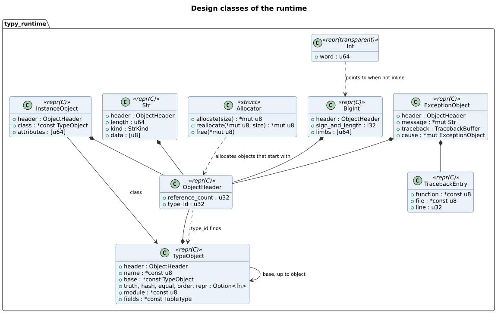
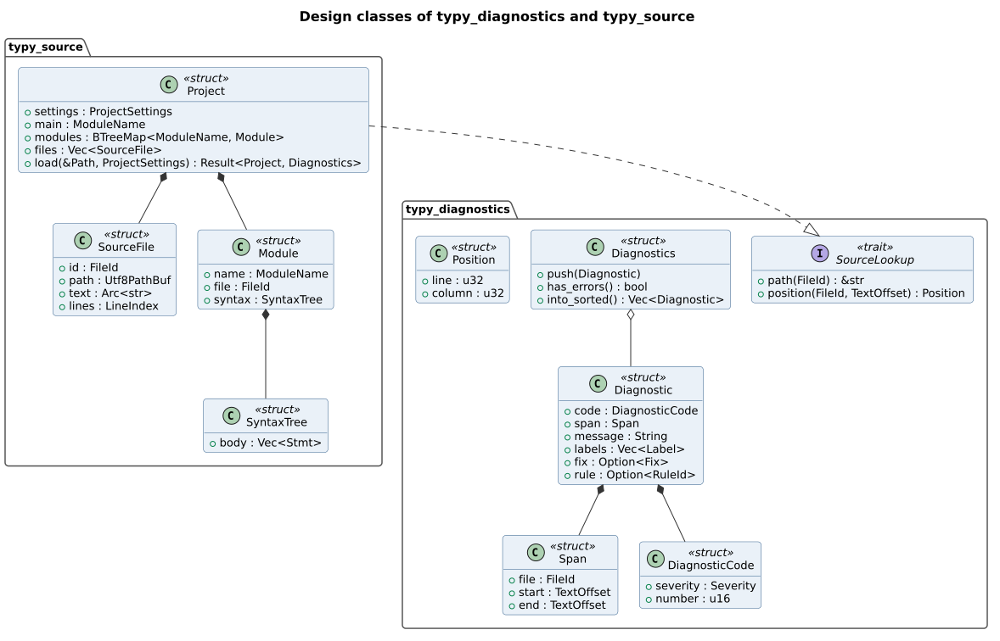
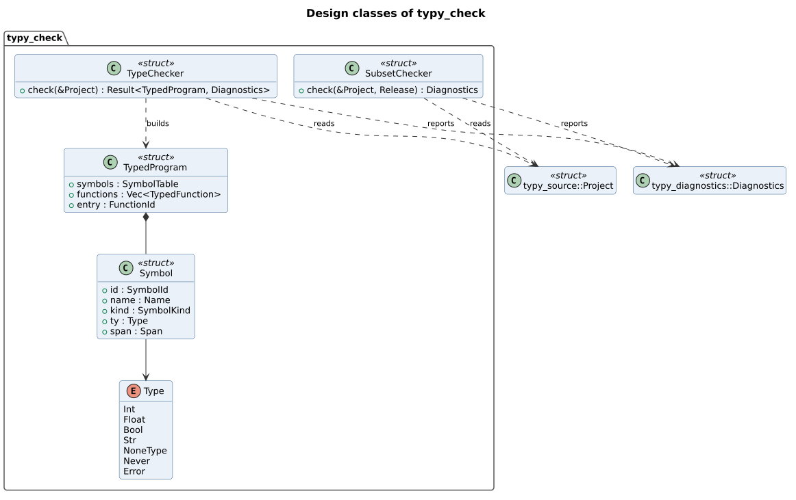
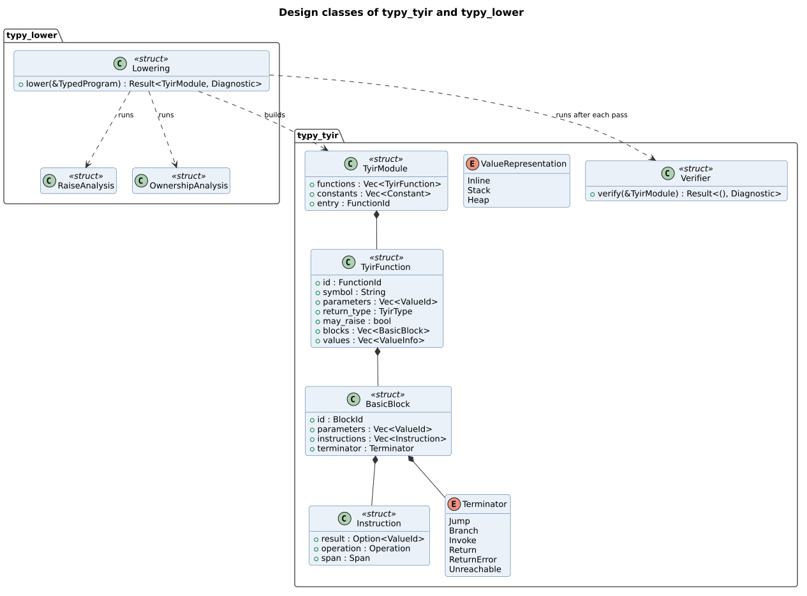
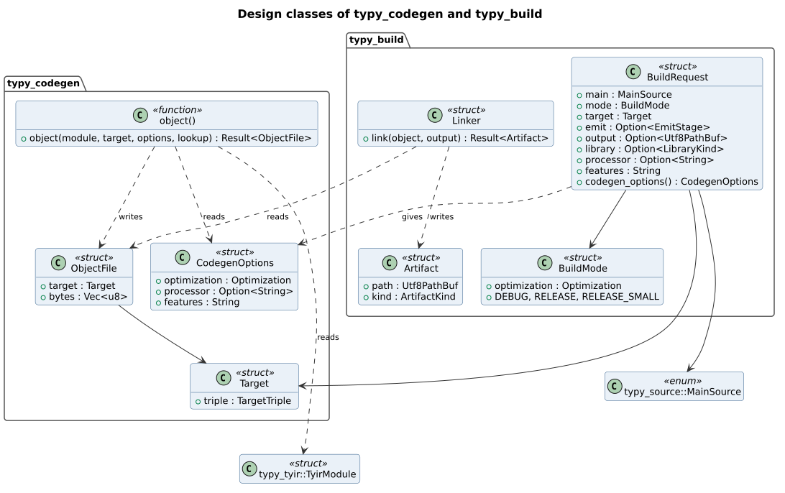

# TyPy detailed design

| Field | Value |
| --- | --- |
| Document | TyPy detailed design |
| Version | 2.107 |
| Status | Approved |
| Owner | typy-lang contributors |
| Last updated | 2026-11-23 |

## 1. Purpose and scope

This document specifies the code of TyPy: the package layout, the layering
rules, and each type with its fields, behaviour and errors, under the names
the code uses. It builds on the approved
[software architecture](../architecture/architecture.md), the
[domain model](../modeling/domain-model.md) and the decision records
ADR-0001 to ADR-0009.

It covers release 0.1, every requirement of the specification whose release
is 0.1, and the parts of release 0.2 written so far. Each later release
extends this document in the same change as its code. Where a type gains
fields or variants in a later release, the text says so with the release
number.

## 2. Workspace layout

Each crate is laid out by the rules of section 3.1: one module per kind of
object, a `name.rs` file for a module and a `name/` folder for its children.

```text
Cargo.toml                    workspace, shared lint settings
Cargo.lock                    committed
rust-toolchain.toml           Rust 1.99.1
clippy.toml                   project names allowed in documentation
crates/
  typy-diagnostics/src/       span, code, rule, registry, diagnostic,
                              diagnostics, render
  typy-source/src/            settings, module, source_file, line_index,
                              int_literal, project,
                              syntax/ (tree, statement, expression,
                              operator, node_kind, dump),
                              parse/ (statement, expression, operator)
  typy-check/src/             types, builtin, method, unprovided, check/
                              (definition, annotation, module_scope,
                              definition_order, visit), subset/ (feature,
                              statement, expression), body/ (program,
                              flow, locals, statement, expression, name,
                              operator, call, builtin_call, iterable_call,
                              list, slice, loop_source), typed/
                              (symbol, constant, signature, function,
                              program, statement, expression)
  typy-check/tests/           checker.rs, through the public API
  typy-tyir/src/              module, function, block, instruction,
                              types, verify, print
  typy-lower/src/             program, function, ownership, invoke,
                              statement, augmented, expression,
                              arithmetic, comparison, conversion, builtin,
                              iterable_builtin, tuple, list, list_method,
                              slice, loop_source, call_graph, mangle,
                              strings, types
  typy-codegen/src/           target, optimization, layout, statics, abi,
                              runtime, function, operation, constant,
                              descriptor, bits, tuple, arithmetic,
                              comparison, call, terminator, emit
  typy-build/src/             request, mode, emit_stage, runtime_archive,
                              linker, artifact
  typy-driver/src/            pipeline, emission, outcome, failure,
                              sources
  typy-cli/src/               main, arguments, command/ (check, build,
                              run), cache, output, exit_status, guard
  typy-runtime/src/           entry, cell, header, allocator, libc, libm,
                              refcount, word, compare, int, float,
                              string, list, tuple, slice, zip, message,
                              io, exception, range, stack, set, dict,
                              hash, type_object, instance
  typy-conformance/src/       expectation, observation, oracle, subject,
                              suite, test_case, verdict
tests/
  conformance/<area>/         <ID>_<behaviour>.py, one rule per file
  golden/<stage>/             expected --emit output
  e2e/                        tests that run the typy executable
```

The crates from `typy-tyir` on are listed with their planned modules; each
is laid out by the same rules when it is written.

## 3. Layering and code rules

The dependencies between crates are those of architecture section 4.2, and
a CI job checks them against `cargo metadata`.

### 3.1 Modules

The code is organised so that it stays easy to change as it grows:

- One module per kind of object or per responsibility: `Span` and
  `Position` in `span`, the `Diagnostics` collection apart from the single
  `Diagnostic`, operator typing apart from name resolution.
- A module with children is a `name.rs` file and a `name/` folder, without
  `mod.rs`. A type's methods may be spread over child modules by
  responsibility, as `BodyChecker`'s are under `body/`.
- Modules are private. The crate root re-exports the public API with
  `pub use`, so a type moves between modules without breaking a caller.
- Items are as private as they can be: `pub(super)` for a module family,
  `pub(crate)` for the crate, `pub` only for the API.
- A source file stays under about 400 lines. A longer file is split by
  responsibility before more is added to it.
- Unit tests sit beside their module in `name/tests.rs`, declared with
  `#[cfg(test)] mod tests;`, and the crate root's in `src/tests.rs`. Code
  scanning leaves test files out, since a test's checks of results it
  knows to succeed read to its path-insensitive queries as null pointers,
  and an inline test module would bring them back in. Tests that need only
  the public API are integration tests in the crate's `tests/` folder.

### 3.2 Code rules

Within the code:

- Every compiler crate starts with `#![forbid(unsafe_code)]`. Only
  `typy-runtime` contains `unsafe`, and each block carries a comment that
  starts with `SAFETY:` and says why it is sound.
- Clippy runs with `-D warnings` and the `pedantic` group. Each allowed lint
  is listed in `Cargo.toml` with its reason.
- Identifiers of compiler objects are newtypes over `u32`: `FileId`,
  `SymbolId`, `ScopeId`, `FunctionId`, `BlockId`, `ValueId`. They index a
  vector owned by the aggregate that created them and are never mixed.
- Maps whose order can reach any output are `BTreeMap` or sorted `Vec`
  (architecture section 7.2). `HashMap` is used only for lookups whose
  order never escapes.
- Functions that can fail return `Result`. Compiler code does not call
  `unwrap`, `expect` or `panic!` on a path that input can reach; a broken
  internal invariant returns an internal `Diagnostic` with code `E9001`.
- There is no process-wide mutable state in the compiler. Everything a
  command needs travels in the `BuildRequest` and the objects the stages
  return.
- Line and branch coverage is measured with `cargo-llvm-cov` over the whole
  workspace, the runtime included, and counts the `typy` executable when
  tests run it as a subprocess. CI fails below 96 percent (NFR-11).

## 4. typy-diagnostics

### 4.1 Types

`TextOffset`

| Field | Type | Default | Rule |
| --- | --- | --- | --- |
| `0` | `u32` | none | A byte offset into a `SourceFile`; LEX-09 keeps it below 2^24 |

`Span`

| Field | Type | Default | Rule |
| --- | --- | --- | --- |
| `file` | `FileId` | none | Names a file of the current `Project` |
| `start` | `TextOffset` | none | On a UTF-8 character boundary |
| `end` | `TextOffset` | none | Not before `start`; on a character boundary |

`Span::new(file, start, end)` returns `None` when `end` is before `start`.

`Position`

| Field | Type | Default | Rule |
| --- | --- | --- | --- |
| `line` | `u32` | none | From 1 |
| `column` | `u32` | none | From 1, counted in code points (DIA-01) |

`DiagnosticCode`

| Field | Type | Default | Rule |
| --- | --- | --- | --- |
| `severity` | `Severity` | none | `Error` for `E` codes, `Warning` for `W` codes |
| `number` | `u16` | none | 0 to 9999; its first two digits give the range of section 4.3 |

`DiagnosticCode::parse("E0401")` returns `Err(CodeError::Malformed)` for
any text that is not a letter `E` or `W` followed by four digits.
`Display` writes the same form back.

`RuleId` wraps a `&'static str` such as `"TYP-03"`. Only the constants in
`rules.rs` create one, and a unit test checks that each constant is an ID
in `docs/requirements/srs.md`.

`Diagnostic`

| Field | Type | Default | Rule |
| --- | --- | --- | --- |
| `code` | `DiagnosticCode` | none | Listed in the registry (section 4.3) |
| `span` | `Option<Span>` | none | The primary location; `None` for a diagnostic about no place in the source, such as a failed link |
| `message` | `String` | none | One sentence in lower case with no final period (DIA-01) |
| `labels` | `Vec<Label>` | empty | Secondary spans, each with a short text |
| `help` | `Option<String>` | `None` | A hint, shown after `help:`, when no fix is certain |
| `fix` | `Option<Fix>` | `None` | Set only when the fix is certain (DIA-02) |
| `rule` | `Option<RuleId>` | `None` | Required when the diagnostic rejects valid Python (DIA-03) |

`Diagnostic::new(code, span, message)` makes a located diagnostic and
`Diagnostic::without_location(code, message)` one without a span.

`Fix` holds a `Span` and the `replacement: String` for it. `Label` holds a
`Span` and a `text: String`.

`Diagnostics` collects diagnostics for one command.

| Method | Behaviour |
| --- | --- |
| `push(diagnostic)` | Adds it, unless one with the same code and span is already present |
| `has_errors()` | True when any diagnostic has severity `Error` |
| `iter()` | The diagnostics in the order they were added |
| `into_sorted(lookup)` | Returns them sorted by file path, line, column and code; those without a location come first |

`SourceLookup` is the trait the renderers use to turn a `Span` into text.
`typy-source::Project` implements it.

| Method | Returns |
| --- | --- |
| `path(file)` | The file's path relative to the project root |
| `position(file, offset)` | The `Position` of the offset |
| `line_text(file, line)` | The text of one line, without its line ending |

### 4.2 Rendering

`render_text(&Diagnostic, &dyn SourceLookup) -> String` writes the form
below. The source line is shown with a marker under the span, and the fix,
when present, as the corrected line.

```text
error[E0402]: `total` was declared as int and is assigned a str
 --> app.py:3:13
  |
3 |     total = "done"
  |             ^^^^^^
  = rule: TYP-03
help: assign an int, or use a new variable
```

The gutter is as wide as the line number. A span that runs past its first
line is marked to the end of that line. Each label is written as
`= LINE:COLUMN: text`. A certain fix follows as `help: write it as` and the
corrected line.

A diagnostic without a location is written as its header, then its rule and
its help:

```text
error[E0701]: the C toolchain program `cc` was not found
 = rule: A-01
help: install `cc`, which TyPy runs to link the program
```

`render_json` writes the same diagnostic as one JSON object on one line
(DIA-05). Every key is always present, in this order, with `null` where
the diagnostic has nothing, so a tool reads each line the same way:

| Key | Value |
| --- | --- |
| `code` | The code, such as `"E0402"` |
| `severity` | `"error"` or `"warning"` |
| `message` | The one sentence of DIA-01 |
| `file` | The path from the project root, or `null` |
| `line`, `column`, `end_line`, `end_column` | The span from 1, columns in code points, or `null` |
| `rule` | The requirement ID, such as `"TYP-03"`, or `null` |
| `help` | The help line, or `null` |
| `labels` | An array of `{"line", "column", "text"}` |
| `fix` | `{"line", "column", "end_line", "end_column", "replacement"}`, or `null` |

A string escapes a quote, a backslash and each control character, and
keeps every other character as UTF-8.

### 4.3 Diagnostic codes

The registry in `registry.rs` lists every code with its summary, the rule
it enforces and its status. `typy explain` reads the same table.

| Code | Summary | Rule |
| --- | --- | --- |
| E0101 | Source file larger than 16 MiB | LEX-09 |
| E0102 | Source file is not valid UTF-8 | LEX-01 |
| E0103 | Python syntax error, syntax newer than the Python floor, or `return`, `break` or `continue` out of place | STD-01 |
| E0104 | Imaginary literal | LEX-08 |
| E0105 | Source file cannot be read | None |
| E0106 | Output file cannot be written | None |
| E0107 | `typy.toml` is not valid | CLI-07 |
| E0201 | Feature planned for a later TyPy release | The feature's own rule |
| E0202 | Feature TyPy cannot compile with CPython's meaning | STD-04 |
| E0203 | Parameter without a type annotation | TYP-01 |
| E0204 | Function without a return annotation | TYP-01 |
| E0205 | Name is not defined | STD-04 |
| E0206 | Import of a module TyPy does not provide | LIB-08 |
| E0301 | `is` used on values other than `None`, `bool` values or class instances | EXP-08 |
| E0302 | `**` whose CPython result could be a `float` for `int ** int`, or `complex` | EXP-04 |
| E0303 | `and` or `or` with operands of different types | EXP-09 |
| E0304 | Truth test on a value of an unsupported type | EXP-10 |
| E0305 | Conditional expression with branches of different types | EXP-11 |
| E0306 | Variable read before it is assigned on every path | TYP-12 |
| E0307 | Tuple indexed other than by an integer literal inside it | DAT-08 |
| E0308 | Unpacking into a different number of targets | SMT-02 |
| E0309 | Instance used, or an attribute read, before `__init__` assigns every attribute; `__init__` that can end without assigning one | CLS-01 |
| E0310 | Attribute whose type is not known yet, because the `__init__` that assigns it is checked later | CLS-01 |
| E0401 | Operator not defined for these operand types | EXP-02 |
| E0402 | Assignment changes the type of a variable | TYP-03 |
| E0403 | Retired in 0.11: `object` and `cast` are accepted (TYP-23, TYP-24), and `Any` is E0201, planned (TYP-25) | TYP-10 |
| E0404 | Argument of the wrong type | TYP-01 |
| E0405 | Returned value of the wrong type | TYP-01 |
| E0406 | `~` of a `bool` | DAT-19 |
| E0407 | Comparison between unsupported types | EXP-06 |
| E0408 | `tuple`, `list`, `set` or `dict` annotation without its item types; a `Callable` annotation without its list of parameter types and its result, or with `...` for them | TYP-06, FUN-05 |
| E0409 | List, set or dict display with items, keys or values of different types | DAT-07, DAT-09, DAT-10 |
| E0410 | Empty list or dict display, `list()`, `tuple()`, `set()` or `dict()` without an annotation | TYP-05 |
| E0411 | `for` over a value that cannot be iterated | CST-03 |
| E0412 | Method a built-in type does not have | LIB-03 |
| E0413 | Set item or dict key of a type without a hash: a list, a set, a dict, a view, or a tuple that holds one | DAT-09, DAT-10 |
| E0414 | Attribute or method a class does not have | CLS-02 |
| E0415 | `raise` or `from` of a value that is not an exception | SMT-06 |
| E0416 | Bare `raise` outside an `except` clause | EXC-07 |
| E0417 | Call of an exception class TyPy does not let a program build | EXC-12 |
| E0418 | `except` clause that names something other than exception classes | EXC-09 |
| E0419 | `return`, `break` or `continue` that leaves a `finally` block | EXC-06 |
| E0420 | `with` on a value whose class has no `__enter__` and `__exit__` | CST-05 |
| E0421 | `del` of something other than a list item, a list slice or a dict key | SMT-05 |
| E0423 | `global` of a name the module does not bind | SMT-08 |
| E0424 | Module variable an `__init__` reads before the module's code gives it a type | SMT-08 |
| E0425 | Import of a name its module does not define | SMT-07 |
| E0426 | Import inside `__init__` of a module that the imported module imports | MOD-15 |
| E0427 | `%` format that does not fit its values | LIB-10 |
| E0428 | Copies of a generic function without end | GEN-03 |
| E0429 | Module or export that a C library cannot have | FFI-05, CLI-09 |
| E0430 | `ctypes` declaration TyPy cannot compile | FFI-01, FFI-02, FFI-03 |
| E0701 | C toolchain program not found | A-01 |
| E0702 | Link failed | A-01 |
| E0703 | Runtime archive missing, or from another TyPy version | None |
| E9001 | Internal compiler error | NFR-09 |
| W0101 | Invalid escape sequence | DIA-08 |
| W0301 | Assertion that is always true, of a tuple with items | DIA-08 |
| W0401 | `match` that leaves members of the subject's type unmatched | CST-07 |

## 5. typy-source

### 5.1 Types

`ProjectSettings`

| Field | Type | Default | Rule |
| --- | --- | --- | --- |
| `root` | `Utf8PathBuf` | Directory of the main file | Absolute; every module path is relative to it |
| `release` | `Release` | `Release::V0_1` | The release whose feature table the subset checker uses |
| `python_floor` | `PythonFloor` | `PythonFloor::V3_12` | One of 3.12 to 3.15; the parser's target version and the lowest oracle version (ADR-0008). Read from `python-floor` in `typy.toml` (CLI-12) |
| `module_paths` | `Vec<Utf8PathBuf>` | empty | Directories relative to `root`, each made only of normal components and existing; the loader looks for a module in `root`, then in each, in order (MOD-01) |
| `library` | `bool` | `false` | Set by `--lib` through `SettingOverrides::library`: the main file is a module named after its file, and the checker reads its exports from `__all__` (CLI-09, ADR-0044) |
| `version` | `Option<String>` | `None` | `version` in `typy.toml`, a string whose release `version_release` finds; the version of a library whose module has no `__version__` (CLI-13) |
| `library_paths` | `Vec<Utf8PathBuf>` | empty | `library-paths`: directories under `root`, checked as `module_paths` are, where the linker looks for C libraries first (FFI-04) |
| `libraries` | `BTreeMap<String, LibraryLink>` | empty | `[libraries."NAME"]`, each a table of one `link`, `"static"` or `"dynamic"`, for a name of letters, digits and `_.+-` that does not start with `-`; `typy_build::library_argument` gives the linker's argument for each target (FFI-04) |
| `platform` | `Platform` | `Platform::host()` | `Linux` or `MacOs`, the operating system of the build's target, which `Pipeline` sets from the target and `sys.platform` names: `linux` or `darwin` (LIB-22) |
| `allocator` | `Option<Allocator>` | `None` | The table `[allocator]`: the C functions `allocate`, `reallocate` and `free`, each an identifier of at most 255 characters outside the prefixes `typy_`, `__typy` and `_TY`, all three different, and an optional `library`, a name the linker takes as `-lname` that starts with a letter, a digit or `_` (MEM-08, ADR-0043) |

`ProjectSettings::read(root, overrides)` builds the settings once, when a
command starts: the defaults, then `root/typy.toml` when it exists, then
`SettingOverrides`, the flags of the command line (CLI-07). The file is
parsed with `toml_edit`, whose spans place each E0107 on its line; every
wrong setting is reported, and the command stops with exit status 2 before
any module is read (UC-11). The file becomes `SourceFile` 0 of the
`LoadFailure`, so the diagnostics render with its text. The table
`[allocator]` is read by `settings_file::allocator`, whose problems name
MEM-08. Library links from `typy.toml` are planned for 0.5 (FFI-04).

`Project::load` names the main module `__main__`, or for a library build
after its file without `.py`, so `tools.py` is the module `tools`. The name
also names the library and its C header, so a file name that is not an
ASCII identifier is E0429 under CLI-09, before any file is read.

`SourceFile`

| Field | Type | Default | Rule |
| --- | --- | --- | --- |
| `id` | `FileId` | none | Unique in its `Project` |
| `path` | `Utf8PathBuf` | none | Relative to `ProjectSettings::root`, or `<stdlib>/name.py` for embedded modules |
| `text` | `Arc<str>` | none | Valid UTF-8, at most 16 MiB, without a leading byte order mark |
| `lines` | `LineIndex` | none | Byte offset of each line start, built when the file is read |

`SourceFile::read(id, root, path)` refuses a file over 16 MiB with E0101
before reading it, and a file that is not UTF-8 with E0102 at the offset of
the first invalid byte. A file that cannot be read gives E0105 with the
operating system's reason. In each case the file is still registered, with
empty text, so the diagnostic has a location. A leading byte order mark is
removed, as CPython accepts it. `LineIndex` treats LF, CRLF and a lone CR
as line endings, as LR 2.1.2 does.

`ModuleName` wraps a `String` of dotted identifiers, such as `__main__` or
`builtins`. `ModuleName::new` refuses an empty name and any part that is
not an identifier.

`Module`

| Field | Type | Default | Rule |
| --- | --- | --- | --- |
| `name` | `ModuleName` | none | `__main__` for the main file (STD-06) |
| `file` | `FileId` | none | Its `SourceFile` |
| `syntax` | `SyntaxTree` | none | Built by `parse` |
| `is_package` | `bool` | none | Read from an `__init__.py` (MOD-02); `package()` gives the package a relative import starts from |

`Project`

| Field | Type | Default | Rule |
| --- | --- | --- | --- |
| `settings` | `ProjectSettings` | none | Immutable after load |
| `main` | `ModuleName` | `__main__` | A key of `modules` |
| `modules` | `BTreeMap<ModuleName, Module>` | none | The main module and every module its imports reach |
| `files` | `Vec<SourceFile>` | none | Indexed by `FileId`; a file imported under two names, as the main file by its own name, is read once |
| `imports` | `BTreeMap<ModuleName, Vec<Import>>` | none | Each module's imports, with the packages above each module they name |
| `order` | `Vec<ModuleName>` | none | Each module after the modules its module-level imports need, in name order otherwise |
| `standard` | `BTreeSet<ModuleName>` | none | The standard library modules imported, which no file under the root provides |

`Project::load(main_path, settings) -> Result<Project, LoadFailure>` reads
and parses the main file and every module its imports reach, and returns
every diagnostic of every file together. `LoadFailure` holds the
`Diagnostics` and the files they point into, and implements
`SourceLookup`, so a failed load can still be rendered. The checker reads
the declarations of `builtins` from `typy-stdlib` (section 6).

`loader.rs` finds the imports of each module at any depth, in function and
class bodies too. An `Import` names the module, its span, whether it runs
while the module initialises, which an import in a function does not, and
whether it is optional: `from a import b` needs the submodule `a.b` only
when it exists. `import a.b` needs `a`, then `a.b`. `absolute_name` turns a
relative import into an absolute name from the importing module's
package, with CPython's messages for a module outside a package and for
too many dots. `locate` finds `a.b` as the package `a/b/__init__.py`, or
else `a/b.py`, under the main file's directory, as CPython's file finder
prefers a package. A module no file provides is a standard library module
when its top-level name is in `STDLIB_NAMES`, CPython 3.12 to 3.15's
`sys.stdlib_module_names` written by `scripts/generate-stdlib-names.py`;
the checker says whether TyPy provides it. Any other is E0206, `no module
named 'x'`, with `; 'a' is not a package` when `a` is a module.
`initialisation_order` follows the module-level imports depth first; an
import that leads back to a module on the path is E0422, with each import
of the cycle shown, MOD-05 (ADR-0015).

### 5.2 The syntax tree

`SyntaxTree` is TyPy's own copy of the parsed module. Its node types follow
the names of CPython's `ast` module for Python 3.12, such as `FunctionDef`,
`AnnAssign`, `BinOp` and `Compare`, so the Language Reference and the `ast`
documentation describe them. Every node carries a `Span`.

A node the current release compiles is converted with all its parts. Any
other node becomes `Stmt::Other` or `Expr::Other`, holding its `NodeKind`,
such as `ClassDef` or `ListComp`, and its span, which is what the subset
checker needs to reject it with E0201 or E0202. Each release converts the
nodes of the features it adds, as 0.2 does for `Expr::Set`, a set
display, `Expr::Dict`, a dict display whose `keys` hold `None` for a `**`
item, as CPython's `ast.Dict` does, and `Expr::ListComp`, `SetComp` and
`DictComp`, whose clauses are `Comprehension` values as CPython's
`ast.comprehension`; 0.9 converts `Expr::GeneratorExp` with the same
parts (EXP-15), and `Expr::Starred`, a `*value` item (EXP-17).
`elif` chains become nested `If` nodes, as
in CPython's `ast`. An integer literal keeps its value as decimal digits,
so literals of any size survive conversion (DAT-01).

`dump(tree, lines) -> String` writes the tree as indented text with the
`LINE:COLUMN` of each node, for `--emit=ast` and golden tests. No type from
`ruff_python_parser` or `ruff_python_ast` appears outside `parse.rs`
(ADR-0005).

`parse(file: &SourceFile, floor: PythonFloor) -> Result<SyntaxTree,
Vec<Diagnostic>>` calls
`ruff_python_parser::parse_unchecked` with
`ParseOptions::from(Mode::Module)` and the program's Python floor as the
target version, 3.12 in 0.1. Each entry of `Parsed::errors()` and
`Parsed::unsupported_syntax_errors()` becomes an E0103 diagnostic, so
syntax that the floor version does not accept is refused (STD-01). The
parser reads PEP 810 lazy imports and marks them `is_lazy`, which the
syntax tree keeps (MOD-06). `typy_source::lazy_modules` reads a module's
`__lazy_modules__` list, and `typy_source::is_lazy` says whether an import
statement is lazy by its keyword or by that list (MOD-07); the loader
orders the modules of lazy imports as it orders imports inside a
function, so they close no cycle. The tree is converted only when there
are no errors.

Before parsing, `parse/limits.rs` reads the tokens and refuses the 201st
nested bracket with "too many nested parentheses" and the 100th nested
block with "too many levels of indentation", CPython's tokenizer limits
(LEX-11, ADR-0020). The parser runs with its `stacker` feature, which
grows its stack on the heap. Converting the tree counts the nesting of
expressions and statements, an `elif` counting as the `if` it becomes,
and stops past `MAX_DEPTH`, 25000, with E0103; so every later pass
recurses at most that deep, and the `typy` command runs the compiler on
a thread with a 512 MiB stack, which holds it.

The parser gives a literal's value as UTF-8 text, which writes U+FFFD
for each escape of a surrogate. `parse/surrogate.rs` reads the literal's
source in order: the n-th U+FFFD of the value comes from the n-th item
that gives one, U+FFFD itself, `\ufffd`, `\U0000fffd`,
`\N{REPLACEMENT CHARACTER}` or a surrogate escape, so each surrogate goes
back in its place whatever newlines the parser normalised (LEX-10). A
literal that holds one becomes `Constant::StrPoints`, its code points, and
so does its implicit concatenation; literal text of an f-string that
holds one becomes a replacement field of that constant, which formats as
the string itself. A raw literal has no escapes. The constant goes on as
`TypedConstant::StrPoints` and as TyIR's `Constant::StrPoints`, an index
into `TyirModule::str_points`, and codegen emits it as any string
constant, at the width of its widest code point. Compile-time readers of
literal text, such as `open` modes and `%` formats, take it as a value
that is not a literal.

## 6. typy-stdlib

`typy-stdlib` holds the Python sources of the standard library modules
TyPy implements (ADR-0007), embedded in the `typy` binary with
`include_str!`, and the declarations of the private `_typy` module. It is
created with the first module written in Python, `sys` and `math` in 0.3.

`math` is not written in Python either (ADR-0018): its functions take an
`int` or a `float` and some any number of arguments, which the 0.3
subset cannot declare. `crates/typy-check/src/math.rs` lists each name:
a constant with its value, or a function with its `MathShape`, which
gives the types of its arguments and its result, and the Python version
that added it, so a name newer than the program's floor is E0425.
`import math` binds a built-in module object, which runs no code and
prints as `<module 'math' (built-in)>`; `TypedProgram::builtin_modules`
lists the ones a program imports, after its own modules. A call is
`TypedExprKind::MathCall`, checked by `body/math_call.rs` with CPython's
messages for an argument of a type it refuses for every value, and
lowered by `lower/math.rs`, which converts each argument as CPython does,
an `int` to a `float` for a real-number parameter, and calls the runtime
function (section 14). `fsum`, `dist`, `prod` and `sumprod` (LIB-12) are
checked by `body/math_iterable.rs`, which turns each iterable into a list
with `TypedExprKind::ListOf` and takes `int`, `bool` or `float` items, or a
union of them (LIB-15); `prod` of other items, or with another start, is
E0201, planned for 1.0 (LIB-21). `lower/math_iterable.rs` gives `prod` and
`sumprod` whose type is `int | float` an `int` when
`typy_rt_math_has_float` finds no `float` item, and otherwise the `float`
the runtime computes; `prod` with a `bool` start gives the start for no
items, and otherwise the product of the start as an `int`, so its type is
`bool | int` or `bool | int | float`.

`sys` is built the same way. `crates/typy-check/src/sys.rs` sorts every
public name of CPython 3.12 to 3.15's `sys` into a `SysName`: a
`SysValue` (`argv`, `stdout`, `stderr`, `stdin`, `version_info`), `exit`, a
switch of lazy imports (E0202, MOD-09), a `SysConstant` folded into the
program, `getrecursionlimit` and `setrecursionlimit`, which
`TypedExprKind::RecursionLimit` reads and sets in the runtime, or a name TyPy
does not provide (E0202). `body/version_info.rs` folds `sys.version_info`
written out into constants where it is compared with a tuple of `int`s,
indexed or read by field (ADR-0029). Held as a value it is
`Type::VersionInfo`, the runtime's one immortal object of type
`sys.version_info`, type ID 20, which `typy_rt_sys_version_info` gives and
writes as CPython 3.15.0 writes it (LIB-16). An index, a slice, a
comparison other than `is`, `len`, a loop, `+` and unpacking read it through
`version_tuple`, which makes `TypedExprKind::VersionRead`: the value is
evaluated, then the constant tuple `(3, 15, 0, 'final', 0)` is what the
operation reads, so the tuple's own checks apply; a comparison with a tuple
of `int` literals is made when compiling, its result the read's constant,
and a field is item `i` of the tuple. `body/builtin_module.rs` holds what the two
modules share: `BUILTIN_MODULES`, the `ModuleFunction` and
`BuiltinValue` a name gives, and `Program::builtin_lookup`, whose
refusals point at the name. A value of `sys` is `TypedExprKind::SysValue`,
lowered by `lower/sys.rs` to a runtime call whose result is borrowed,
since the runtime keeps the list and the two files for the whole run.
`sys.exit(code)` is `TypedExprKind::SysExit`, lowered to raising
`SystemExit` built with the code as its argument. `sys.stdout` and
`sys.stderr` have the type `Type::TextFile`, shown as `TextIOWrapper`,
whose `write` and `flush` are methods of the method table; `print`
takes one as `file`, and `file=None` is no `file`.

`open` is a builtin checked by `body/open_call.rs` (ADR-0019). The mode
must be a string literal, which `crates/typy-check/src/open.rs` reads as
CPython's `_io.open` does: `open_access` gives an `OpenAccess` (`Read`,
`Write`, `Append`, `Create`) or a `ModeRefusal`, either `Fails` with
CPython's `ValueError` text (E0404), and an `OpenMode` of the access and
whether the mode is binary; a mode with `+` is one of `ReadPlus`,
`WritePlus`, `AppendPlus` and `CreatePlus`, numbered with the bit of `+`
above the access. A binary mode gives `Type::BinaryFile` with the
`BinaryKind` of CPython's class, `Raw` for `FileIO` with the literal
`buffering=0` (ADR-0031); its `mode` is the one CPython 3.15's `FileIO`
shows, such as `rb+`. `binary_file` refuses `encoding`, `errors` and
`newline` with CPython's `ValueError` text, `buffering=1`, and a
`buffering` that is not a literal (E0201, LIB-19). The methods of a text
file serve a binary one, typed by `Type::file_line`: `bytes` in place of
`str`. A mode that is not a literal is a `str` in `OpenOptions::mode`, and
the file is a `TextFile`; `typy_rt_open` reads it as `open_access` does,
with the same `ValueError` texts, and raises `TypeError` for one with `b`
(ADR-0031). A file argument of type
`int` is a descriptor: the file is `Type::DescriptorFile`, text or of a
`BinaryKind`, whose `name` is `FileAttribute::Descriptor`, an `int`, and
it lowers to `typy_rt_open_descriptor`. `closefd` other than the literal
`True` is `OpenOptions::closefd`; the literal `False` with a path is
E0404, and any other value sets a bit of the word `typy_rt_open` reads,
tested when the program runs. A `bool` file is E0404, since CPython 3.13
and later warn for it.
`body/open_options.rs` checks the arguments after the mode into an
`OpenOptions`: `buffering`, an `int` kept unless it is the
literal -1; `encoding` and `errors`, string literals resolved by
`codec_argument` as for `str.encode`, so a file has the codecs `utf-8`,
`ascii` and `latin-1` and the six handlers, numbered as the runtime takes
them, and the encoding as written for the file's `repr`; `newline`, a
`str | None`, whose literal CPython refuses is E0404. `closefd` other than
`True` is E0201 (LIB-14), and `opener` other than `None` is E0201 for 1.0
(LIB-18). The call is `TypedExprKind::Open { path, mode, access, options }`
of type `Type::TextFile`, the
type of `sys.stdout`, whose methods add `read`, `readline`, `readlines`,
`writelines`, `close`, and the methods of LIB-14: `fileno`, `isatty`,
`readable`, `writable`, `seekable`, `seek(cookie, whence=0)`, `tell` and
`truncate(pos=None)`, whose `pos` is `ParameterType::IntOrNone`, an `int`
or the literal `None`. `name`, `mode` and `closed` are
`TypedExprKind::FileAttribute`; calling one is E0401, and another name of
a text file is E0412. A text file is iterable: `Type::iterable_item`
gives `str`, a `for` loop and `iter()` make a runtime iterator over it,
and `next(file)` is `next(iter(file))`. `TypedStmt::With` carries a
`WithProtocol`: `Methods { enter, exit }` for a class, or `TextFile`,
which enters with `typy_rt_text_enter` and leaves with
`typy_rt_text_close`. An `OSError` the runtime raises for a file opened from
a descriptor holds the descriptor as its third argument, CPython's
`filename` for it (ADR-0035).

The builtins (LIB-01, LIB-02) are not written in Python. `print`, `min`
and `max` take any number of arguments, which the 0.1 subset cannot declare
(EXP-17), and `sorted`, `sum`, `any` and `all` take any iterable, which
needs generics (0.4), so ADR-0007's "written around it" applies: each
builtin is a `Builtin` value that `typy-check` types from its own table and
`typy-lower` lowers to runtime calls (section 7.3). A builtin moves to
`builtins.py` when the features it needs arrive.

## 7. typy-check

### 7.1 Types

`Type` is an enum. Its variants are `Int`, `Float`, `Bool`, `Str`,
`NoneType`, `Tuple(Vec<Type>)` and `List(Box<Type>)` from 0.2, and `Error`.
`Error` is the type of an expression that already has a diagnostic; every
check accepts it silently, so one cause gives one error (DIA-04). A type
built from other types holds them, so `Type` is `Clone` and not `Copy`, and
two types are equal when their structure is. `Dict`, `Set`, `Bytes` and
`Class` follow in 0.2; `Union`, `TypeParameter` and `Callable` in 0.4 and
1.0.

| Method | Behaviour |
| --- | --- |
| `is_assignable_to(&self, target)` | True when equal, or either side is `Error`; a tuple item by item. An `Int` is not assignable to `Float` (TYP-09) |
| `can_test_equality(&self, other)` | True for the same type, two numbers, or tuples of one length whose items can (EXP-06) |
| `can_order(&self, other)` | The same, except that `None` cannot be ordered; inside a tuple a pair of `None` items is accepted, because CPython orders tuples by the first pair of items that differ and two `None` items never do |
| `has_error(&self)` | True when the type is or holds `Error` |
| `Display` | The Python spelling, such as `int` or `None` |
| `with_article(&self)` | The spelling with its article, for messages: `an int`, `a str`, `None` |

`Symbol`

| Field | Type | Default | Rule |
| --- | --- | --- | --- |
| `id` | `SymbolId` | none | Unique in the `SymbolTable` |
| `name` | `Name` | none | A Python identifier |
| `kind` | `SymbolKind` | none | `Local`, `Parameter`, `ModuleVariable`, `Function` or `Builtin` |
| `ty` | `Type` | none | Never changes after the symbol is created (TYP-03) |
| `span` | `Span` | none | Where the name is first bound |

`Scope`

| Field | Type | Default | Rule |
| --- | --- | --- | --- |
| `id` | `ScopeId` | none | Unique in the `SymbolTable` |
| `kind` | `ScopeKind` | none | `Module` or `Function` in 0.1 |
| `parent` | `Option<ScopeId>` | `None` for a module | A function scope's parent is its module |
| `names` | `BTreeMap<Name, SymbolId>` | empty | One symbol per name |

`FunctionSignature`

| Field | Type | Default | Rule |
| --- | --- | --- | --- |
| `parameters` | `Vec<SignatureParameter>` | empty | Each with `name`, `ty`, `default: Option<TypedConstant>`, `default_call` and `kind`, the parser's `ParameterKind`: `Normal`, `PositionalOnly` before `/`, `KeywordOnly` after `*`, `VarPositional` for `*args`, whose `ty` is `tuple[T, ...]`, or `VarKeyword` for `**kwargs`, whose `ty` is `dict[str, T]` |
| `returns` | `Type` | none | `NoneType` for `-> None` |

A default value is a constant in 0.1, which makes "evaluated once, when the
function is defined" (EXP-16) hold trivially. `BodyChecker::bind_to` binds
each call's arguments to parameter positions, so TyIR and code generation
see positions alone. `body/binding.rs` says where each goes: a positional
argument fills the parameter of its index among those that take one by
position, which Python puts first, then `*args`; a keyword fills the
parameter it names unless that is positional-only or variadic, then
`**kwargs`. A positional argument past the others, or a keyword no
parameter takes, is E0404 under FUN-03 and TYP-01, where CPython raises
`TypeError`. Each `Argument` holds its parameter's index, and an argument
`**kwargs` takes also holds its `keyword`; one `*args` or `**kwargs`
takes is converted to the item type, so a call may hold several arguments
of one variadic parameter, in source order (EXP-17). The generic solver
pairs each argument with the type `body/binding.rs` gives it, so `T` of
`*items: T` is solved from the items. An override keeps the variadic
parameters of the method it overrides, E0404 (CLS-04). A nested function,
a method or a `lambda` with one, read as a value, takes the `Callable` its
context expects through an adapter, and one with `*args` or `**kwargs` is
E0203 where none is expected (FUN-19, `body/callable_adapter.rs`).

An `isinstance` test of an abstract class of `collections.abc` or `typing`,
`Iterable`, `Iterator` or `Generator`, is decided by its static type when
it can be, and otherwise tested by `MemberTest`s: the classes of the
program that define the class's methods, and for `Iterator` the runtime's
iterators, generators and files, for `Generator` its generators, each by
the type ID in its header (TYP-17, TYP-21). A true test of an
`Iterable[T]` against `Iterator` or `Generator` reads it as an
`Iterator[T]`. A class pattern's test never matches only when the value
and each member of a union decide so. `AnnotationName` keeps whether a
name of both modules came from `typing`, whose names a class pattern
refuses, E0401, as CPython raises `TypeError`.

`iterator_fits.rs` holds, for one check, what the instances of each
iterator or iterable class are, which `body/iterator_class.rs` finds
once the methods' signatures are known: a class whose `__next__` and
`__iter__` take the instance alone, and whose `__iter__` returns an
instance of the class or of a base, is an `Iterator[T]` of `__next__`'s
result, and a class whose `__iter__` returns an `Iterator[T]`, a generator
or an instance of such an iterator class is an `Iterable[T]`.
`Type::is_assignable_to` and `Type::iterable_item` read it, as they read
the classes that satisfy protocols; `TypedProgram` keeps both tables, and
`ProgramScope` puts them back while lowering reads the program's types. A
value converted to an `Iterator[T]` becomes `AsIterator`; a `for` over a class
whose `__iter__` returns an iterator of another kind goes over the call of
`__iter__` (TYP-20).

A call with `*value` or `**value` goes through `body/call_expression.rs`. For a
callee that `binds_when_it_runs` does not take, a builtin, a function value or
an exception class, `written_out` gives the call's arguments with each `*` of a
tuple display or of a variable of a fixed tuple as its items, `name[0]` on, and
each `**` of a dict display with `str` literal keys as keyword arguments,
checked as written (EXP-19). It keeps a call `bind_to` or `print` binds, or one
the arms below take, and otherwise refuses `**` of a dict in a call of a builtin
with E0201, planned for 1.0 (EXP-24, ADR-0099). A call of a function value with
`*` (`body/value_unpacking.rs`) is `TypedExprKind::CallValueUnpacked`: the
values before the first `*`, converted to their parameters, then one `Spread`
list of the rest, of the one type the parameters left take. Lowering checks the
count with `typy_rt_value_arity`, which raises CPython's `TypeError` naming the
function from the value's descriptor, counting a bound method's instance and
writing a built-in's count as a built-in does, then reads each item with
`ListGet` and calls through the value. `**` there is E0201, planned for 1.0
(EXP-21). A call of `print` with `**` keeps the dicts in `PrintCall::options`;
lowering (`print_options.rs`) binds the keywords and the dicts against a
description of `print` with `CallName`, `CallMerge` and `CallCheck`, as for any
call, then `typy_rt_print_check` raises CPython's error for a `sep` or an `end`
whose value is no `str` and a `file` whose value has no `write` or is a binary
file, each value read as the one it holds, so `None` keeps the default whatever
the dict's value type. Each keyword no argument names takes
`typy_rt_print_text`, `typy_rt_print_file` or `typy_rt_print_flush` from the
merged dict, which lives to the end of the call; a keyword reads the dict only
when its value type may hold what it takes. `Argument::passed` says how each
argument reaches its parameter: `Position`, `Name`, `Keyword` for one `**kwargs`
takes, `Items` for the items of a tuple of a fixed number of items `*` unpacks,
each bound as a positional argument, `Tail` for the list of every positional
value from the first `*iterable` of unknown length on, `Entries` for a `**dict`,
and `Default` for a default a call makes. `body/unpacked_arguments.rs` gives the
tail one type: that of the parameters it may reach when they share one, which
each part must hold its values alike to, E0404, or else the first value's, which
each part must hold alike, E0409, and which must fit each parameter it may
reach, E0404; the dicts share one value type, which fits each parameter a
keyword may still fill. Such a call binds when it runs (ADR-0073).

A function of the program read without a call, by its name or as
`module.name`, is `TypedExprKind::FunctionValue(id)`, of the type
`Type::Callable { parameters, returns }` of its signature (FUN-05,
ADR-0060). `check/callable_annotation.rs` reads `Callable[[A, ...], R]` of
`typing` or `collections.abc`, and refuses `Callable[..., R]` and every
other form with E0408. A generic function has no one copy to be the value,
and a function with a keyword-only parameter cannot be called by position,
so both are E0202. `body/function_value.rs` checks a call through a value,
`TypedExprKind::CallValue { callee, arguments }`, whatever the callee
expression is: one argument by position for each parameter, checked and
converted as an argument of a call by name is; a keyword argument or
another number of arguments is E0404, and a call of a value of any other
type is E0401. A call of a local variable reads the variable first, so an
optional `Callable` that a test narrowed is called; a module variable read
in a function is never narrowed (SMT-08). An attribute of an instance that
holds a function value is called the same way, after the receiver is read
as a value, so an instance whose `__init__` has not assigned every
attribute was already refused (CLS-01).

`callable_type.rs` gives the rule of NFR-19: a `Callable` type fits
another when they have as many parameters, each parameter of the target
passes unchanged as the function's, and the function's result passes
unchanged as the target's. A type passes unchanged as itself, as a class
it derives from when neither is a protocol, as an exception class it
derives from, as either of those wrapped as optional, and as a `Callable`
type it fits; every such pair is held alike, as one address. Every other
pair, such as `int` and `float`, `int` and `int | None` or a union and its
member, needs a conversion that only a call by name makes, so it does not
fit, and parameters and results vary in opposite directions, so a function
of circles never receives any shape. A fitting value is an `Upcast`, which
generates no code. Two function values compare with `==`, `!=` and `is`,
hash, and are true; they have no order.

`body/method_value.rs` reads a method without a call. Through its class,
`Class.name` is the method's `FunctionValue`, whose first parameter is the
instance, and a static method's is the function. Through an instance it
is `TypedExprKind::BoundMethod { object, methods }`, of the `Callable`
type of the parameters after `self`: `methods` holds the method the
instance's static class has, then, for each class derived from it that
defines the method itself, that class and its method, sorted by the depth
of the class, so a class comes after each class it derives from. A static
method no subclass defines again is its function after the object is
evaluated. An override a subclass holds otherwise than its base enters
`methods` as its adapter to the signature of the method read: the class's
own adapter when it adapts to that signature, or else one
`Program::value_adapter` writes for the pair of the override and the
method read (FUN-09). A method with type parameters of its own or a
keyword-only parameter is E0202, as a function is. An assignment to a
method of an instance is E0414.

`body/closure_scope.rs` finds, from a function's source alone, what each
of its nested `def`s captures and which captured variables live in a cell
(ADR-0061), as CPython's symbol table finds free and cell variables: the
names a nested function reads, directly or through the functions nested in
it, that the function binds or captures itself, less the nested function's
own name, which reads the running object. A captured variable is copied
when one binding gives its value, outside every loop and before each `def`
that captures it; any other lives in a cell.

Nested functions of one statement list that reach one another through the
names they read, each bound only by its `def`, form a group, which
`ClosureScope::groups` names for each of its `def`s, when three things
hold: each names the others only to call them by name, never as a value
or from a function nested in it; only `def`s run from the group's first
`def` to its last; and no other nested function defined before the last
reads one of them. Then no function of the group runs before each of its
`def`s has run, since nothing between them can raise, leave the block or
reach one of them. Each function of the group captures what any of them
captures, less the group's names, in one order, so a call by name among
them passes the running function object and no function object holds
another (ADR-0061). Without a group, two functions that call each other
hold each other, one through a cell, which is a cycle that only cycle
collection frees (MEM-06). A name a nested function declares `nonlocal`
is one of its free variables, and its function's own variable that a
nested function, or one nested deeper, assigns so is in
`ClosureScope::rebound` and lives in a cell; an annotation alone binds a
name without giving it a value. Such a variable is in no group, and a
nested `def` of that name is E0202. `body/nested_function.rs`
checks a `def` in a function: its signature in the annotations around it,
its `__qualname__` `outer.<locals>.name`, a new function and signature,
and the variable of its name, of the `Callable` type of its signature,
which only the `def` binds, so binding it again is E0202. The statement is
`TypedStmt::FunctionDef { function, target, captures, span }`, the reads
of each captured variable where the `def` runs, which reports one that may
be unassigned (TYP-12). The nested body is checked after the body around
it, with its `Closure`: inside it a captured name reads
`TypedExprKind::Capture(position)`, its own name
`TypedExprKind::RunningFunction`, and a call by name of a nested function
in reach is `TypedExprKind::CallNested { function, closure, arguments }`,
bound as a call of a function by name is. A call by name of another
function of the group is `CallNested` with `RunningFunction` as its
closure. The later `def`s of a group copy their captures from the first
one's function object, `TypedExprKind::CaptureOf { function, closure,
index }`, so each holds the same values with the types they had where the
first `def` ran, also a type narrowed before it. A call of a function of
the group whose `def` was refused reports nothing more (DIA-04).
`BodyChecker::declare_nonlocals` makes each name a nested function
declares `nonlocal` a variable of its own, of the type of the captured
cell, assigned from the start, whose cell is that capture:
`TypedProgram::nonlocals` maps its symbol to the position. A name no
function around it binds is E0103. `BodyChecker::changed_by_calls` holds
for a variable a function declares `global`, one of `rebound`, and a
`nonlocal` one: no test or assignment narrows it and no operation splits
on its members, since any call may assign it. An `except` clause whose
name is declared `global` or `nonlocal`, or is a variable outside the
clause that a nested function shares, is E0202, since the clause's
variable is its own and CPython deletes the shared one.
`TypedProgram::closures` holds
each nested function's captures, `CapturedVariable { name, ty, cell }`.
A variable that lives in a cell is read as `TypedExprKind::CellRead(symbol)`
and captured as `CellObject(symbol)`; inside a nested function a captured
cell is read as `CapturedCell(position)` and passed on to a deeper `def` as
`CapturedCellObject(position)`. `TypedProgram::cells` holds each function's
cell variables, also an `except` clause's, whose symbol is the clause's
own. A cell's type is the variable's once the body around the `def` is
checked, since an assignment after the `def` may give it. A nested
function with type parameters of its own (FUN-18, ADR-0081) reads them in
its annotations beside those of a generic function around it
(`definition_of`), and is a `Generic` whose `nested` flag keeps it out of
the module's copies. Its `def` makes one function object, as any nested
function's. `check_nested` checks it after the others of its body, in
`body/nested_generic.rs`: once for each combination of opaque types and
constraints with `Program::generic_pass` set, then each copy the body's
calls asked for, taken from `Generics::pending` until none is left, with
the same closure, so every copy reads the captures by one layout. A call
by name goes through `call_target` to the copy for its types and passes
the function object, and lowering gives the generic itself a stub that
takes the object, so the object's descriptor has code. Read as a value,
also inside another nested function, it is E0202
(`refused_function_value`). One in a generic function, as a `lambda`
and a generator expression there, is checked in each pass and copy of
the function (ADR-0081): while `generic_body::check` checks the generic
body, `Program::generic_pass` makes `check_body_of` keep each nested
function as a generic with no body, so only the copies, checked by
`generic_copies`, make code. Lowering
writes a copy's `__qualname__` without its type arguments, so
`pair_with[int].<locals>.make` shows as `pair_with.<locals>.make`. A call
of a local variable before an assignment gives it a type is read first, so
it is E0306.

`body/generator.rs` checks generator functions (SMT-11, FUN-07, ADR-0063).
A function whose body has a `yield` or a `yield from`, outside the
functions and classes it defines, is a generator function, and
`BodyChecker::generator` holds its `GeneratorTypes { yields, sends,
returns }` from its annotation: `Type::Generator { yields, sends, returns
}` of `Generator[Y, S, R]`, which names all three, or `Iterator[Y]` and
`Iterable[Y]`, whose `S` and `R` are `None`; any other annotation is
E0405. `yield value` and a bare `yield`, which gives `None`, are
`TypedStmt::Yield { value }`, the value converted to `Y`, E0405 when it
does not fit. A generator's end returns, so it is never E0405 for
reaching it, and `TypedFunction::generator` keeps the types for the
lowering. `Generator[Y, S, R]` is assignable to `Iterator[Y]` and
`Iterable[Y]`, the same object, and `sequence` and `next` take a
generator as its `Iterator[Y]` through `Upcast`, so loops, `iter()`,
`next()` and every builtin of an iterable read it as an iterator.
`target = yield value`, also annotated, is `TypedStmt::Yield { value,
received }`: `received` is the assignment, checked with
`BodyChecker::received` holding `TypedExprKind::Received`, of type `S |
None` (ADR-0067), which the checker's `Expr::Yield` arm gives as the
assignment's value; the assignment's checks report a target that does
not fit, E0402 with a help about `None` for a variable. `send`, `throw`
and `close` are `Method::GeneratorSend`, `GeneratorThrow` and
`GeneratorClose`, of `Type::Generator` alone: `send` takes an `S`,
converted to it, and E0404 for `None` names `next(generator)` in its
help; `throw` takes what `raise` takes, a class called with no
arguments; `send` and `throw` give `Y`. The same names on an
`Iterator[Y]` are E0412 under FUN-07, with a help that names
`Generator[Y, S, R]`. A `return value` in a generator is checked against
`R` and converted to it, and a generator whose `R` cannot be `None` must
not reach its end. `body/yield_from.rs` checks `yield from source` as
`TypedStmt::YieldFrom { source, item, received }` (ADR-0072): the source
is read as a loop reads it, an `Iterator` as it is and any other iterable
as an `Iterable`, its items must fit `Y`, a generator source's `S` must
hold what the generator is sent, and `item` is `DelegatedItem` converted
to `Y`; in `target = yield from source`, `received` assigns
`DelegatedResult`, the source's `R`, or `None` for any other iterable. The
subset walker accepts a `yield` as a
statement, `yield value` or `target = yield value`, and the same of
`yield from`; one inside a larger
expression or a `lambda` is E0201, planned for 1.0 (FUN-12), and one
outside a function or inside a comprehension is CPython's `SyntaxError`,
E0103.

`body/lambda.rs` checks a `lambda` (EXP-14) as a nested function of one
`return` statement, `<lambda>`, whose `__qualname__` is
`outer.<locals>.<lambda>`, or `<lambda>` at module level. `Expected`
holds what the context gives: the parameter types by position and the
result type. `expression_expecting` gives the `Callable` it expects, also
through either branch of a conditional (`body/conditional.rs`), and
`key_argument` the item type alone. A parameter without a type, where
nothing or a `Callable` of fewer parameters is expected, is E0203; one
taken by keyword only is E0202. The body is checked where the `lambda`
stands, with `check_body_of`, so a capture of a variable assigned no type
yet is E0306.
Where no result type is expected, the body's type becomes the result:
the signature holds `Type::Error` while the body is checked, which a
`return` takes as no expected type, and `settle_lambda_result` gives the
signature the type of the returned value. The value is
`TypedExprKind::Lambda { function, captures }`. `ClosureScope` notes each
`lambda` as it notes a nested `def`, by its span; a name an assignment
binds counts where the value is evaluated, so a `lambda` in the value
captures the variable it is assigned to through a cell; and a
comprehension's variable that a `lambda` in it reads is a cell variable
of the function. At module level, `ClosureScope::of_module` captures only
such a comprehension variable, since a module variable is a global that
every function reads as it is.

`check::decorators::expand` rewrites each decorated function of a module,
at its top level or nested in a function, also in each block of a
statement there (`blocks`), before the module is checked
(FUN-06, ADR-0082): the function takes the hidden name `inc (undecorated)`,
a space no Python name holds, and an assignment `inc = outer(inner(inc
(undecorated)))` follows it. Python evaluates that call as it evaluates
decorators: the decorator expressions top to bottom, then each applied
bottom up; a function's defaults, constants in TyPy, have no effect to
order. The name is then a variable of the decorators' result, read as any
variable, also inside the function's body. Lowering shows the hidden name
as the own one in tracebacks and `__qualname__` (`python_name`). Methods
and classes keep their decorators, which the subset walker refuses as
planned (FUN-15, CLS-38); it meets no other decorated function.

`body/builtin_value.rs` reads a built-in function as a value (FUN-08,
ADR-0077). Where a `Callable[[A1, ..., An], R]` is expected, which
`lambda` passes on for any expression that is no `lambda`, a name of a
built-in function the program binds nothing to becomes the hidden function
`return name(<value0>, ..., <valueN>)` of parameters `A1` to `An`, whose
names no program can write (`hidden_parameters`), checked with
`check_body_of` as a `lambda` is; its result takes the call's type and
must match `R`, else E0404, and a call the built-in refuses is reported at
the name. `Program::builtin_value` keeps one hidden function for each
module, built-in and parameter types, and `keep_module_types` drops those
a first look made. `TypedProgram::builtin_values` names them, so lowering
marks the `TyirFunction` as `builtin` and gives its symbol the function's
number, and codegen emits its object under the type ID 28. A method of a
built-in type read through the type, such as `str.upper` or `list.append`,
is the hidden function `return value0.method(value1, ...)`, named
`str.upper`, whose first parameter must be of that type, else E0404; its
`TyirFunction::stands_for` is `BuiltinMethod`, and its object takes the
type ID 29. A function of `math` or `sys`, read as `math.sqrt` through any
variable bound to the module or as a name a `from` import of the module
binds, is the hidden function `import math` and `return math.sqrt(value0,
...)`, named `sqrt`, so it reads the module wherever the program's import
stands. A method read through a built-in value, such as `words.append`,
is the same hidden function bound to the value: `lambda` passes the
`Callable` it expects to the attribute read through
`BodyChecker::expected_method`, for that read's span alone, and
`bound_builtin_method` makes `TypedExprKind::BoundMethod` of the value and
the hidden function, whose parameters are the value's type and the
`Callable`'s; with nothing expected it is E0203. Lowering makes the object
with `typy_rt_builtin_method_new`, of the type ID 30. A built-in type
whose call TyPy types, `int`, `float`, `str`, `bool`, `bytes`, `list`,
`tuple`, `set` or `dict`, is the hidden function `return int(value0, ...)`
where a `Callable` is expected (FUN-14); its `stands_for` is `BuiltinType`,
and its object takes the type ID 31, written `<class 'int'>`, of the type
`type`. A class of the program or an exception class there is E0201,
planned for 0.14 (FUN-16). The hidden functions of one built-in share the
descriptor of the first as their identity (ADR-0076). A function of the
module with a default, `*args`, `**kwargs` or a keyword-only parameter,
read where a `Callable` of another number of parameters is expected, is
the hidden adapter `return name(<value0>, ...)`, which binds the call as
any call (FUN-13, ADR-0080); its `stands_for` is `Adapter` of the function,
so codegen gives its descriptor that function's descriptor as identity,
and `Program::name_adapters` gives it that function's names once every
function is checked. Read where nothing is expected, one with `*args` or
`**kwargs` is E0203.

`body/callable_adapter.rs` fits a nested function, a method or a `lambda`
to the `Callable` its context expects in the same way (FUN-19, ADR-0080).
`needs_adapter` holds when a function, after the parameters a value binds,
has a default, `*args`, `**kwargs` or a keyword-only parameter, and its
parameters are not the `Callable`'s one for one; one that fits exactly
keeps its own value. A nested function in reach (`function_held`) becomes
`closure_adapter`: a hidden nested function of the `Callable`'s parameters
whose one capture, made by `Closure::adapting` under the function's own
name, holds the function object, so its body `return add(<value0>, ...)`
is a `CallNested` that binds as a call by name does. The value is
`TypedExprKind::Lambda { function: adapter, captures: [original] }`, read
as the original is read for a call, so a capture of it never refuses it.
Its `stands_for` is `Adapter` of the original; codegen gives a closure
descriptor of that kind a null identity, and the runtime's `identity_of`
reads such a closure's first capture in its place, so two adapters of one
function are one function to `is`, `==` and `hash`. A method becomes
`Called::Direct`, a hidden function whose body calls the method by the
name `<function N Class.name>`, which `call` reads back with
`direct_function` and calls with `call_function`, so it calls that very
method whatever the program names. Read through its class, or as a static
method, the hidden function takes the `Callable`'s parameters; read
through an instance, `BoundMethod` or `ChosenFunction` holds, for the
method of each class the instance may be of, one that takes what the
method binds first, the instance or for a class method the class, so a
class method's copy is called as it is. `expected_method` carries the
`Callable` to the read of the attribute, and `lambda` keeps an outer one
while the object is read. A method read through a protocol value notes an
`AdaptedRead` under a name of its own; `Program::write_adapted_reads`
gives each class that satisfies the protocol its method's adapter, and the
adapter of the dispatcher stands when none does. A `lambda` types a
parameter past the `Callable`'s positions, or a keyword-only one, by its
default, and `*args` by the positions past the others, which have one
type, else E0409; then it is adapted as a nested function is. `**kwargs`
in a `lambda` is E0203, since a `Callable` passes no keywords.

A class method read as a value (FUN-09, ADR-0079) is
`TypedExprKind::BoundMethod` with `binds_class`: read through a class, of
that class's copy, binding the type object; read through an instance, of
the copy of each class from the static class down, the last whose test
holds chosen, binding the instance's runtime type, as CPython binds `cls`.
One of a generic class read through an instance is E0201, planned for
0.14 (CLS-30). A static method read through an instance whose subclasses
define it again, or a method a subclass defines again as a static method,
is `TypedExprKind::ChosenFunction` of the function of each class, chosen by
the instance's class when the program runs. `binds` lists the classes that
define it as a method: for one of them, lowering passes the method's
descriptor and `typy_rt_method_or_function` binds the instance to it, and
for any other class it returns the function object. An override of the
other kind fits only with values held as the base's (CLS-35), so each
function gives a value of the read's `Callable` type. A method read
through a protocol value is `TypedExprKind::ProtocolMethod`; once every
module is checked, `Program::write_protocol_method_values` gives each
class that satisfies the protocol its method, or its adapter to the
protocol's signature when it takes or gives a value held otherwise, in
`TypedProgram::protocol_methods`, and lowering binds it as a
`BoundMethod`. An
`isinstance` argument that is a type object held in a value, such as
`type(c)` or a variable of type `type[Square]`, joins
`IsInstanceTest::held` (CLS-18, ADR-0084): lowering evaluates it after the
value, and tests the value's runtime type with
`typy_rt_type_derives_from`, `None` of an optional as `NoneType`; a held
class whose type names one narrows the value to it. The runtime's `bool`
derives from `int`, as in CPython. `issubclass(class, classes)`
(CLS-19) is `TypedExprKind::IsSubclass` of the class and each class of the
second argument, type objects named or held, which lowering evaluates in
order and tests with `typy_rt_type_derives_from`. A `type[Sub]` is
assignable to `type[C]` through `TypeObjectOf::derives_from`, which reads
`class_bases`, a table of each class's bases noted as the module's classes
and copies are made, and which `TypedProgram::fits` carries to lowering.
`may_hold_derived` tells such a value from an exact one, the class's name
or `cls` of a class method (`BodyChecker::class_parameter`), and a call,
a class variable or a class method through a value that may hold a
derived class is E0201 (CLS-39). A class pattern whose class is held in a
value is checked by `body/pattern_held_class.rs`: the subject's test is an
`IsInstanceTest` with the class in `held`, and keyword sub-patterns read
the attributes of the class its type names; positional ones are E0201,
planned for 0.14 (CLS-40), and a tuple of classes is E0401. `Union[...]`
and `Optional[...]` in `isinstance` take held classes too. Either takes a
tuple of
classes held in a value: lowering evaluates it once and tests each item of
a fixed tuple, or calls `typy_rt_type_derives_from_any` with a
`tuple[type, ...]`, which goes over its items. An abstract collection
of `typing` or `collections.abc` names `AnnotationName::Abstract`, whose
`AbstractCollection::of` gives `Type::Abstract` of an `AbstractType`: the
collection, its arguments, and `members`, the built-in types it holds,
their union, with `None` for the part of a dict a view or a dict read for
its keys does not read (LIB-20, ADR-0086). Only declared types are
abstract: `BodyChecker::typed` gives every expression the type
`without_abstract` makes, a variable's current type is its members while
`declared` keeps the collection, and lowering maps it to its members.
`AbstractType::takes` and `member_for` decide assignability, with a
derived class's instances for the items of a collection that
`reads_only`, a dict of any other part for a member that reads one part,
and `converted_to_abstract` retypes such a value as that member by an
`Upcast` before it joins the union. `infer` solves an abstract
collection's arguments from the items, or the keys and values, given.
`reversed` of a value held as `Iterable[T]` of several members is
`TypedExprKind::Reversed`, which `typy_rt_iterator_reversed` makes an
iterator of the reversed kinds, from the last item, entry or value of a
list, a tuple, a `str`, a `bytes`, a range, a dict or a view; a member
that is a set is E0411. `isinstance` with a nominal collection tests its
built-in types; `Container`, `Collection` and `Reversible` are
`AbstractClass` kinds, which also take classes of the program that define
their methods.
`sequence_of` reads a union of built-in iterables of one item type as an
`Iterable[T]`, so a loop and the built-ins of one iterable go over it
through the runtime's iterator of the member it holds. `callable(x)`
(LIB-23) is an `IsInstanceTest` that holds for a `Callable` or a type
object, by member for an optional or a union, and a name `names_builtin`
takes is the constant `True`. Where nothing is expected, `chr` is
`Callable[[int], str]` and `ord` `Callable[[str], int]`, and any other
built-in function, and a method such as `str.upper`, is E0203. A built-in
compared with a function value takes that value's type.

`body/generator_expression.rs` checks a generator expression (EXP-15) as
a nested generator function, `<genexpr>`, of one parameter, `.0`, the
iterator `iterator_of` makes of the first iterable where the expression
stands; its body, which `check_body_of` checks, is a `for` over `.0`, a
`for` over each later iterable and an `if` for each condition, around
`yield element`. `ClosureScope` notes it as it notes a `lambda`, reading
the first iterable outside and binding `.0` inside. The item type is the
one an expected `Iterable`, `Iterator` or `Generator` gives, or else the
element's, which `settle_yields` gives the signature and the generator
types once the body is checked. The value is `TypedExprKind::CallValue`
of the `Lambda` with the iterator, of type `Generator[Y, None, None]`. An
assignment expression inside one is E0201, planned for 1.0 (EXP-18).

The subset walker accepts a starred item in a list, set or tuple display
and in an unpacking target, and refuses it anywhere else with CPython's
`SyntaxError`, E0103: `can't use starred expression here`, `multiple
starred expressions in assignment` and `starred assignment target must
be in a list or tuple`. `body/spread.rs` checks a display with `*` as
`Spread { kind, parts }`, each part an item or the `LoopSource` of an
iterable; the items have the type the context expects or the first
item's, and an iterable's values must be held alike, the same type, the
optional of a type other than a tuple, or a base class, E0409. A dict
display with `**` is `DictSpread`, whose dicts must have its key and
value types. `body/unpacking.rs` checks a target of several elements
over anything but a tuple of as many items: a starred target over a
tuple takes the items between the others, which share one type, E0308
otherwise, and any iterable gives every target its item type and a
starred one a list of it, as `AssignTarget::Unpack { before, rest, after,
item }` (SMT-02, EXP-17).

`body/key_argument.rs` checks the `key` of `sorted`, `min` and `max`, also
of `min` and `max` of several values, and of `list.sort`: a function value
that fits `Callable[[T], K]` for the item type `T`, whose result type `K`
orders with `<`, or `None`, which is no key. Any other value is E0404, and
keys that do not order are E0407. The call is
`TypedExprKind::Keyed { operation, list, key, option, option_first }`,
whose `KeyedOperation` is `Sorted`, `Sort`, `Min` or `Max`; `min(a, b,
key=f)` is the call over the list of its values, and `option_first`
records whether the call writes `reverse` or `default` before the key, so
they are evaluated in its order.

`TypedProgram`

| Field | Type | Default | Rule |
| --- | --- | --- | --- |
| `symbols` | `SymbolTable` | none | All scopes and symbols |
| `functions` | `Vec<TypedFunction>` | none | Sorted by qualified name; the module body is one of them |
| `entry` | `FunctionId` | none | The body of `__main__` |

A `TypedFunction` holds its `FunctionSignature` and its body as typed
statements, in which every expression is a `TypedExpr` with a `kind`, a
`ty` and a `span`.

Tuples (DAT-08, SMT-02, TYP-06) add these forms. `TypedExprKind::Tuple`
holds a display's items. `TypedExprKind::TupleItem { tuple, index }` reads
an item at a position known when compiling: the index is an integer
literal, or a negated one counted from the end, and E0307 reports any other
index or one outside the tuple, a program CPython would stop with
`IndexError`. `TypedStmt::Assign` stores into `AssignTarget`s, each a
`Name(SymbolId)` or a `Tuple` of targets; unpacking needs a tuple with one
item for each target, or E0308. An annotation `tuple[A, B]` names each item
and `tuple[()]` the empty tuple; a bare `tuple` is E0408. `+` joins two
tuples, `len` gives a constant, and `==`, `!=`, `<`, `<=`, `>` and `>=`
compare tuples whose items compare.

`Type::Bytes` is `bytes` (DAT-06): a literal such as `b"a\x00"`, an
item read at a position, an `int` from 0 to 255, slices, `len`, `+`, `*`,
comparisons, `in` of an `int` or of `bytes`, `for` over its `int` items,
and `str` and `repr`, which write `b'...'`. `bytes()` is empty, `bytes(n)`
holds `n` zero bytes, and `bytes(values)` takes any iterable of `int`;
`bytes` of a `str` without an encoding is E0404, and `bytes(text,
encoding, errors)` is `text.encode(encoding, errors)`.

`str.encode` and `bytes.decode` take the encoding and the errors as string
literals, by position or keyword, so the checker resolves them when
compiling, as `codecs.lookup` would, and passes their numbers: the codecs
`utf-8`, `ascii` and `latin-1` under every alias CPython gives them, and
the error handlers `strict`, `ignore`, `replace`, `backslashreplace`,
`xmlcharrefreplace` for encoding only, and `surrogateescape`. A name TyPy
does not provide, or one that is not a literal, is E0404, so a program
never meets a `LookupError` that CPython would not raise.

`Type::TupleOf(T)` is `tuple[T, ...]` (DAT-14), an immutable sequence of any
length, written `tuple[int, ...]`; `...` anywhere else in a tuple annotation
is E0408. It is a list object at run time, under the tuple type ID, so it
reads as a list does: items at computed positions, slices, `len`, `in`,
`+`, `*`, comparisons, `for`, and the builtins of one iterable, and it has
the methods `count` and `index`, `Method::TupleCount` and
`Method::TupleIndex`. `Type::sequence_item` gives the item type of either.
A fixed tuple whose items all have type `T` is accepted where a
`tuple[T, ...]` is expected: `BodyChecker::converted` wraps it in
`TypedExprKind::TupleOf`, at an annotated or typed assignment, an argument,
a `return`, an item of a display, and beside a `tuple[T, ...]` in a
comparison, `in` or `+`, so `t += (3,)` gives a `tuple[T, ...]`. A `for`
over a fixed tuple reads it the same way when its items have one type, and
is E0411 otherwise, because the loop variable would need a union.
`tuple(source)` is `TupleOf(ListOf(source))`, and `tuple()` the empty
`tuple[()]`, or an empty `tuple[T, ...]` where that is expected.

Lists (DAT-07, DAT-11, TYP-05, EXP-07, CST-03) add `TypedExprKind::List`,
`ListItem { list, index }` and `Method { receiver, method, arguments }`, the
target `AssignTarget::Item { list, index }`, and `TypedStmt::ForEach`. Every
item of a display has the first item's type, or E0409. An empty display has
a type only where the context gives one, through
`expression_expecting(expr, expected)`: an annotated or already typed
variable, a `return`, or an argument; anywhere else it is E0410 (TYP-05).
`Method::of(receiver, name)` lists the methods of the built-in types; any
other name is E0412 (LIB-03). On a list they are `append`, `pop`, `insert`,
`extend`, `remove`, `index`, `count`, `clear`, `copy`, `reverse` and `sort`;
on a `tuple[T, ...]`, `count` and `index`. On a `str` they are the methods
that read or rebuild text without Unicode tables: `find`, `rfind`, `index`,
`rindex`, `count`, `startswith`, `endswith`, `split`, `rsplit`,
`splitlines`, `partition`, `rpartition`, `join`, `strip`, `lstrip`,
`rstrip`, `removeprefix`, `removesuffix`, `replace`, `center`, `ljust`,
`rjust`, `zfill`, `expandtabs` and `isascii`, the case methods `upper`,
`lower`, `casefold`, `swapcase`, `capitalize` and `title`, and the tests
`isalpha`, `isalnum`, `isdecimal`, `isdigit`, `isnumeric`, `isspace`,
`isupper`, `islower`, `istitle`, `isidentifier` and `isprintable`. On a
`bytes` they are the same methods with `bytes` in place of `str`, except
`casefold`, `isdecimal`, `isnumeric`, `isidentifier`, `isprintable` and
`encode`, with `decode` and `hex` added; what a search looks for is a
`bytes`, where CPython also takes an `int`.
`Method::signature(receiver)` gives a `MethodSignature`: each `Parameter`
has CPython's name, a `ParameterKind`, `Positional`, `Either`, `Keyword`
or `Rest`, which takes every remaining positional argument, none or many,
whether a call must give it, and a `ParameterType`: an exact type,
`StrOrNone` for a `str` or `None`, `Affixes` for a `str` or a tuple of
them, `Strings` for any iterable of `str`, or `Items(T)` for any iterable
of `T`. `method_call` binds the positional arguments in turn, then each
keyword by name, and keeps them in source order as `Argument { parameter,
value }`; a keyword for a
positional-only parameter, a name the method does not have, a parameter
given twice, or a missing one is E0404. `for` over a
call of the builtin `range` stays `ForRange`; any other `for` is `ForEach`
over a `LoopSource`, binding a target that may unpack. A source is
`Items` of a list, a `str`, a set or a dict, `Reversed` of one,
`Range { start, stop, step, reversed }` for `range(...)` and
`reversed(range(...))`, `Enumerate { source, start }`, or `Zip { sources,
strict }`, and `enumerate` and `zip` take sources, so `enumerate(zip(a, b))`
nests. A `range` source has one to three `int` arguments, E0404 otherwise,
and is read wherever a source is: a comprehension, `list`, `set`, `dict`,
`sorted`, `sum` and the other builtins of one iterable. A `range(...)`
anywhere else is a `range` value, `Type::Range`, also written as an
annotation (DAT-17): `len`, indexing and slicing give an `int` and a
`range`, `in` takes an `int`, `==` and `!=` compare two ranges, and `for`,
`reversed` and `iter` read it. Ranges are not ordered, E0407. A `for` over a
range value keeps the range loop's counter, limit and step, read from the
object by `typy_rt_range_bound`. `called_builtin` names a
builtin only when no local or program function of the same name hides it,
as a call resolves it, so a program's own `range` is called by `for`. Over a
fixed tuple whose items differ, and over any other value, a `for` is E0411.
`enumerate`, `zip` and `reversed` outside a `for`, a comprehension or an
iterable argument are E0201, planned for after 1.0 (CST-09). `x in
xs` needs an `x` of the item type; on a `str` it is a substring test and
needs a `str`; on a tuple it compares with each item, which must all compare
with `x` for equality, or E0407, and two lists compare with `==` when
their item types are equal, because the runtime compares items by the
list's own item kind. A list holds items of any type: `int`, `float`,
`bool`, `None`, `str`, lists and tuples of these.

In a comparison chain, an empty display takes its type from a neighbouring
operand, so `xs == []` and `x in []` need no annotation; `[] == []` is still
E0410. `+` joins two lists of one type, and `*` repeats a list by an `int` on
either side; lists of different item types are E0401, because the runtime
stores items by the kind of the item type. Two lists order with `<`, `<=`,
`>` and `>=` like two tuples, item by item.

The builtins of one iterable (LIB-02), `sorted`, `sum`, `any`, `all`, and
`min` and `max` of one argument, add `TypedExprKind::IterableBuiltin {
builtin, iterable, option }`. The option is the one optional value each
takes: `reverse`, a `bool`, for `sorted`; `start`, by position or keyword,
for `sum`; `default`, of the item type, for `min` and `max`. `key` takes a
function value (FUN-05); any other keyword is E0404. `iterated_item` gives
the item type of the iterable, which `for` also uses: a list's item type,
E0201 for a `str` or a tuple until they can be iterated later in 0.2,
and E0411 for anything else. `sorted`, `min` and
`max` need items that order. `sum` adds `int` or `float` items; a
`list[float]` needs a `float` start, E0404, because CPython returns the
`int` 0 for an empty list without one, a type the call could not have. A
list of `bool` adds as `int`s from an `int` start, through
`typy_rt_list_sum_bool`, which counts the true items (DAT-19).
`round(number, ndigits)` gives an `int` for an `int`, and for a `float`
an `int` without `ndigits` and a `float` with it, as CPython does;
`ndigits` is an `int`, by position or keyword, and `round` of a `bool` is
`round` of the `int` it is. Arithmetic takes a `bool` as its `int` (DAT-19,
ADR-0098): `BodyChecker::bool_operands` holds each `bool` operand beside a
number, or beside a sequence for `*`, as `int(operand)`, a written `True`
or `False` as the constant 1 or 0, and keeps `&`, `|` and `^` of two bools;
`numbers_compared` does the same for comparisons, unary `-` and `+` and
`abs` take the `int`, an augmented assignment of a numeric union variable is
checked as `x = x op y` so each member combines, and `~` of a `bool` is
E0406. `list()` has the expected type, as `[]` does, and `list(source)` is
`TypedExprKind::ListOf(source)`, a new list of every value the loop source
gives. The builtins of one iterable take any loop source the same way:
`iterable_argument` passes a list on as it is and wraps any other source,
a `str` or `enumerate`, `zip` or `reversed`, in `ListOf`, as CPython's
`sorted` builds a list. `list.sort` takes `reverse` by keyword only, which
`MethodSignature::keyword` names. Inside a display without an expected type,
an empty display takes the type of the first other item, so `[[1], []]`
needs no annotation.

Slices (DAT-12) add `TypedExprKind::Slice { value, lower, upper, step }`, each
bound optional and an `int`, or E0404. A `str` or a list can be sliced, and
the slice has the sliced type; any other value is E0401. A tuple is sliced
with integer literals, or missing bounds, E0307 otherwise, because each item
can have its own type: `TypedExprKind::TupleSlice { tuple, positions }`
holds the positions, worked out as CPython's `PySlice_AdjustIndices` does,
and a zero step is E0307, since the slice would always raise. A slice
inside a tuple index, `grid[1:2, 0]`, is E0401. Assigning to a slice is
E0201, planned for 0.3 (DAT-13).

Sets (DAT-10, DAT-15, TYP-05, EXP-07, CST-03) add `Type::Set(T)`, written
`set[T]`, and `TypedExprKind::Set(items)` for a display and `SetOf(source)`
for `set(source)`. An item of a set needs a hash: `Type::is_hashable` is
false for a list, a set, and a tuple that holds one, and such an item type,
in a display, in `set(source)` or in a `set[...]` annotation, is E0413.
Every item of a display has the first item's type, or the expected item
type, or E0409. A display always has items, since `{}` is a dict; `set()`
has the expected type, from an annotation, a `return`, an argument, or a
neighbouring operand of a comparison as `[]` has, and is E0410 elsewhere.
`set(source)` takes any loop source, as `list(source)` does. `|`, `&`, `-`
and `^` combine two sets of one type, and the augmented forms change the
set in place; sets of different item types are E0401. `==` and `!=` compare
sets of one type, and `<`, `<=`, `>` and `>=` test proper and plain subsets
and supersets. `x in s` needs an `x` of the item type. `for`, `len`,
`bool`, `print`, `str`, `repr` and the builtins of one iterable read a set
in its table's order; `reversed` of a set is E0411, because a set has no
order to reverse. On a set the methods are `add`, `remove`, `discard`,
`pop`, `clear`, `copy`, `union`, `intersection`, `difference`,
`symmetric_difference`, `update`, `intersection_update`,
`difference_update`, `symmetric_difference_update`, `issubset`,
`issuperset` and `isdisjoint`. `union`, `intersection`, `difference`,
`update`, `intersection_update` and `difference_update` take any number of
arguments, a `Rest` parameter, and the other methods that combine sets one;
each argument is `Items(T)` of the set's item type (DAT-15).
`items_argument` checks it: a display, `[]` or `set()` takes the wanted
type, a set, a list or a `tuple[T, ...]` is passed as it is, and any other
loop source, such as a `str` or `zip`, becomes `ListOf(source)`, whose
items the runtime reads in the order CPython reads the iterable. A source
whose items have another type is E0404.

Dicts (DAT-09, TYP-05) add `Type::Dict(K, V)`, written `dict[K, V]`, and
`Type::DictView(View, K, V)` for `keys()`, `values()` and `items()`, written
`dict_keys[K, V]` and so on, as `TypedExprKind::Dict { keys, values }`,
`DictOf(source)` and `DictItem { dict, key }`, and the target
`AssignTarget::Entry { dict, key }`. A key needs a hash, E0413. The keys of
a display have one type and the values one type, or E0409; `{}` and
`dict()` take the expected type as `[]` does, also beside a dict in a
comparison, and are E0410 elsewhere. `dict(source)` takes a dict, which is
merged, or any loop source of two-item tuples, whose pairs are set in
order; any other item is E0404. Keyword arguments, with or without a
source, give `TypedExprKind::DictWith { source, names, values }`, a dict of
`str` keys whose values have the source's value type, the expected one or
one type, E0409 otherwise; a name given twice is E0404, as CPython's
`keyword argument repeated`. `dict.fromkeys(source, value)` gives
`DictFromKeys`, of the source's items and the value's type, or `None`
without a value; it takes no keywords. Both are checked in
`body/dict_call.rs`. Lowering in `dict_call.rs` keeps CPython's order:
every argument is evaluated, then the source is read through
`each_value_after`, which calls a class's `__iter__` only then, and each
keyword is set last, as `dict_vectorcall` does. `d[k]` and `d[k] = v`
check the key against the key type and the value against the value type,
E0404 and E0402, and
`d[k] op= v` reads and writes the one entry. `in` finds a key in a dict, a
key, a value or a `(key, value)` pair in a view; `for`, `len`, `bool`,
`print` and the builtins of one iterable read a dict's keys or a view's
items in insertion order. `|` merges two dicts of one type and `|=` updates
in place; `==` and `!=` compare dicts of one type, and dicts do not order,
E0407. A view of keys or items acts as a set of its items, a key or a
`(key, value)` tuple (DAT-16): `|`, `&`, `-` and `^` with a set, a view or a
list of the same items give `set[T]`, E0413 for items without a hash and
E0401 for other items, and each comparison with a set or such a view gives
`bool`. Views of values compare only with `==` and `!=`, by identity. Both
are checked in `body/view_operator.rs` and lowered in `view_set.rs`.
`reversed` of a dict or a view reads it from its last entry: lowering
starts at `typy_rt_dict_last_entry` and steps with `typy_rt_dict_previous`,
which raises `RuntimeError` when the size changed, as CPython's
`dictreviter_iternext` does; it does not notice keys changed at the same
size. The methods are `get` and
`setdefault` with a default, `pop` with or without one, `popitem`, `keys`,
`values`, `items`, `update`, `clear` and `copy`. `get` and `setdefault`
without a default would give `V | None`, E0201 until TYP-06 brings it.
`update` takes `Pairs(K, V)`: a dict, which is passed as it is, or any
source of pairs of the dict's types. A dict passed to a set method or to
`set()` stays a dict, so the runtime takes CPython's dict steps.

Generic functions (GEN-01 to GEN-03, ADR-0023) keep their syntax as
`TypeParameter`s on `Stmt::FunctionDef`. `check::definition::collect_functions`
resolves each into a `generic::TypeParameter`, with its bound or its
constraints, owned by the definition's span, and checks the signature with each
name in `AnnotationScope::parameters` as `Type::Parameter`, an opaque type
assignable only to itself and, through `through_union_base`, offering its
bound's attributes and methods. `check::generic_body` checks the body with each
unconstrained parameter opaque and once for each combination of the constraints
of the others, then keeps the function as a generic with no body, which lowering
compiles to an empty stub. `body::generic_call` types the arguments once with
what that look reports dropped, solves the parameters with `generic::infer`,
joining two solutions into a union, checks bounds and constraints, and asks
`Program::request_copy` for the copy of the arguments, which
`check::generic_copies::check` checks at the end of the module as an ordinary
function with `Program::type_arguments` naming the arguments. A copy made inside
64 others is E0428. `generic::infer` and `Type::substituted_with` reach every
type that can hold a parameter, the parameters and result of a `Callable` and
the three types of a `Generator` included, so `apply(1, increment)` with
`change: Callable[[T], T]` solves `T` from both arguments (ADR-0081). A copy
of another module's generic, a function or a method
of a generic class, is checked in that module's names, which
`Program::context_of` kept when the module ended, from the definitions
`ModuleDefinitions` holds for it, so its body reads its own module's functions,
classes and variables (GEN-07). The module body's first look gives back the
copies it made, with the function IDs they took. Generic classes (ADR-0028) are
noted before any signature is read, by
`check::generic_class::note_generic_classes`, in `body::ClassCopies`
behind a `RefCell` the annotation scope shares, so `Box[int]` in a signature
asks for a copy, which takes a class ID after the module's classes.
`ClassCopies::applied` gives the generic class's own instances for its own
parameters and otherwise the copy's, an `InstanceClass` whose `generic` names
the class and the type arguments. The generic class's methods are generic over
its parameters; `Program::make_class_copies` adds each copy's `ClassInfo`, with
its attribute types substituted, which `Program::attribute_ty` also reads from
the generic class while the copy's are unknown, and a copy of each method,
checked as function copies are. `Program::substitute` maps a copy to the copy
for the substituted arguments, so a recursive class such as `Node[T]` refers to
its own copies. A call of a generic class solves its type arguments from
`__init__` in `BodyChecker::class_to_call`. A static method that names no type
parameter of its class, in its signature or in its body, is left out of
`finish_generic_class`'s copies, so it is compiled once; any other static or
class method called through the generic class takes the type arguments its
arguments give, solved by `BodyChecker::solved_arguments`, and a class method
then runs the copy's method with the copy as `cls`. `Class[arguments].name(...)`
calls the method of the copy `BodyChecker::applied_class` names. A class
variable or a default of a generic class is one module variable, `Class.name`,
which a copy's `ClassInfo`, cloned from the generic class's, names as the
generic class does, so every copy shares it as every instance shares it in
CPython. One whose annotation names a type parameter of the class, which
`check::class::refuse_shared_parameter` finds, is E0201, planned for 0.13
(GEN-11), and `class_values` makes no module variable for it. A generic class
may derive from a class of the program (GEN-08, ADR-0040): its
`GenericClass::instance` holds the chain `class_types` gives it, and
`ClassCopies::applied` gives each copy that chain through `copy_ancestors`,
each copy in it made again for the copy's arguments by
`ClassCopies::substitute`, which `Program::substitute` now calls. A copy's
`ClassInfo` keeps the generic class's base, so its layout and method table
extend the base's. `isinstance` with a generic class does not narrow a
variable, since `Program::is_opaque_class` holds for the generic class
(GEN-14); for the same reason `@dataclass` refuses the comparison methods of
a generic dataclass derived from a dataclass, and a generic exception class or
protocol is E0201 from `refuse_generic_kind` (GEN-12, GEN-13). A base that
names a copy, `Box[int]` or `Box[T]`, is read after the module's generic classes
are noted, by `check::generic_base::derive_from_copies`, which goes over the
classes in source order, gives each class whose base is a copy, and each class
derived from one, the chain of the copy, and gives a generic class its new
`GenericClass::instance`; `class_types` passes over such a base, and a bare
generic class as a base is E0408. Collecting the members reads a copy base
through `Classes::get`, which gives the generic class's `ClassInfo`, its
attributes taking the copy's arguments through `Classes::as_member_of`, and an
override is checked against the base method's signature with the arguments of
each copy `inherited_method` passed through. `make_class_copy` gives a copy of
a generic class derived from a copy the copy of that base for its own
arguments, and `make_class_copies` adds the bridges of the copies it made once
all are, since a base copy may be made after the copy that names it. A class
derived from a copy whose generic class has class methods, and a dataclass
derived from a copy of a generic dataclass, are E0201, planned for 0.13
(GEN-15). Since a class may derive from a copy with a higher ID,
`lower::methods::MethodTables::new` lays out the tables with each base first,
and the TyIR verifier walks a chain of bases as far as there are classes,
refusing one that comes back to its class. A copy whose arguments hold a
parameter, and the generic class itself, are opaque: lowering lays them out
empty and their methods are stubs. A copy's `TyirClass::public` names the
generic class, which codegen writes as the type object's base and as its
`public` field, which `typy_rt_object_type` returns.

A method with type parameters of its own (GEN-01) is a generic function owned
by its class: `check::class::method_definition` resolves its parameters in a
scope that adds them to the class's, and notes its name in
`ClassInfo::generic_methods`. `BodyChecker::method_target` sends a call of such
a method, through an instance, its class or `super()`, to
`BodyChecker::call_target`, which solves the parameters from the arguments
after the first `skip` and returns the copy and its signature; the call does not
dispatch. A generic method may override one with as many type parameters, in
classes that are not generic: `check_override` compares it with its own
parameters named as the base's, `as_parameters_of`, and when the copies of a
module are checked, `Program::make_override_copies` gives each copy of an
overridden generic method, and the copy of each override for the same type
arguments, a place in their classes' methods under the key `name[arguments]`,
which no Python name can be, so lowering's method tables dispatch a call through
the base to the object's class's copy; the generic stand-ins themselves stay out
of the tables. Other overrides of or by a generic method are E0201, planned for
0.13 (GEN-16). A class method's own type parameters are resolved for each class's
copy in `ClassMethodCopies::make`, which also lets a protocol parameter make it
generic; a call through a class goes to `call_target_with` with the arguments of
a copy of a generic class first, `copy_arguments_of`. Such a class method has no
bridge, so a call through an instance is E0201, and so are type parameters of a
special method or a property, from `later_generic_method`, all planned for 0.13
(GEN-16). A method of a generic class with type parameters of its own is generic
over the class's first and its own after them, two lists with two owners that
`Program::substitute_each` replaces in turn; `finish_generic_class` keeps it out
of the copies' methods, and a call takes the class's arguments from the copy
that holds the method, `holder_arguments`, solves the method's own by
`solve_each`, and runs the copy `call_target_with` makes for the copy of the
class. A static method that names none of the class's type parameters is generic
over its own alone. A generic type alias (SMT-10) is expanded by
`check::type_alias` before any annotation is read: `Pair[int]` becomes the
alias's value with `int` in place of `T`, and a type parameter of an enclosing
function or class hides an alias of its name.

A protocol (GEN-04, ADR-0023) is a class whose base names `typing.Protocol`;
`check::class::class_types` marks its `InstanceClass::protocol`. It has no
instances: `Program::is_opaque_class` holds for it, its methods are stubs whose
bodies, often `...`, are not checked, and calling it is E0401.
`check::protocol::protocol_parameters` gives each parameter whose annotation
names a protocol a type parameter of its own, bounded by the protocol and named
`Shape of shape`, a name no source can write, so `def total(shape: Shape)` is
`def total[S: Shape](shape: S)` and compiles to a copy per class. When a type
argument's bound is a protocol, `BodyChecker::unsatisfied` checks it by its
members: each method, not static, taking the protocol method's parameters by
name with types that accept the protocol's and a default where it has one, then
only parameters with defaults, and returning a type the protocol's accepts; and
each attribute with the same type. A union satisfies a protocol when each member
does. `isinstance` with a protocol is E0401 (GEN-05).

A protocol as the type of a variable, an attribute, a result or a container
item, and of a parameter of a special method or a property, which
`protocol_parameters` leaves as it is for such a method, is a protocol value
(GEN-10, ADR-0041), which lowering holds as `TyirType::UNION`. When a module's
classes are collected, and again after its `__init__` methods are checked,
`Program::note_protocol_fits` notes in `ProtocolValues::fits` each class that
satisfies each protocol, by `Program::class_unsatisfied`, which skips a pair
whose attribute types are not all known yet; it does so for each copy of a
generic class `make_class_copies` makes too. It notes each pair in the table of
`protocol_fits`, which a `FitsScope` opens for the check and clears when it
ends, and `InstanceClass::derives_from` holds for a class and a protocol it
satisfies, so every conversion that takes an instance of a base takes one of a
satisfying class as an `Upcast`. `begin_module` gives a protocol no bridges and
makes its dispatchers, `<protocol Protocol.name>`, one for each method, with
the method's signature, and a getter for each attribute; `Program::method` of a
protocol gives the dispatcher, so a call through a protocol value, by a method
call, an operator or a builtin such as `len`, reaches it, and an attribute read
calls the getter through `protocol_attribute`. Once every module is checked,
`write_protocol_dispatchers` gives each its body: an `EachMember` over the
satisfying classes, the most derived first, each arm calling the class's method
through its table with the arguments and the result converted, or reading its
attribute. `==` and `!=` of protocol values call `typy_rt_objects_equal`, which
the `equal` slot of the class that decides answers. A mismatch where a protocol
is wanted takes the reason as its help, from `protocol_help`. Assigning an
attribute through a protocol value, a class derived from a protocol, a
protocol's properties, static and class methods, class variables and defaults,
a protocol in its own methods' signatures, and a value of a built-in type held
as a protocol are E0201, planned for 0.13 (GEN-17).

`Type::Object` is `object` (TYP-23, ADR-0090): every type with a value when
the program runs is assignable to it through `Upcast` (`Type::has_value`
leaves out a C library and a `ctypes` class), a union that holds it is it,
and so is `object | None`. Lowering holds it as `TypeId::UNION`. `FunctionLowerer::boxed`
(`object_value.rs`) makes the object: an object as it is, an `int`, a `float`,
a `bool` or `None` through `typy_rt_box_int`, `typy_rt_box_float`,
`typy_rt_box_bool` and `typy_rt_box_none`, an optional by its presence, a tagged
union member by member, and a fixed tuple as a tuple object of its items, each
boxed. Without a test an `object` takes `==`, `!=` and `is` with any value
(`Type::can_test_equality`, `body::operator::objects_compared`, which holds the
other operand as an `object` too, and `x in items` of `object` items), `str`,
`repr`, an f-string, `type()`, a truth test and `isinstance`; any other operation
is the usual error with `operator::OBJECT_HELP`, and `Type::can_order` refuses
its order. `isinstance` narrows it by `BodyChecker::object_narrowed`: `int` to
`int | bool`, a class to its instance type, and a collection, whose items would
be `Any`, is E0201 for TYP-25. `type(x) is C` becomes an `IsInstanceTest` of
`MemberTest::Exact`, which lowering tests by the identity of the object's type
object; `int` narrows to `int` alone there. `FunctionLowerer::unboxed` reads a
narrowed value back: `typy_rt_unbox_int`, `typy_rt_unbox_float` and
`typy_rt_unbox_bool` for values held by value, a downcast for an object, and
for a union, each member tested in the union's order, which puts `bool` before
`int`, then tagged. An operator method's `other: object`, such as `__eq__`'s,
takes the operand boxed (`operand_for`).

`typing.cast(T, value)` (TYP-24, ADR-0091) is `AnnotationName::Cast`, which
`body::cast_call` checks: a value already assignable to `T` is converted as
any assignment converts it, and any other becomes `TypedExprKind::Cast` of a
`CastCheck`, an `IsInstanceTest` whose checks are the classes of `T`'s
members, `int` as `MemberTest::Exact` since a `bool` is no `int` (TYP-03),
with `T` written for the message. Lowering (`isinstance.rs`) tests the value,
finds its class before the branch, calls `typy_rt_cast_failed`, which raises
`TypeError: cast to T found C`, when the test fails, and otherwise narrows the
value: unboxed from an `object`, unwrapped from an optional, read from a
tagged union, or downcast. A `T` no test decides, such as `list[int]`, and a
cast that can never hold are E0404.

Unions (TYP-14, ADR-0027) add `Type::Union(members)`, which `Type::union` builds
in normal form in `union_type`: nested unions flatten, `None` makes the union
optional, a member another member accepts is dropped, the members are sorted by
their debug text so `A | B` is `B | A`, and one member is that member. A member
is assignable to its union, and a union to any type each member is assignable
to, through `Upcast`. Lowering holds a union as its members are when all are
held alike, as the class every member derives from when they are instances that
share one (`Type::union_base`), and otherwise as `TypeId::UNION`, an object
whose header says what it is, which the verifier lets any object become and
become again. `body::union::through_union_base` gives the receiver of an
attribute, a method or `raise` the shared class, or the common exception class
of a union of exceptions, which an `except (A, B) as name` binds. `str`, `repr`,
`type()` and a truth test of a `TypeId::UNION` value call `typy_rt_object_str`,
`typy_rt_object_repr`, `typy_rt_object_type` and `typy_rt_object_is_true`, which
read the object's type slots; `str` has a `str` slot that returns the object
itself. `IsInstanceTest::otherwise` gives the members no tested class takes in
every case, which the flow state holds in the branch where the test fails, and a
narrowed `T | None` that a test showed is not `None` reads as `T`. A truth test
of a union held as a base whose members test themselves otherwise, or of a
member class whose truth comes from `__len__`, is E0201, planned for 0.5.
`body::each_member` checks an attribute, a method call, an operator, an item, a
comparison other than `is`, or a builtin call other than `print`, `str`, `repr`,
`type`, `isinstance` and `bool`, whose operand is a variable that holds a union
of members with no shared class, once for each member with `Fact::Narrowed` set
to it, and joins the results with `Type::union`. `TypedExprKind::EachMember`
keeps the variable's read and, for each member, a `MemberTest` with its checked
expression. The test is the member's class, or for an iterator, a traceback, a
module, a file, a type alias, `sys.version_info` and `NotImplemented` the
`RuntimeKind` of the runtime's object. Lowering tests the object with
`typy_rt_is_instance` against a class, or with `typy_rt_object_has_type_id`
against the type ID of a kind, for each member but the last, whose branch runs
when none holds; the branches pass their result to one block. Two members that
share a kind, such as two iterators, cannot be told apart at run time, so
`member_test` refuses the operation with `E0201`, planned for 1.0 (TYP-19).
A loop, a comprehension or a builtin that reads an iterable over a
variable that holds a union of fixed tuples goes over
`body::union_loop::union_tuple_items`: an `EachMember` whose arm for each
member is a list display of that member's items, each converted to the union
of every member's item types, so the loop reads one list (ADR-0034). A
literal index outside some of the tuple members gives those members'
arms `TypedExprKind::Raise` of `IndexError("tuple index out of range")`,
which lowering throws in place of a value; an index outside every member is
E0307. Equality
and order refuse a union that is not a variable, which no split reaches. A
container of a union of objects stores each as an object item, and the runtime
compares two objects of different types as CPython does: a built-in type is
equal only to its own objects, and a class's slot, which tests
the other object's class, decides for its instances. A union with a member that
is not an object (`Type::is_object`) is held as `TupleTypes::intern_union`, a
tuple of an `int` tag and a slot for each member, which the descriptor marks
with item kind 11; every slot but the tag's holds the value `zero_value` gives,
which counting passes over, so owning the tuple is owning its member.
`lower::tagged_union` tags a member in `widened_to_union`, reads a member's
slot, or retags a narrower union, in `narrowed_union`, both through an optional,
and switches on the tag in `tag_switch` for `str`, `repr`, truth, `type()`,
`isinstance`, whose `IsInstanceTest::members` give each member's outcome, and an
operation checked for each member. The runtime's `ItemKind::Union` holds a union
item as the member its tag names, and `values_equal` compares two members as
CPython does: numbers by value, exactly, tuples item by item, and other types
never equal. An expected union converts the value given for a method's argument,
an item, an entry and a needle of `in`. A single target's value is checked as
the target's type already; one value assigned to several targets, or a tuple
unpacked into targets, may reach a target of another form, a union or an
optional of the value's type. `converted_target` then gives the target
`AssignTarget::Converted`: lowering stores the value in a hidden variable,
`<converted N>`, and assigns the target that variable's read converted to the
target's type, as `converted` builds it for a single value (TYP-16). A
variable, an instance attribute, a list item and a dict entry take it.

Optional values (TYP-06, TYP-13, ADR-0011) add `Type::Optional(T)`, written `T |
None` or `None | T`, which `Type::optional` builds so that `T` is never `None`
or optional itself. `is_assignable_to` accepts `None` and a `T` where `T | None`
is declared, and `matches` compares types item by item for everything a
container stores, so `list[int]` is not a `list[int | None]`: a stored item is
never converted. `BodyChecker::converted` makes the conversion explicit as
`TypedExprKind::Wrap(value)` wherever a value meets a declared type, at an
assignment, an argument, a `return`, an item of a display and a branch of a
conditional expression, and converts a tuple display item by item. An instance,
or an optional one, that meets the type of a class it derives from becomes
`TypedExprKind::Upcast(value)`, and so does the receiver of an inherited method
(CLS-04). A display, and a conditional expression with a `None` branch, join
their items' types, so `[1, None]` is `list[int | None]`. An optional value is
compared with `None` by `is`, tested for truth and written as text. `==` and
`!=` take it with `None`, with another optional value or with a value of its
base: `None` equals only `None`, and two values compare as their base does,
which lowering's `optional_equality` tests one side at a time (EXP-06).
Ordering, operators and methods on it are E0407, E0401 and E0412, with a help
that says how to narrow it. `True`, `False` and `None` are each the only object
of its value, so two `bool` or `bool | None` values also compare by `is`:
lowering compiles it as `==` of two `bool` values, after testing an optional one
for `None`, which is never a `bool` (EXP-08). The flow state of definite
assignment holds `Fact::Assigned(symbol)` and `Fact::NotNone(symbol)`, joined by
intersection, so a fact holds only where it holds on every path. `test_facts`
gives the facts a test shows when it holds and when it fails: `x is not None`
and a truth test of `x` show `x` is not `None` when they hold, `x is None` when
it fails, `not` exchanges them, and `and` and `or` combine their operands'. An
`if` and a `while` add them to each branch, the operands of `and` and `or`, the
branches of a conditional expression and the clauses of a comprehension after a
condition see what the test before showed, and an early `return`, `break` or
`continue` leaves what the other branch showed. Assigning a value that is not
`None` to an optional variable shows it is not `None`, and assigning `None` or
an optional value forgets it. A loop forgets the facts of every variable its
body assigns before it reads its test or binds its target, since the next pass
starts from what the body left. A name whose fact holds reads as
`TypedExprKind::Unwrap(local)` of type `T`. `dict.get(key)` without a default
gives `V | None`, or `V` when `V` is optional, as `get(key, None)`;
`setdefault(key)` without a default needs an optional `V`, E0404 otherwise.

Comprehensions (EXP-12) add `TypedExprKind::Comprehension { element, value,
generators }`, a `value` only for a dict, and each `Generator { target,
source, conditions }`. A clause's source is checked before its target is
bound, so the first is read in the enclosing scope and each later one sees
the targets before it, as CPython reads them. Each target name gets a new
variable of the comprehension, and the scope's names and definite
assignment are restored after it, so a comprehension variable is not seen
after it, E0205, and leaves an outer variable of the same name as it was.
The conditions are truth tests. A list comprehension makes `list[T]` of
its element's type, a set comprehension `set[T]`, whose item needs a hash,
E0413, and a dict comprehension `dict[K, V]`; an expected type gives the
element, as it gives a display's items, so `[[] for _ in xs]` takes an
annotation. An `async for` clause is E0201, as `async` is.

An assignment expression (EXP-13) is `Expr::Named { target, value }` in
the syntax tree and `TypedExprKind::Named { target, value }` after
checking. `collect_locals` and `module_variables` bind its name through
`visit_statement`, which reaches every expression of a statement, so a
`:=` inside a comprehension assigns the variable of the function or module
around it, as CPython scopes it. `body/named.rs` checks the value against
the variable's declared type as an assignment does, and the expression
gives the value itself: a value wrapped into a `T | None` is unwrapped, and
`assign_name` wraps it again as it stores it. `narrowable_variable` sees
through it, so `(m := f()) is not None` narrows `m`. Each function lists
its targets in `TypedFunction::named_targets`, which lowering adds to the
assigned symbols, since no statement shows them, so a parameter assigned
by `:=` is not borrowed. The subset walker keeps the names enclosing
comprehensions bind and whether a comprehension's source is being walked,
and reports CPython's `SyntaxError`s as E0103: rebinding a comprehension
variable, `:=` in a source, and `__debug__` as the target.

A `match` statement (CST-06) is `Stmt::Match { subject, cases }`, each
`MatchCase` holding a `Pattern`, a guard and a body, as CPython's `ast`
module has them. `body/matching.rs` writes each pattern as the test it
stands for and checks that test as an expression: a value pattern is
`subject == value`, a singleton `subject is None`, a capture or an `as`
name an assignment of the subject, and `p | q` the alternatives, whose
assigned variables meet. The facts a test gives hold in its guard and
body, and the facts of its failure hold in the later cases when a case is
one test without a guard, so `case None:` narrows an optional subject in
the cases after it. A local subject is tested as it is; any other subject
is first stored in a hidden local named `<match N>`, which no program can
write. The result is `TypedStmt::Match` with a `TypedCase` per case, whose
`TypedPattern` is `Test`, `Bind`, `All` or `Any`. A sequence or mapping
pattern (`body/pattern_sequence.rs`, `body/pattern_mapping.rs`) first
tests the subject with `isinstance_test` against `list`, `tuple` and
`range`, or `dict`, which narrows a union or an optional subject; a type
no class takes is E0407. A sequence pattern then tests the length, with
the built-in `len` called directly so a function of that name in the
program does not change it, or compares a fixed tuple's length when it is
checked, and matches item `i` as `subject[i]`, counting from the end after
a starred name. The starred name binds a list: a slice, `list()` of a
slice, or for a fixed tuple a list display whose type is the union of the
items it takes. A mapping pattern tests `key in subject` and matches
`subject[key]`; `**rest` binds a dict comprehension over the items whose
key is not one of the pattern's. A class pattern (`body/pattern_class.rs`)
resolves its class as `isinstance` does, tests the subject the same way,
then matches each sub-pattern against `subject.attribute`. A positional
sub-pattern takes its attribute from `ClassInfo::match_args`, which class
collection reads from a `__match_args__ = (...)` of `str` literals in the
class body, the nearest base's applying when a class has none; for the
nine built-in classes CPython names, one positional sub-pattern matches
the subject itself. More positional sub-patterns than the class takes,
and two for one attribute, are E0401, since CPython raises `TypeError`
for them on every instance. `@dataclass` writes `__match_args__` from the
fields unless `match_args=False` is given or the class assigns its own,
and `DataclassInfo::match_args` carries the names to the class's
information. A part that a nested pattern tests is stored
first in its own hidden local, so it is read once and narrows as a
variable does. Lowering gives each case a block its pattern jumps to when
it fails, so the cases are tried in order and a subject no case matches
goes on after the statement. `body/pattern_coverage.rs` splits the
subject's type into members, each member of a union, `None` of an
optional and `True` and `False` of a `bool`, and finds the members no
case without a guard covers, reading the patterns without their values
and resolving a class pattern's class with `type_object_named`, which
reports nothing. When none is left, the `match` cannot end without
running a case, so no assigned state falls through it and a function
returning from each case does not reach its end; otherwise a subject of
two or more members gives W0401 naming the members left, unless checking
the `match` reported an error (CST-07, ADR-0033). The subset walker
reports CPython's compile-time `SyntaxError`s for patterns as E0103: a
capture or wildcard before the last case or alternative, alternatives that
bind different names, a name bound twice, `__debug__`
as a target, an f-string as a value, two starred names in one sequence
pattern, a keyword repeated in a class pattern, and a literal key repeated
in a mapping pattern, where `1`,
`1.0` and `True` are one key (`subset/pattern_key.rs`).

Classes (CLS-01, CLS-02, CLS-08, ADR-0012) are collected before any
signature: `collect_classes` gives each `class` statement at the top of the
module a `ClassId` in source order, and an annotation names a class through
an `AnnotationScope`. A bare class name may be used only where the `class`
statement has already run when CPython evaluates the annotation: in a
signature after it, never in its own class. Any other use is E0306, with a
help that quotes the name. A quoted annotation, `"Node | None"`, which the
parser reads into `Expr::Quoted`, may name any class, and a program whose
floor is 3.14 or later may name any class bare, since those versions
evaluate annotations only when they are read. `collect_members` gives each
class its `ClassInfo`: the attributes the class body declares with an
annotation, then those `__init__` assigns on its first parameter, in source
order, and its methods. A method is a `Definition` whose first parameter is
the instance, `Type::Instance(InstanceClass)`, without an annotation, and
whose qualified name is `Class.method`. `__init__` may leave out its return
annotation and returns `None`, E0405 otherwise; `__str__` and `__repr__`
take only `self` and return a `str`, E0404 otherwise; any other name with
two leading and trailing underscores is E0201, planned for 0.4 (CLS-07).
A second class, attribute or method of one name is E0202, as is a class
whose name is also a function or a variable.

Each `__init__` is checked first, so the attributes it assigns without a
declaration take the type of their first value; a first value of `None`
gives none, E0410. An attribute whose type is still unknown where another
`__init__` reads it is E0310, with a help that declares it. Inside
`__init__` the flow state also holds `Fact::Attribute(index)` for each
attribute assigned on every path, and the instance is used only to assign
and read assigned attributes until every attribute holds a value: a read
before the assignment, any other use of `self`, and a `return` or the end
of `__init__` with an attribute unassigned are E0309. So no program reads
an attribute that holds no value. Calling a class checks the arguments of
its `__init__` after the instance, or none when it has no `__init__`, and
gives `TypedExprKind::New { class, init, arguments }`. `object.name` reads
`TypedExprKind::Attribute { object, index }`, `object.method(arguments)`
is a `Call` of the method with the instance as its first argument, and an
assignment to an attribute is `AssignTarget::Attribute`; a name the class
does not have is E0414 (CLS-02). An instance is equal only to itself, has a
hash and no order, and is true; `is` compares two instances, or optional
instances.

An f-string (LEX-07) is `Expr::FString` in the syntax tree: its literal
text and `ReplacementField`s, each with its value, its debug text for
`{x = }`, its conversion and its format specification, itself parts. The
checker makes `TypedExprKind::FString` of `FStringPart`s, each a literal or a
`FormattedValue`; `{x = }` becomes its text and a field with the conversion
`!r` unless the field has a conversion or a specification, as CPython does.
A field formats a value of any type.

Type objects (CLS-12) are `Type::TypeObject(Some(TypeObjectOf))`, written
`type[int]`, or `Type::TypeObject(None)`, written `type`, when the type is
known only when the program runs. `type(x)` is `TypedExprKind::TypeOf(x)`.
The type object of an instance of a class that no class of the program
derives from is the class's, and that of an optional one `NoneType` or
its base's; an instance of a class with a subclass, and an exception, give
the class the object holds when the program runs, of type `type`. The
classes some class derives from, in any module, are read from the syntax
before any module is checked (`ClassIndex::derived_from`), so a subclass
in a module checked later counts. Calling a value of type `type` is
E0201, planned for 0.14 (CLS-39), and so is reading a class variable or a
class method through it (ADR-0084). A class name,
or one of `int`, `float`, `bool`, `str`, `bytes`, `list`, `tuple`, `set`,
`dict`, `object` and `type` read as a value, is `TypedExprKind::TypeObject`,
and `__name__` of a type object is `TypedExprKind::TypeName`; any other
attribute is E0412. Two type objects compare with `is`, `is not`, `==` and
`!=`, have a hash and no order, and are true; a display of different type
objects holds `type`. The annotation `type` holds any type object and
`type[X]` the one of `X`. `type` with three arguments makes a class while
the program runs, E0202.

Exceptions (ADR-0013) are `Type::Exception(ExceptionClass)`, written with the
class name. `ExceptionClass::Builtin` holds a `BuiltinException`, one of the
classes of EXC-02 and EXC-10, each with its CPython base.
`ExceptionClass::Class` holds a shared `ProgramException`: a class of the
program, its ancestors that are classes of the program, nearest first, and the
built-in class its chain reaches. `derives_from` compares the IDs of the
program's classes and walks the built-in chain, so an exception is assignable
where its class or any base is declared without the class table. A class's base
is resolved in source order by `class_types`, which gives every class the type
of its instances: `object`, a built-in exception class, or a class of the
program defined before it, named by its name or as `module.Class` (CLS-03,
CLS-04). A class derived from an exception class is an exception type; any
other is `Type::Instance(InstanceClass)`, which holds the class, its name and
its ancestors that are classes of the program, nearest first, so
`is_assignable_to` accepts an instance where its class or any base is declared
without the class table, as for exceptions, and two instances of related
classes compare with `==` and `is`. A base defined after the class, or the
class itself, is E0306, `UnicodeDecodeError` and `UnicodeEncodeError` are
E0417, any other base, such as `int` or `list`, is E0201 (CLS-04), and several
bases are E0201, planned for after 1.0. A class whose base is the program's
holds its base's attributes first, counted in `ClassInfo::inherited`, and the
type of an inherited attribute is read from the class that declares it; a
subclass may declare an inherited attribute again only with the type its base
declares, E0202 otherwise and when the base assigns it without declaring it
(ADR-0021). A method is looked up in the class, then in each base. A method
that a base defines too is checked against it by `check::overriding::Override`,
except `__init__`: the same number of parameters with the same names, each of a
type that accepts the base's, taken by position and by keyword wherever the base
takes it so, and with a default where the base has one, and a
result the base's result type accepts, E0404 otherwise (CLS-04, CLS-13). A
call through the method table that leaves out a parameter whose default an
override changes takes the default of the object's class: lowering tests the
instance against each override's class, the nearest first
(`MethodTables::overrides`, `dispatched_default`). An override whose parameter
or result is held otherwise than the base's, such as `int | None` for `int`
(`overriding::Fit::Adapted`), gets an adapter, which
`Program::add_override_adapters` writes with the base's signature: it widens
each argument, calls the override through the table, and widens the result.
The adapter takes the override's name and qualified name, and
`TypedProgram::builtin_values` marks it `Adapter` of the override, so a
method read through the base as a value binds it for the subclass and is
written, compared and hashed as the override (FUN-09): codegen gives the
bound-method descriptor of an adapter the override's bound-method
descriptor as identity, and its function descriptor the override's.
`MethodTables` puts the adapter in the base method's place and gives the
override a place of its own, under which calls typed at its class find it; such
a parameter with a default of its own is E0201, planned for 0.14 (CLS-34). A
call of a method on an instance is `TypedExprKind::Call` with `dispatch` set,
and a call through `super()` has it clear. Calling an
exception class without
an `__init__` of the program's takes positional arguments of any type; with one,
its arguments are bound as for a call and `TypedExprKind::NewException` carries
an `InitCall` with them and the count of those written by position, which become
the exception's arguments; an `OSError` starts with none, as `OSError.__new__`
leaves them to `OSError.__init__` for a class with an `__init__` of its own.
`body::super_call` checks `super().name(...)`, and
`super(Class, self)` naming the enclosing class or one of its bases and the
method's instance, in any method (CLS-14, CLS-26): a `Call` of the method of
the nearest base of that class on the instance with `dispatch` clear, E0414
when no base of the program's has the method or outside a method, E0404 for
a class outside the chain, and E0201, planned for 0.14, for another instance
(CLS-29). For a class method of a base, it is the call through the instance,
which dispatches on the instance's class to that class's copy, when the
enclosing class and every class derived from it hold a copy made from the
same class method, which `ClassInfo::class_method_origins` records; otherwise
E0201, planned for 0.14 (CLS-25, CLS-46). In `__init__`,
`super().__init__(...)` calls the nearest base's `__init__`; with none, an
exception class gets `TypedExprKind::SetArguments` and any other class nothing,
as `object.__init__()` does, E0404 with arguments. After it the inherited
attributes count as assigned. `ClassInfo::init_uses_instance` notes an
`__init__` that uses the instance other than through its attributes, directly
or through its base's; `super().__init__(...)` that runs such an `__init__`
before the class's own attributes are assigned is E0309, since an override may
read them. Calling a class whose attributes the `__init__` that runs, its own
or its nearest base's, does not all assign is E0309, so no instance holds an
attribute without a value (CLS-01). `body::isinstance` checks
`isinstance(value, classes)` with classes named in the call (CLS-09). For each
class it decides, from the value's static type, whether every value is an
instance, none is, or the runtime must check: a class derived from the static
class, or any class for a value held as a generic object. The result is
`TypedExprKind::IsInstance(IsInstanceTest)`, which lowers to a constant or to
`is_instance` calls, which walk the object's type up its bases; `None` gives
the checker's answer for `NoneType` and `object`. When the value reads a
variable, the type a true test gives it, the common base of the tested
classes, takes a place in the function's table of narrowed types, and
`flow::test_facts` gives `Fact::Narrowed(variable, place)`. Reading the
variable where the fact holds gives `TypedExprKind::Downcast`, which lowers to
`Operation::Downcast`, verified like `Upcast` the other way and free when the
program runs; assigning the variable ends the narrowing (TYP-07). `is`
compares two exceptions. `FunctionParts::method_kind` reads a method's
decorator (CLS-06). A static method's definition takes no instance, is recorded
in `ClassInfo::static_methods`, and is called directly as `Class.name(...)` or
through an instance; an instance that is not a variable is evaluated first, in a
`TypedExprKind::Sequence` (CLS-25). Any other method called as
`Class.name(instance, ...)` is `BodyChecker::unbound_call`: a direct call of the
method `Class` holds or inherits, its first parameter taking the instance; for
a generic class, the method of the copy the instance belongs to. In `__init__`,
`Base.__init__(self, ...)` on the instance being built goes to `base_init`, which
`super().__init__(...)` also reaches, and counts `Base`'s attributes as
assigned. `Program::add_static_bridges` gives each
static method `<static name>`, which takes the instance first and calls it; the
method tables hold the bridge in the static method's place, so when a class
derived from the instance's static class defines the name again, as a static
method or not, a call through the instance calls the bridge through the table
(`through_static_bridge`). An override compares a static method as one that
takes the instance; one held otherwise is E0201, planned for 0.14 (CLS-35). A
property's getter is a method of its name, recorded in `ClassInfo::properties`,
and its setter the method `name.setter`, so both override and dispatch as
methods do. `body::accessor` reads `instance.name` of a
property as a call of the getter with `dispatch` set, and checks
`object.name = value` as the target `AssignTarget::Property`, which lowering
gives the setter after it evaluates the value and the object; `object.name op=
value` gives the setter the getter's value combined with the value, the
object held in a hidden variable. A property without a setter is E0414, and
calling a property E0201. A class method follows
ADR-0025: `ClassMethodCopies`, kept across modules, makes, for each class, a
copy of each class method it defines or inherits, whose `cls` has the type of
that class's type object, recorded in `ClassInfo::class_methods`. A copy of a
class method of another module reads its signature in that module's names,
which `ClassMethodCopies` keeps, and its `Definition::home` names the module, so
`check_bodies` gives it to a `Deferred` checked once every module is, in the
`ModuleContext` `Program::end_module` kept for that module (ADR-0037).
`Program::add_class_method_bridges` gives each copy of a class that is not
generic a bridge, a function of the class method's name in
`ClassInfo::methods` that takes the instance and the copy's other parameters
and calls the copy with the class's type object, so a call through an
instance dispatches to the bridge of the instance's class; a generic class's
copies have none, and such a call is E0201, planned for 0.14 (CLS-30). An
inherited copy's `Definition::copy_of`
names the copy it repeats, and the checker drops the diagnostics of an
inherited copy that the original reported. `Class.name(...)` calls the class's
copy with the class's type object first; calling a variable of `type[C]`, such
as `cls`, makes an instance of `C`. Before any module is checked,
`check::subclass_variables` reads every module for `Class.name = value` of a
class that only inherits `name`, following the bases by name, and notes the
class in `SubclassVariables::own` and the class whose body gives `name` in
`shared` (ADR-0037). Each such class holds a module variable `Class.name` of its
own; a read through a class is `TypedExprKind::ClassVariable` of the holders
from that class up, which lowering reads as the first one bound, and a read
through an instance of a `shared` class's chain calls the getter
`name.class`, which `Program::add_class_variable_getters` gives each class of
the chain once the first look has typed the variables, through the method
table. An assignment through a variable that holds a class, such as `cls`, of
a variable a base gives is E0201, planned for 0.14 (CLS-31). Comparison
methods follow ADR-0026: `class_types` records in `InstanceClass::operators`
which of `__eq__`, the ordering methods and `__hash__` a class defines or
inherits, so
`Type::can_order` and `Type::is_hashable` answer for instances, and a class
with `__eq__` and no `__hash__` has no hash. A comparison method takes `self`
and a value of a type that accepts its class, E0404 otherwise.
`body::operator_method` makes a single comparison of instances whose class
defines the method `TypedExprKind::OperatorCall`, with the left class's method,
the right class's reflected one, the left class's reflected one, and its
`OperatorKind`: `Arithmetic`, `Ordering` or `Equality`, with the symbol a
`TypeError` names; `!=` without `__ne__` negates `__eq__`. Lowering
(`operator_call`) builds the steps CPython takes (ADR-0038). A comparison
calls the right object's reflected method first when its class derives from
the left object's and is another class, and the other method after it. An
arithmetic operator does so only when the right object's class also has
another method at the reflected method's table slot, which
`Operation::SameMethod` compares, and calls a reflected method of two
instances only when their classes differ. A method whose result may be
`NotImplemented` is followed by a test of the result; when every method gave
way, equality compares identities, and `operands_unsupported` or
`ordering_unsupported` raises CPython's `TypeError` with the operands'
classes. `check::not_implemented` reads every module, through
`check::class_index`, before any is checked, and each method of an
arithmetic, reflected, in-place or comparison name in a chain of bases where
one says `return NotImplemented` returns `T | NotImplementedType`
(`Type::may_give_way`); the call's type is the methods' result without it
(`Type::implemented`). Such a method that also returns `None` is E0201,
planned for 0.14 (CLS-33). `TypedExprKind::NotImplemented` reads the
runtime's one object of the type, and `is` tests a result that may hold it.
`TyirClass` holds `equal`, `order` and `hash`, and codegen fills the type
object's slots with functions that call them; the `equal` slot compares by
identity an object its `__eq__` does not take. `Program::add_comparison_bridges`
writes, for each comparison method of a class's own, a bridge such as
`<equal>` or `<less>` that returns `self op other`, and the slot calls the
bridge in the method's place when the method may give way or the class is one of
a chain of bases, whose objects a container may hold side by side. A slot method
that may raise follows ADR-0039: codegen's slot function gives the exception to
`typy_rt_slot_failed` and returns its default, every slot of the program first
asks `typy_rt_slot_pending`, and lowering follows each runtime call whose
`RuntimeFunction::may_call_slots` holds with `slot_raised`, when
`Calls::raising_slots` says a slot method may raise. `body::comparison_chain`
checks a chain such as `a < b < c` of such instances as its comparisons
joined with `and`, each middle operand held in a hidden `<chained N>`
variable through `TypedExprKind::Named` (CLS-22). Arithmetic methods
reuse the same call, and when the right operand's class has no reflected
method, `OperatorCall::reflected_below` lists the classes derived from it that
define one, which lowering tests the right object against in the reflected
method's place. Arithmetic methods: `operator_binary` makes `a op b` an
`OperatorCall` with `__add__` and its reflected `__radd__`, typed by the
method's result, joined
with the reflected method's when it may run first or after the method gives
way (CLS-22); `operator_unary` calls
`__neg__`, `__pos__`, `__invert__` and, for `abs`, `__abs__`. An augmented
assignment on an instance calls the class's in-place method, such as
`__iadd__`, with `dispatch` set, and the binary method when the class has
none, and assigns the result to the target (CLS-20); an in-place method that
does not take the value is E0404, since CPython calls it whatever the value
is, and an in-place method that
may give way is the first step of an `OperatorCall` whose symbol is `+=`.
`body::in_place::pinned_augmented` first holds the object and the key of an
item or an attribute of an expression in hidden variables, so the target is
evaluated once; an in-place method that only a class derived from the
target's defines is E0201, planned for 0.14 (CLS-32). `body::container_method` calls
`__len__` for `len`, wrapped in `TypedExprKind::CheckedLength`, which lowers to
`int_length` and raises CPython's `ValueError` or `OverflowError`;
`__getitem__` for a subscript; `__setitem__` for `variable[key] = value`, as a
statement that evaluates the value first; `__delitem__` for `del`; and
`__contains__` for `in` and `not in`. Without `__contains__`, `in` on an
instance whose class has `__iter__` is `TypedExprKind::IterContains`: the
value and each item are held in hidden variables, and lowering iterates the
instance as `for` does until `item is value or item == value` holds
(CLS-23); a class with `__getitem__` alone is E0201, planned for 1.0
(CST-11). `body::slice_object` gives `Type::Slice`, a runtime object of type ID
22 that owns its three bounds, each an `int` word or 0 for `None`:
`x[a:b:c]` on an instance passes `Builtin::Slice` of the bounds to the
container method (`index_value`), a slice's attributes are
`TypedExprKind::SliceBound`, `indices` is `Method::SliceIndices`, three
calls of `slice_index`, which computes with integers of any size when the
length is past an inline `int`, as CPython does, and `seq[s]` of a built-in
sequence is `TypedExprKind::Slice` of the bounds, the slice held in a hidden
variable (`object_bounds`), also as an assignment target. A slice bound
may be `int | None`: lowering passes its word, and the runtime's
`slice::select` takes the word 0 as a missing bound (DAT-12). An
augmented assignment to an item of an instance (`is_instance_item`)
pins the container and the index, then gives `__setitem__` the item
`__getitem__` gave, combined with the value (`instance_item_augmented`).
Lowering tests an instance's truth with
`__bool__`, or with its checked `__len__` against zero, and `TyirClass::truth`
puts `__bool__`, or `<truth>`, which `Program::add_truth_bridge` writes as
`len(self) != 0` for a class whose truth comes from `__len__`, in the type
object's `truth` slot for `any` and `all`. When a class derived from the
static class may decide otherwise, lowering asks the object's type object
through `object_is_true` (CLS-24). A class body's values follow ADR-0024.
`check::dataclass` expands each `@dataclass` before the
subset check reads the module: it finds the fields, its own after a dataclass
base's, writes `__init__`, `__repr__`, `__eq__` and, with `order=True`, the
ordering methods as Python source, parses it, moves every node to the
decorator with `Stmt::relocate`, and gives `__init__` the fields' own
annotations and defaults; the methods take the first dataclass of the chain,
and test the other object's class, as CPython does. `init=False` and
`repr=False` leave out those methods, and `slots=True` keeps no class
attribute of a default. `__hash__` follows CPython's table of actions
(CLS-16): `unsafe_hash=True`, or `eq=True` with `frozen=True`, writes one
that returns `TypedExprKind::Hash` of the tuple of the fields, the hash a
set takes through `typy_rt_hash_value`, unless a field's annotation names a
`list`, `dict` or `set` or a dataclass that has none, and `unsafe_hash=True`
with the class's own `__hash__` is E0404. A field with
`field(default_factory=f)` becomes a module-level function
`<default module:Class.field>` that returns `f()`, written before the class,
and `__init__` takes its call as the field's default, which
`SignatureParameter::default_call` holds, so a call that leaves the field out
calls it each time (CLS-15). Other options of `field` and `@dataclass`, and
a `default_factory` in a generic dataclass, are E0201, planned for 0.14
(CLS-28). A frozen dataclass's
`ClassInfo::frozen` makes assigning a field E0414 outside the `__init__` the
expansion wrote. `check::dataclass::named_tuple` expands a class whose base
names `typing.NamedTuple` in the same pass (CLS-27, ADR-0088): it reports
what CPython raises when the class statement runs, with its text, as E0404,
removes the base, and writes `__init__`, `__repr__`, `__eq__`, `__hash__`,
the order methods when every field's annotation names a number, a string,
`bytes`, or a list or tuple of them, `__match_args__`, `_fields` and
`_asdict`, each over the tuple of the fields, the hidden method
`class_type::NAMED_TUPLE_FIELDS`, which returns that tuple, and, for the
class and each class derived from it, the hidden method
`class_type::NAMED_TUPLE_REPLACE`, which takes each field as `tuple[F] |
None` and returns an instance of its own class. A method the class
defines is kept. `DataclassInfo::named_tuple` and
`ClassInfo::named_tuple` mark the class, a frozen one whose field
assignment is E0414 with CPython's `AttributeError` text, and
`Operators::named_tuple` marks it and the classes derived from it, which
may add methods; `__new__`, `__init__`, attributes of their own and the
methods of the tuple protocol are E0201, planned for 1.0 (CLS-41).
`body/named_tuple.rs` reads a named tuple as the tuple of its fields
through `tuple_view`, which `version_tuple` sites call, and
`compared_tuples` and `arithmetic_tuples` once the operator methods have
not taken the operands, by a `TypedExprKind::Call` of the hidden method,
which evaluates the value once. `replace_call` checks `_replace` called
on an instance: keyword arguments that name fields, each passed as
`(value,)` and each other field as `None`, to the hidden method through
the method table, so the receiver's own class makes the instance;
`planned_member` refuses `_make`, `_field_defaults`, and `_replace` read
as a value or through the class, planned for 0.14 (CLS-43).
`isinstance` of one against `tuple` is
always true, and `TypedClass::named_tuple` becomes `TyirClass::tuple_base`,
which gives the type object the runtime's `tuple` as its base.
`check::builtin_iterators` adds to a module that calls `map` or `filter`,
and binds neither name nor `next`, a generic iterator class for each form
it calls (LIB-23, ADR-0089): `map` with each number of iterables, which
takes `strict` and checks the iterators' lengths with CPython's
`ValueError` texts when it is true, and `filter` with a function and with
`None`. Their names, those of their attributes and methods, and the
imports of `Callable` and `Iterator` their annotations read hold a space,
and `builtin_iterators::built_in_class` gives `map` or `filter` for them,
which messages, `InstanceClass`'s `Display` and lowering's `TyirClass`
name use, with no module, so the runtime writes `<map object at 0x...>`.
`body/map_filter.rs` checks a call: each iterable becomes its iterator as
`iter()` makes it, an iterator class's object passing as `Iterator[T]` of
what `__next__` returns; the function is typed against the item types
through `lambda`'s `Expected`, as a `key` is; and the call is
`TypedExprKind::New` of the copy for the item types and the result type,
with the function first. A call with too few or too many arguments, and a
keyword other than `strict` from floor 3.14, is E0404 with CPython's text;
`*` in a call and `map` or `filter` as a value are E0201, planned for 1.0
(LIB-25).
`check::type_alias` expands the module's `type` statements
after the dataclass expansion and before the subset check: it expands each
alias's value through the aliases it names, reports an alias that reaches
itself and one defined twice, and replaces each alias name in an annotation,
except before a subscript, with its value as an `Expr::Quoted`, which is read
late, so an alias may name a class defined below it (SMT-10). A `type`
statement inside a function, a class or a block adds its alias to the
scope of that block, which `Expansion::scopes` keeps innermost last, so the
alias stands for its value in the statements after it and the blocks inside
them (SMT-12). A bound or constraints on an alias's parameter are read as
CPython reads them, which checks no argument against them; the expanded
alias is checked as the type it stands for. `expand` returns the module's
aliases, and `Program::export_aliases` keeps each as an `ExportedAlias`:
its parameters, its value, and the module's class names and
`ImportedNames`, which `ModuleScope::alias_values` holds when the module
ends. An import of an alias binds `Imported::TypeAlias`, which
`ImportedNames::aliases` and `Program::imported_aliases` keep, and a module
bound by name carries its aliases in `module_aliases`; `annotation_type`
reads `Pair[int]`, `shapes.Pair[int]` or a plain alias of another module by
reading the alias's value in a scope made from its own module's names, with
each type argument, read where it is written, bound to its parameter. The
subset walker lets a subscript of a name the module imports, or of a name
read through an imported module, reach the checker. An alias read as a value
is `TypedExprKind::TypeAliasObject`, an index into `TypedProgram::type_aliases`
that `Program::type_alias_object` fills with the alias's name and module the
first time it is read; its type is `Type::TypeAlias`, held as
`TyirType::TYPE_ALIAS`, type ID 19. Lowering gives `Constant::TypeAlias`, and
codegen emits one immortal static object per alias, a header then the name
and the module's name as `str` objects, as it emits module objects, so `is`
compares two reads. The runtime's `typing.TypeAliasType` writes an alias as
its name and hashes it by identity, and `typy_rt_type_alias_name` and
`typy_rt_type_alias_module` give `__name__` and `__module__`
(`TypedExprKind::TypeAliasPart`). Calling an alias and `isinstance` with
one are E0401, as CPython raises `TypeError` (SMT-12). An alias object
also holds its qualified name, which its `repr` writes.
`Program::alias_sources` keeps each alias's type parameters and its value
as its `type` statement writes them, those of a module's top level and
of its classes from `prepare_module`, those of a function from
`local_type_alias`. `body/alias_value.rs` reads `__type_params__` as a
tuple of typing values keyed by the alias, and `__value__` by writing the
value with `typing_value` in the names of the alias's module
(`AliasRendering`, `swap_module_context`), or as a class, an alias or
`None`; it finds the alias from `TypeAliasObject`, the variable
`alias_symbols` notes, or a class value named after the alias. A generic
alias of a module given type arguments is a typing value keyed by the
alias. A function's `type` statement binds a variable of the function
to `TypedExprKind::NewTypeAlias`, which `typy_rt_type_alias_new` makes
anew from the alias's static description each time it runs; a class's
alias is a class value that reads the hidden name `<type alias
Class.Name>`. Both are `Type::TypeAlias(15)` below the floor 3.15, since
CPython 3.15 writes their qualified names, and `check_typing_text`
refuses writing them there.

`body/typing_value.rs` reads a typing value (TYP-18, ADR-0087).
`expression_or_class` asks `typing_value` first for a name or an
attribute that `standard_name` resolves, a subscript of such a name or of
`list`, `dict`, `set`, `tuple` or `type`, and a `|` chain, each when
nothing of the program binds the name. `part` reads the expression as a
`Part`: its text as a built-in or `collections.abc` generic writes it, its
text as a `typing` generic writes it, with `None` as `NoneType`, its text
alone where that differs, such as `<class 'collections.abc.Iterator'>`,
its key, and the floor from which every oracle writes it alike. A class
of the program is `module.Name`, a type alias `module.Name`, written
alike from 3.15, and a type parameter its own name, keyed by the
function, so every copy writes `list[T]`. `Part::union` flattens unions,
drops a member whose key an earlier one has, writes the rest with ` | `,
keys them by the sorted set of their keys, and is written alike from 3.14
when `Optional` or `Union` spells it; a union of one class is that class.
`AnnotationName::Callable` and `Abstract` keep their `Origin`, which
decides the module a name is written with. The value is
`TypedExprKind::TypingValue`, an index into `TypedProgram::typing_values`
of text and key, and its type is `Type::Typing(floor)`: 12 when every
oracle from the program's floor writes it alike, else the floor that
does. A newer floor's value fits where an older one's does not, and only
a value of 12 is an `object`. `check_typing_text` refuses a value of a
newer floor, also in a collection, where `print`, `str`, `repr`, an
f-string or `%` writes it, and `typing_identity` allows `is` only between
two names, which `Program::single_typing_values` notes. The subset walker
lets `...` reach the checker only as a type argument of `tuple`, `Tuple`
or `Callable`. The type is held as `TyirType::UNION`; lowering gives
`Constant::TypingValue`, and codegen emits one immortal static object of
type ID 36 for each, a header then the text and the key as `str`
objects. The runtime's typing value type writes the text, and compares
and hashes by the key. `isinstance` tests each member of a `|` union, as
`typing_classes` tests `Union[...]`. `Final` follows TYP-08:
`body::locals::declare` records each `Final` variable in
`Program::final_variables` with the name its declaration assigns, and `assign`
and `module_attribute_target` refuse any other with E0414; a class body's
`Final` with a value is a class variable, whose module variable `Class.name` is
declared the same way; and `note_init` records each `self.name: Final` statement
of `__init__` in `ClassInfo::final_attributes` before any method is checked, so
`attribute_target` refuses every other assignment whichever method comes
first. Class bodies' values follow ADR-0024:
`check::class_values` turns `name = value` and `name: ClassVar[T] = value` into
an assignment to the module variable `Class.name`, and `name: T = value` into
one that holds the default of the attribute `name`. These module variables are
declared with the module's others, bound by `collect_locals` and assigned
where the `class` statement stands in the module body, and every function may
assign them, so a test of one narrows nothing. `ClassInfo::class_variables`
and `ClassInfo::defaults` record them, and `body::class_value` reads
`Class.name` and `instance.name` of a class variable as that module variable,
through `module_attribute` for a class of another module, and checks
`Class.name = value` and `Class.name op= value` as its assignment. Assigning a
class variable through an instance, and a default through the class, are
E0414. An exception class's defaults are stored once the runtime makes the
exception, before its `__init__` runs (`store_defaults`).
`TypedClass::defaults` gives, for each attribute with a default, the variable
of the nearest class that gives one; `__init__` starts with those attributes
assigned, and lowering stores each default into a new instance after
`NewInstance`. A class name
read as a value is `TypeObjectOf::Exception`, and in an annotation it names the
exception type. Calling a class takes positional arguments of any type and gives
`TypedExprKind::NewException { class, arguments }`; a keyword is E0404, and a
call of `UnicodeDecodeError` or `UnicodeEncodeError` is E0417 (EXC-12). The type
object of an exception is read when the program runs, since its class may derive
from the static one, so `type(e)` has the type `type`. `raise` gives
`TypedStmt::Raise { exception, cause }`: the exception is an exception, or a
class, which becomes a `NewException` with no arguments; anything else is E0415.
`from None` is `RaiseCause::None`, `from x` is `RaiseCause::Exception` under the
same rule, and no `from` is `RaiseCause::Absent`. A bare `raise` is accepted
only inside an `except` clause, E0416 (EXC-07). Like `return`, `raise` makes the
point after it unreachable for the flow state, so a function that ends with it
needs no `return`.

`body/exception_part.rs` recognises `name.args` of an exception and `name.code`
of a `SystemExit` where `print`, `str`, `repr`, `bool`, `len` of `args`, an
f-string field, a condition, `not`, `==` or `!=` reads them, before the operand
is checked, and gives `TypedExprKind::ExceptionPart { exception, part, operation
}` with a `PartOperation` (EXC-11, EXC-13, ADR-0030). Any other use reads them
as values (EXC-15, ADR-0034). `exception_arguments::Creations` records each
creation of an exception: `exception_with_arguments` and a call of a class with
its own `__init__` record the class with the tuple of the arguments given by
position, `super().__init__` records the initializing class with its
arguments, `sys.exit` records `SystemExit`, and a dict lookup, `dict.pop`,
`set.remove`, an entry target and a `%` format of a dict record the key type.
`Creations::arguments_of(class)` gives the type of `args`: the tuples of every
creation of the class and of the classes derived from it, of every
initialization of a related class, and of the runtime's own raises (a message,
`tuple[str]`; the key of a `KeyError`; `(int, str)` of an `OSError`; `()` of
`StopIteration`; and the five items of a `UnicodeEncodeError` or a
`UnicodeDecodeError` only when the program encodes, decodes, opens a file or
makes a `str` with a surrogate standard output cannot write, so `args` of a
`ValueError` stays narrow in most programs). A call of `OSError` itself with two
to five arguments becomes the subclass for its `errno`, so it counts for every
related class, as an initialization does. Tuples of one layout, as
many items with one type or two object types at each position, merge into one
member, so the layout of an exception's arguments names its member; the
members are not given to `Type::union`, which would drop `tuple[int]` for
`tuple[float]`. `name.args` becomes `TypedExprKind::ExceptionArguments`, and
`name.code` reads it and takes, for each member, `None`, its one item, or the
tuple. `each_member::Split` lets an operation be checked for each member of a
union of tuples that `name.args` is, as for a variable. `TypeChecker::check`
checks the program once; when a body read `args` or `code` as a value, the
first check typed them as errors, so it checks again with the creations found,
and again while a check finds a creation the ones before did not, up to eight
checks, after which the read is E0201 (EXC-17). Only the errors of the check
whose creations settled are reported, since an earlier check may type `args`
without a creation it later finds. Lowering reads the arguments
with `typy_rt_exception_arguments_address` and, for a union, tests each member
but the last with `typy_rt_exception_arguments_match`, which compares the
layouts field by field, the runtime's text standing for one `str`.

A call of an exception class without an `__init__` of the program's with
`*` or `**` goes through `body/exception_unpacking.rs` (EXP-22, ADR-0083):
`TypedExprKind::NewExceptionUnpacked` holds the class, its positional values
as `ExceptionValues::Each`, or as `ExceptionValues::Listed`, one `Spread` list
of the first value's type, which each other value must have (E0409), when one
is `*iterable`, and the `**` dicts. A listed call records `Type::TupleOf` of
the item with `Creations::make_variadic`. A `tuple[T, ...]` member takes in
each fixed tuple whose items are all held as `T` is, and two of one layout
join, so a member's layout still names it. `name.code` of a `SystemExit`
whose member is a `tuple[T, ...]` is an `IfExp` on its length, and a loop over
a union with such a member converts its items with a comprehension. `OSError`
and its subclasses refuse `*` of a value only the run knows with E0202, since
their attributes read the arguments by position (ADR-0035). Lowering
(`exception_unpacking.rs`) evaluates the values, merges each dict with
`typy_rt_call_merge` against a description of the class alone, raises with
`typy_rt_exception_keywords` when the merged dict holds an entry, then makes
the exception with `typy_rt_exception_from_list`. It reads a `tuple[T, ...]`
member with `typy_rt_exception_arguments_all` and
`typy_rt_exception_arguments_tuple`. A call of an exception class with an
`__init__` of the program's binds as a call of any class does (ADR-0073):
`exception_init_unpacked` records the types of the values given by position,
a `tuple[T, ...]` when a tail gives any, which they must all have (E0409), or
none for the `OSError` family. Lowering (`new_exception_bound_when_run`)
evaluates the arguments with `unbound_arguments`, makes the exception from
`Unbound::by_position` in front of a copy of the tail, or from a tuple of them,
then checks the call and runs `__init__` on it.

A call of a built-in function with `*` of a value only the run knows goes
through `body/builtin_unpacking.rs` (EXP-22, ADR-0083), which desugars it into
typed expressions lowering already has. The values before the first `*`, the
`Spread` list of the rest, of one type (E0409), and the keyword values are
stored in order in hidden variables with `TypedExprKind::Named`, chained by
`TypedExprKind::Sequence`. `arity` gives each built-in's numbers of arguments
and CPython 3.15's messages for any other number, as Argument Clinic or the
built-in itself writes them. The call is checked once for each number, by name
on hidden variables that each arm stores from the list; an arm's errors carry a
label of how many values reached it. An `IfExp` on the list's length picks the
arm, and the last branch raises `TypeError` with the message, its count written
by `str` of the length. The arms must give one type, or the call is E0202. The
keyword arguments are checked in each arm, where the built-in's parameter types
them, and evaluated in the arm that runs. `max` and `min` (`extreme_unpacked`)
put every positional value in the list and have three arms: none raises, one
calls the built-in on the value, which it iterates, or raises `'T' object is not
iterable` from `type(value).__name__` for a value that cannot be iterated, and
more call it on the list. `zip` (`zip_unpacked`) gives `TypedExprKind::ZipMany`,
an `Iterator[tuple[T, ...]]` over the list of iterables, each fixed tuple first
made a `tuple[T, ...]` by a comprehension; lowering calls `typy_rt_zip_many`,
which makes an iterator of each iterable, as CPython's `zip` does, and whose
`IteratorKind::ZipMany` steps them all into a new tuple it owns, raising
`typy_rt_zip_unequal`'s `ValueError` for `strict` iterables of different
lengths. A method of a built-in type (`body/method_unpacking.rs`) stores its
receiver in a hidden variable and goes through the same arms, with the numbers
and messages `body/method_arity.rs` gives each method, read from CPython 3.15 by
calling it with zero to eight arguments; a method of a file has those of its
class. The methods of a set that take any number of iterables apply the method
that updates a set to each iterable, in a comprehension, on a copy of the
receiver for `union`, `intersection` and `difference`. A function of `math` or
`sys` (`body/module_unpacking.rs`), named `module.name` or imported, goes
through the same arms with the numbers of `body/arity_table.rs`; `irregular`
gives the messages that change with the number, such as `prod()` and
`isclose()`. `math.gcd`, `math.lcm` and `math.hypot`, which take any number,
give `TypedExprKind::MathOfList`, whose list `typy_rt_math_gcd_list`,
`typy_rt_math_lcm_list` or `typy_rt_math_hypot` folds; an `int` list given to
`hypot` is first made a list of `float`s by a comprehension. A function of
`ctypes` refuses `*` with E0202.

`body/os_error.rs` accepts an `OSError` of arguments of any type, as CPython
does (EXC-14, EXC-16, ADR-0035), except a number as the third of three to five
arguments of `OSError` or `BlockingIOError`, which a `BlockingIOError` reads as
`characters_written`: E0201, planned for 1.0 (EXC-18). `errno`, `strerror`,
`filename` and `filename2` of an `OSError` whose class declares no attribute of
that name are read from the arguments the exception holds, file names
included: `Creations::raw_arguments_of` gives their type, a union of tuples,
and for each member the attribute is the item its position names (the first
two of two to five, the third of three to five, the fifth of five when the
third is not `None`, through a `TypedExprKind::IfExp` when it may be), or
`None`. The read is a `TypedExprKind::EachMember` over
`TypedExprKind::ExceptionArguments { raw: true }`, whose arms read the
exception again, held first in a hidden variable unless it is one; like `args`,
it makes the program checked again. `Creations` keeps each creation's raw
tuple and gives `args` from it by CPython's rule, a file name that is not
`None` leaving `errno` and `strerror` alone. Lowering calls `os_error_new` in
place of `exception_new` for an `OSError` of two to five arguments, and gives a
class derived from `OSError` the `str` of `typy_rt_os_error_str` through
`TyirClass::os_error`.

`assert test, message` gives `TypedStmt::Assert { test, exception }`, whose
exception is an `AssertionError` of the message, and the facts the test gives
hold after it (SMT-04). Where `T | None` is expected, a display, a comprehension
or a collection call is checked against `T`, then wrapped like any other value.

Iterators (ADR-0014) are `Type::Iterator(T)`, written `Iterator[T]`. A
class may define `__iter__` and `__next__`, each taking only the instance.
`for` over an instance of a class with `__iter__` is
`LoopSource::Protocol { iterable, iter, next, iterator, item }`, where
`next` is the `__next__` of the class `__iter__` returns and `item` is
what it returns; a class without `__iter__`, or an `__iter__` whose
result has no `__next__`, is E0411 (CST-08). `iter(value)` of a built-in
iterable is `TypedExprKind::Iter`, of an iterator the iterator itself, and
of an instance a `Call` of its `__iter__`. `next(iterator)` and
`next(iterator, default)` are `TypedExprKind::Next { iterator, method,
default }`, with `method` the `__next__` of an instance's class; with a
default the result has the item type, or is optional when the default is
`None`, and any other default is E0404 (CST-09). Iterators compare with
`is` only.

`typing` and `collections.abc` give `Iterator` and `Iterable`, and `types`
gives `TracebackType` and `ModuleType`, as `AnnotationName`s that
`resolve_import` binds for annotations only (TYP-15): a name imported from
them, or a name bound to one of the modules, such as `typing.Iterable`,
enters `AnnotationScope::names` or `standard`; read as a value it is a
typing value (TYP-18). `Iterator[T]` is `Type::Iterator(T)`,
`TracebackType` is `Type::Traceback` and `ModuleType` is `Type::AnyModule`,
a module whose attributes are unknown, E0412. `Iterable[T]` is
`Type::Iterable(T)`: any built-in iterable or iterator whose items have
type `T`, by `Type::iterable_item`, a fixed tuple of one item type first
becoming a `tuple[T, ...]`. `converted` wraps such a value in
`TypedExprKind::AsIterable`, which keeps the object, so an iterable list
reads twice; an empty display where an iterable is expected is a list or a
set of its items. Its truth and length depend on its collection, so a
condition, `not`, `bool` and `len` of it are E0304 and E0404, and it
neither compares nor hashes. Lowering holds it as `TyirType::ITERABLE`, an
object of any of those types under the type ID 16, and a loop or `iter()`
over it calls `typy_rt_iterable_iterator`, which makes the iterator its
header calls for, reading a view through its dict, or gives an iterator
itself.

`typing` also gives `Optional`, `Union`, and `List`, `Dict`, `Set`,
`Tuple` and `Type` as `AnnotationName::Builtin` (LIB-17). In an annotation
`Optional[T]` is `Type::union` of `T` and `None`, `Union[A, B]` the union
of its members, and `List[int]` is read as `list[int]` by rewriting the
name; the subset walker lets these subscripts through by name, as it does
`Iterator[T]`. As the class of `isinstance` or of a class pattern,
`body/typing_class.rs` reads these names before the class is checked as a
value (TYP-17): `List` and the others give the built-in class,
`Optional[T]` and `Union[A, B]` the classes of their members, and
`Iterable` and `Iterator` give `TypeObjectOf::Abstract`, which lists the
classes of the program that have `__iter__`, and `__next__` for
`Iterator`, each with its bases. `abstract_outcome` answers each member of
the value's type: the built-in collections are `Iterable`, their iterators
and files are both, and a class of the program is one when it or a base is
listed, may be one when a listed class derives from it, and is not
otherwise. `isinstance_test` replaces the abstract class in the checks it
leaves for the program's run with the listed classes, so lowering never
meets it. A bare `Optional`, `ClassVar` or `Final`, and a subscripted
generic, are E0401, as CPython raises `TypeError`; and a bare `Union` is
E0202, since the oracle versions differ.

A class may define `__enter__`, taking only the instance, and `__exit__`,
taking the instance and three parameters that may be left without
annotations: they are then `type | None`, `BaseException | None` and
`TracebackType | None`, and any annotation must accept those types;
`__exit__` returns `None`, a `bool` or `bool | None`, or it is E0404
(CST-10). `with a as x, b as y:` gives nested `TypedStmt::With { manager,
enter, exit, suppresses, target, body }`; a manager whose class lacks
either method is E0420 (CST-05). `suppresses` is true when `__exit__` may
return a true value, and then the point after the `with` meets the state
before its body with the state at its end, since a suppressed exception
may stop the body anywhere. `Type::Traceback` is the traceback, which
compares with `is` only.

`del target, ...` gives `TypedStmt::Delete { targets }`, each target the checked
subscript: a `ListItem` or a `Slice` of a list, or a `DictItem`; a tuple or list
of targets is flattened in order. A name, an attribute, or part of a tuple,
`str` or `bytes` is E0421 (SMT-05).

`list[lower:upper:step] = items` gives `AssignTarget::Slice { list, lower,
upper, step }`: the target takes a list of the same type, E0402
otherwise, and a slice of a tuple, `str` or `bytes` is E0401 (DAT-13). The
value is checked against the list's type, so `xs[:] = []` types its empty
list. An augmented assignment to a slice is E0201.

`try` gives `TypedStmt::Try { body, handlers, orelse }`, with one
`TypedHandler { classes, name, body }` per `except` clause. A clause names
an exception class or a tuple of them, and a bare `except` catches
`BaseException`; anything else is E0418 (EXC-09). The name after `as` is a
new symbol of the clause alone, whose type is the nearest common base of
the classes, so two clauses may bind one name to different classes; when
the clause ends the name is unbound again, and a variable of that name
outside the clause counts as unassigned after it, as CPython deletes the
name. The body may stop at any statement, so each clause starts from the
flow state before the `try`, less the `NotNone` facts of variables the
body assigns; `else` continues from the end of the body, and the state
after the `try` is the meet of the ends of `else` and of every clause.
A bare `raise` is accepted inside a clause. `finally` runs on every way
out, so it is checked from the flow state before the `try`, and what it
assigns holds after the `try` in addition to the meet of the other ends;
a `finally` that cannot complete leaves the point after the `try`
unreachable. A `return`, or a `break` or `continue` of a loop outside the
block, inside `finally` is E0419 (EXC-06).

`TypedStmt::AugAssign` takes an `AssignTarget`: a name, or an item of a list,
`xs[i] += 1`. An item of a `str` or a tuple cannot be assigned, E0401, and the
result must have the item type, E0402.

### 7.2 Behaviour

`TypeChecker::check(project) -> Result<TypedProgram, Diagnostics>` checks
every module into one `Program`, each after the modules its module-level
imports need, in `Project::order`. A module's functions and classes are
numbered after those of the modules before it, and `begin_module` gives the
bodies its own tables of names, so `TypedProgram::modules` lists each
module with the function of its body and its path. Before a module's
functions are collected, `module_imports` resolves its module-level
imports with `Program::resolve_import`: a function or a class imported by
name enters the module's tables, so calls and annotations find it, and a
name bound to a module or to a module variable's value becomes a module
variable of the importer, typed `Type::Module` or with the source's type.
A call or an annotation reads such a name when compiling.
`ModuleImports::report_clashes` gives E0202 for a name an import binds that
the module also defines with `def` or `class` or assigns as a variable
(STD-04). A name imports bind to more than one function, class or function
of a built-in module, or that an import inside a block binds, is a
`body::rebound::Rebound` (MOD-12, ADR-0036): `add_binding_variables` adds
the module variable `<bound name>`, an `int` whose symbol is named `name` so
its `NameError` names it, and takes a name with several targets out of the
tables of functions and classes and into the annotation names as
`AnnotationName::Rebound`, which an annotation reports as E0201 (MOD-14).
The module body starts by storing 0 in each, and each import statement that
binds the name stores its number, from 1 in source order, as an
`ImportBinding::Expression`; a lazy import does it in an `Import` with no
modules that follows its `LazyImport`, and notes its function in
`Program::rebound_reify`. `rebound_call` checks a call once for each
binding and chains `TypedExprKind::IfExp`s on the number, each arm the call
of that import's target, wrapped in `Lazy` for a lazy one, and a last arm
of `Raise` of a `NameError`; `rebound_read` guards a class read as a value
the same way. A function's own import of the name hides it. Another module
that reads a name with several targets gets E0201 through
`Program::rebound_elsewhere`.
A function's own imports enter the tables while it is checked. An import
statement is `TypedStmt::Import { modules, bindings }`: the modules to
initialise, each package before its submodules, and each `ImportBinding`,
a module object or a copied value. `module_of` sees through a name of type
`Type::Module`, so `m.x` is `ModuleAttribute`, `m.f()` a call of `m`'s
function, `m.C()` an instance, `m.x = v` an assignment of `m`'s variable,
`pkg.sub` a `Submodule`, and `m.C` an annotation. A name a module does not
define is E0425. A function whose body imports a module not checked yet,
which only an import that closes a cycle can make, waits: `check_module`
gives it to a `Deferred` with a copy of the module's `ModuleContext`, and
once every module is checked `Deferred::check` swaps that context in,
checks the body and the copies of generics it needs, and swaps back
(MOD-13, OI-22). An `__init__` is checked before the rest of its module,
since it gives the attributes their types, so such an import there is
E0426, planned for 1.0 (MOD-15).
A standard library module gives E0201 when a later release provides it,
and E0206 otherwise (LIB-08). For each module it runs:

1. `SubsetChecker::check` walks the syntax tree and looks up each node kind
   in the feature table of `ProjectSettings::release`. A node planned for a
   later release gives E0201, naming the release and the rule, such as
   "dicts are planned for TyPy 0.2 (DAT-09)". A node that is excluded from
   TyPy gives E0202 with rule STD-04.
2. The resolver binds names. A name assigned anywhere in a function is a
   local of that function, as LR 4.2.2 defines. A name the module binds
   at module level is a module variable, `SymbolKind::ModuleVariable`,
   whose symbol `Program::declare_module_variables` makes before any body
   is checked. A function reads it as `TypedExprKind::ModuleVariable`,
   which no test narrows, and after `global` assigns it (SMT-08); a
   `global` of a name the module does not bind is E0423. In the module
   body it is read with definite assignment, and narrowed unless some
   function declares it `global`. The subset walker reports CPython's
   `SyntaxError`s for `global`: a name used or assigned before it, a
   parameter, or an annotated name, E0103. It reports those for
   `nonlocal` too, with `GlobalScope::nested` for a function that no
   function encloses, which has no binding to name; the module level is
   E0103 as well.
   A lazy import at module level becomes `TypedStmt::LazyImport`. Each
   name it binds gets a function, `Program::add_lazy_import`, whose body
   is the eager `TypedStmt::Import` of that name alone, so assigning one
   name cancels only its own import. A call of a function or a class
   imported lazily, a class read as a value, and `m.f()` or `m.x` through
   a module bound lazily become `TypedExprKind::Lazy`, which names that
   function. `Program::lazy_names` maps each module and name to it; its
   IDs are the same in the first look and the final check of a module
   body, since only module bodies add functions while they are checked. A
   function's own import of the name hides it. Another module's use of
   such a name, as `m.name` or `m.f()`, is `Lazy` with that module's
   function, and its `from m import name` lists the function in the
   import's `pending`, run after the modules and before the names are
   bound. `m.x = v` through a module bound lazily is `AssignTarget::Lazy`.
   A variable bound by several lazy imports keeps its first function in
   `lazy_names`; lowering reads every function that binds the variable,
   and each `LazyImport` arms its own and disarms the others, so at most
   one waits. A function or a class bound by two is called through its
   binding variable (MOD-11, MOD-12, ADR-0036). The subset walker reports
   CPython's `SyntaxError`s for `lazy` inside a function or a `try`, and
   with `*` or `__future__`, as E0103;
   a class body holds only methods, so one there is E0202.
   `format % values` with a string literal on the left is checked by
   `body/percent.rs` (LIB-10). `percent_format::parse` reads the format
   with CPython's grammar and `ValueError` messages; each conversion then
   takes its value from the right operand: an item of a tuple, the
   operand itself when it is not a tuple, or a key of a `dict[str, V]`,
   and `*` takes an `int` item. A conversion that cannot format its
   value's type, or values that are too few or too many, is E0427 with
   CPython's message, since CPython raises for every run of such a
   program. The result is `TypedExprKind::PercentFormat`, the right
   operand with a `PercentPart` for each piece. A format that is not a
   literal, and a `tuple[T, ...]` operand, are E0201 (LIB-11).
3. Inference gives each local the type of its first assignment (TYP-02) and
   refuses a later assignment of another type with E0402.
4. The definite assignment pass follows every path through each function
   and the module body, and refuses a read that some path reaches with the
   variable unassigned, with E0306 (TYP-12). A loop body may run zero
   times, `while True` ends only through `break`, and `else` runs only when
   no `break` does. A function whose return type is not `None` and whose
   end can be reached gets E0405.
5. Expressions are checked against the rules EXP-01 to EXP-11. An `int`
   where a `float` is declared is refused (TYP-09), with the certain fix
   `1.0` for a literal. The arguments of `min` and `max` must have one
   type, because CPython returns one of them unchanged.

Two checks look at the module as a whole. A name may be a function or a
module variable, not both, because CPython would rebind it. And a
module-level statement may only reach, through any chain of calls,
functions whose `def` has already run, and functions and classes that an
import outside any block binds only once that import has run
(`ModuleImports::bound_at_top`); otherwise CPython raises `NameError`, so
TyPy refuses it with E0306.

The subset walker also reports `return` outside a function and `break` or
`continue` outside a loop as E0103, because CPython's compiler rejects them
but the parser does not.

Functions are checked one after another, and their diagnostics are
sorted before they are returned. Each `__init__` comes first, since it
gives the attributes it assigns their types, then the module body, which
gives the module variables theirs, then the other functions. An
`__init__` reads a module variable with the type a first check of the
module body gives it. That check runs on the program itself, and
`Program::snapshot` and `keep_module_types` undo all it did but those
types, dropping its diagnostics, so a module costs the same however many
modules come before it; one whose type needs an attribute is E0424. Parallel checking
(architecture section 7.5) is added when the build-time benchmarks of
NFR-04 call for it.

The 0.1 feature table accepts: module-level `def` without decorators or
type parameters; positional and keyword parameters with constant defaults;
`return`, `pass`, `break`, `continue`; assignment, annotated assignment and
augmented assignment to a name; `if`, `while` and `for` with `else`, where
`for` iterates over a call to `range` with one to three `int` arguments;
expression statements; the operators of EXP-02 to EXP-11; calls; names;
constants of type `int`, `float`, `str`, `bool` and `None`; and indexing a
`str` with an `int`.

`dump(program, lookup) -> String` writes the typed program for
`--emit=typed-ast`: a `Program` line naming the entry function, then each
function with its module, parameters and return type, its locals, and its
body, one node per line, indented two spaces per level. Each statement and
expression line ends with `@LINE:COLUMN`, and each expression line also
gives its type after ` : `:

```text
Function fn0 __main__.twice(n: int) -> int @1:1
  locals total: int
  body
    Assign total: int @2:5
      Local n : int @2:13
```

### 7.3 Exports of a library

When `ProjectSettings::library` is set, `TypeChecker::check` gives
`TypedProgram::exports` the `Export` of each name the main module's
`__all__` lists, in order: the name and the `FunctionId` (FFI-05,
ADR-0032). `exports::listed_names` reads `__all__` from the syntax, the
one module-level assignment, annotated or not, of a list or tuple of string
literals. Each name is checked in turn, and each problem is E0429 under
FFI-05:

| Check | Refused |
| --- | --- |
| The name | Listed twice; not ASCII; starting with `__`, `_` and a capital letter, or `typy_`; one of `RUNTIME_C_FUNCTIONS`, the C library functions the runtime calls, and `main`; one of the allocator's functions (MEM-08); a C function the module calls through `ctypes`, whose symbol the export would take the place of (FFI-05) |
| The function | No function of the module defined at its top level has the name; it is generic |
| Its types | A parameter or the result other than `int`, `float` or `bool`; a result of `None` is accepted |

An executable has no exports, and `exports` is `None`.

`library_version::library_version` gives `TypedProgram::library_version`,
the release its files carry (CLI-13, ADR-0045): of `__version__` when the
module binds it once to a string literal, else of
`ProjectSettings::version`, else `None`. `typy_source::version_release`
finds the release, the numbers and dots a version starts with after an
optional `v`. A `__version__` bound otherwise, one without a release, and
one that differs from `version` are E0429 under CLI-13, reported with the
problems of the exports.

### 7.4 ctypes declarations

`check::ctypes_declarations::read` runs on each module after its type
aliases, before checking (ADR-0047). It finds the names the module's
imports give `ctypes` and its members, then reads its statements at
module level: `NAME = ctypes.CDLL("library")` or
`ctypes.cdll.LoadLibrary("library")` declares a `DeclaredLibrary`, kept
by the span of its call, whose `name` is `None` for `CDLL(None)`, the C
and maths libraries every program links (FFI-14, ADR-0059), and
`NAME.function.argtypes = [...]` and `NAME.function.restype = ...`
declare a `DeclaredFunction`, whose
`declared` is the end of the later of the two. The assignments to
`argtypes` and `restype` then leave the module. Each type is a `CData`
(section 7.5): `CType::from_name` maps each scalar name of `ctypes` to a
`CType`, with the sizes of 64-bit Linux, so `c_long` is `Int64`;
`POINTER(T)` of a scalar is `CData::Pointer`; and a name an earlier
module-level assignment binds to either stands for it, while the
assignment stays in the module. A library named other than by one
literal, a value that is not a list or tuple of types or a type or
`None`, a type `ctypes` has but TyPy does not compile, and a declaration
made twice are E0430; a pointer to a pointer is E0201 under FFI-10.

A class statement whose one base is `ctypes.Structure` is read by
`structure::fields` (ADR-0049): a docstring, `pass` and one `_fields_`
list of `(name, type)` pairs, whose types `Types::declared` reads with
arrays allowed and with the structures of this module and of the modules
it imports, by `from` or by `import`. `StructureClass::new` places each
field at the next offset its alignment allows and rounds the size up to
the largest alignment. The structure joins the program's table, and the
statement becomes `NAME = <structure N>`, a hidden name the body checker
reads as the class. Any other statement in the body, a bit field, a
decorator, a `Union` base, other bases, and a subclass of a structure are
E0201 under FFI-11; a field listed twice, `_fields_` other than a literal
list, and an item other than a pair of a string literal and a type are
E0430.

The body checker's `Foreign` holds the declarations and the
`ForeignLibrary` and `ForeignFunction` tables `TypedProgram` carries. A
call whose span a declaration names is `TypedExprKind::ForeignLibrary` of
type `Type::ForeignLibrary`, before its callee is checked. A method call
whose receiver is a module variable a library is bound to, which no local
name hides, is `TypedExprKind::ForeignCall`: E0430 without both
declarations, or at module level before them; E0404 for a keyword, a wrong
count, or an argument `CData::accepts` refuses, and a truth test for a
`c_bool`. An argument `ctypes.byref(x)` is checked where the call is, as
`CDataExpr::Reference` of `x` with `x`'s type. The call's type is
`CData::result_type`. A library read as a value is E0201 under FFI-09.

### 7.5 ctypes objects

`CData` is a `ctypes` class (ADR-0048): `Scalar(CType)`, `Pointer` of a
class, or `Array` of a class and a length. `class_name` gives CPython's
name, `size` the bytes of an object's buffer on 64-bit Linux, and
`accepts` what a C function's argument of the class takes. A class read as
a value, such as `ctypes.c_int`, `POINTER(T)` or `T * 3`, is
`CDataExpr::Class` of type `Type::CDataClass`, which lowers to nothing.
`BodyChecker::expression` refuses such a value with E0201 under FFI-10,
unless `class_allowed` is set, which an assignment to names sets for its
value; a call's callee, the operands of `*`, and the argument of
`POINTER` and `sizeof` are checked with `expression_or_class`, which takes
one. `POINTER`, `pointer`, `byref`, `sizeof`, `CDLL` and `cdll` themselves
read as values are E0201 under FFI-10 (`BodyChecker::ctypes_value`), and
so are `enumerate`, `zip` and `reversed` outside a loop, a comprehension
or an iterable argument, as their calls are (`BodyChecker::loop_only`).

An object has type `Type::CData`, which lowers to the runtime's `CDATA`
objects; it has identity, no hash and a truth. `TypedExprKind::CData`
holds each `CDataExpr`:

| `CDataExpr` | Source | Checks |
| --- | --- | --- |
| `New(arguments)` | `T(...)` | A scalar takes 0 or 1 value it stores, an array its items, a pointer class 0 or 1 object of its target; E0404 for a keyword, a count or a type |
| `Pointer(target)` | `pointer(x)`, `POINTER(T)(x)` | A scalar object; a pointer or an array is E0201 under FFI-10 |
| `Value(object)` | `x.value` | A scalar; its type is `CType::result_type` |
| `Contents(pointer)` | `p.contents` | A pointer; E0412 for any other attribute |
| `Item { object, index }` | `p[i]`, `a[i]` | A pointer or an array of scalars and an `int` index; a slice is E0201 under FFI-10 |
| `Length(array)` | `len(a)` | An array |
| `Size(object)` | `sizeof(x)` | An object; `sizeof(T)` is a constant |
| `NewStructure(fields)` | `S(...)` | Positional values in field order, keywords by name, each field once; E0404 otherwise |
| `Field { object, field }` | `s.name` | A field of the structure: a scalar's value, or a new object over the field |
| `Reference(object)` | `byref(x)` | Only as a C function's argument; elsewhere E0201 under FFI-10 |

`AssignTarget::CData` writes `CDataPlace::Value`, `Item(index)` or
`Field(position)` of an object, after `check_value` accepts the value's
type, E0402 otherwise: a scalar takes what `CType::stores` accepts and a
`c_bool` any value with a truth, a structure or an array an object of its
class, and a pointer one of its class or `None`. An augmented assignment to a value
or an item is checked as the assignment of the combined value, with the
object held in a hidden variable as for a property. A `for` loop, a
comprehension, `in` and the iterable built-ins read an array's items as
`LoopSource::Items`, each of its item's value type.

## 8. typy-tyir

### 8.1 Types

`TyirType` is `Int`, `Float`, `Bool`, `Unit`, `Object(TypeId)` or, from
0.2, `Tuple(TupleTypeId)` and `Optional(OptionalBase)`, an `int`, `float`,
`bool`, object or tuple that holds `None` in a value it never takes
(ADR-0011): the word 0, the signalling NaN `0x7ff4000000000001`, the byte 2,
the null address, or for a tuple a two-item tuple of a presence flag and the
tuple, which `TupleTypes` interns. `Wrap { value, ty }`, `Unwrap(value)`
and `IsNone(value)` make, read and test one, and `Constant::NoneOf(base)`
is its `None`. An instance of class `n` of the module is
`Object(TypeId::class(n))`, and `TyirModule::classes` holds each
`TyirClass`: its name, its module, the tuple type that lays out its
attributes, its `__repr__` and `__str__`, its own or a base's, and its base
when that is a class of the module. `Upcast { value, ty }` is an instance,
or an optional one, as an instance of a class it derives from, which the
verifier checks by the bases; it generates no code, since a subclass's
attributes follow its base's (ADR-0021). A call the lowering makes of an
inherited method, such as `__init__`, `__iter__` or `__repr__`, upcasts the
instance the same way. `str`, `repr` and `print` of an instance of a class
that has a subclass call `object_str` or `object_repr`, which call the
methods the object's class holds; of any other class, they call its
methods directly.
`NewInstance { class }` makes an instance
with every attribute zero, `Field { object, index }` borrows an attribute,
`SetField { object, index, value }` stores one, taking over the value's
reference without releasing the old value, and `Identical { left, right }`
compares two objects by address. A type object is `TyirType::TYPE`, and
`Constant::TypeObject` is the address of a runtime type object, by the
symbol of its `RuntimeType`, or of a class's. `Constant::NoInstance(id)`
is the null address, the first value of a slot of a class or exception
type. `TypeObjectRef::Exception(name)` is a runtime exception class, by
the symbol `typy_rt_exception_` and its name. An
optional `bool` is a byte; every other optional has its base's layout, and
is counted as its base is. `TyirType` is `Copy`: a tuple type is a number
in the module's `TupleTypes`, which interns each distinct list of item
types and says whether a type is counted. A tuple is a value
with its items in place, not an object, as ADR-0001 decides, so `is` cannot
observe a copy (EXP-08), and it is counted when an item is.

`methods::MethodTables` lays out each class's method table (ADR-0021).
A class starts from a copy of its base's table, puts its own method in place
of each one it overrides, and appends each new method that a class derived
from it defines again; `__init__` has no entry, since it runs only on the
class being made. `TyirClass::methods` holds the table, and a program
without overrides has empty tables. `call_method` lowers a call with
`dispatch` set, and the calls of `__iter__`, `__next__`, `__enter__` and
`__exit__`: when a class derived from the method's class defines the method
again, the call is `Operation::CallMethod { class, slot, arguments }`, or an
invoke of `Callee::Method { class, slot }`, whose parameters and result are
those of the entry of `class`'s table; otherwise it is a direct `Call`. The
methods at one position of the tables form a family, and when one of them
may raise, each is lowered as one that may, so every entry returns the same
way. The call graph of FUN-02 counts each override of a called method as a
callee. The verifier checks that a class's table is at least as long as its
base's and that the entries at one position take the same number of
arguments, may raise alike, and have equal types or two instance types, which
are both addresses. Codegen emits a class's type object followed by its
table in one global, so the runtime reads the type object as before; a call
loads the class from the instance, at offset 8 in an instance and an
exception alike, then the entry, and calls it indirectly. The type object of
a class derived from a class of the program has that class as its base.

A function object is `TyirType::FUNCTION`, `Object(TypeId::FUNCTION)`, the
type ID 24 (FUN-05, ADR-0060). `Constant::Function(id)` is the immortal
object of function `id`, which captures nothing, and
`TyirFunction::qualified_name` is the `__qualname__` its `repr` writes. An
invoke of `Callee::Value` calls the code of the function object that is
its first argument, with the other arguments, in the raising form whatever
the function, since a `Callable` type does not say whether it raises; its
normal block's one parameter gives the result type. The verifier checks
that the first argument is a function object and that the blocks take one
result and the exception. Escape analysis lets every argument of a call
through a value escape, since its code is known only when the program
runs, so no instance passed through one is held in a frame (MEM-03).
A nested function's code takes its function object first, a `FUNCTION`
parameter before its own. `NewClosure { function, captures }` makes its
object with every capture zero, laid out as the tuple type `captures`,
`SetCapture { closure, captures, index, value }` stores a capture, taking
over the value's reference, and `Capture { closure, captures, index }`
borrows one. A cell is `TyirType::CELL`, type ID 26: `NewCell { layout }`
makes one with no value, laid out as the tuple of the value and a `bool`
that says it is assigned, `CellGet` borrows the value, `CellBound` reads
the flag, `CellSet` stores a value, taking over its reference, and
`CellClear` leaves the cell with no value; neither releases the value it
replaces. Escape analysis lets every stored capture and every value stored
in a cell escape, since either may outlive the function that made it
(MEM-03).
A generator is `TyirType::GENERATOR`, type ID 27, which `Upcast` holds as
an `ITERATOR` (ADR-0063). A generator function lowers to two functions:
its own, which `NewGenerator { function }` makes the generator of the
resume function `function` in, `SetGeneratorArgument` stores each
argument in, the closure first, taking over its reference, and which
returns the generator as its annotation's type; and the resume function,
appended after the program's functions, which takes the generator and
whose `TyirFunction::generator` is its `GeneratorFrame { arguments,
closure, yields, frame }`, `frame` the tuple of the arguments then every
slot. Its entry reads the closure with `GeneratorClosure` and ends in
`Terminator::Resume { generator, start, points }`, which continues in
`start` for the first step, where the prologue takes each argument with
`GeneratorArgument`, or in the block after the `yield` the generator
stopped at. `yield value` stores the value's bits with `SetGeneratorItem`
and ends the step in `Terminator::Yield { generator, resume }`. Since the
blocks after the yields are successors of the entry alone, the
definitions check rejects a value of one step used in another, so only
slots outlive a yield. Every resume function may raise, and no instance
is placed in its frame (MEM-03). The block after a `yield` inside an
`except` clause first makes the clause's exception the one being handled
again with `ExceptionEnter` (ADR-0068); then `GeneratorThrown` takes what
`throw` or `close` gave the step, which `ExceptionThrow` raises there
when it is not `None`; then the assignment of `received` runs, whose
`Received` is `None` unless `GeneratorReceived` says `send` gave a
value, read with `GeneratorSent` as an `S` and wrapped as `S | None`. In
a resume function a clause keeps its exception in a hidden slot, a
`finally` block run for a pending exception keeps that one in a hidden
slot and goes on with it when the block ends, and
`Cleanup::Handling::previous` is `None`: leaving the clause restores the
exception of the clause around it, or `GeneratorCaller`, the one the
step's caller handles. `send` passes the bits of its value and whether
it is `None` to `RuntimeFunction::GeneratorSend`, `throw` hands its
exception over to `GeneratorThrow`, and both then read the item the step
yielded as `next()` does; `close` calls `GeneratorClose`. `return value`
hands the value's bits to `GeneratorSetResult`, then runs the cleanups
and returns. `yield from` keeps the source's iterator in a hidden slot
under `Cleanup::Iterator`, calls `GeneratorDelegate(generator, iterator,
first)` for each step and branches on its answer: when the source
yielded, the generator yields `item`, whose `DelegatedItem` is the
iterator's current item, and resumes at the next delegation step, which
makes the clause's exception the one handled again and leaves `thrown`
to the runtime; when the source ended, `received` runs, whose
`DelegatedResult` is `None` for an `R` of `None`, or reads
`GeneratorResult`, guarded by `GeneratorHasResult` when `R` is optional
(ADR-0072).
`Constant::MethodDescriptor(id)` is the address of method `id`'s bound
method descriptor as bits, and `RuntimeFunction::MethodNew` makes a bound
method of a descriptor and an instance, which escapes into it.

A list is `TyirType::LIST`, `Object(TypeId::LIST)`. `TyirType::Bits` is the
eight bytes that stand for a list item at the runtime's interface, never
counted: `ToBits(value)` makes them from an `int`, `float`, `bool` or
object, 0 from `None`, and for a tuple the address of a stack slot made at
the start of the function that holds it, which the runtime copies from
before the call returns. `FromBits { bits, ty }` reads them back as a value
borrowed from the list, for a tuple by loading it from the address the
runtime gives (MEM-02). `Constant::PlaceholderList` is the runtime's
immortal empty list, the first value of a list slot.
`Constant::TupleDescriptor(id)` is the address of the descriptor of a tuple
type, which `ListNew` receives for a list of tuples, and zero bits for any
other list. An `Int`
is a 64-bit word: an inline value has its lowest bit set and holds the
number shifted left by one, so it covers -2^62 to 2^62 - 1; any other value
is a pointer to a `BigInt` (ADR-0001, DAT-01). `Str` values are
`Object(TypeId::STR)` and exceptions `Object(TypeId::EXCEPTION)`. `Int` and
`Object` values are counted; the others are not.

`ValueInfo` holds a value's `ty: TyirType` and its
`representation: ValueRepresentation`: `Inline`, `Stack` or `Heap`. In 0.1
`Int`, `Float`, `Bool` and `Unit` are `Inline` and objects are `Heap`;
from 0.5 escape analysis marks `Stack` each new instance its function holds
in its frame (section 8.3, MEM-03).

A function's locals are `Slot`s, stack variables read with `load` and
written with `store`, as LLVM's `alloca` is. LLVM's `mem2reg` pass turns
them into registers, so lowering does not have to build SSA form for
locals itself. A counted slot starts empty and owns the reference it
holds.

`TyirFunction`

| Field | Type | Default | Rule |
| --- | --- | --- | --- |
| `id` | `FunctionId` | none | Unique in the module |
| `symbol` | `String` | none | The mangled name of section 10.3 |
| `name` | `String` | none | The name tracebacks show, such as `fib` or `<module>` |
| `parameters` | `Vec<ValueId>` | empty | The entry block's parameters |
| `return_type` | `TyirType` | none | `Unit` for `-> None` |
| `may_raise` | `bool` | `false` | Set by `RaiseAnalysis` |
| `blocks` | `Vec<BasicBlock>` | none | The first is the entry block |
| `values` | `Vec<ValueInfo>` | empty | Indexed by `ValueId` |
| `slots` | `Vec<Slot>` | empty | Indexed by `SlotId`; each has a name and a type |

`BasicBlock` has an `id`, its `parameters: Vec<ValueId>`, its
`instructions: Vec<Instruction>` and one `terminator: Terminator`.

`Instruction` has an optional `result: ValueId`, an `operation: Operation`
and the `span` of the source it came from, which becomes the line of a
`TracebackEntry`. An `Operation` cannot raise. It is a constant, a `load`
or `store`, an `int`, `float` or `bool` operation that cannot raise, a
comparison or truth test of one `ScalarKind`, a call of a runtime function
or a program function that cannot raise, `MakeTuple { ty, items }`, which
takes over its items' references, `TupleItem { tuple, index }`, which
borrows an item, or an `Increment` or `Decrement` of a counted value; for a
tuple it counts each counted item.

`RuntimeFunction` lists the runtime's functions, each with its parameter
types, result type and whether it may raise, such as `int_floor_divide`
(may raise `ZeroDivisionError`) and `str_concat` (cannot raise). The
runtime's symbol is `typy_rt_` and the function's name.

`Terminator`

| Variant | Meaning |
| --- | --- |
| `Jump { target, arguments }` | Continue in `target`, passing its parameters |
| `Branch { condition, then, otherwise }` | Continue in one of two blocks, which take no parameters |
| `Invoke { callee, arguments, normal, error }` | Call a function that may raise; `normal` takes the result as its one parameter, and `error` the exception |
| `Return(value)` | Return a value, which the caller then owns; a unit value for `-> None` |
| `ReturnError(exception)` | Return the exception to the caller (ADR-0004) |
| `Unreachable` | A point no path reaches |

`FunctionBuilder` builds a function one block at a time. Code added after a
block's terminator goes to a new block with no predecessors, as dead code
after `return` does.

### 8.2 Verifier and text form

`verify(module) -> Result<(), VerifyError>` checks that the entry
function exists and every function has an entry block; that every value is
defined once, and that its definition comes before each use on every path,
by dominance; that operands, stored values, arguments and results have the
types their operations take; that a call of a function that may raise is
an `invoke` and every other call is not; that an `invoke`'s blocks take
the result and the exception; that branch targets take no parameters; that
only a function marked `may_raise` returns an exception; that only
counted values are counted; that only a new instance of a class that is
not an exception is held in the frame; that each argument of a
`CallForeign` has a type its `CType::takes`; and that each export of a library
calls a function whose parameters and result are the TyPy types of its C
types. A `VerifyError` names the function and the
block, and the caller reports it as E9001 with the pass that ran last. The
verifier runs after every pass in every build of the compiler. Dominance comes
from the immediate dominators, found with Cooper, Harvey and Kennedy's
iteration in reverse postorder, and a preorder and postorder numbering of
the dominator tree answers each query in constant time, so a function of
many blocks verifies in time and memory in proportion to them
(ADR-0020).

`print(module) -> String` writes the deterministic text form used by
`--emit=tyir-mem`, and `print_without_counting(module)` the same text without
its `inc` and `dec` instructions, for `--emit=tyir`. An instance held in the
frame ends its line with `in frame`, as in `v6 = new class#0 in frame`. A
library adds a line `library NAME`, or `library NAME version X.Y`, after
the entry, and a line
`export add(int64_t, int64_t) -> int64_t = fn3` for each export:

```text
string s0 = "hi\n"
entry fn0

fn _TY8__main__3div(v0: int, v1: int) -> int raises {  # div
  slot s0 q: int
b0(v0: int, v1: int):
  v2 = const int 0
  v3 = cmp.int.ne v1, v2
  branch v3, b1, b2
b1():
  invoke rt.int_floor_divide(v0, v1) to b3 unwind b4
b2():
  v6 = int.add v0, v2
  return v6
b3(v4: int):
  store s0, v4
  return v4
b4(v5: exception):
  return_error v5
}
```

### 8.3 Escape analysis

`place_instances(module)` runs once the whole program is lowered, before
the verifier, in every build mode, so a debug and a release build hold the
same instances in frames (NFR-15, ADR-0042). It marks `Stack` the result of
each `NewInstance` of a class that is not an exception when no value that
may hold the instance escapes.

Within a function the analysis puts values and slots in sets with a
union-find forest, without regard to order: a `store` joins the value and
its slot, a `load` the slot and its result, `Downcast`, `Upcast`, `Wrap`,
`Unwrap`, `ToBits` and `FromBits` their operand and result, and a `jump`
each argument and its target's parameter. A set escapes when one of its
values is returned or raised, stored in a module variable or in an
attribute, put in a tuple, passed to a runtime function, or passed to a
parameter that escapes. The runtime functions `IsInstance`,
`ObjectHasTypeId` and `ObjectType` read only the object's type, so their
arguments do not escape. An attribute read, a tuple item and a call's
result start sets of their own: an object stored in an attribute or a tuple
has already escaped, and a callee that returns its parameter lets it escape.

| Rule | Reason |
| --- | --- |
| Parameters start as not escaping, and each round adds those whose set escapes, until a round adds none | Every function is analysed against the others, also when they call each other |
| A call through a method table counts the function each table of the class and of every class derived from it holds at that position | Any of them may run, as for `may_raise` (ADR-0021) |
| A position past a callee's parameters escapes | An unknown argument is kept |
| An exception class never qualifies | An exception's layout is the runtime's, and it outlives the function as the error it returns |

## 9. typy-lower

`lower(program) -> Result<TyirModule, Diagnostics>` turns each
`TypedFunction` into a `TyirFunction` and verifies the module. Its only
errors are internal, E9001. The crate has one module per responsibility:
the function lowerer, ownership, `invoke` and its error path, statements,
expressions, arithmetic, comparisons, conversions, builtins, the call
graph, symbol names and the string pool.

| Concern | Behaviour |
| --- | --- |
| Locals | Each parameter and local gets a slot. The entry block, written last, stores every parameter and gives every counted slot an immortal value, so every error path can release every slot |
| Imports | Each module has a state global, an `int`: 0 not started, 1 running, 2 done, all 0 from the entry's first block. An import tests it and, when 0, stores 1, calls the module's code under `Cleanup::Initialising`, which stores 0 on the error path, and stores 2 (MOD-03). A binding stores `Constant::Module`, the module's immortal object, or the source variable's value after testing its flag, else `typy_rt_module_import_error`. `ModuleAttribute` tests the flag and calls `typy_rt_module_attribute_error`, and `Submodule` tests that the submodule is done; both pass the module's state, which says whether it is still initialising. A function tests a module variable's flag unless it is its own module's code |
| `%` formatting | `PercentFormat` evaluates the right operand once and borrows each value from it. A field's flags, width and precision become one string, such as `-08.3`, built at run time when a `*` gives a number. `%s`, `%r` and `%a` convert the value, then `typy_rt_percent_str` keeps the precision's code points and pads; integer conversions call `typy_rt_percent_int` with the `int` of the value, which writes at least the precision's digits; float conversions call `typy_rt_percent_float`; `%c` calls `typy_rt_percent_char` or `typy_rt_percent_char_str`. The runtime functions build a format `Spec` and reuse the layout of `format()`. The pieces are joined as an f-string's are (LIB-10) |
| Lazy imports | Each function of a lazy import has an armed `bool` global, false from the start. `LazyImport` stores true in each and unbinds each variable: its value is released and its bound flag cleared. A read of a variable bound lazily, also in its own module's code, calls the function when the flag is armed and the variable is unbound, then tests the bound flag. `Lazy` calls the function when it is armed. The function clears its flag only when the import returns, so after an error the next use tries again (MOD-06, MOD-08) |
| Module variables | Each is a `TyirGlobal`, an internal LLVM variable of zeros, with a second `bool` global that is true once it is bound (ADR-0015). The entry function's first block gives every counted one an immortal value, so a store can release the value it replaces. `LoadGlobal` and `StoreGlobal` read and write them; a function tests the flag first and calls `typy_rt_name_error`, which raises `NameError: name 'x' is not defined`, while the module's own code does not, since definite assignment shows the variable is bound |
| Ownership | A lowered value is owned or borrowed. Constants are immortal and borrowed, and so are slot values; results of calls and of `int` arithmetic are owned. A store moves an owned value or counts a borrowed one, then releases the slot's old value. Owned temporaries are tracked until they are released or moved |
| Raising | A call of a runtime function or program function that may raise is an `invoke`. Its error block releases the live owned temporaries and every slot, then returns the exception (ADR-0004) |
| `RaiseAnalysis` | A function may raise when its lowered code contains an `invoke`. Lowering runs again until that set of functions stops growing, so the analysis always agrees with the code; the verifier checks it |
| Statements | `if`, `while` and `for` with `else`; `break` and `continue` jump to the loop's targets. `for` over `range` evaluates its arguments once into hidden slots, raises `ValueError` for a zero step unless the step is a nonzero constant, and keeps its counter apart from the target, as CPython's iterator does |
| Expressions | `and` and `or` return an operand and stop early (EXP-09); comparison chains evaluate each operand once and stop at the first false link (EXP-06); mixed `int` and `float` arithmetic converts the `int` with an `invoke`, because a large `int` raises `OverflowError`; `int` and `float` compare exactly in the runtime |
| Tuples | A display evaluates every item first, so an exception from a later item still releases the earlier ones, then takes over their references. An item read from a tuple the function owns gets its own reference before the tuple is released. A tuple target stores each item into its target from left to right after the whole value is evaluated, so `a, b = b, a` swaps. `str` and `repr` join the `repr` of each item, with a comma after a single item, as `(1,)`. Two tuples compare item by item: the first pair that is not equal decides, and tuples whose items are all equal are equal. A counted tuple slot starts as a tuple of zeros, empty strings and `None` |
| Lists | Every list operation is a runtime call that borrows its arguments; a list adds its own reference to an item it stores. A display creates the list with room for its items, then appends each in order. `list[index]` borrows the item, which gets its own reference when the list is a temporary. `list[index] = value` evaluates the value, then the list and the index, as CPython does. `for` follows CPython's iterators: each sequence is evaluated once and kept in a hidden slot with its position, and taking the next value reads the length again, checks the position, fetches the item and moves the position on before the body runs, so items appended in the body are visited and a list that shrinks ends the loop. `reversed` starts at the length less one and also stops below zero. `enumerate` keeps its count in a slot. `zip` asks its sources in order and stops at the first that runs out; with `strict` true, a later source that runs out is shorter, and when the first runs out each other source is asked once more and is longer if it gives a value, both raising `ValueError` through `typy_rt_zip_unequal`. The branch taken when a source runs out is lowered with the temporaries tracked before that source was asked, so an error raised there releases only values that exist on it. A list slot starts as the placeholder list. A slice passes each bound as an `int` word, 0 when it is missing, and a mask of the bounds written, 1 for the start, 2 for the stop and 4 for the step, so the runtime applies Python's defaults. `xs += ys` and `xs *= n` change the list in place, as `list.__iadd__` and `list.__imul__` do, so every name that shares it sees the change, while a `tuple[T, ...]`, a list object too, gets a new tuple and leaves the one other names hold unchanged; `*=` builds the repetition first, so a count that raises leaves the list as it was. `xs[i] op= value` evaluates the list and the index once and reads the item before the value, as CPython does; the item keeps its own reference while the value is evaluated, because the value may change the list. `sorted` copies the list and sorts the copy. `max(xs, default=d)` tests the length first: an empty list gives `d` with a reference of its own, and any other list the item the runtime found, so both reach the join with one reference |
| Sets | Every set operation is a runtime call that borrows its arguments; a set adds its own reference to an item it stores. A display creates the set, then adds each item in order. A display of three to thirty items that are all constants, literals, numbers with signs and tuples of them, is then copied, as CPython 3.15 merges the frozenset its compiler builds into a new set (OI-19). `set(s)` of a set copies it, which merges its table as CPython does; `set(source)` of any other source adds each value in order. Each operator and method takes CPython's steps: `\|` and `union` copy the set and extend the copy with each other collection, skipping the receiver itself; `&` and `intersection` intersect with each in turn, and with none copy; `-` and `difference` subtract the first and remove the items of the rest; `&=` and `intersection_update` replace the set's table with the intersection's. The in-place forms and the updating methods change the set, so every name that shares it sees the change. Another collection is passed as its address, a `Bits` value, since it may be a set or a list. `for` keeps the set, the next slot and its number of items in hidden slots; `typy_rt_set_next` returns the next active slot, or -1 at the end, and raises `RuntimeError` when the number of items changed, as CPython's set iterator does. `pop` gives an owned item. A set slot starts as the placeholder set |
| Dicts | Every dict operation is a runtime call that borrows its arguments; a dict adds its own references to a key and a value it stores. A display creates the dict presized for its entries, as CPython's `BUILD_MAP` does, then sets each key and value in order. `d[k]` borrows the value, which gets its own reference when the dict is a temporary; `d[k] = v` evaluates the value, then the dict and the key. `get`, `setdefault` and `pop` give a value with a reference of its own, and `popitem` builds its pair from the key and value the dict gives up. `keys()`, `values()` and `items()` make a view object that holds the dict, so a view reads the dict as it changes and keeps its own type ID for `in`, `len` and its text, also inside a list or a tuple. `for` over a dict or a view keeps the source, the next entry, the number of entries when the loop began and the entries visited in hidden slots, and `typy_rt_dict_next` raises CPython's `RuntimeError` when the size or the keys changed. `\|` copies and updates, and `\|=` updates in place. A dict slot starts as the placeholder dict, and a view slot as null, which counting passes over, so a `return` lowered before a later loop adds its hidden view slot leaves nothing of that slot to release |
| Comprehensions | A comprehension creates its list, set or dict, then lowers its clauses as loops, each around the next. A clause starts its iterator, binds its target and tests each condition, going back for the next value when one fails; the innermost loop evaluates the element and appends or adds it, or evaluates the key, then the value, and sets the entry, as CPython does. The collection is a temporary throughout, so an exception from an element releases it |
| Variadic arguments | `call_arguments` in `packing.rs` evaluates a call's arguments in source order, each kept alive for the call, then packs those of the callee's `*args` into a new list sealed with `tuple_seal`, and those of `**kwargs` into a new dict with `dict_set`, each key a `str` constant, in order; a variadic parameter with no argument takes an empty one. Calls, nested calls, `New` and an exception's `__init__` go through it, and an exception keeps every positional argument in `args` before its `__init__` takes them packed, as `BaseException.__new__` does (EXP-17) |
| Iterator classes | A class the checker finds an iterator or an iterable (`TypedClass::steps`, `iterates`) gives its `TyirClass` its `__next__` and `__iter__`, and code generation emits `typy.classN.next` and `typy.classN.iter`, which call the method and write its result into the slot the runtime gives, returning the exception the method raised or null; the type object also holds the item kind and layout of `__next__`'s result. `AsIterator` holds an instance as an `Iterator[T]`, the same object. A loop over an `Iterator[T]` or an `Iterable[T]` asks `iterable_iterator`, which calls an instance's `__iter__` and wraps an instance it gives in a runtime iterator of kind `Instance`, which holds each item until the next step and reads a `StopIteration` as the end; `next()` asks `iterator_stepper`, which wraps the instance without calling `__iter__`, and `iter()` of an `Iterable[T]` asks `iter`, which gives what `__iter__` returns as it is. An object held as an iterable or an iterator in a union, or read as an iterator after an `isinstance` test, is the same object, relabelled through its bits (TYP-20, TYP-21, ADR-0065) |
| Calls that unpack | `bound_call.rs` evaluates the arguments in source order: each static one, the items of a fixed tuple, the tail's list, then each keyword, whose name `call_name` records, and each `**dict`, which `call_merge` merges, both raising CPython's `got multiple values for keyword argument`. `call_check` then checks the number of positional values and the names against the callee, read from a `str` description: the qualified name, the name with its module, and a line per parameter of its kind, whether it has a default, and its name. Each parameter takes its static argument, or the tail's item when the tail reaches it, else its entry in the merged dict, else its default, through `either` branches; `*args` takes the static extras and the rest of the tail, and `**kwargs` the keywords and entries no parameter took. `print` writes each value of a list a `*iterable` gives it, with a separator before every value but the first written (EXP-17, ADR-0073) |
| Unpacking | A display with `*iterable`, `TypedExprKind::Spread`, makes an empty list or set of its item type, then appends or adds each item and each value of each iterable, read with `each_value` as a loop reads it; a tuple display seals its list with `tuple_seal`. A dict display with `**dict`, `DictSpread`, makes an empty dict, then sets each entry and merges each dict with `dict_update`, in order. `AssignTarget::Unpack` assigns a tuple of a fixed number of items item by item, and a new list of the items between the targets to a starred one; any other value goes to `unpack(source, kind, descriptor, before, after, starred)`, which gives a new list of its values, and each target takes its item with `list_get`, the last ones counted from the end, and a starred one the `list_slice` between, from left to right (SMT-02, EXP-17) |
| Ranges | A `range` source evaluates its arguments once, in order, and raises `ValueError` for a step that is not a nonzero constant and is zero. It keeps a counter, a limit and the step, and gives each value with a reference of its own before the counter moves on. `reversed(range(...))` starts from `typy_rt_range_last` and steps back to `start - step`, as CPython's `range_reverse` does |
| Classes | `Class(arguments)` evaluates the arguments, makes the instance, then calls `__init__` with the instance first. An attribute is read with `Field`, borrowed from the instance, and gets a reference of its own when the instance is a temporary. Assigning an attribute evaluates the value, then the instance, stores the value with `SetField` and releases the value the attribute held; `object.attribute op= value` reads the attribute once, with a reference of its own, before the value. `str` of an instance calls `__str__`, then `__repr__`, and `repr` calls `__repr__`; a class with neither is written by `typy_rt_instance_text`. `==`, `!=`, `is` and `is not` on instances are `Identical`, and an instance is true. A slot of a class type starts as `NoInstance` |
| f-strings | The pieces are joined left to right with `str_concat`. A field evaluates its value; with a conversion it is written by `str`, `repr` or `repr` and `ascii`, and then formatted as a `str` when a specification follows. Without a conversion a field with no specification is `str(value)`, and one with a specification calls the formatter of the value's type: `format_int`, `format_bool` with the `bool` as an `int` word, `format_float` or `format_str`, an optional value branching on `IsNone`, and any other type `format_other` with its `str` and its type's name. The specification is itself an f-string, evaluated after the value, as CPython evaluates it |
| `try` | The lowerer keeps a stack of `Cleanup`s. A `try` body pushes `Handlers { dispatch }`, so the error path of a call inside it releases the live temporaries, runs the cleanups opened inside the body and jumps to `dispatch` with the exception; an error path outside every `try` body releases the slots and returns the exception. `dispatch` tests the clauses in order with `exception_matches` against each class. A matching clause calls `exception_enter`, keeps the result, and stores the exception in its variable or holds it, then pushes `Handling { previous, exception }`. Leaving the clause, by its end, `return`, `break`, `continue` or an error, calls `exception_leave(previous)` and drops the exception: the variable is set to null and its value released. `break` and `continue` run the cleanups opened since their loop started, and `return` runs them all, after it has taken its own reference to the value it returns. An exception no clause matches takes the error path from after the `try`. In a program with a generator function, the error path that leaves the function hands each variable holding an object other than a `str`, `bytes` or a type to the exception with `exception_keep`, and a failed call of the program's code hands it the arguments the caller owns, so they live as long as the exception, as CPython's traceback keeps the frames (ADR-0070). `else` runs after the body, outside its clauses. A `finally` block pushes `Finally` with a copy of its statements, so every way out runs it: falling through lowers it after the rest, `return`, `break` and `continue` run it as a cleanup, and an error path runs it with the pending exception entered as the one being handled, so an exception the block raises takes it as its context and releases it, and otherwise leaves it and goes on. While a copy runs, only the cleanups outside the `try` are open. `return` holds its value as a live temporary while cleanups run, and an error path sets aside the temporaries it released before it runs any `finally` block. A function that returns a value ends in `unreachable` where its body ends, since the checker rejects one that can reach its end |
| Slice assignment | `AssignTarget::Slice` evaluates the value, then the list and its bounds, and calls `list_assign_slice` with the bounds and mask a slice read passes and the new items. The runtime copies the items, each with a reference of its own, before the list changes; a slice of step 1 replaces its run and moves the rest of the list, and any other step takes exactly as many items or raises `ValueError` (DAT-13) |
| `del` | A list item calls `list_delete`, which raises `IndexError: list assignment index out of range` outside the list; a slice calls `list_delete_slice` with the bounds and mask a slice read passes, which compacts the list and releases what the slice selects; a dict key calls `dict_pop` and releases the value |
| `with` | The manager is kept in a hidden slot, `__enter__` is called on it and its result bound to the target, and the body runs inside a `With` cleanup. Falling through, `return`, `break` and `continue` call `__exit__` with three `None` values. An exception calls it with `exception_class` of the exception, the exception and `traceback`, each wrapped as optional, while the exception is entered as the one being handled; when `__exit__` may suppress, a true result releases the exception and jumps after the `with`, and otherwise the exception goes on. An exception `__exit__` raises releases the first. A text file (`WithProtocol::TextFile`) enters as itself after `typy_rt_text_enter` checks that it is open, and leaving calls `typy_rt_text_close`, which suppresses nothing; an error of closing takes the exception being handled as its context. `str` and `repr` of an iterator or of the traceback call `object_repr` |
| Iterators | `for` over a class keeps what `__iter__` returned in a hidden slot and calls `__next__` at each step through `call_next`, whose error path releases a `StopIteration` and leaves the loop, and takes the error path for any other exception. `iter()` calls `iterator_new` with the source, or a view's dict, the kind's code and, for a dict's items, the descriptor of the pair. `next()` calls `iterator_advance`, which raises `StopIteration` at the end when told to, and `iterator_item`, whose borrowed bits become a value with a reference of its own; with a default the two ends meet in a block whose parameter is the result. `for` over an iterator steps it the same way, and `type()` of one calls `object_type`. Every loop, a comprehension's clause and a builtin that reads its iterable as a loop does push `Cleanup::Iterator` with the iterator's hidden slots while its body runs, so `return` and an error path release them, and release them where the loop ends: when it runs out, before its `else` clause, and after `break`, as CPython drops a loop's iterator; a generator the loop reads then closes (FUN-11, ADR-0069) |
| `assert` | The test branches to the rest of the code when true; when false, the exception is built, which evaluates the message, and raised as by `raise`, in every build mode |
| Exception classes | A class of the program derived from an exception class has a `TyirClass` whose `exception_base` names its base's type object, the runtime's or a class's, and whose `repr` and `str` are its own or its nearest base's methods. Its instances are exceptions: `NewException` with an `InitCall` evaluates the arguments in order, makes the exception with those written by position as its arguments, then calls `__init__` with it first. `Field` and `SetField` on an exception carry the class, since every exception has the type `exception`, and reach the attributes past the fixed part. `SetArguments` evaluates the arguments into a tuple and calls `exception_set_arguments` |
| Exceptions | A call of an exception class evaluates the arguments in order into a tuple and calls `exception_new` with the class, the tuple's descriptor and its address; the runtime copies the tuple and retains its items, and the tuple is released. `raise` evaluates the exception, or calls `exception_handled` for a bare `raise`, sets the cause with `exception_set_cause`, null for `from None`, then invokes `exception_throw`, which always returns the exception as an error, so the call's error path adds the line of the `raise` to the traceback and releases what the frame owns; the normal block is unreachable. `str` and `repr` of an exception call `exception_text`, which goes through the class's `str` and `repr`, and `type(e)` calls `exception_class` |
| Type objects | `type(x)` evaluates `x`, releases it and gives the constant type object of its type; for an optional value it selects `NoneType` or its base's by `IsNone`. A type object is immortal and never counted. `str` and `repr` of one call `typy_rt_type_text`, `__name__` calls `typy_rt_type_name`, `==` and `is` are `Identical`, and a type object is true |
| Optional values | `None` where `T \| None` is expected is the constant `NoneOf`, and a value of `T` is wrapped; wrapping and unwrapping hand the reference on with the value. `is None` and `is not None` on an optional value test `IsNone`, and on any other value are constants. `str`, `repr` and truth tests branch on `IsNone` and read the value only where it is not `None`, so a null object never reaches the runtime. An optional slot starts as `None`, and an optional parameter's default is `None` or its wrapped constant. `dict.get(key)` finds the key and wraps its value with a reference of its own, or gives `None` |
| Builtins | Each builtin of 0.1 becomes runtime calls. `print` evaluates every argument in source order, then converts and writes each value. `min` and `max` keep the first value on a tie, as CPython does |
| Stack | A function in a cycle of calls invokes the runtime's stack check on entry (FUN-02). Each function that calls through a function value counts as one, since every cycle through a value passes through such a call |
| Cells | A variable that lives in a cell has a slot of `CELL`; the prologue makes each cell, and stores a parameter's value in its cell with a reference of its own. A read gets the value from the cell, and an assignment stores the new value with `CellSet` and releases the old one, zero when there was none; such a variable is never moved. An `except` clause's variable in a cell is cleared when the clause ends. A captured cell read in a nested function tests `CellBound` and calls `free_variable_unbound`, which raises `NameError`, when it holds no value. The slot of a `nonlocal` variable takes the captured cell, with a reference of its own, in place of a new one, and its reads test `CellBound` the same way |
| Nested functions | A `def` emits `NewClosure` and a `SetCapture` with a reference of its own for each capture, in order, then stores the object in its variable. `Capture` and `RunningFunction` read the running function's object, its first parameter, borrowed, since its caller holds it for the call. `CallNested` calls the code directly with the object first. `CaptureOf` reads a capture of another function object with `Capture` and takes a reference of its own before the object is released. A `lambda` makes its object as a `def` does and gives it as a value; its symbol adds the function's number to its `__qualname__`, since the lambdas of one function share it. A comprehension makes a new cell for each of its variables a `lambda` captures each time it runs, and releases the cell of the run before, as CPython 3.12 to 3.15 do for an inlined comprehension |
| Keys | `Keyed` evaluates the list, then the key and the option in the call's order, and holds a reference to the key's function value for the call. `sorted` and `list.sort` copy the list, call the key through its value for each item as a `for` loop reads the copy, appending each key to a list of keys, then call `list_sort_keyed`; `list.sort` then clears its list and extends it with the copy. `min` and `max` call the key for each item of the list and pass it with the item to `list_keep_extreme`, which keeps the best key and its item in two lists of at most one item, and `list_extreme` of the list of the item gives the result or the default. A function with a `Keyed` call checks the stack on entry, as one that calls through a value does |
| Bound methods | `BoundMethod` evaluates the object, starts from the descriptor of the first method and, for each later entry, tests `is_instance` of its class and selects its descriptor when the test holds, then calls `method_new` with the descriptor and the object |
| Function values | A function read as a value is its `Constant::Function`, borrowed, since it is immortal. A call through a value evaluates the callee, then the arguments, keeps each for the call as a call by name does, so the call cannot free the object it runs by assigning where it was read, and invokes `Callee::Value`. A function value's slot starts as null, `type()` and `str` of one read its header, `==` calls `objects_equal`, and it is true |

Arguments are borrowed (MEM-04). A parameter the function never assigns
keeps the reference its caller holds: its slot is not counted on entry and
not released on the way out, so passing an argument counts nothing. The
caller keeps every argument alive for the call: a variable or a constant
already is, because no callee can assign a caller's variable, and any other
borrowed argument, such as an item read from a list or an attribute, gets
a reference of the caller's own, released after the call, since the callee
could free it by changing the container. The same holds for every operand
that another operand evaluated after it may free: `borrow::is_quiet` says
whether an expression runs no code of the program, a variable, a
constant, a field or an item of a list read from such operands, or an
operation of the built-in types on them, and `operand_before` gives an
operand that is followed by one that is not quiet a reference of its own,
in an operator, a comparison, a display, an index or a slice, a method's
receiver and arguments, the arguments of a builtin and of `print`, the
target of an item assignment, an augmented assignment and `del` (NFR-07).
In `current.text + replace()`, where `replace` binds the module variable
`current` again, the text is kept until the addition is done. A `return`
of a variable hands its slot's reference to the caller and skips that slot
when the others are released.

A variable's last use moves its value when it is the value of an
assignment or an item a display, `append`, `insert` or `add` stores
(MEM-09). `last_use.rs` computes liveness backwards over the function's
statements: a loop is iterated until what is live at its start stops
growing, and inside a `try` or a `with` whatever an `except` clause, a
`finally` block or the code after a suppressing `__exit__` reads stays
live. A read moves when the statement reads the variable nowhere else, it
is outside any comprehension, and the variable is not live after the
statement. Only variables the function owns are moved: not a borrowed
parameter, not a module variable, not the name of an `except` clause, and
not a value whose zero value allocates, such as a view of a dict. A moved
read loads the slot and stores the slot's zero value, so the value is an
owned temporary and every later release of the slot passes over it.

An owned value, a moved variable or the result of a call, goes into a
collection through a store that takes over its reference:
`typy_rt_list_append_moved`, `_list_insert_moved`, `_list_set_moved`,
`typy_rt_set_add_moved`, which releases an item equal to one the set
holds, and `typy_rt_dict_set_moved`, which takes the value and counts the
key. `store_call` chooses the store, and the value is then neither
counted nor released. `EscapeAnalysis` is planned for 0.4 and
`CycleAnalysis` for 1.0.

## 10. typy-codegen

### 10.1 Types and functions

`TargetTriple` is one of the supported triples: `x86_64-unknown-linux-gnu`
and `x86_64-unknown-linux-musl` from 0.1, `aarch64-unknown-linux-gnu` from
0.6 (ADR-0051), and `aarch64-apple-darwin` from 0.7 (ADR-0055), which LLVM
is given as `arm64-apple-macosx11.0.0` with the CPU `apple-m1`, so a
program runs on every Apple silicon Mac from macOS 11. `builds_on(host)`
holds for a Linux triple on a Linux host and for the macOS triple on a
macOS host, since linking for macOS needs Apple's SDK; the command line
refuses any other. `is_macos` chooses the Mach-O steps of linking.
`Target` holds a triple, and `Target::host()` returns the triple `typy` was
built for.

`Optimization` is `None`, `Speed` or `Size`, for the three build modes.
LLVM 23 has no `Oz` pipeline, so `Size` runs the `O2` pipeline with every
function marked `minsize` and `optsize`.

| Function | Returns |
| --- | --- |
| `object(module, target, optimization, lookup)` | The `ObjectFile`: its target and its bytes |
| `llvm_ir(module, target, optimization, lookup)` | The optimised LLVM IR as text, for `--emit=llvm-ir` |
| `assembly(module, target, optimization, lookup)` | Assembly text, for `--emit=asm` |

Each declares every function first, emits each one, verifies the LLVM
module, runs the pipeline and writes the output. A tuple is an LLVM struct
of its items that have a value, so an item of type `None` takes no field and
the empty tuple is `{}`. `abi::storage_order` orders the fields by
decreasing `alignment`, 8 bytes for an `int`, a `float` and an object, 1 for
a `bool`, a tuple's largest item's, and by the declared order among items of
one alignment, so the padding is at the end; `tuple_field` gives the field
of each declared item, and every access goes through it, an instance's
attributes and an optional tuple's flag and tuple included (MEM-11,
ADR-0062). `MakeTuple` inserts each field and `TupleItem` extracts one.
Tuples pass to and return from program functions by value. A tuple type
that a list holds gets a descriptor, emitted once as two private
constants: the `TupleType` header and its table of `Field` entries, in the
declared order, whose offsets the target's data layout gives, so the
runtime reads each field where the generated code stores it. The target
machine uses the baseline CPU of the triple, so the output runs on
every machine of the target and does not depend on the build host (NFR-06).
Only the entry function is visible outside the object. `lookup` gives the
file names and lines of traceback entries. Every error is internal, E9001.

The crate has one module per responsibility: the target, the optimisation
level, the shared layout, static objects, the calling convention, runtime
declarations, function setup, operation dispatch, constants, arithmetic,
comparisons, operations on inline ints in place, calls and counting,
terminators, and emission.

### 10.2 Contract with the runtime

| Item | Form |
| --- | --- |
| `int` | A 64-bit word. An inline value has its lowest bit set and holds the number shifted left by one; any other word is the address of a large integer. Every `int` argument of a runtime function is such a word. The generated code does `+`, `-`, `*`, unary `-`, `~`, `&`, `\|`, `^` and the comparisons of two inline words in place, with LLVM's overflow intrinsics, and calls the runtime for a large integer or a result outside the inline range; a reference count of an `int` word calls the runtime only for a large integer (ADR-0102) |
| `float`, `bool`, objects | A double, an `i1`, a pointer. A `bool` returned by the runtime is one byte, and a `bool` argument is declared `zeroext i1`, as Rust declares it (ADR-0053) |
| Object header | 8 bytes: `reference_count: u32`, then `type_id: u32`. A count of `u32::MAX` marks an immortal object, whose header the runtime never writes |
| Type IDs | `str` is 1, an exception is 2, a large integer is 3, a list is 4, a `tuple[T, ...]` is 5, a `bytes` is 6, a set is 7, a dict is 8, a view of a dict is 9, a type object is 10 and an instance of a class is 11 |
| Type objects | The runtime exports its type objects as `typy_rt_object` and `typy_rt_type_` followed by `int`, `float`, `bool`, `str`, `bytes`, `none`, `list`, `tuple`, `set`, `dict`, `dict_keys`, `dict_values`, `dict_items` or `type`, and its exception classes as `typy_rt_exception_` followed by the class name, such as `typy_rt_exception_ValueError`. The type `type` hashes a type object by identity and writes it as `<class 'name'>`, or `<class 'module.Name'>` for a class |
| Exception class | A class derived from an exception class has a type object whose base is the runtime's class, such as `typy_rt_exception_ValueError`, or its base's `typy.classN`; whose `repr` and `str` are `typy_rt_exception_repr` and `typy_rt_exception_str` unless it or a base defines `__repr__` or `__str__`; and whose descriptor lays out its attributes after the exception's fixed part of `EXCEPTION_PREFIX`, 96 bytes |
| Traceback | One immortal object with the type ID 13 and the type `traceback`, exported as `typy_rt_traceback`, written as `<traceback object at 0x...>`; it holds no frames, which the exception keeps for its report (CST-10) |
| Iterator | Header with the type ID 12, `kind` (0 list, 1 tuple, 2 `str`, 3 `bytes`, 4 set, 5 dict keys, 6 dict values, 7 dict items, 8 an ASCII `str`, 9 a range, 10 a range past a C `long`, from 13 to 20 the reversed iterators `typy_rt_iterator_reversed` makes of a list, a tuple, a `str`, a `bytes`, a range, a dict's keys, its values and its items, and 21 a `zip` of a list of iterables, whose `source` is the list of their iterators, `position` the item kind of its tuples and `length` 1 for `strict`), `source`, null once exhausted, `position`, `length` and `visited` for the checks of a set or dict, `current`, the borrowed item of the last step, `held`, a `str` iterator's current string, `number`, a range iterator's current `int` word, `pair_type` and `pair` for a dict's items, and `owned`, a zip's current tuple. Its type object has CPython's name, such as `list_iterator` or `dict_itemiterator`. The compiler gives a range kind 9, and the runtime makes it 10, `longrange_iterator`, when the start, stop, step or length does not fit a C `long`, as CPython does |
| Range | Header with the type ID 14, then `start`, `stop`, `step` and `length`, four `int` words the range owns, so a range reaches past 64 bits as CPython's does. Its type object `typy_rt_type_range` is true when the range is not empty, hashes and compares as CPython's `range_hash` and `range_richcompare` do, by length, then first value, then step, and is written `range(0, 3)` or `range(0, 9, 3)`. A range slot starts as null (DAT-17) |
| Instance | Header, `class: ptr` to the class's type object, then the attributes laid out as the class's tuple descriptor says. `typy_rt_instance_new(class)` makes one with every attribute zero; the runtime frees it by releasing each attribute the descriptor counts. `typy_rt_instance_on_stack(block, class)` and `typy_rt_instance_off_stack(block)` make and release an instance in a frame block (section 10.4). A class's type object is a private constant `typy.classN`, whose base is the runtime's `typy_rt_object`, whose hash is `typy_rt_identity_hash` and whose `repr` is `typy_rt_instance_repr`, or `typy.classN.repr`, which calls the class's `__repr__` and adds a null exception when it cannot raise |
| Type object | Header, `name: ptr` to UTF-8 bytes, `name_length: u64`, `base: ptr` (null only for `object`), then five nullable function pointers with the C calling convention: `truth(object) -> bool`, `hash(object) -> i64`, `equal(left, right) -> bool`, `order(left, right, comparison) -> bool` and `repr(object) -> { str, exception }`, then `module: ptr` to UTF-8 bytes, `module_length: u64`, `fields: ptr` to the tuple descriptor of a class's attributes, null for the runtime's own types, and last `str(object) -> { str, exception }`, null when `str` is `repr`. An absent function means what it means for `object`: true, equal only to itself, and no hash, order or text. A class's `str` is `typy.classN.str`, which calls its `__str__`, or null when it has none. The runtime frees its own objects by type ID, so the type objects stay out of a program that never tests, compares or writes an object of unknown type (ADR-0012) |
| Function object | Header with the type ID 24, then `descriptor: ptr` at the offset an instance keeps its class. A function that captures nothing has one immortal object, the private constant `typy.function.N`. The descriptor is the private constant `typy.function.descriptor.N`: `name` and `qualified_name`, two `str` objects, `code`, the address of the code a call through the value runs, `captures`, null for none, and `identity`, the descriptor of the function it stands for: its own address, or for the hidden functions of one built-in the first one's (ADR-0076). The runtime's type `function`, `typy_rt_type_function`, writes `<function QUALNAME at 0x...>`; `typy_rt_same_function`, which `is` between function values calls, and its `equal` and `hash` slots take two objects of functions that capture nothing as one function when their descriptors name one identity, and any other object as itself (FUN-05, FUN-08, ADR-0060) |
| Closure | A nested function's object: header with the type ID 24, `descriptor: ptr`, then its captures, laid out as the tuple descriptor the descriptor's `captures` gives. `typy_rt_closure_new(descriptor)` makes one with every capture zero; freeing it releases each capture the tuple descriptor counts. Its descriptor, `typy.closure.descriptor.N`, has the code `typy.closure_thunk.` and the function's symbol, which passes the object on first (FUN-04) |
| Built-in function | A built-in function used as a value: a function object of the hidden function that calls the built-in, emitted immortal with the type ID 28 in place of 24. Its type `builtin_function_or_method`, `typy_rt_type_builtin_function`, hashes by identity and writes `<built-in function NAME>` from the descriptor's name (FUN-08, ADR-0077) |
| Method of a built-in type | A method of a built-in type read through the type: a function object of the hidden function that calls the method on its first argument, emitted immortal with the type ID 29. Its type `method_descriptor`, `typy_rt_type_method_descriptor`, writes `<method 'upper' of 'str' objects>` from the descriptor's name and the type's name before the dot of its qualified name, and compares and hashes as a function (FUN-08, ADR-0077) |
| Built-in method | A method of a built-in type read through a value: a bound method of the hidden function and the value, made by `typy_rt_builtin_method_new(descriptor, value)` under the type ID 30, which holds a reference to the value. Its type is `builtin_function_or_method`, which writes it `<built-in method append of list object at 0x...>`; two are equal when they bind one value to functions of one identity, as bound methods of the program are, whose `equal` and `hash` also compare the identity their descriptors name (FUN-08, ADR-0076) |
| Built-in type as a function | A built-in type where a `Callable` is expected: a function object of the hidden function that calls the type, emitted immortal with the type ID 31. Its type, `typy_rt_type_builtin_type_function`, is named `type`, writes `<class 'int'>` from the descriptor's name, and compares and hashes as a function (FUN-14, ADR-0077) |
| Boxed value | A value TyPy holds by value, boxed where a value of type `object` holds it (TYP-23, ADR-0090): an `int` as a `BoxedInt` of the header and the word under the type ID 32, which holds a reference to a large integer; a `float` as a `BoxedFloat` of the header and the double under the type ID 33; `True` and `False` as two immortal objects of the type ID 34; and `None` as one immortal object of the type ID 35. `typy_rt_box_int`, `typy_rt_box_float`, `typy_rt_box_bool` and `typy_rt_box_none` make them, and `typy_rt_unbox_int`, `typy_rt_unbox_float` and `typy_rt_unbox_bool` read them back; a large integer and `True` or `False` unbox as `int` words too. Their types are `int`, `float`, `bool` and `NoneType`, whose slots write, hash and test them; an `int`, a `float` and a `bool` compare by their numbers, exactly, also across the three, and equal numbers hash alike, as in CPython (`boxed::numbers_equal`, which `list::objects_equal` calls first) |
| Cell | Header with the type ID 26, `layout: ptr` to the tuple descriptor of its value and its flag, then that tuple. `typy_rt_cell_new(layout)` makes one with every byte zero, no value; freeing it releases the value through the descriptor. `typy_rt_free_variable_unbound(name)` returns `NameError: cannot access free variable 'NAME' where it is not associated with a value in enclosing scope`, as CPython 3.12 to 3.15 word it (FUN-04) |
| Bound method | Header with the type ID 25, `descriptor: ptr`, then `instance: ptr`, the one capture, which it holds a reference to. `typy_rt_method_new(descriptor, instance)` makes one, and freeing it releases the instance. The method's descriptor, `typy.method.descriptor.N`, has the code `typy.method_thunk.` and the method's symbol, which reads the instance from the bound method and calls the method with it first. The type `method`, `typy_rt_type_method`, is equal for one descriptor and one instance, hashes the two addresses, and writes `<bound method QUALNAME of REPR>`, the instance through its type's `repr`, whose exception it passes on (FUN-05) |
| Call through a value | Generated code loads the descriptor from the object, then the code, and calls it with the object first, then the arguments, in the raising form. The code of a function of the program is the thunk `typy.thunk.` and its symbol, which calls the function directly: one that may raise in a tail call, one that cannot with its result paired with a null exception |
| Exception | Header, `class: ptr` at the offset an instance keeps its class, `message: ptr` to the `str` the runtime gave it or null, `arguments_type: ptr` to the tuple descriptor of the arguments the program built it with or null, `arguments: ptr` to them or null when there are none, the traceback with the objects it keeps, `cause: ptr`, `context: ptr` and `suppress_context: u64`, then a class's attributes as its descriptor lays them out (ADR-0013). `typy_rt_exception_new(class, arguments_type, arguments)` makes one with a copy of the arguments, whose items it retains |
| `str` object | Header, `length: u64` in code points, `kind: u32` (1, 2 or 4 bytes per code point), 4 bytes of padding, then the code points |
| Large integer | Header, `sign_and_length: i32`, 4 bytes of padding, then that many `u64` limbs, least significant first |
| Constants | Strings, `bytes` and large integers are immortal static objects in read-only memory; a `bytes` constant is a one-byte `str` object with the `bytes` type ID |
| List items | Eight bytes: the `int` word, the `float` bits, a `bool` as 0 or 1, the pointer, 0 for `None`, or for a tuple the address of its bytes. A tuple descriptor is `{ size: u64, length: u64, fields: ptr }`, and each field `{ kind: u32, offset: u32, tuple: ptr }`, with the kind codes of `ItemKind`: 0 `int`, 1 `float`, 2 `bool`, 3 object, 4 `None`, 5 tuple, and for `T \| None` 6 `int`, 7 `float`, 8 `bool` (one byte in a tuple), 9 object and 10 tuple, whose descriptor is that of its pair of a flag and the tuple (ADR-0011). The runtime writes, compares, hashes and tests an optional item as `None` or as its base, and counting does nothing for the word 0 and the null address |
| A function that may raise | Returns `{ result, exception }`, or only the exception when it returns nothing; a null exception means none was raised. A runtime function's `bool` result is one byte in either form, and its `float` result in this form is the 64 bits of the double, `{ i64, ptr }`, the runtime's `RaisingFloat`, which every target returns in two integer registers; generated code bitcasts the bits back (ADR-0053). The entry function always uses this form |
| A function that cannot raise | Returns its result directly |
| `invoke` | When the exception is not null, generated code calls `typy_rt_traceback_add(exception, function, file, line)` with C strings, then takes the error path |
| Dropped generators | In a program with a generator function, after every `decrement`, every call of a runtime function that takes an object other than a `str`, `bytes` or a type, and the release of the frame blocks, generated code loads `typy_rt_generator_dropped` and calls `typy_rt_generator_close_dropped()` when it is not null, so a generator a release dropped closes before the next operation (FUN-11, ADR-0069) |
| Entry | The runtime's `main` calls `__typy_main`, the body of `__main__`, and at the end `__typy_finish`, `TyirModule::finish`, both with external linkage. In a program with a generator function `__typy_finish` unbinds and releases every module variable, `__main__`'s first in the order its code binds them, then each other module's, the last to run first, so a generator one holds closes at exit, as CPython clears its modules (FUN-11, ADR-0071) |
| Runtime functions | `typy_rt_` and the name from TyIR's `RuntimeFunction`, plus `increment`, `decrement`, `int_increment`, `int_decrement`, `int_add`, `int_subtract`, `int_multiply`, `int_and`, `int_or`, `int_xor`, `int_negate`, `int_invert`, `int_compare`, `traceback_add`, `exception_raise`, `exception_enter`, `exception_leave` and `exception_matches`, with the C calling convention. TyIR's `ExceptionNew`, `ExceptionSetCause`, `ExceptionThrow`, `ExceptionHandled`, `ExceptionClass` and `ExceptionText` are `exception_new(class, descriptor, arguments)`, `exception_set_cause(exception, cause)`, `exception_throw(exception)`, `exception_handled()`, `exception_class(exception)` and `exception_text(exception, repr)`; each borrows its arguments |

In 0.1 every `int` operation calls the runtime. Inline fast paths for
inline values come with the benchmarks of NFR-03.

### 10.3 Symbol names

A TyPy function's symbol is `_TY`, then the length and text of each part of
its module name, then the length and text of the function name:
`_TY8__main__3fib`. The module body of `__main__` is `__typy_main`. Symbols
are internal and may change in any release.

### 10.4 Frame blocks

For each instance marked `Stack`, code generation adds an `alloca` of
16 bytes plus the attributes' size, as the class's descriptor gives it,
aligned to 16, in the entry block, and stores zero in its header there.
`NewInstance` then calls `typy_rt_instance_on_stack(block, class)`, and
each `return` and `return_error` first calls
`typy_rt_instance_off_stack(block)` for every block of the function.

| Block state | `on_stack` does | `off_stack` does |
| --- | --- | --- |
| Header cleared | Makes the instance in the block with a count of 2^30 + 1 | Nothing |
| Instance at count 2^30 | Releases its attributes and makes the new instance in the block | Releases its attributes and clears the header |
| Instance above count 2^30 | Returns `typy_rt_instance_new(class)` from the heap | Stops the program: `typy runtime: an instance in a frame is still held when its function returns` |

The bias keeps the count of an instance in a frame from reaching zero, so
the ordinary decrements never free it, and a count back at 2^30 means no
reference is left. A site in a loop reuses its block only then, and an
instance still held, as `previous = current` keeps one, sends the next to
the heap.

### 10.5 Heap hooks

Every object defines `typy_rt_heap_allocate(size)`,
`typy_rt_heap_reallocate(pointer, size)` and `typy_rt_heap_free(pointer)`,
which the runtime's `allocator` calls for all its memory (MEM-08,
ADR-0043). Each is hidden, so a shared library does not export it, and
makes a tail call of the function `TyirModule::allocator` names, through
its address with the hook's own type, so a name the module already has
with another type still verifies. `TyirAllocator::default()` names
`malloc`, `realloc` and `free`; the driver sets the module's allocator from
`ProjectSettings::allocator` after lowering, for every stage that emits
code.

### 10.6 C calls

`TyirModule::foreign_libraries` names the libraries a program declares,
`None` for `CDLL(None)`, for which the driver adds nothing to the link,
and `foreign_functions` holds each `TyirForeignFunction`: its symbol, its
library and the `CType` of each parameter and of the result, from
`Int8` to `UInt64`, `Float`, `Double`, `Bool`, `CharPointer`,
`VoidPointer` and `Pointer` of a class of `cdata_classes`. Lowering gives
each argument the type its C type takes: a `bool` becomes an `int` for an
integer type, an `int` becomes a `float` through `CtypesFloatArgument`,
which raises `ctypes.ArgumentError` for one too large, any value becomes
its truth for a `c_bool`, and `None` becomes the `None` of an optional
`bytes`, `int` or `ctypes` object. `Operation::CallForeign` then
calls the function, which the text form shows as
`call_foreign name(arguments)`.

Code generation declares the function with the C types, an integer and a
`bool` as a 64-bit word widened by its sign or by zeros, as `libffi`
passes it for CPython, and calls it through its address, so a name the
module already has with another type still verifies. On Apple's arm64,
`GeneralRegisters` counts `x0` to `x7` as the arguments take them, and a
structure that no longer fits takes the rest; an integer or `bool`
argument past them passes at its C width, marked `signext` or `zeroext`
below 32 bits, where `libffi` puts it on that stack (FFI-13, ADR-0058).
An integer argument is `typy_rt_int_low_bits` of its word, wrapped to its
width and widened again; a `float` narrows for `c_float`; `bytes` passes
`typy_rt_bytes_data`, its own buffer, which a zero ends; and an `int` for
`c_void_p` becomes an address. A result of 32 bits or fewer becomes an
inline `int` word in place; `int64_t`, `uint64_t`, `char *` and `void *`
results go through `typy_rt_int_from_int64`, `typy_rt_int_from_uint64`,
`typy_rt_bytes_from_c_string` and `typy_rt_int_from_address`, which give
`None` for null. A `ctypes` object, or `None` in its place, passes
`typy_rt_cdata_argument`, and a `Pointer` result becomes a new pointer
object through `typy_rt_cdata_from_address`.

`TyirModule::cdata_classes` holds each `TyirCDataClass` a program uses,
which lowering's `CDataClasses` adds the first time it meets one, the
class of its item first: its name, its `CDataShape` (`Scalar`, `Pointer`
or `Array` of another entry, or `Structure` with each field's offset and
class), its size and its alignment. `Constant::CDataClass(index)` is the
class's address, of type `bits`, which `cdata::cdata_class` emits
once as the private constant `typy.cdata.N` in the layout of the runtime's
`CDataClass`. Each `CDataExpr` and `AssignTarget::CData` lowers to calls
of the `Cdata*` runtime functions: a read of an item takes a short-lived
object over it from `CdataItem`, reads it with the getter of its type and
releases it.

A `CType::Structure` parameter or result passes by value as the target's
C calling convention passes a C struct (ADR-0052), which
`structure_abi::passing` gives for the class and `Shared::target`. Each
`Piece` has its offset and size and is loaded without reading past the
structure: a `float`, a `double`, or its bytes widened to a word.

| Target | `Passing` | Parameter | Result |
| --- | --- | --- | --- |
| Both | `Nothing`, for no bytes | none | none |
| x86-64 | `Registers`: one piece for each eight bytes, a vector piece when each scalar in it is a `float` or a `double` | each piece, while `Registers` has the six general and eight vector registers they need; otherwise a `byval` pointer to the buffer | one piece, or a pair of two |
| x86-64 | `Memory`, above 16 bytes | a `byval` pointer to the buffer | the buffer of a new object, passed first as `sret` |
| AArch64 | `Array`: one to four `float`s or `double`s of one kind, one piece each; or 9 to 16 bytes of anything else, two words | one array `[n x float]`, `[n x double]` or `[2 x i64]` | the same array |
| AArch64 | `Registers`: up to 8 bytes of anything else, one word | the word | the word |
| AArch64 | `Reference`, above 16 bytes | the address of a copy in a stack slot of the function's entry block, since the callee may change it | the buffer of a new object, passed first as `sret`, which AArch64 passes in `x8` |

A result in registers is stored into a new object of the class. AArch64
counts no registers: its back end puts an array the registers left cannot
hold on the stack whole.

### 10.7 Library objects

`TyirModule::library` holds the `TyirLibrary` of a library build: its name,
the release of its version, and a `TyirExport` for each export, with its
function, the `CType` of each parameter and of the result (`Int64`,
`Double` or `Bool`, and `None` for `void`), and the parameters' Python
names. `LibraryEmitter` adds to the object (ADR-0044):

| Item | Form |
| --- | --- |
| Constructor | `typy.library.load`, internal, in `llvm.global_ctors` at priority 65535: calls `typy_rt_library_load(__typy_main)` |
| Destructor | `typy.library.unload` in `llvm.global_dtors`: calls `typy_rt_library_unload()` |
| Export | A function with the export's name and C types, a `bool` as an `i1` that is `zeroext` on x86-64 and not on AArch64 Linux, as clang lowers `_Bool` (ADR-0058): calls `typy_rt_library_enter()`, converts each `int64_t` with `typy_rt_int_from_int64`, calls the program's function, drops the converted words, ends the process through the no-return `typy_rt_library_raised` when the call raised, converts an `int` result with `typy_rt_int_into_int64`, which may raise `OverflowError`, calls `typy_rt_library_leave()` and returns |

An export whose name the object already has is an internal error, which
the checker's rules prevent. `c_header(library)` writes the header: a guard
of the name in capitals, `stdbool.h` and `stdint.h`, `extern "C"` for C++,
and a declaration of each export, whose parameters keep their Python
names, with an underscore after one that C or C++ reads as a keyword, such
as `default_`, and `argumentN` for one that is not ASCII.

`python_binding(library, soname)` writes the binding module of ADR-0046: it
imports `ctypes`, lists the exports in `__all__`, loads `soname` with
`ctypes.CDLL` into `_library`, with underscores added until no export or
parameter has the name, assigns each export's `argtypes` and `restype`
from `c_int64`, `c_double`, `c_bool` or `None`, and defines a function of
each export's name, parameters and Python types that calls it.
`python_stub(library)` writes the stub of those functions. A string literal
escapes `"`, the backslash and control characters.

## 11. typy-build

`BuildMode` is `Debug`, `Release` or `ReleaseSmall`, and
`BuildMode::optimization()` gives the codegen `Optimization` of CLI-05.
`EmitStage` is `Ast`, `TypedAst`, `Tyir`, `TyirMem`, `LlvmIr`, `Asm` or
`Obj`; `EmitStage::parse` accepts the lower-case names of CLI-04.

`BuildRequest`

| Field | Type | Default | Rule |
| --- | --- | --- | --- |
| `main` | `Utf8PathBuf` | none | Ends in `.py`, or `BuildRequest::new` returns `RequestError::NotPython`; that the file exists is checked when it is loaded (E0105) |
| `mode` | `BuildMode` | `Debug` | `--release` and `--release-small` are exclusive |
| `target` | `Target` | `Target::host()` | Supported (section 10.1) |
| `emit` | `Option<EmitStage>` | `None` | When set, no executable is written |
| `output` | `Option<Utf8PathBuf>` | `None` | `output_path()` defaults an executable's to the main file without `.py`, next to it; a library's files are named by `LibraryLayout` |
| `library` | `Option<LibraryKind>` | `None` | `Static` or `Shared` builds a C library instead of an executable (CLI-09) |

Each field has a `with_` method that returns the changed request.

`RuntimeArchive::beside(executable, triple, mode)` opens
`<prefix>/lib/typy/<triple>/libtypy_runtime.a` for a compiler at
`<prefix>/bin/typy`, or the archive in `lib/typy-small/` that
`BuildMode::runtime_directory` names for `--release-small` (ADR-0100), and
`RuntimeArchive::open(path)` opens an archive by path. Both read the archive and
find the runtime's version marker, `typy-runtime-version:` and the version,
which must equal the compiler's package version. A missing archive, a file
without the marker and another version each give E0703 with the path. The driver
opens the archive before it compiles a build that links, so a bad installation
fails before any work and `typy check` never needs it.

`Linker::new(triple, archive)` picks the C toolchain program.
`Linker::link(object, output) -> Result<Artifact, Diagnostics>` writes the
object to a temporary file in the output's directory, then runs the program
as a subprocess with an argument list and no shell:

| Target | Program | Arguments |
| --- | --- | --- |
| `x86_64-unknown-linux-gnu` | `cc` | `-o TEMP OBJECT -Wl,--push-state,--no-as-needed -lm -Wl,--pop-state RUNTIME_ARCHIVE [LIBRARY] -lm -Wl,--gc-sections` |
| `x86_64-unknown-linux-musl` | `musl-gcc` | `-static`, then the same |
| `aarch64-apple-darwin` | `cc` | `-o WORK/NAME -arch arm64 -mmacosx-version-min=11.0 WORK/program.o -lm RUNTIME_ARCHIVE [LIBRARY] -Wl,-dead_strip`, then `-Wl,-S` for a release or `-Wl,-oso_prefix,WORK/` for a debug build (ADR-0056) |

`Linker::with_libraries(libraries)` adds each argument that links a
library after the runtime archive, and `with_library_paths(paths)` adds
`-L` and each path before the object. The driver passes `-l` and the
allocator's library (MEM-08), and for each library a `ctypes` declaration
names `library_argument(target, library, statically, paths)`, as
`typy.toml` says, with the directories of `library-paths` (FFI-01,
FFI-04): for GNU ld `-l:NAME` or `-l:BASE.a`, and for Apple's linker
`-lNAME` for `libNAME.dylib`, or the path of `BASE.a` in the first
library path that holds it, since Apple's linker has no `-l:`.
`LibraryLayout::beside(directory, kind, name, release, target)` names a
library's files. For Linux, as ADR-0045 decides: `libNAME.so.X.Y` with the
soname `libNAME.so.X` and links of that name and `libNAME.so`, or
`libNAME.X.Y.a` with a link `libNAME.a`, and without a release
`libNAME.so`, whose soname is its name, or `libNAME.a`. For macOS, as
ADR-0056 decides: `libNAME.X.dylib`, its own install name, with the
`versions` `X.0` and `X.Y` and a link `libNAME.dylib`, or `libNAME.dylib`
without a release, and `libNAME.a`. `LibraryLayout::at(path, kind)` is the
layout of `-o PATH`: the file alone, a shared library's soname its file
name.

On macOS, `mach_o` links each output in a work directory beside it and
renames it into place, since nothing changes a binary after the linker
signed it. The linker signs a binary ad hoc under its file name and records
the object's path and time in the debug map, so none of them may vary
(NFR-06): an executable is linked as `program`, whatever `-o` names it, and
a library under its layout's name; the work directory is named by its
canonical path, which `-oso_prefix` takes off, so the map records
`program.o`; and the object is dated 1970. A debug build of an executable
then runs `dsymutil --oso-prepend-path=WORK` on the renamed executable,
which copies the debug information of the object, deleted with the work
directory, into `NAME.dSYM` beside it. Every tool runs with
`ZERO_AR_DATE=1`, so Apple's linker and `libtool` write no times.
`Linker::link_library(object, layout, kind, exports)` builds the library in
a temporary directory beside it, renames it into place when every step
succeeded, then makes each link in the temporary directory and renames it
over the name it replaces (ADR-0044):

| Kind | Steps |
| --- | --- |
| `Static` | `cc -r -nostdlib -o library.o program.o RUNTIME_ARCHIVE`; `objcopy --keep-global-symbols=exports.txt library.o`, with `--strip-debug` for a release; `ar rcsD library.a library.o`, whose `D` writes no times or owners |
| `Shared` | `cc -shared -o library.so -Wl,-soname,SONAME` with the arguments an executable's link has after its output, and `-Wl,--version-script=exports.map`, which makes the exports global and every other symbol local |
| `Static`, macOS | `cc -arch arm64 -mmacosx-version-min=11.0 -r -nostdlib -Wl,-exported_symbols_list,exports.txt -o library.o program.o RUNTIME_ARCHIVE`, with `-Wl,-S` for a release, which leaves every symbol but the exports local; `libtool -static -D -o NAME library.o` |
| `Shared`, macOS | `cc -dynamiclib -o NAME -Wl,-install_name,INSTALL_NAME`, `-Wl,-compatibility_version,X.0 -Wl,-current_version,X.Y` for a release, `-Wl,-exported_symbols_list,exports.txt`, and the arguments an executable's link has after its output; each export is listed with the underscore Mach-O gives a C symbol |

`tool::run_tool` runs each program, with E0701 when it is missing and
E0702 when it fails, as for an executable.
A `--release` or `--release-small` build adds `-Wl,--strip-debug`, so the
executable holds no debug information, which the runtime archive brings
from `core` and `compiler_builtins` with LTO; the symbol table stays. A
debug build keeps it for a debugger.

The C maths library comes before the runtime archive. The archive holds
Rust's `compiler_builtins`, which defines weak copies of some C maths
functions, such as `cbrt`, that differ from glibc's in the last bit; the
linker takes an archive member only for a symbol still undefined, so with
`-lm` first, and kept by `--no-as-needed`, the program calls the C library
CPython calls (LIB-05). The second `-lm` serves the static musl link, where
the order of archives matters the other way.

`TEMP` is created with mode 0755 less the umask, the mode of a new
executable. On success it is renamed to `output`, so a failed link leaves no
file and an existing file is replaced whole (UC-02, flow 5a); both temporary
files are removed on every path. A missing program gives E0701 with its
name; a failed run gives E0702 with the command line and the linker's
standard error in its help; an output directory that cannot be written
gives E0702 with the directory. None of them has a source location. An
`Artifact` holds its `path` and its `kind`: `Executable`, `StaticLibrary`,
`SharedLibrary`, `Object` or `Text`.

## 12. typy-driver

`Pipeline::new(compiler)` takes the path of the `typy` executable, which
finds the runtime archives (section 11). `with_overrides` adds the
settings of the command line (CLI-07) and `with_deny_warnings` makes
warnings fail (DIA-07); the pipeline holds nothing else, so one pipeline
runs any number of builds, and the conformance suite runs many in one
process. Each method returns a `Success`, the `Outcome` with the
`Warnings` of loading and checking the program, or a `Failure`.

| Method | Behaviour |
| --- | --- |
| `check(main, target)` | Loads and checks the program for the target, whose operating system `ProjectSettings::platform` takes, and returns `Outcome::Checked` with its `Sources` (CLI-03, LIB-22) |
| `run(request)` with `emit` set | Runs the stages up to that stage and returns `Outcome::Emitted` with an `Emission`: `Text` for every stage but `obj`, `Bytes` for `obj` (CLI-04). `ast` needs only a program that parses; every later stage needs one that checks |
| `run(request)` without `emit` | Opens the runtime archive, then loads, checks, lowers, generates the object and links it, and returns `Outcome::Executable` with the `Artifact` |
| `run(request)` with `library` set | Loads the main file as a library, so its module is named after its file, then links with `link_library` into the layout of `-o`, or `LibraryLayout::beside` the main file with the module's name and release, and writes beside the library the C header `NAME.h`, and the binding `NAME_binding.py` and its stub `NAME_binding.pyi`, which load the soname of the shared library of the build's release, also for a static build (CLI-09, CLI-13, FFI-05, FFI-08) |

The root of the project is the main file's directory. A `Failure` holds
the `Diagnostics` and the `Sources` they are rendered against:
`Sources::Project` once the program loaded, `Sources::Unloaded` with the
files of a program that did not, and `Sources::None` when the build stopped
before reading any file, as a missing runtime archive does. Each stage runs
only when the stages before it found no errors.

Warnings come from two places (ADR-0017, ADR-0033). `parse_with_warnings`
scans the parser's tokens for invalid escapes, W0101, and
`Project::warnings` keeps them; the subset walker gives W0301, the body
checker W0401, and `TypedProgram::warnings` keeps the checker's. After
checking, the pipeline joins them. With `deny_warnings` set, any warning
makes a `Failure` before lowering, so no
code is generated; otherwise `Warnings` holds them with the project's
`Sources`, and with `Sources::None` when there are none, so a clean build
copies nothing.

## 13. typy-cli

| Item | Design |
| --- | --- |
| Arguments | Parsed with `clap`; the commands `check FILE`, `build FILE` and `run FILE [-- ARGS]` in 0.1, `explain` in 0.3. Each of the three takes `--python-floor VERSION`, which becomes `SettingOverrides` for `Pipeline::with_overrides`. `build` takes `--emit=STAGE` and `-o PATH`; `build` and `run` take `--release` or `--release-small`, never both. `build` and `check` take `--lib static` or `--lib shared`, which sets `SettingOverrides::library` and the request's `library` (CLI-09). A main file that is not a `.py` file is wrong usage |
| Output | `Reporter` writes diagnostics in the `--error-format` the command line chose, a global flag: sorted, rendered with `render_text` and written to standard error with a blank line between two of them, or with `render_json` one per line. The panic guard and internal errors use the same reporter, so a tool reading JSON also gets E9001 as JSON (UC-10). `--emit` output goes to `-o`, or to standard output without it. A file that cannot be written gives E0106 |
| `typy explain CODE` | Prints the section of `docs/diagnostics/troubleshooting.md` for the code, embedded in the binary with `include_str!`, so the page and the command never disagree: its heading and prose, its samples indented by four spaces without their fences and `typy-expect` comments, links as their text, then the rule from the registry (CLI-10, UC-04). A retired code says so and names its replacement. A text that is not a code, or a code the registry lacks, is wrong usage, status 2. Every section of a code whose cause is one program file holds a program that gives it and the corrected program, which the documentation test runs; the codes about files, settings, the C toolchain and imports between modules show their files as text, and E0429, which only a library build gives, shows modules that are correct as programs |
| Exit status | `ExitStatus` is `Success = 0`, `ProgramErrors = 1`, `Usage = 2` and `Internal = 101` (CLI-06); a failure with any `E9xxx` diagnostic is `Internal`. `typy run` exits with the program's status, or 128 plus the signal that ended it |
| Panic guard | The command runs on a thread of its own with a 512 MiB stack (ADR-0020), inside `std::panic::catch_unwind`, with a panic hook that records the location in a thread-local; a panic becomes E9001 with the location and message, and exit status 101 |
| Warnings | `Reporter::warnings` writes the warnings of a `Success` before the command's output. `--deny-warnings` is a global flag. `typy run` checks a program whose build it takes from the cache, so its warnings show on every run, and the cache key includes `--deny-warnings` |
| `typy print WHAT` | `command::print` writes one fact a line, in `typy.toml`'s form (CLI-25): `targets` from `TargetTriple::ALL` with `builds_on` the host; `target-cpus` the triple's baseline `TargetTriple::cpu`, `native` with `typy_codegen::host_processor` for the host, and the processors LLVM lists, which it writes only to standard error, so `print` runs its own `typy` with the hidden command `llvm-processor-help` and reads them from the child; `paths` from `RuntimeArchive::path_beside` and the cache directory; `settings` from `ProjectSettings::read` with the command line's overrides, refused as `typy check` refuses them; and `version` |
| Inspection | `-v` and `--timings` are global options, and `--save-temps` an option of `build` and `run` (ADR-0104). `Pipeline::with_verbose` passes `-v` to `Linker::with_verbose` and `Toolchain::with_verbose`, whose `run` writes `typy_build::command_line` of each tool before running it; `typy run -v` writes the program's command too (CLI-23). `Pipeline::timed` records each stage it runs, `load`, `check`, `lower`, `generate` and `link`, behind a `Mutex` of the pipeline, which the conformance suite shares between threads; `command::write_timings` writes them and their total after the command, also when it fails (CLI-22). `Pipeline::with_save_temps` writes the object a build generated beside its output, named after the output up to its first dot, E0106 when it cannot (CLI-24) |
| External commands | clap's external subcommand gives `typy NAME ARGS` for any NAME that is not a command; `command::external` accepts a NAME of letters, digits, `-` and `_` only, so it never names a path, finds the first executable `typy-NAME` in `PATH`, and runs it with ARGS, `TYPY` set to `typy`'s own path, its streams and status passed through as `typy run` passes a program's; otherwise exit status 2 (CLI-32, ADR-0105) |
| `typy run` | Builds into `cache/<key>/<name>`, where the cache is `$TYPY_HOME/cache`, else `$XDG_CACHE_HOME/typy` or `~/.cache/typy`, and `key` is the SHA-256 of the compiler version, the mode, the target, the main file's name and its text, each preceded by its length. A build already in the cache is run again without compiling. The executable gets the arguments after `--` and the same standard input, output and error |
| Logging | `--log-level` arrives in 0.3 with UC-10; the 0.1 compiler has no log events |

The pipeline is created with the path of the running executable, so an
installed `typy` finds `<prefix>/lib/typy/` and `<prefix>/lib/typy-small/`,
and a `typy` in `<target>/debug/` finds the archives `make runtime` stages.

## 14. typy-runtime

### 14.1 Types

| Type | Layout | Rule |
| --- | --- | --- |
| `ObjectHeader` | `reference_count: u32`, `type_id: u32` | The first 8 bytes of every heap object (NFR-12) |
| `TypeObject` | Header, `name`, `name_length`, `base`, the functions `truth`, `hash`, `equal`, `order` and `repr`, then `module`, `module_length`, `fields` and `str`, as in section 10.2 | An immortal object of type `type`; every chain of bases ends at `object`, which has none (ADR-0012, CLS-10). The runtime's own types are statics, and the compiler emits one for each class |
| `InstanceObject` | Header, `class: *const TypeObject`, then the attributes | An instance of a class, under the type ID 11; its class's `fields` lays out the attributes |
| `Int` | One `u64` word, as in section 8.1 | Arithmetic on two inline values that does not overflow never calls the runtime |
| `BigInt` | Header, `sign_and_length: i32`, then that many `u64` limbs, least significant first | Normalised: no leading zero limb, and a value that fits inline is never a `BigInt` |
| `Str` | Header, `length: u64` in code points, `kind: StrKind`, 4 bytes of padding, `hash: AtomicI64`, then the data from offset 32 | `kind` is `Latin1`, `Ucs2` or `Ucs4`, the narrowest that holds every code point, as in PEP 393. `hash` is -1 until the string is first hashed, then its hash; an immortal string, which lives in read-only memory, keeps -1 (ADR-0101) |
| `ExceptionObject` | Header, `class: *const TypeObject`, `message: *mut Str`, `arguments_type: *const TupleType`, `arguments: *mut u8`, `traceback: TracebackBuffer`, `cause` and `context: *mut ExceptionObject`, `suppress_context: u64`, then the attributes | An exception under the type ID 2, whose `class` is an exception class (ADR-0013). The runtime gives `message` to the exceptions it raises and the program gives `arguments` to those it builds; a Unicode error has both, its five arguments for `repr` |
| `ExceptionKind` | One variant per exception class the runtime raises | Names its class: `ExceptionKind::ValueError.class()` is `typy_rt_exception_ValueError` |
| `TracebackEntry` | `function: *const u8`, `file: *const u8`, `line: u32` | One per frame passed through |
| `ListObject` | Header, `length: usize`, `capacity: usize`, `kind: u32`, `words: u32`, `items: *mut u64`, `tuple: *const TupleType` | The items live in a buffer of their own, `words` eight-byte words each, so the list keeps its address as it grows; `kind` is an `ItemKind`: `Int`, `Float`, `Bool`, `Object`, `NoneValue` or `Tuple`, and `tuple` is the descriptor of tuple items or null |
| `SetObject` | Header, `fill: usize`, `used: usize`, `mask: usize`, `finger: usize`, `kind: u32`, `words: u32`, `tuple: *const TupleType`, `table: *mut u64`, `states: *mut u8` | A table of `mask + 1` slots, a power of two and at least eight, in one allocation with a state byte per slot after it: empty, active or dummy. A slot is a hash word followed by the item's words. `fill` counts the active and dummy slots, `used` the active ones, and `finger` is where `pop` starts, as in CPython's `PySetObject` |
| `DictObject` | Header, `used: usize`, `filled: usize`, `usable: usize`, `log2: u32`, `key_kind: u32`, `value_kind: u32`, `key_words: u32`, `key_tuple`, `value_tuple`, `indices: *mut i64`, `entries: *mut u64`, `live: *mut u8` | CPython's combined table: the entries in insertion order, each a hash word, the key's words and the value's words, with a byte that says whether it holds an item, and `2**log2` index slots that hold an entry's position, -1 when empty or -2 when its entry was removed. `used` counts the items, `filled` the entries written, holes included, and `usable` the entries left before a resize. A new dict has no table, `log2` 0 |
| `ViewObject` | Header, `kind: u32`, padding, `dict: *mut DictObject` | A view of a dict under the type ID 9: 0 shows the keys, 1 the values, 2 the items. It holds a reference to its dict, so the dict lives as long as the view |
| `CDataClass` | `name: *const u8`, `name_length: u64`, `kind: u32`, `ctype: u32`, `size: u64`, `item: *const CDataClass`, `length: u64` | A `ctypes` class the compiler emits once: `kind` 0 for a scalar of C type `ctype`, numbered as `CType`, 1 for a pointer, 2 for an array of `length` items of `item`, and 3 for a structure, whose name holds its module (ADR-0048, ADR-0049) |
| `FunctionObject` | Header, `descriptor: *const FunctionDescriptor`, then a nested function's captures | A function object under the type ID 24, which the compiler emits immortal for a function of a module, and which each `def` of a nested function makes; its type `function` hashes by identity and writes `<function QUALNAME at 0x...>` (FUN-04, FUN-05). Under the type ID 28 it is a built-in function used as a value, of the type `builtin_function_or_method` (FUN-08) |
| `GeneratorObject` | Header, `descriptor: *const GeneratorDescriptor`, `state: u32`, `point: u32`, `current: u64`, `sent: u64`, `thrown: *mut ExceptionObject`, `result: *mut u8`, the owned one-item tuple of what the body returned, or null, `held: *mut u8`, `received: u64`, `caller: *mut ExceptionObject`, `dropped: *mut GeneratorObject`, then the frame | A generator under the type ID 27 (ADR-0063). `typy_rt_generator_new` makes one not started with its frame zero. A step, which `typy_rt_iterator_advance`, `typy_rt_generator_send`, `typy_rt_generator_throw` and `typy_rt_generator_close` take after checking the stack, releases the current item, marks it running, notes the exception being handled in `caller`, calls the descriptor's `step`, the resume code, and makes `caller` the one being handled again (ADR-0068); the code marks it suspended at a `yield`, and a step that ends any other way finishes it. `send` sets `received` and `sent`, and refuses a value other than `None` before the start with `TypeError`; `throw` hands its exception to `thrown`, and raises it at once, finishing the generator, before the start or after the end; `close` gives `GeneratorExit` to `thrown`, returns null when the body ends or raises it, and `RuntimeError: generator ignored GeneratorExit` when the body yields again. `send` and `throw` raise `StopIteration` when the body ends, with the body's result as its argument, and so does `next()`; a loop releases the result. `received` is 1 for a value `send` gave, 2 for `None`, and 0 for `next()`. `typy_rt_generator_set_result` keeps a returned value that is not `None`, and `typy_rt_generator_delegate` resumes the iterator of a `yield from` as the delegating generator was resumed, closing a generator source first on `GeneratorExit` and raising CPython 3.12's `AttributeError` for a value sent to an iterator that is no generator; `typy_rt_generator_has_result` and `typy_rt_generator_result` give a source's result, the second `TypeError` when it holds none (ADR-0072). `typy_rt_generator_hold` makes a yielded item its current one, an inline item copied into `held`. Freeing one not started or finished releases its current item, the arguments its frame still holds, and the rest of its frame unless its body ended. Freeing a suspended one puts it at the end of the queue of dropped generators, linked through `dropped`, whose first entry is the export `typy_rt_generator_dropped`; `typy_rt_generator_close_dropped` takes the whole queue and closes each generator in order, then frees it, writing an exception the closing raised as `Exception ignored in: <generator object NAME at 0x...>` with its traceback and last line, and freeing one that yielded again as `ABANDONED`, without closing it a second time (FUN-11, ADR-0069). Running again inside its own step is `ValueError: generator already executing`, and a `StopIteration` its body raises becomes `RuntimeError: generator raised StopIteration` raised from it |
| `GeneratorDescriptor` | `name`, `qualified_name`, `step`, `frame: *const TupleType`, `arguments: u64`, `item_kind: u64`, `item_tuple: *const TupleType`, `result: *const TupleType` | What the compiler emits once for each generator function, `typy.generator.descriptor.N`: its resume code, the layout of its frame, how many of the frame's fields are arguments, how its items are held, and the one-item tuple of its result, null for an `R` of `None` |
| `CellObject` | Header, `layout: *const TupleType`, then the value and its flag | A cell under the type ID 26, which a function makes for each of its variables a nested function shares; it owns a reference to its value (FUN-04) |
| `MethodObject` | Header, `descriptor: *const FunctionDescriptor`, `instance: *mut ObjectHeader` | A bound method under the type ID 25, made at each read of a method through an instance; it owns a reference to the instance (FUN-05) |
| `FunctionDescriptor` | `name: *const StrObject`, `qualified_name: *const StrObject`, `code: *const c_void`, `captures: *const TupleType` | What the compiler emits once for each function used as a value; `captures` lays out a nested function's captures, and is null for a function of a module |
| `CDataObject` | Header, `class: *const CDataClass`, `address: *mut u8`, `owner: *mut ObjectHeader`, `kept: *mut Kept` | A `ctypes` object under the type ID 23: a scalar or an array owns a buffer after this part; an object over another's memory counts `owner`, the object whose buffer it is or, for C's memory, the pointer it was read through; `kept` is the table of the objects the values in its buffer refer to, by address: a pointer's target and the `bytes` of each `c_char_p` written into it or through an object over it |

[](../diagrams/class-design-runtime.svg)

### 14.2 Behaviour

| Module | Behaviour |
| --- | --- |
| `entry` | `main` keeps its arguments for `sys.argv`, records the stack limit, calls `__typy_main`, reports an uncaught exception, releases it and closes the generators it kept, through the hook making a generator installs, calls `__typy_finish`, closes the open files, flushes standard output and returns the exit status `sys::exit_status` gives |
| `cdata` | `typy_rt_cdata_new(class)` makes an object, every byte zero; the getters and setters read and write a scalar of each C type, wrapping an `int` to its width; `typy_rt_cdata_pointer(class, target)` points to an object and keeps it; `typy_rt_cdata_from_address` makes a pointer of a C result; `typy_rt_cdata_contents` and `typy_rt_cdata_item` give an object over the target or an item, `ValueError: NULL pointer access` for a null pointer and `IndexError: invalid index` outside an array, which counts from its end when negative; `typy_rt_cdata_argument` gives the address a C function takes; `typy_rt_cdata_field` gives an object over a structure's field, `typy_rt_cdata_copy` copies an object's bytes into another of its class and keeps the source, and `typy_rt_cdata_set_pointer` writes a pointer field or item. The type object's slots give CPython's truth and `repr` (FFI-03, ADR-0048) |
| `foreign` | `typy_rt_int_low_bits(word)` gives the low 64 bits of an `int` word in two's complement, and 0 for the word 0; `typy_rt_int_from_uint64`, `typy_rt_int_from_address` and `typy_rt_bytes_from_c_string` make a C result a TyPy value, null giving `None`; `typy_rt_ctypes_float_argument(word, position)` converts an `int` for a `c_double`, raising `ctypes.ArgumentError`, a class whose module is `ctypes`, with CPython's text for one too large (FFI-03, ADR-0047) |
| `library` | `typy_rt_library_load(module)` records the stack limit, keeps `['']` for `sys.argv`, runs the module bodies and flushes standard output; `_unload` flushes it and closes the files; `_enter` records the stack limit for the calling thread, `_leave` flushes standard output; `_raised(exception)` exits with a `SystemExit`'s status, or reports any other exception as uncaught and aborts (ADR-0044). `stack::record_limit` reads `getrlimit` once and measures from the current stack pointer |
| `allocator` | `allocate`, `reallocate` and `free` over the program object's hooks `typy_rt_heap_allocate`, `typy_rt_heap_reallocate` and `typy_rt_heap_free` (section 10.5), asking for at least one byte. Running out of memory prints `MemoryError` and aborts. The unit tests define the hooks over `malloc`, `realloc` and `free`, since they link no program object |
| `refcount` | `typy_rt_increment` and `typy_rt_decrement`, not atomic (A-03). A decrement to zero calls the type's `drop`, then frees the memory |
| `int` | Addition, subtraction, multiplication, floor division, modulo, power, negation, comparison, conversion to and from `str` and `float`, all with Python's results (EXP-02, EXP-05). `typy_rt_int_from_int64` and `typy_rt_int_into_int64` convert a C `int64_t` for an export, the second dropping the word and raising `OverflowError: Python int too large to convert to C int64_t` outside its range (FFI-05). The arithmetic of large integers works on `int::limbs::Limbs`, which holds up to 16 limbs, 1024 bits, in place and moves to `malloc` only past them (ADR-0103) |
| `float` | Division, floor division, modulo and power with the special cases of CPython's `float_divmod` and `float_pow`. `int / int`, `float(int)` and `float(str)` round once to the nearest double, ties to even, by CPython's `long_true_divide` method on exact integers. `int(float)` and `int` against `float` comparisons are exact. `round` rounds half to even on the exact value: `round(x)` to an integer, `round(x, n)` by rounding `x * 10**n` exactly and reading the result back with one correct rounding, as CPython's `_Py_dg_dtoa` and `_Py_dg_strtod` do, so `round(2.675, 2)` is `2.67`. Beyond 323 digits a `float` rounds to itself and below -308 to zero; a result too large raises `OverflowError: rounded value too large to represent`. `round` of an `int` with negative `ndigits` gives the even multiple of `10**-ndigits`, as `long_round` does. `repr` writes the shortest digits that read back as the same double, found exactly with large integers, and breaks an exact tie toward the even digit as CPython does; the layout is positional when the decimal exponent is from -4 to 15, otherwise scientific with a sign and at least two exponent digits, and `inf`, `-inf`, `nan` and `-0.0` are written as CPython writes them (DAT-02) |
| `libm` | `floor`, `fmod`, `pow` and `ldexp` from the C maths library, which is why every link passes `-lm` |
| `math` | The functions behind the `math` module (LIB-05, ADR-0018), one `typy_rt_math_*` symbol each. A function of the C library runs inside CPython 3.15's `math_1` or `math_2` checks: a NaN from a number is `ValueError`, with the function's 3.15 message such as `expected a nonnegative input, got -1.0`, or `math domain error`, and an infinity from a finite number `OverflowError: math range error` where the function can overflow. `pow`, `fmod`, `remainder`, `ldexp`, `ulp`, `nextafter`, `fma`, `isclose`, `hypot` and `dist`, with CPython's `vector_norm`, `gamma` and `lgamma`, with its Lanczos sum and its multiply-adds fused on AArch64 as the oracle's Clang build fuses them there, `fsum`, with Shewchuk's partials, and `sumprod`, with its machine-integer path, its triple-length path and the exact total it falls back to, are ported from `mathmodule.c`; `prod` of an `int` start keeps the exact product until its first `float` item, and each reads the member a union item holds (LIB-15), and `fmax` and `fmin` keep `x` when the two are equal, as the oracle's Clang build does. A logarithm of an `int` too large for a `float` is that of its top 55 bits, rounded once, plus its bit count times the logarithm of 2, by `fma`, as 3.15 does. `factorial` multiplies by halves, `isqrt` runs Newton's method from a power of two, `comb` and `perm` take exact running quotients, and `gcd` is Euclid's; each refuses what CPython refuses, with its message and its limit of a C `long`. The C functions are named with `#[link(name = "m")]`, so a Rust test binary of the runtime also calls the C library before `compiler_builtins` |
| `string` | Every `str` and `bytes` object, and every constant one, keeps a zero unit after its data, so `typy_rt_bytes_data` gives C the object's own buffer as a string (ADR-0047). A string of one byte a code point, which most text is, takes byte paths (`string::narrow`, NFR-21): a part copied as one run, `join`, `split`, `find`, `count`, `replace` and `strip` over its bytes, and the case methods and the `is` tests of ASCII text answered without the Unicode tables, which the tests compare with the general path. Hashing reads the stored data a word at a time, the same bytes CPython hashes, and two strings compare by their stored data: one byte a code point orders as its bytes, and strings of two kinds are never equal, since a string is held at its narrowest kind. Every `str` of no code point or of one up to U+00FF that indexing, slicing, `chr`, iteration or a method makes is one of 257 immortal statics, as CPython shares them; a `bytes` is never shared. Creation, concatenation, repetition, indexing with negative indexes (DAT-11), slicing into a string as narrow as the code points it selects (DAT-12), length, the methods of LIB-03 that need no Unicode tables, with CPython's index adjustment for `start` and `end` and its rules for an empty substring, whitespace as `str.isspace` defines it, and the line breaks of `str.splitlines`, built through a `StrBuilder` that makes the new string as narrow as its widest code point, and the case methods and `is` tests. Their tables in `string/unicode/case_tables.rs` are read off CPython 3.15 itself, code point by code point, by `scripts/generate-unicode-tables.py`: for each property the code points where it changes, and for each case mapping runs of a constant difference over a stride of one or two, about 200 for each, with the few mappings to more than one code point listed apart. A program links only the tables its methods use. `lower` makes a capital sigma final sigma, when a cased code point comes before it and none after it, skipping case-ignorable ones, as CPython does; both properties are read from CPython by lowering a sigma beside each code point. `title` lowercases a code point after a cased one, comparison, `repr`, `chr` and `ord`. `repr` escapes the code points `str.isprintable` rejects, and `int()` and `float()` read the decimal digits of every script, from tables that `scripts/generate-unicode-tables.py` writes from CPython 3.15's Unicode 17.0 data (OI-15). The tables hold 676 boundaries up to U+FFFF as `u16`, 806 above it as `u32`, and 77 digit zeros, about 4.9 KB |
| `list` | `typy_rt_list_new(kind, capacity, descriptor)`, `_append`, `_length`, `_get`, `_set`, `_equal`, `_contains`, `_repr`, `_slice`, `_pop`, `_insert`, `_extend`, `_remove`, `_index`, `_count`, `_clear`, `_copy`, `_reverse`, `_concat`, `_repeat`, `_compare`, `_sort`, `_extreme`, `_sum_int`, `_sum_float`, `_any` and `_all`. A list grows to `n + n/8 + 4` items while small and to `n + n/32 + 4` from 65,536 items, so a list of a million `int` values built one `append` at a time takes at most 8.5 MB (NFR-13). A position counts from the end when negative; one outside the list raises `IndexError: list index out of range`, or `list assignment index out of range`, and a large integer `cannot fit 'int' into an index-sized integer`. An `Object` item is compared and written by the type ID in its header, so a list of lists needs nothing from the compiler. `repr` joins the `repr` of each item once, in a string as wide as its widest piece. `pop` takes its index with an `int` flag, 1 when an index is given, so no `bool` crosses into the runtime as an argument, and returns the item with the reference the list held. `insert` clamps its position to the list, as CPython does. `extend` reads the other list's length first, so `xs.extend(xs)` doubles the list once. `clear` sets the length to zero before releasing the items, so an item's `drop` never sees a half-cleared list. `remove` and `index` raise `ValueError` with CPython 3.14's messages, `list.remove(x): x not in list` and `list.index(x): x not in list` (OI-14). `repeat` raises `OverflowError` for a count that does not fit an index. `compare` decides by the first unequal pair, then by length. `sort` is `list::listsort`, a port of CPython 3.15.2's `listsort` that calls `<` on the same items in the same order: natural runs that `count_run` finds, extended by binary insertion to the `minrun` that `minrun_next` spreads over the list, merged by the powersort strategy with galloping through a buffer of half the list; a comparison whose slot method raised ends it, the items a permutation of the input as CPython leaves them (OI-27). With `reverse` it reverses, sorts and reverses again, as CPython does, so equal items keep their order; a `nan` makes the order of a list depend on the algorithm, and CPython's own versions differ on it. `extreme` keeps the first item until a later one is less, for `min`, or greater, for `max`, so the first of equal items wins, and an empty list raises `ValueError: min() iterable argument is empty`. `sum_float` is CPython 3.12's compensated sum, Neumaier's improvement of Kahan's: each rounding error is collected and added once at the end unless it is not finite. A `tuple[T, ...]` is a list object whose header has the tuple type ID, 5, set by `typy_rt_tuple_seal` once its items are in: `repr` writes it between parentheses, `(1,)` for one item, its index error is `tuple index out of range` and `index` raises `tuple.index(x): x not in tuple`, and a slice, `+` or `*` of a tuple is a tuple. `typy_rt_placeholder_list` is an immortal empty list. Freeing a list, and `clear`, release the items last first, as CPython does, and so do a tuple's release and generated code's release of a tuple value; an instance releases its attributes first first, as CPython frees an instance's `__dict__`, so generators these drop close in CPython's order (FUN-11) |
| `iterable_iterator`, `iterator_stepper`, `iter` | `typy_rt_iterable_iterator(source, pair)` makes the iterator a loop steps: a runtime iterator or a generator is its own, a built-in iterable gets one of its kind, and an instance's `iter` entry runs, an instance it gives being wrapped in an iterator of kind `Instance`; it gives back the exception `__iter__` raised. `typy_rt_iterator_stepper(source)` gives what `next()` steps, the iterator itself or a wrapper of an instance, and `typy_rt_iter(source, pair)` gives `iter()` of an `Iterable[T]`, what an instance's `__iter__` returns as it is. A wrapper's step calls the `next` entry into its slot, releasing the item it held first, and ends at a `StopIteration`, which `next()` without a default raises as it is (TYP-20, ADR-0065) |
| `call_check`, `call_merge`, `call_name` | `typy_rt_call_check(description, positional, names)` checks a call that unpacks as CPython's `initialize_locals` does: each keyword in order, for a parameter a positional value filled, `got multiple values for argument`, for none, `got some positional-only arguments passed as keyword arguments` or `got an unexpected keyword argument` with CPython 3.15's `Did you mean`, found by its weighted edit distance of UTF-8 bytes; then too many positional values, then the missing positional and keyword-only arguments. `typy_rt_call_merge` merges a `**dict` into the call's entries, records each key, and copies the keys no parameter takes by name into `**kwargs`; `typy_rt_call_name` records a keyword. Both raise `got multiple values for keyword argument` with the name and module of the callee (EXP-17, ADR-0073) |
| `unpack` | `typy_rt_unpack(source, kind, descriptor, before, after, starred)` reads the values of any iterable through its iterator into a new list of the kind given: every value when a target is starred, otherwise at most one past the targets, so an endless iterator ends. Too few values raise `ValueError: not enough values to unpack (expected N, got M)`, `expected at least N` with a starred target, and too many `too many values to unpack (expected N)`, with `, got M` for a list, a tuple or a dict, whose lengths are known, as CPython 3.15 words them (SMT-02, EXP-17) |
| `format` | `typy_rt_format_int`, `_bool`, `_float`, `_str` and `_other` give `format(value, spec)` as f-strings call it (LEX-07), a port of CPython's `formatter_unicode.c`: the specification `[[fill]align][sign][z][#][0][width][grouping][.precision][type]` is read with CPython's checks and `ValueError` messages, the digits of a number are grouped by `,` or `_` with zeros added inside the groups when `0` pads it after its sign, and the number or text is padded and aligned. A `float` is written as `PyOS_double_to_string` writes it for `e`, `f`, `g` and `repr`, from digits rounded half to even on the exact value with large integers, as `_Py_dg_dtoa` rounds them, then laid out as `format_float_short` lays them out. A `bool` comes as an `int` word, and any other type as its `str` and its type's name, which an empty specification gives back and any other raises `TypeError`. `typy_rt_ascii` escapes every code point outside ASCII for `!a`. `scripts/generate-format-cases.py` writes the test table, 4,628 results that CPython 3.12 to 3.15 all give |
| `message` | Builds an exception message of up to 1024 code points from text, numbers and `repr` of a string, so an error about a long input stays short |
| `io` | Standard output is buffered in 8 KiB and flushed when full, at exit, and before anything is written to standard error. `string::write_utf8` writes a surrogate as each standard stream's handler in CPython's UTF-8 mode does: `Surrogates::Escape` writes U+DC80 to U+DCFF to standard output as the bytes 0x80 to 0xFF, and `Surrogates::Backslash` writes `\ud800` to standard error and in reports. `string::unescapable` finds the first surrogate outside U+DC80 to U+DCFF and the end of its run, where `typy_rt_write_stdout_checked` and a `write` to `sys.stdout` raise CPython's `UnicodeEncodeError` before writing any of the string (LEX-10) |
| `text_file` | `TextFile` objects under the type ID 17: a header, a descriptor, flags (readable, writable, closed, standard), the name of a standard file, the path and mode of a file `open` made, its `Reader` or `Writer`, and its place on the list of open files. `sys.stdout` and `sys.stderr` are immortal statics that print as `<_io.TextIOWrapper name='<stdout>' mode='w' encoding='utf-8'>`, and `sys.stdin` one with mode `r`, read through a static `Reader` that escapes a byte outside UTF-8 as U+DC80 to U+DCFF, as CPython 3.15's UTF-8 mode does, and that `input()` shares; writing to it raises `io.UnsupportedOperation: not writable`; standard output is written through its buffer and standard error at once, and closing either only writes it out. `typy_rt_open` installs the functions that free a file and close every open file, which `destroy` and `main` call through a hook, so a program that never opens a file links none of this code (NFR-01) |
| `text_file::disk` | `typy_rt_open(path, mode, how, buffering, encoding, newline)` encodes the path as `os.fsencode` does (U+DC80 to U+DCFF as bytes, `ValueError: embedded null byte` for U+0000), opens it with `O_CLOEXEC` and the flags of the access, retrying `EINTR`, and refuses a directory opened for reading with `EISDIR`, as CPython's `fstat` check does. Every operation on a closed file raises `ValueError: I/O operation on closed file.`; reading a file opened for writing, or the other way round, raises `io.UnsupportedOperation`. A mode with `+` opens the descriptor `O_RDWR` and gives the file a `Reader` and a `Writer`: a read writes out the writer first, and a write drops what the reader holds, so it lands where the reader stopped reading the descriptor, as CPython's text layer over `BufferedRandom` writes. `close` writes out the buffer, closes the descriptor even when that fails, frees the buffers and takes the file off the list; a file whose last reference goes is closed with its error dropped |
| `text_file::state` | `typy_rt_text_name` and `typy_rt_text_mode` give the path and mode a file was opened with, or the name of a standard file and `r` or `w`. `typy_rt_text_fileno` gives the descriptor, and `typy_rt_text_state(file, question)` answers `isatty`, `readable`, `writable`, `seekable` (`lseek` to the current position succeeds) and `closed`. On a closed file these raise `ValueError: I/O operation on closed file` without the full stop, as CPython's raw file does, except `closed`, and `readable` or `writable` for the direction the file lacks, which answer `False` as CPython's buffered layer does |
| `text_file::position` | `tell`, `seek` and `truncate` (LIB-14). A position is a byte offset: CPython's cookie for UTF-8 when no decoding is pending, which holds at every character a read gives out. `tell` writes out what the file holds and gives the descriptor's position less the bytes its `Reader` holds. `seek` checks as CPython's `TextIOWrapper.seek` does, in its order: `whence` a C `int`, the file open and seekable, `whence` 0, 1 or 2, a move from 1 or 2 only by zero, then no negative position; it writes out the buffer, resets the `Reader` and moves the descriptor. A position from 2^63 is `EINVAL`, as `lseek` gives it. `truncate` writes out the buffer, refuses a file not opened for writing with `io.UnsupportedOperation: truncate`, reads `pos` as a C `long`, and calls `ftruncate` without moving the file. A `for` loop reads through `loop_line`, which marks the `Reader` so that `tell` raises `OSError: telling position disabled by next() call` until the loop ends or a `seek` resets it. `typy_rt_open` moves a file opened with `a` to its end, as CPython's `FileIO` does |
| `text_file::reader` | A `Reader` holds one chunk of 8192 bytes, `TextIOWrapper._CHUNK_SIZE`, the up to three bytes of a character cut off at its end, and a `\r` that waits for the next byte, and decodes as its `Decoding` says: a `Codec`, a `Handler` and a `Newline`. Each chunk is checked by the codec when it is read, as CPython's incremental decoder checks it, so with `strict` an invalid byte raises `UnicodeDecodeError` with the chunk as its object and its position in the chunk, at the read that reaches the chunk, and with `xmlcharrefreplace` CPython's `TypeError`. Another handler decodes every byte: `ignore` and `replace` take a whole error, and `backslashreplace` and `surrogateescape` one byte at a time; the rest of a `backslashreplace` escape that a size cuts waits in the reader for the next read. `read()` without a size decodes the rest at once. With universal newlines `\r\n` and `\r` read as `\n`; otherwise lines end where the `Newline` says and nothing is translated |
| `text_file::writer` | A `Writer` translates `\n` as its `Newline` says, encodes the whole text with its codec and handler through `codec::encode` first, so an error raises `UnicodeEncodeError` with the translated text before anything is written, then holds the bytes in a buffer of 8192 that is written out when full, on `flush`, on `close`, and after a write of a `\n` or `\r` when the file is line-buffered |
| `text_file` (standard files) | `io::STANDARD_CLOSED` holds a bit for each of standard input, output and error the program closed; `flags_of` adds `CLOSED` for one, so every method checks a standard file as it checks one `open` made, and the descriptor stays open, as CPython's `closefd=False` leaves it. `input()` checks standard output before its prompt and standard input before reading. With standard error closed, `report_uncaught` writes `lost sys.stderr` and `sys.exit` with a message writes only the line ending. `print()` without `file` calls `typy_rt_write_stdout_checked`, which may raise, only when `TypedProgram::closes_text_files` is set, as the checker sets it for a `close()` of a text file or a `with` block over one, or `TypedProgram::makes_surrogates`, which it sets for a call of `chr` and for a literal or a default with a surrogate outside U+DC80 to U+DCFF; any other program keeps `typy_rt_write_stdout`, which cannot raise, so its code and runtime do not grow (NFR-02). `sys.argv`, standard input and `surrogateescape` decoding make only U+DC80 to U+DCFF, which standard output writes as bytes |
| `text_file::disk` (descriptors) | `typy_rt_open_descriptor` checks a descriptor as CPython's `FileIO` does: past a C `int` is `TypeError: expected str, bytes or os.PathLike object, not int`, negative is `ValueError: negative file descriptor`, `fstat` failing is its `OSError`, and a directory is `IsADirectoryError` naming the number. The file is flagged `DESCRIPTOR`, so its `repr` shows `name=3`, and `KEEP_OPEN` for `closefd=False`, so `close` leaves the descriptor open; `typy_rt_open` refuses `closefd=False` with `ValueError: Cannot use closefd=False with file name` before it opens the path |
| `text_file::binary` | Binary files, flagged `BINARY`, and `RAW` for a `FileIO` (ADR-0031). A buffered file reads through a `Reader` of `latin-1` with `read_bytes`, and writes through its `Writer` with `add`; a `BufferedRandom` moves the descriptor back by what the reader holds before a write, so it writes where `tell` says, and `tell` counts what the writer holds without writing it out, as CPython's buffered layer does. A `FileIO` calls the descriptor for each operation and reads a line a byte at a time. Each operation refuses in CPython's order and words: a buffered file checks that it can read or write before it checks that it is open, and names the operation (`read of closed file`, `seek of closed file`); a `FileIO` checks that it is open first. `seek` of a buffered file allows `whence` 0 to 4 and refuses an offset past an `i64` with `ValueError`; a `FileIO` gives `whence` to `lseek` and refuses such an offset with `OverflowError` |
| `text_file::newline` | `Newline::of` reads `newline`: `None` is `Universal`, `""` `Untranslated`, and `"\n"`, `"\r"` and `"\r\n"` end lines there; any other value raises `ValueError: illegal newline value: x`. `typy_rt_open` checks `buffering` as a C `int` before opening and checks `buffering=0` and `newline` after, closing the descriptor, as CPython opens the file before it checks them |
| `text_file::os_error` | `os_error(errno, filename)` gives the `OSError` subclass CPython's errno table names for the system's numbers, written as `[Errno 2] No such file or directory: 'name'` with the `repr` of the file name, and with the arguments `(errno, strerror)` for its `repr`. On Linux the texts are glibc's, in a table `make errno-texts` writes, so the glibc and musl targets print the oracle's words; on macOS they are those the system's `strerror` gives, as CPython's (EXC-19, ADR-0057) |
| `libc` | Declares the C functions the runtime calls, and takes the `errno` accessor and the constants that differ between systems from `libc/linux.rs` or `libc/macos.rs`, chosen by `target_os`: the flags of `open`, the place of `st_mode` in `struct stat`, `RLIM_INFINITY` and the error numbers of the `OSError` subclasses (ADR-0057) |
| `text_file::os_error` (programs) | `typy_rt_os_error_new` makes an `OSError` the program built with two to five arguments of any type: `OSError` itself becomes the subclass for `errno` when it is an `int` that fits a word or a `bool`. `typy_rt_os_error_str`, the `str` of every `OSError` class, writes the runtime's text, or for arguments of two to five `[Errno N] strerror` with `str` of each, then a colon and the `repr` of `filename`, and an arrow and the `repr` of `filename2`, when they are not `None`, raising what a `str` raises, as CPython's `OSError_str` does; other arguments are written as `BaseException` writes them (ADR-0035). `args`, `str` and `repr` show only `errno` and `strerror` when a `filename` other than `None` was given, as CPython does; `exit_code` reads arguments without that rule, so a program links no `OSError` code for its exit status (EXC-14, NFR-02) |
| `format::percent::dynamic` | `typy_rt_percent_dynamic` formats `format % values` when the format is not a literal or the values are a `tuple[T, ...]` (LIB-11): it reads the format with the grammar of CPython's `unicode_format_arg_parse`, takes the values from a tuple of their layout, from one value, or from the list that holds a `tuple[T, ...]`, reads a key from a dict, converts each value by its kind with the code of the literal path, and raises CPython 3.15's errors |
| `exception::variadic` | `typy_rt_exception_from_list(class, list)` makes an exception whose arguments are a list's items: one field per item at the list's item width, with the layout written after the items in one block, so freeing the arguments frees the layout. `typy_rt_exception_keywords` raises `TypeError` for keywords `**` gave an exception class. `typy_rt_exception_arguments_all` says whether every item of `args` is held as a list's items of one kind are, and `typy_rt_exception_arguments_tuple` reads `args` as a `tuple[T, ...]` (EXP-22, ADR-0083) |
| `exception::part` | `typy_rt_exception_part_text`, `typy_rt_exception_args_length`, `typy_rt_exception_part_truth` and `typy_rt_exception_part_equal` read `args` or `code` from an exception: `args` is the tuple of its arguments, or of the runtime's text, and `code` `None`, the one argument as the value it holds, or the tuple of several. `==` takes the other value as a tuple of one, and `values_equal` compares an optional or a union with a value of another type as the value it holds (ADR-0030). `typy_rt_exception_arguments_match(exception, layout)` says whether `args` is laid out as a member of the union of tuples `args` has, and `typy_rt_exception_arguments_address` gives the address of its items: the arguments, or the field that holds the runtime's text (EXC-15, ADR-0034) |
| `sys` | `typy_rt_sys_argv` builds the list once from the arguments of `main`, decoded as UTF-8 with each stray byte as U+DC80 to U+DCFF, as CPython's `surrogateescape` does. `typy_rt_input` writes the prompt, flushes standard output, then reads a line through `sys.stdin`'s reader without its `\n`, and raises `EOFError: EOF when reading a line` when nothing is left. `typy_rt_sys_getrecursionlimit` and `typy_rt_sys_setrecursionlimit` keep the limit, checked as a C `int` of at least 1. `exit_status` gives the status of an uncaught exception: for a `SystemExit` or a subclass, 0 for no code or `None`, the low byte of an `int`, 255 for one outside `i128` as CPython 3.15 gives, and 1 after writing any other value to standard error, all without a traceback; 1 with the report for any other exception |
| `exception` | Defines the built-in exception classes with CPython's bases: `BaseException`, with `SystemExit` and `Exception`; under `Exception` `ArithmeticError` with `OverflowError` and `ZeroDivisionError`, `LookupError` with `IndexError` and `KeyError`, `RuntimeError` with `NotImplementedError` and `RecursionError`, `ValueError` with `UnicodeError` and its `UnicodeDecodeError` and `UnicodeEncodeError`, `OSError` with its fifteen subclasses and `io.UnsupportedOperation`, which `derives_from` also counts as a `ValueError`, its second base in CPython, and `AssertionError`, `AttributeError`, `EOFError`, `StopIteration` and `TypeError` (EXC-02, EXC-10). Each hashes by identity and writes its objects with `typy_rt_exception_repr` and `typy_rt_exception_str`. `str` is the runtime's message, or from the arguments: empty for none, the `str` of one, its `repr` for a `KeyError`, and the `repr` of the tuple of several; `repr` is the class name and the arguments between parentheses, with no comma after one, and a runtime message stands for the one argument (EXC-08). `typy_rt_exception_matches` walks the chain of bases (EXC-01). The exception being handled is one value, which `typy_rt_exception_enter` sets and returns the one before and `typy_rt_exception_leave` restores; every exception raised meanwhile, by the runtime or through `typy_rt_exception_raise`, takes it as its context, unless it is that exception, and a link back to the raised exception in the context's chain is cut first, as CPython's `_PyErr_SetObject` does. `typy_rt_exception_set_cause` sets the cause, or none, and suppresses the context (EXC-04). The runtime creates its exceptions with CPython's message for each operation. Where the oracle versions word a message differently, the runtime uses the wording of the newest, CPython 3.15 (OI-14): `division by zero` for every division and modulo of `int` and `float`, and `zero to a negative power` for `0.0 ** -1.0`. A conformance test cannot check such a message, because the oracles disagree on it, so the runtime's unit tests check it. It adds `TracebackEntry` values, and it prints an uncaught exception as CPython does: the oldest exception of its chain first, each followed by `The above exception was the direct cause of the following exception:` for a cause or `During handling of the above exception, another exception occurred:` for a context that `from` did not suppress, each exception shown once; for each, `Traceback (most recent call last):` when it was raised, one line per entry, an entry repeated in a row shown at most three times and the rest counted as `[Previous line repeated N more times]`, as CPython's `TB_RECURSIVE_CUTOFF` does, then `Type: message`, or `Type` alone when the message is empty, with the module before the class name unless it is `__main__`, and `<exception str() failed>` when `str` raises (STD-05). The report calls `str` through the class, so a program that raises nothing links none of the code that writes arguments (NFR-01) |
| `bytes` | A `bytes` is a `str` object of one byte per code point under the type ID 6, so it shares the string algorithms; `typy_rt_bytes_concat`, `_repeat`, `_slice`, `_length`, `_compare` and `_contains` call them and keep the result a `bytes`. `_get` gives an item as an `int`, with `IndexError: index out of range` outside; `_contains_byte` raises `ValueError: byte must be in range(0, 256)` for an `int` outside; `_zeros` and `_from_list` build one, `bytes must be in range(0, 256)` and `negative count` as CPython words them; `_repr` writes `b'...'` in double quotes when the bytes hold a single quote and no double quote, and escapes every byte outside 0x20 to 0x7e as `\xhh` |
| `bytes` methods | The string algorithms read the type ID of the object they are given: on a `bytes`, whitespace is only space, `\t`, `\n`, `\v`, `\f` and `\r`, line breaks are `\n`, `\r` and `\r\n`, a missing `index` raises `subsection not found`, a fill of the wrong length raises CPython 3.15's `center(): argument 2 must be a byte string of length 1, not a bytes object of length 2` (OI-14), and every text they build is a `bytes`. `typy_rt_bytes_search` and the other `bytes_` symbols forward to them under `bytes` signatures; `_case`, `_test` and `_hex` are ASCII only, as CPython's are |
| `codec` | `typy_rt_str_encode` and `typy_rt_bytes_decode` with the codecs and handlers above. A run of code points the codec cannot encode, surrogates for `utf-8` or those past its range for `ascii` and `latin-1`, is one error, and UTF-8 is decoded as CPython's decoder does: a lead byte outside `C2` to `F4` is an invalid start byte, a byte outside the range its lead allows ends an invalid continuation, and data that runs out is an unexpected end of data; `replace` gives one U+FFFD for each error range. The messages of `UnicodeEncodeError` and `UnicodeDecodeError` are CPython's, such as `'utf-8' codec can't decode byte 0xff in position 0: invalid start byte` |
| `tuple` | A list of tuples stores each tuple inline, in the words its descriptor gives, and the list's header keeps the descriptor. A `TupleType` holds the item size, a multiple of eight bytes and at least eight, the number of items, and a `Field` for each: its `ItemKind` code, its byte offset, and a nested tuple's descriptor. A `bool` field is one byte and `None` takes none. `retain`, `release`, `equal`, `order` and `repr` walk the fields, so the compiler emits data and no code: tuples order as CPython orders them, by the first pair of items that are not equal, and `repr` writes `(1,)` for one item |
| `hash` | The hashes CPython gives (ADR-0010): an `int` is its magnitude modulo 2^61 - 1 with its sign, a large one reduced limb by limb since 2^64 is 8 modulo that prime; a `float` follows `_Py_HashDouble` on its mantissa and exponent, so it hashes as an equal `int`, an infinity as 314159 with its sign, and a NaN as 0 (OI-18); `None` is 4238894112 and a `bool` 0 or 1; a tuple combines its items' hashes with xxHash's rounds, its length and CPython's constants. A `str` or `bytes` is SipHash-1-3 under a key of zeros of its code points one, two or four bytes each, as CPython stores them, so its hash is the one CPython gives with `PYTHONHASHSEED=0`, and an empty one hashes to 0. A hash of -1 becomes -2, as in CPython |
| `set` | `typy_rt_set_new(kind, descriptor)`, `_add`, `_contains`, `_discard`, `_remove`, `_pop`, `_clear`, `_length`, `_next`, `_item`, `_repr`, `_copy` and `_compare`, a port of CPython's `setobject.c` (ADR-0010). A probe visits a run of ten slots, or one near the end of the table, then jumps to `(slot * 5 + 1 + perturb) & mask` with `perturb` shifted right by 5 from the hash. An item goes to the first empty slot of its probe, or to the last dummy slot before it; when `fill * 5 >= mask * 3` the table is rebuilt for four times the items, or twice above 50000, at the smallest power of two above that, which drops the dummies. A merge into an empty set copies the slots when the tables have one size and no dummies, and otherwise places each item in its first empty slot. `_extend(set, other, skip)`, `_intersect`, `_subtract`, `_remove_all`, `_symmetric`, `_toggle`, `_replace` and `_relation` take another collection by its address and read its type ID, as CPython's `PyAnySet_Check` and `PyDict_CheckExact` do: a set is combined table by table, a dict key by key with the hashes it stored, and a list or `tuple[T, ...]` item by item, in order (DAT-15). With a dict, `_extend` first resizes for every key, `_subtract` tests each item of a set at most four times larger than the dict and otherwise copies and removes, and `_toggle` removes or adds each key directly. They follow CPython's choices: an intersection tests the items of the smaller set, a difference copies and removes when the set is four times larger than the other, a difference update first intersects a set eight times larger and then rebuilds a table more than a quarter dummy, and `^` merges the right operand and updates with the left. With a list, an intersection adds each item the set holds until it is as large as the set, a difference copies the set and removes each item then rebuilds a table more than a quarter dummy, a symmetric difference update first makes a set of the list, and `issubset` intersects and compares sizes. `_remove` raises `KeyError` with the item as its argument and the `repr` of the item as its text, and `_pop` raises `KeyError: 'pop from an empty set'`; `exception::key_error` keeps the key in the exception's argument block with a layout of one field after it, so a tuple key needs no descriptor of the compiler's. `_next(set, slot, length)` returns the next active slot or -1, and raises `RuntimeError: Set changed size during iteration` when the set no longer has `length` items |
| `dict` | `typy_rt_dict_new(key_kind, key_descriptor, value_kind, value_descriptor, capacity)`, `_set`, `_find`, `_contains`, `_get`, `_get_or`, `_key`, `_value`, `_pop`, `_pop_or`, `_popitem`, `_setdefault`, `_length`, `_clear`, `_next`, `_copy`, `_update`, `_equal`, `_has_value`, `_has_item`, `_repr` and `_view_repr`, a port of CPython's `dictobject.c` for a combined table (ADR-0010). A probe starts at `hash & mask` and jumps to `(slot * 5 + perturb + 1) & mask`, `perturb` shifted right by 5 each time; an entry whose key is the very object looked for matches before its keys are compared, as in CPython. Setting a key that is there keeps its key and position and replaces the value; a new key is written after the last entry, and when no entry is usable the table is rebuilt for `used * 3` slots, at least eight, at the next power of two, which drops the holes; a table holds two thirds of its slots in entries. `capacity` presizes a display's table, as CPython's `BUILD_MAP` does. Removing a key leaves a hole; `popitem` takes the last item and drops the entries after it. `_copy` clones a table at most a third holes and otherwise merges into a new dict; a merge into an empty dict clones a source without holes that is at the minimum size or more than half full, and otherwise resizes the target for both first when it has too few usable entries. `_update` takes a dict or a list of `(key, value)` tuples by its address. `_next(dict, position, length, visited)` returns the next entry that holds an item, or -1, and raises `RuntimeError: dictionary changed size during iteration` when the dict no longer has `length` items, and `dictionary keys changed during iteration` when it finds an item after `visited` reached `length`. `_get` and `_pop` raise `KeyError` with the key as its argument and its `repr` as its text, and `_popitem` raises `KeyError: 'popitem(): dictionary is empty'`. `_view_repr` writes `dict_keys([...])`, `dict_values([...])` or `dict_items([(key, value), ...])`. `typy_rt_dict_view(dict, kind)` makes a view, and `_view_dict`, `_view_length`, `_view_contains(view, item, pair)` and `_view_text` read one; a pair looked for among the items is read through its tuple descriptor. `typy_rt_dict_view_combine(left, right, operator, result)` fills an empty set with `\|`, `&`, `-` or `^` of two operands, one a view, as CPython's `dictviews_or`, `_PyDictView_Intersect`, `dictviews_sub` and `dictviews_xor` do: the left operand becomes a set, a keys view from its dict, and is updated with the right one, read item by item; `&` intersects a set at least as large as the view with the view, puts the larger of two views first, and otherwise adds each item of the other operand that the view holds; `^` of two items views copies the left dict, takes out each key the right maps to an equal value, adds the right's other pairs, then the copy's pairs. `typy_rt_dict_view_compare(left, right, comparison, kind, descriptor)` compares by sizes, then by whether each item of the smaller side is in the other, as `dictview_richcompare` does; a pair tested against a view is looked up by its key, so its value needs no hash. The set functions read a view operand by its type ID, like a list |
| `module` | A module object is an immortal static object codegen emits for each module: header with the type ID 15, then its name and its path from the project root as `str` objects. The type `typy_rt_type_module` writes it `<module 'm' from 'm.py'>` (OI-20). `typy_rt_module_attribute_error` and `typy_rt_module_import_error` raise CPython's `module 'm' has no attribute 'x'` and `cannot import name 'x' from 'm' (m.py)`; while the module initialises they add CPython 3.13 to 3.15's note `(consider renaming 'm.py' if it has the same name as a library you intended to import)`, the newest oracle's wording (OI-14). `typy_rt_name_error` raises `name 'x' is not defined` |
| `range` | `typy_rt_range_check_step` raises `ValueError: range() arg 3 must not be zero`, and `typy_rt_range_last(start, stop, step)` returns `start + (n - 1) * step` for the `n` values of the range, by CPython's `compute_range_length`, on `int` words of any size: the last value, or `start - step` for an empty range. `typy_rt_range_new` makes a range value, with the same `ValueError` for a zero step; `_length` raises `OverflowError: Python int too large to convert to C ssize_t` for a length that is not inline, as `len()` does; `_bound` gives the start, stop or step; `_get` raises `IndexError: range object index out of range`; `_slice` builds a range from the slice's indices, as CPython's `compute_slice` does; `_contains` tests an `int` by arithmetic without stepping; `_equal` compares as `==` does. A slice of a range whose length passes `sys.maxsize` raises `OverflowError`, where CPython computes it with large integers |
| `zip` | `typy_rt_zip_unequal(index, longer)` raises CPython's `ValueError` for a strict `zip`: `zip() argument 2 is shorter than argument 1`, or `zip() argument 3 is longer than arguments 1-2` |
| `stack` | The check at the start of recursive functions reads the stack pointer register and compares it with the recorded limit; the register is read rather than the address of a local, because a sanitizer may keep locals on a separate fake stack. The limit leaves 64 KiB of stack unused; past it the check raises `RecursionError: maximum recursion depth exceeded`. On Linux the main thread's limit is the stack pointer at the start less `RLIMIT_STACK`; on any other thread the first export call reads the thread's own stack with `pthread_getattr_np` and keeps its limit under a `pthread_key_create` key, since a host may create a thread with a smaller stack and glibc reads `/proc/self/maps` for the main thread's (ADR-0075, FFI-15); on macOS it is the bottom of the calling thread's own stack from `pthread_get_stackaddr_np` and `pthread_get_stacksize_np`, since a thread a C host creates there has 512 KiB where the main thread has 8 MiB (FUN-02) |

An `int` word that is not inline is the address of a large integer. The
runtime makes it with `expose_provenance` and turns it back into a pointer
with `with_exposed_provenance_mut`, so Miri checks the accesses through it.

The archive holds `TYPY_RUNTIME_VERSION`, the bytes `typy-runtime-version:`,
the package version and a line feed, which `RuntimeArchive` checks; nothing
refers to it, so a program's link drops it. The runtime also defines
`rust_eh_personality`, which the precompiled `core` and `compiler_builtins`
name in their unwind tables; the runtime aborts on panic, so it is never
called.

When the module body returns an exception, `main` reports it and then
releases it, so a program that ends with an uncaught exception also frees
all its memory (NFR-08).

The runtime uses no `core::fmt`. Each of its `unsafe` blocks is covered by
tests under AddressSanitizer and Miri (ADR-0006).

## 15. typy-conformance

A conformance test is a Python file that CPython can run, with its
expectations in comments at the top:

```python
# typy-test: EXP-03
# typy-expect: accepted
def ratio(a: int, b: int) -> float:
    return a / b

print(ratio(1, 4))
print(ratio(1, 0))
```

```python
# typy-test: EXP-04
# typy-expect: rejected E0302 at 4:12
n: int = 3
print(2 ** n)
```

| Field | Rule |
| --- | --- |
| `typy-test` | One or more requirement IDs, separated by commas; each exists in the specification |
| `typy-expect` | `accepted`, or `rejected CODE at LINE:COLUMN` |
| `typy-python` | Optional; the test's Python floor, `3.12` when absent |
| `typy-output` | Optional; `architecture-dependent` for a test whose output CPython gives otherwise on each architecture, which a run built for another architecture than the oracle's skips and reports as skipped (NFR-16) |
| `typy-system` | Optional; `linux` or `macos` for a test that names a library only that system has, which a run built for the other system skips and reports as skipped (NFR-17) |

The file name starts with the first requirement ID, such as
`EXP-03_float_division_by_zero_raises.py`. A test of several modules is a
directory named so, such as `MOD-01_modules_import_names/`, whose
`main.py` holds the header and whose other files are its modules. For an
accepted test, the suite runs
`python3.X -E -s -B -X utf8 -W ignore::SyntaxWarning FILE` in the file's
directory for each oracle version from the test's Python floor up, which
keeps that directory first on the module path as `-I` would not, removes
the directory's absolute path from what CPython shows (OI-20), builds the
file
with `Pipeline::run` in debug and in release mode, and compares standard
output, exit status and the last line of standard error (UC-09). The
second test above is a valid Python program that CPython runs; TyPy rejects
it because the exponent is a variable.

| Module | Behaviour |
| --- | --- |
| `test_case` | `TestCase::parse(path, text)` reads the comment lines at the top of the file; a missing or malformed field, or a file name that does not start with the first ID, is a `CaseError` |
| `expectation` | `Expectation::Accepted`, or `Rejected` with a `DiagnosticCode`, a line and a column |
| `observation` | `Observation::of(command)` runs a program with no standard input, reads both pipes on their own threads, and keeps standard output, the exit status and the last line of standard error; a program that runs longer than 60 seconds is stopped, a limit set far above the run time of any conformance program so that an oracle slowed by a loaded machine is not taken for a hang |
| `oracle` | Runs `python3.X -E -s -B -X utf8 -W ignore::SyntaxWarning FILE` for each oracle version from the floor up, each in an empty working directory of its own, so a test that writes files writes nothing into the test tree and meets no other run's files; the file's directory still leads the module path. It removes that directory's absolute path from the output |
| `subject` | Builds an accepted test in debug and release mode into a temporary directory and runs each build in an empty working directory of its own, as the oracle runs, and with `Suite::with_sanitizers` also links its debug object file with `cc -fsanitize=address` and runs it with leak detection, where a report ends the run with status 86; checks a rejected test with `Pipeline::check`, which passes when exactly one diagnostic is reported, with that code at that line and column |
| `verdict` | `Pass`, `Fail` with the reason, `Invalid` when the oracles disagree, an oracle cannot run the file, or the header is not valid (STD-03), or `Skipped` with the reason when a run built for another architecture than the oracle's meets a test marked `architecture-dependent` (NFR-16), or a run for one system meets a test of the other (NFR-17) |
| `suite` | `Suite::run(root)` judges every `.py` file under `root`, as many at once as the machine has cores, and returns a `Report` with each verdict and, for each requirement ID, how many accepted and rejected tests name it |

The suite runs as the tests
`crates/typy-conformance/tests/integration/suite.rs` and, with the
sanitizers, `tests/integration/sanitized.rs`, so `make test` and
`make check` run it on every commit. That test fails on any
verdict but `Pass`, and on any requirement the test plan gives the suite for
0.1 that lacks an accepted or a rejected test. A test is built and checked
at its own floor, through `Pipeline::with_overrides`, as `python-floor` in
its `typy.toml` would set it (CLI-12).

## 16. Design class diagrams

[](../diagrams/class-design-source.svg)

[](../diagrams/class-design-check.svg)

[](../diagrams/class-design-tyir-and-lowering.svg)

[](../diagrams/class-design-codegen-and-build.svg)

The dependencies between these crates are shown in the building blocks
diagram of architecture section 4.1.

## 17. Traceability for release 0.1

Each requirement whose release is 0.1, and the sections of this document
that meet it. The test plan traces the same requirements to their tests.

| Requirement | Sections |
| --- | --- |
| STD-01 | 5.2 |
| STD-02 | 14.2, 15 |
| STD-03 | 15 |
| STD-04 | 7.2 |
| STD-06 | 5.1, 14.2 |
| STD-07 | 6 |
| CLI-01 | 11, 13 |
| CLI-02 | 13 |
| CLI-03 | 12, 13 |
| CLI-04 | 8.2, 11, 12 |
| CLI-05 | 10.1, 11 |
| CLI-06 | 13 |
| CLI-11 | 13 |
| LEX-01 | 5.1 |
| LEX-02 | 5.2 |
| LEX-03 | 5.2 |
| LEX-04 | 5.2 |
| LEX-05 | 5.2 |
| LEX-08 | 4.3, 7.2 |
| LEX-09 | 5.1 |
| TYP-01 | 7.1, 7.2 |
| TYP-02 | 7.2 |
| TYP-03 | 7.1, 7.2 |
| TYP-04 | 7.2 |
| TYP-09 | 7.1 |
| TYP-10 | 4.3, 7.1 |
| TYP-11 | 7.1, 8.1 |
| TYP-12 | 7.2 |
| DAT-01 | 8.1, 14.1 |
| DAT-02 | 14.2 |
| DAT-03 | 4.3, 7.2 |
| DAT-04 | 7.1, 8.1 |
| DAT-05 | 14.1, 14.2 |
| EXP-01 | 9 |
| EXP-02 | 9, 14.2 |
| EXP-03 | 9, 14.2 |
| EXP-04 | 4.3 |
| EXP-05 | 14.2 |
| EXP-06 | 4.3, 9 |
| EXP-08 | 4.3 |
| EXP-09 | 4.3, 9 |
| EXP-10 | 4.3 |
| EXP-11 | 4.3 |
| EXP-16 | 7.1 |
| SMT-01 | 7.2 |
| SMT-03 | 7.2 |
| CST-01 | 7.2, 9 |
| CST-02 | 7.2, 9 |
| FUN-01 | 7.2 |
| FUN-02 | 9, 14.2 |
| LIB-01 | 6 |
| LIB-09 | 6 |
| MEM-01 | 14.2 |
| DIA-01 | 4.1 |
| DIA-02 | 4.1, 4.2 |
| DIA-03 | 4.1, 7.2 |
| DIA-04 | 4.1, 7.1 |
| DIA-06 | 4.3 |
| NFR-01 | 11, 14.2 |
| NFR-02 | 14.2 |
| NFR-06 | 3, 10.1 |
| NFR-07 | 3, 14.2 |
| NFR-08 | 9 |
| NFR-09 | 3, 13 |
| NFR-10 | 15 |
| NFR-11 | 3 |
| NFR-15 | 9, 10.1 |
