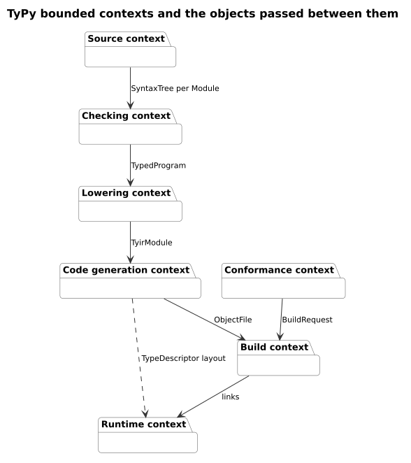
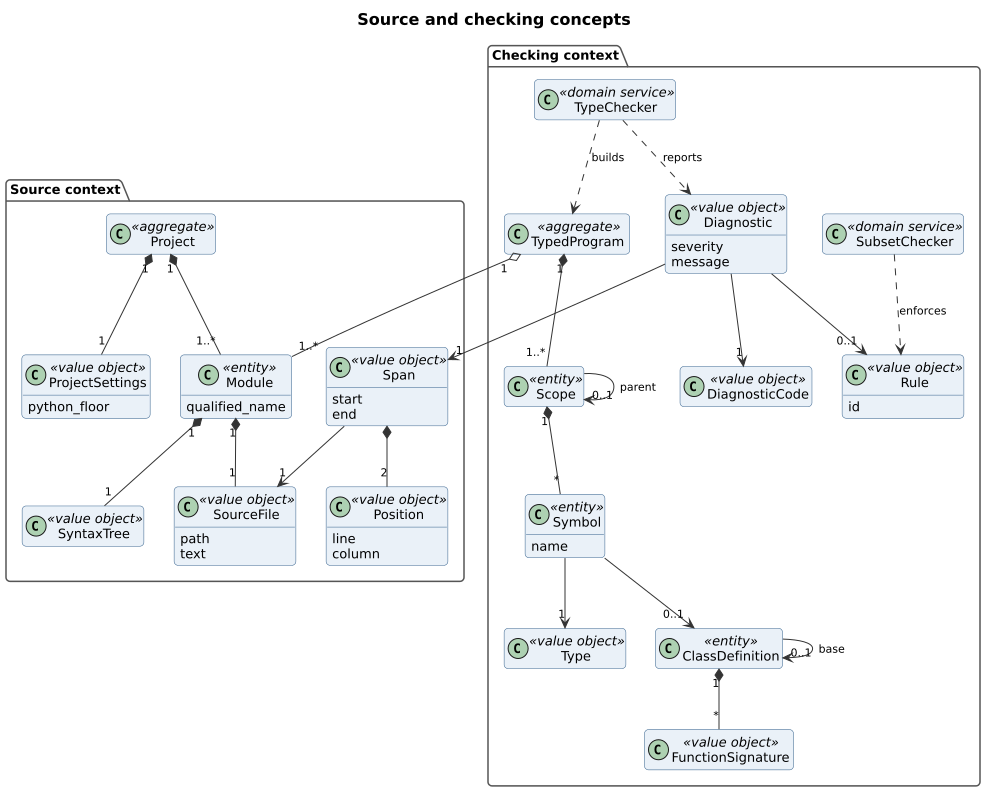
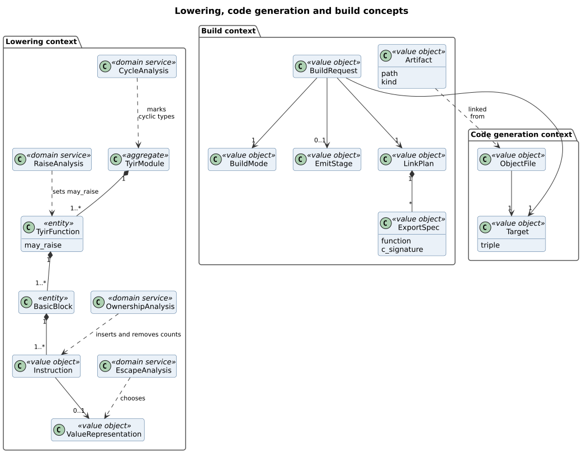
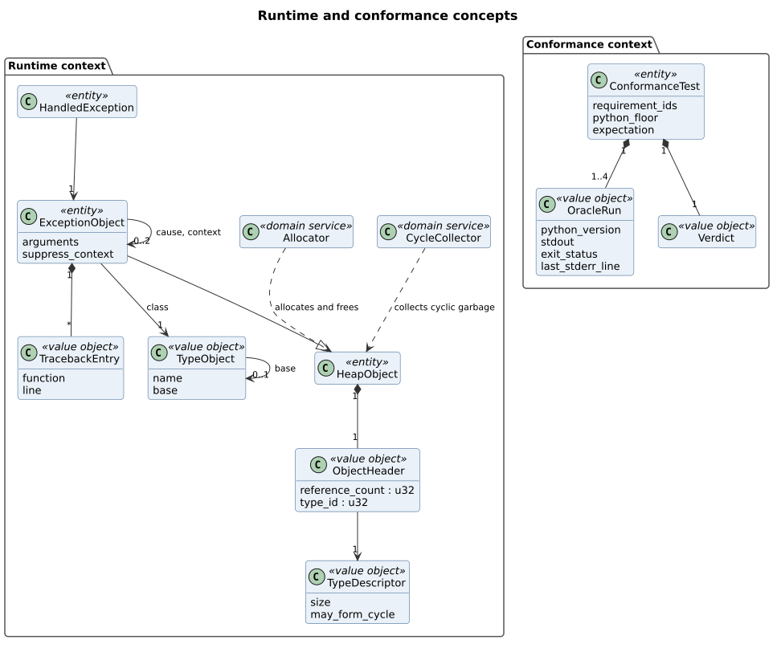
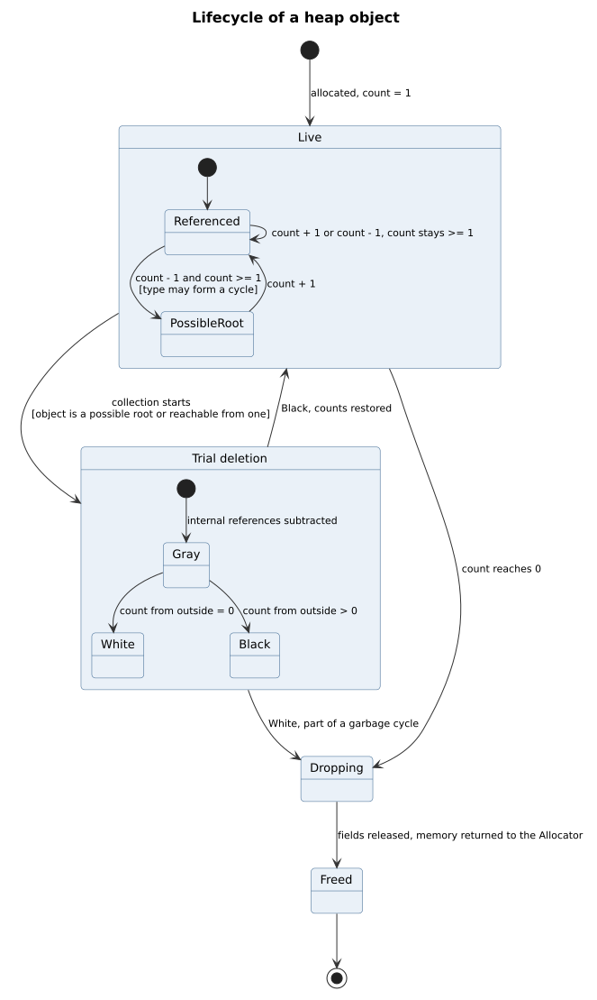
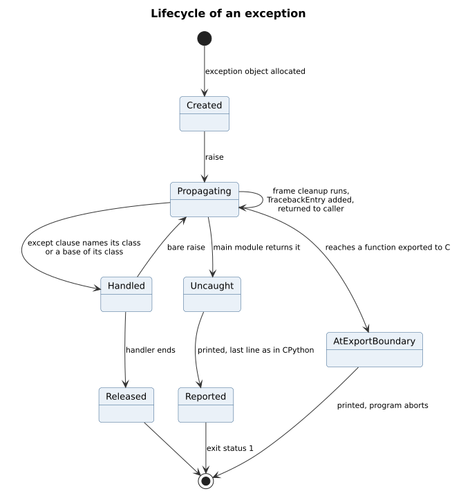
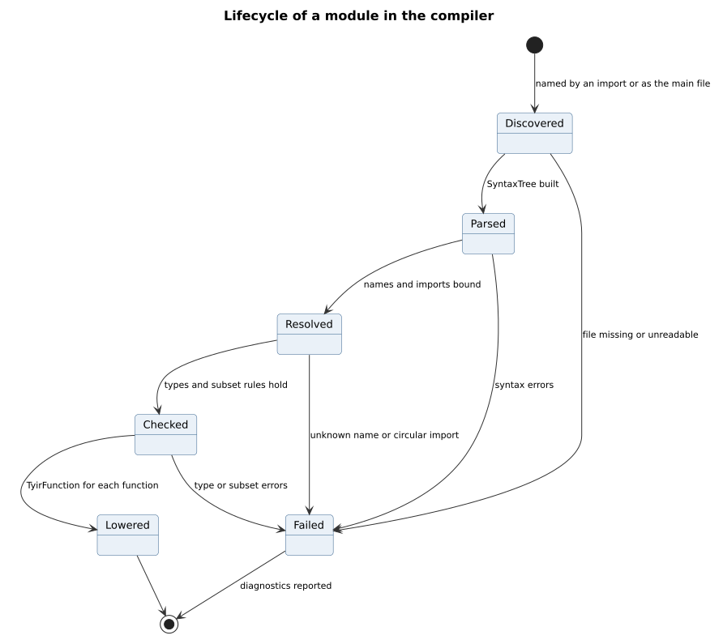

# TyPy domain model

| Field | Value |
| --- | --- |
| Document | TyPy domain model |
| Version | 1.1 |
| Status | Approved |
| Owner | typy-lang contributors |
| Last updated | 2026-11-06 |

## 1. Purpose

This document names the concepts TyPy is built from, says what kind each one
is, and states the rules that always hold for it. It builds on the approved
[use case model](use-case-model.md), version 1.0, the
[software requirements specification](../requirements/srs.md), version 1.0,
and the decision records ADR-0001 to ADR-0005.

The names here are the names in the code, the documents and the diagrams.
The software architecture, which comes next, places these concepts in
building blocks.

Each concept has one of four kinds:

| Kind | Meaning |
| --- | --- |
| Value object | Defined by its value, never changed after it is made, compared by value |
| Entity | Has an identity that stays the same while its contents change |
| Aggregate | An entity that owns a group of objects and is the only way to change them |
| Domain service | An operation on several concepts that belongs to none of them |

## 2. Bounded contexts

TyPy has seven bounded contexts. Each one hands the next a single object, so
a context depends only on the object it receives and never reaches back
into an earlier context. The compiler stages follow from this: the pipeline
in the architecture is the chain from Source to Build.

| Context | Responsibility | Receives | Hands on |
| --- | --- | --- | --- |
| Source | Find, read and parse the program's modules | A file path and `typy.toml` | A `SyntaxTree` per `Module` |
| Checking | Resolve names, check types and the subset rules, report diagnostics | `SyntaxTree` per `Module` | `TypedProgram` |
| Lowering | Build TyIR, decide representations, insert and remove reference counts | `TypedProgram` | `TyirModule` |
| Code generation | Turn TyIR into LLVM IR and object code for one target | `TyirModule` | `ObjectFile` |
| Build | Link object files, the runtime and C libraries into an artifact | `ObjectFile` and `BuildRequest` | `Artifact` |
| Runtime | Allocate, count, collect and free objects; carry exceptions | Code linked into the artifact | Behaviour at run time |
| Conformance | Compare TyPy builds with the CPython oracle | `ConformanceTest` | `Verdict` |

Code generation and Runtime share one contract: the layout of
`ObjectHeader` and `TypeDescriptor`. Code generation emits objects in that
layout, and the runtime reads them.

## 3. Source and checking

### 3.1 Source context

| Concept | Kind | Description |
| --- | --- | --- |
| `Project` | Aggregate | The program being built: its settings and every module it contains. |
| `ProjectSettings` | Value object | The settings read from `typy.toml`, with command line flags applied, including the program's Python floor. |
| `Module` | Entity | One Python module, identified by its qualified name, such as `app.models`. |
| `SourceFile` | Value object | The path and the text of one `.py` file. |
| `Span` | Value object | A range of text in one `SourceFile`, from a start `Position` to an end `Position`. |
| `Position` | Value object | A line and a column in a `SourceFile`. |
| `SyntaxTree` | Value object | The parsed form of one module, as `ruff_python_parser` produces it. |

Rules that always hold:

- `ProjectSettings` is built once, when a command starts, and every key in
  it has been checked (UC-11). A command never reads `typy.toml` again.
- A `Project` has exactly one main module, and no two modules share a
  qualified name.
- A `SourceFile` holds valid UTF-8 text (LEX-01).
- A `Position` counts lines and columns from 1, and columns in code points
  (DIA-01).
- A `Span` lies inside its `SourceFile`, and its start is not after its end.
- A `SyntaxTree` is the only form of the source that later contexts see. Its
  types from `ruff_python_parser` do not leave the Source context (ADR-0005).

### 3.2 Checking context

| Concept | Kind | Description |
| --- | --- | --- |
| `TypedProgram` | Aggregate | Every module with names resolved and every expression typed. |
| `Scope` | Entity | A region where names are bound: a module, class, function or comprehension. |
| `Symbol` | Entity | A name bound in one `Scope`, with its `Type`. |
| `Type` | Value object | The static type of a value, such as `int`, `list[str]`, `Point` or `int \| None`. |
| `ClassDefinition` | Entity | A class with its fields, methods and at most one base class. |
| `FunctionSignature` | Value object | The parameter names, parameter types and return type of a function. |
| `Diagnostic` | Value object | One error or warning, with its `DiagnosticCode`, `Span`, message, optional fix and optional `Rule`. |
| `DiagnosticCode` | Value object | A stable code such as `E0401` or `W0501`. |
| `Rule` | Value object | A requirement of the specification that a program can fall outside, identified by its ID, such as `TYP-03`. |
| `TypeChecker` | Domain service | Resolves names, infers and checks types, and builds the `TypedProgram`. |
| `SubsetChecker` | Domain service | Finds valid Python that TyPy cannot compile with CPython's meaning and reports it against its `Rule`. |

Rules that always hold:

- A `TypedProgram` exists only for a program with no errors. Nothing after
  the Checking context ever receives a program with errors.
- Every expression in a `TypedProgram` has exactly one `Type` (TYP-11), and
  no `Type` is `Any` (TYP-10).
- A `Symbol` keeps one `Type` for its whole life (TYP-03).
- A union `Type` is kept in one canonical form: nested unions are
  flattened, duplicates removed, and members put in a fixed order, so
  `int | None` and `None | int` are equal.
- A `ClassDefinition` has at most one base, and the chain of bases has no
  cycle (CLS-04).
- A `Diagnostic` always has a code, a span and a message (DIA-01). A
  `Diagnostic` that rejects valid Python always names its `Rule` (DIA-03).
- A `DiagnosticCode` is never reused, and a retired code stays reserved
  (DIA-06).

## 4. Lowering, code generation and build

### 4.1 Lowering context

| Concept | Kind | Description |
| --- | --- | --- |
| `TyirModule` | Aggregate | The whole program in TyIR, TyPy's intermediate form in static single assignment. |
| `TyirFunction` | Entity | One function in TyIR, with a flag saying whether it may raise. |
| `BasicBlock` | Entity | A straight sequence of `Instruction` values that ends in one branch, return or raise. |
| `Instruction` | Value object | One operation, such as a call, an arithmetic operation, a count increment or a count decrement. |
| `ValueRepresentation` | Value object | How one value is held: inline, on the stack, or boxed on the heap (ADR-0001). |
| `RaiseAnalysis` | Domain service | Works out which functions may raise (ADR-0004). |
| `EscapeAnalysis` | Domain service | Finds objects that do not outlive their function, so they go on the stack. |
| `OwnershipAnalysis` | Domain service | Inserts reference count operations, then removes those that borrows and moves make unnecessary. |
| `CycleAnalysis` | Domain service | Finds the types whose references could lead back to an object of the same type. |

Rules that always hold:

- A `TyirModule` passes the TyIR verifier after every pass. A failure is an
  internal error, `E9xxx` (NFR-09).
- Generics are expanded: a `TyirModule` has one `TyirFunction` per concrete
  instance of a generic function (GEN-03).
- A `TyirFunction` that is not marked as may-raise contains no raise, and
  calls only functions that are also not marked as may-raise.
- An `int` value has an inline `ValueRepresentation` only while it fits in
  63 bits (DAT-01).
- A stack `ValueRepresentation` is chosen only when `EscapeAnalysis` proves
  that the object does not outlive its function (MEM-03).
- On every path through a function, each heap reference it owns is released
  exactly once, also on paths that raise.

### 4.2 Code generation context

| Concept | Kind | Description |
| --- | --- | --- |
| `ObjectFile` | Value object | The machine code for one `TyirModule` and one `Target`. |
| `Target` | Value object | A target triple, such as `x86_64-unknown-linux-musl`, from the supported list (section 2.3 of the specification). |

Rules that always hold:

- An `ObjectFile` depends only on its `TyirModule`, its `Target`, the build
  mode and the compiler version, so it is byte-identical when they are the
  same (NFR-06).

### 4.3 Build context

| Concept | Kind | Description |
| --- | --- | --- |
| `BuildRequest` | Value object | What a command asks for: the main file, the `BuildMode`, the `Target`, an optional `EmitStage` and the `LinkPlan`. |
| `BuildMode` | Value object | `debug`, `release` or `release-small` (CLI-05). |
| `EmitStage` | Value object | The stage whose output is written instead of an executable: `ast`, `typed-ast`, `tyir`, `tyir-mem`, `llvm-ir`, `asm` or `obj` (CLI-04). |
| `LinkPlan` | Value object | The C libraries to link, each static or dynamic, and the functions to export (FFI-04, FFI-05). |
| `ExportSpec` | Value object | One exported function and its C signature. |
| `Artifact` | Value object | The written output: an executable, a static or shared library, a C header, or stage output. |

Rules that always hold:

- A `BuildRequest` has exactly one `BuildMode` and one `Target`.
- An `ExportSpec` names a module-level function of the program, and its C
  signature matches the function's annotations (UC-07).
- An `Artifact` is written completely or not at all. A failed build leaves
  no partial file (UC-02, flow 5a).

## 5. Runtime and conformance

### 5.1 Runtime context

| Concept | Kind | Description |
| --- | --- | --- |
| `HeapObject` | Entity | An object allocated on the heap, identified by its address while it lives. |
| `ObjectHeader` | Value object | The 8 bytes at the start of every `HeapObject`: a 32-bit reference count and a 32-bit type ID (NFR-12). |
| `TypeDescriptor` | Value object | What the runtime knows about one type: its size, how to release its fields, and whether it may form a cycle. |
| `ExceptionObject` | Entity | A `HeapObject` that carries a raised exception, its traceback and its cause. |
| `TracebackEntry` | Value object | One frame an exception passed through: the function and the line. |
| `Allocator` | Domain service | Hands out and takes back memory, through three replaceable functions (MEM-08). |
| `CycleCollector` | Domain service | Frees cycles of objects whose type may form a cycle, by trial deletion (ADR-0001). |

Rules that always hold:

- A live `HeapObject` has a reference count of at least 1, and its count
  equals the number of references to it, except while the `CycleCollector`
  runs.
- A `HeapObject` is freed exactly once (NFR-07).
- Only an object whose `TypeDescriptor` says it may form a cycle is ever
  given to the `CycleCollector`.
- The `TypeDescriptor` of a type is generated by the compiler and never
  changes while the program runs.
- An `ExceptionObject` gains one `TracebackEntry` per frame it passes
  through, in the order of the frames.
- No `ExceptionObject` crosses a function exported to C (EXC-05).

### 5.2 Conformance context

| Concept | Kind | Description |
| --- | --- | --- |
| `ConformanceTest` | Entity | One test program, the requirement IDs it covers, its Python floor, and whether it is expected to be accepted or rejected. |
| `OracleRun` | Value object | The standard output, exit status and last line of standard error of one CPython version on the program. |
| `Verdict` | Value object | The outcome of a test: passed, failed, invalid or not covered (UC-09). |

Rules that always hold:

- A `ConformanceTest` names at least one requirement ID (NFR-10).
- An accepted-program test has one `OracleRun` for each oracle version from
  its Python floor up to 3.15 (ADR-0008).
- When the `OracleRun` values of one test disagree with each other, its
  `Verdict` is invalid, never failed (STD-03).

## 6. Lifecycles

### 6.1 Heap object

A `HeapObject` starts live with a count of 1. While live, increments and
decrements move its count, and it is freed as soon as the count reaches 0.

An object whose type may form a cycle has one more state. When a decrement
leaves its count above 0, the object becomes a possible root: it might now
be held only by a cycle. When the `CycleCollector` runs, it subtracts the
references that come from inside the group of possible roots and the
objects reachable from them. An object whose count from outside the group
is still above 0 is live, and its counts are restored. An object whose
count from outside is 0 is part of a garbage cycle, and it is freed.

| State | Meaning |
| --- | --- |
| Referenced | Live, and not a candidate for cycle collection |
| PossibleRoot | Live, and might be held only by a cycle |
| Gray | Being examined by the `CycleCollector` |
| Black | Found to be held from outside; returns to live |
| White | Found to be garbage |
| Dropping | Its fields are being released |
| Freed | Its memory is back with the `Allocator` |

### 6.2 Exception

An exception is created as an `ExceptionObject` and raised. While it
propagates, each frame it leaves runs its cleanup, adds a `TracebackEntry`
and returns the exception to its caller (ADR-0004). It ends in one of three
ways: an `except` clause handles it and it is released; it leaves the main
module uncaught and is reported, with exit status 1 (STD-05); or it reaches
a function exported to C and the program aborts (EXC-05).

| State | Meaning |
| --- | --- |
| Created | Allocated, not yet raised |
| Propagating | Moving up the call stack, one frame at a time |
| Handled | Caught by a matching `except` clause |
| Released | The handler has ended, and the exception's last reference is gone |
| Uncaught | Returned from the main module |
| Reported | Printed to standard error, ending with the same last line as CPython |
| AtExportBoundary | Reached the wrapper of a function exported to C |

### 6.3 Module in the compiler

A `Module` is discovered when the main file names it or an import reaches
it. It is then parsed, resolved, checked and lowered. A failure at any step
moves it to failed, and its diagnostics are reported. A failed module stops
the build before code generation, but the other modules are still checked,
so one command reports every error it can (UC-01).

| State | Meaning |
| --- | --- |
| Discovered | Its `SourceFile` has been found |
| Parsed | It has a `SyntaxTree` |
| Resolved | Its names and imports are bound to `Symbol` values |
| Checked | Its types and subset rules hold |
| Lowered | Each of its functions has a `TyirFunction` |
| Failed | A step reported an error |
