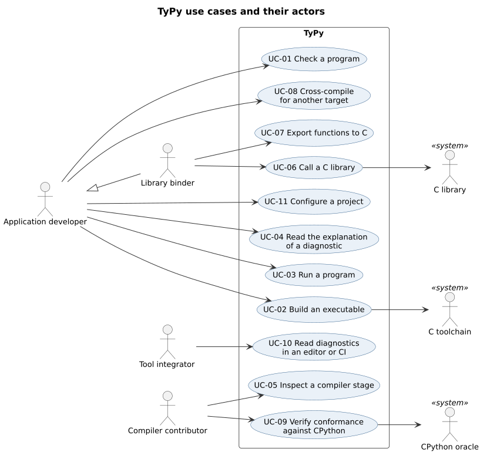
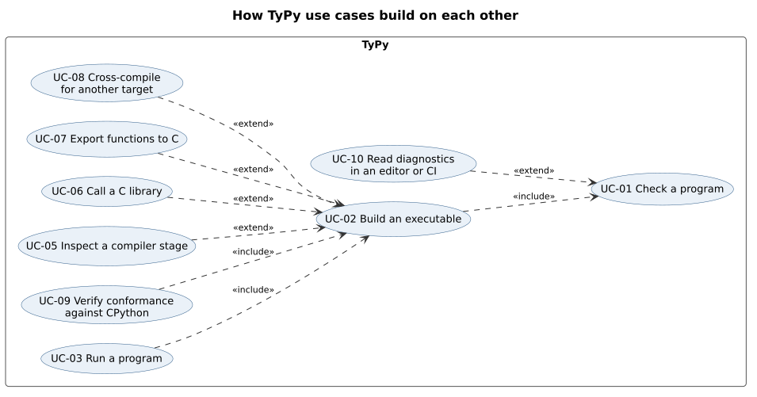

# TyPy use case model

| Field | Value |
| --- | --- |
| Document | TyPy use case model |
| Version | 1.3 |
| Status | Approved |
| Owner | typy-lang contributors |
| Last updated | 2026-11-07 |

## 1. Purpose

This document describes who uses TyPy and what each of them does with it,
as use cases with numbered flows. It builds on the approved
[software requirements specification](../requirements/srs.md), version 1.0,
and on the decision records ADR-0001 to ADR-0005. Each use case lists the
requirements it exercises. The domain model, which comes next, names the
concepts these flows use.

The language rules (areas LEX to MEM in the specification) are not
repeated here. They apply wherever a flow checks, builds or runs a program,
which is UC-01, UC-02, UC-03 and UC-09.

## 2. Actors

| Actor | Kind | Description |
| --- | --- | --- |
| Application developer | Primary | Writes a Python program and ships it as a native binary. |
| Library binder | Primary | An application developer who calls C libraries or exports functions to C. |
| Tool integrator | Primary | Runs TyPy from an editor or a CI system and reads its diagnostics. |
| Compiler contributor | Primary | Changes TyPy and checks it against CPython. |
| C toolchain | Supporting system | The system C linker driver, or `lld`, that links object files into binaries (A-01). |
| C library | Supporting system | A `.so`, `.dylib`, `.dll`, `.a` or `.lib` file with a C interface. |
| CPython oracle | Supporting system | CPython 3.12, 3.13, 3.14 and 3.15 with nothing else installed (A-02). |

## 3. Use case diagrams

The first diagram shows which actor takes part in each use case.

The second shows how the use cases build on each other. UC-02 always runs
the checks of UC-01, and UC-03 and UC-09 always build. The use cases that
extend UC-02 add one option to a build.

| ID | Use case | Primary actor | Release |
| --- | --- | --- | --- |
| UC-01 | Check a program | Application developer | 0.1 |
| UC-02 | Build an executable | Application developer | 0.1 |
| UC-03 | Run a program | Application developer | 0.1 |
| UC-04 | Read the explanation of a diagnostic | Application developer | 0.3 |
| UC-05 | Inspect a compiler stage | Compiler contributor | 0.1 |
| UC-06 | Call a C library | Library binder | 0.5 |
| UC-07 | Export functions to C | Library binder | 0.5 |
| UC-08 | Cross-compile for another target | Application developer | 0.5 |
| UC-09 | Verify conformance against CPython | Compiler contributor | 0.1 |
| UC-10 | Read diagnostics in an editor or CI | Tool integrator | 0.3 |
| UC-11 | Configure a project | Application developer | 0.3 |

## 4. Use cases

The flows below hold for every use case:

- **Internal error.** If TyPy fails internally at any step, it reports a
  diagnostic with an `E9xxx` code and a hint to report the defect, and it
  exits with status 101 (NFR-09, CLI-06).
- **Wrong usage.** If the command line is not valid, TyPy prints the usage
  of the command and exits with status 2 (CLI-06).

### 4.1 UC-01 Check a program

| Item | Value |
| --- | --- |
| Primary actor | Application developer |
| Preconditions | The program's `.py` files exist and are readable. |
| Trigger | The developer runs `typy check PATH`. |
| Postconditions | Every diagnostic is reported, and no file is written. The exit status is 0 when there are no errors and 1 otherwise. |
| Requirements | CLI-03, CLI-06, STD-01, STD-04, STD-07, TYP-01 to TYP-11, MOD-01 to MOD-05, LIB-08, DIA-01 to DIA-04, DIA-07 (0.3) |

Main flow:

1. The developer runs `typy check PATH`.
2. TyPy reads the project settings (UC-11) and finds every module that the
   main file imports.
3. TyPy parses each module as Python.
4. TyPy resolves names and imports and type checks every function.
5. TyPy checks that every feature the program uses is one TyPy compiles
   with CPython's meaning.
6. TyPy finds no errors and exits with status 0.

Alternate flows:

- **3a.** A file has a Python syntax error. TyPy reports each syntax error
  with its location and goes on with the other files. At the end it exits
  with status 1.
- **4a.** The program has a type error. TyPy reports it with its code, its
  location, one sentence, and a corrected line when the fix is certain.
  Errors that follow from the same cause are suppressed. TyPy exits with
  status 1.
- **4b.** The program imports a standard library module that TyPy does not
  provide. TyPy reports the import and lists the modules it does provide
  (LIB-08), then exits with status 1.
- **4c.** The program has a circular import. TyPy reports the cycle
  (MOD-05) and exits with status 1.
- **5a.** The program uses valid Python that TyPy cannot compile with
  CPython's meaning, such as `eval` or a metaclass. TyPy reports the
  construct and names the rule it falls outside (DIA-03), then exits with
  status 1.
- **6a.** From 0.3, TyPy finds warnings but no errors. It reports them and
  exits with status 0, or with status 1 when `--deny-warnings` is given
  (DIA-07). 0.1 defines no warnings.

### 4.2 UC-02 Build an executable

| Item | Value |
| --- | --- |
| Primary actor | Application developer |
| Supporting actors | C toolchain |
| Preconditions | As UC-01. A C linker for the host is installed (A-01). |
| Trigger | The developer runs `typy build FILE`, optionally with `--release` or `--release-small`. |
| Postconditions | An executable is written. Building again with the same source, flags, target and compiler gives the same bytes. |
| Requirements | CLI-01, CLI-05, CLI-06, CLI-11, NFR-01, NFR-04 to NFR-06, NFR-15, C-03, ADR-0001, ADR-0004 |

Main flow:

1. The developer runs `typy build FILE` with a build mode.
2. TyPy checks the program as in UC-01, steps 2 to 5.
3. TyPy lowers the program to its intermediate form, inserts and removes
   reference count operations, and generates LLVM IR.
4. LLVM optimises the IR at the level of the build mode and writes an
   object file.
5. TyPy links the object file with the runtime and the C library through
   the C toolchain.
6. TyPy writes the executable and exits with status 0.

Alternate flows:

- **2a.** The check finds errors. TyPy reports them as in UC-01, writes no
  file and exits with status 1.
- **5a.** The C toolchain is missing or the link fails. TyPy reports the
  linker command and its output, removes any partial output and exits with
  status 1.
- **6a.** The output path cannot be written. TyPy reports the path and the
  reason and exits with status 1.

### 4.3 UC-03 Run a program

| Item | Value |
| --- | --- |
| Primary actor | Application developer |
| Supporting actors | C toolchain |
| Preconditions | As UC-02. |
| Trigger | The developer runs `typy run FILE`, optionally followed by `--` and arguments. |
| Postconditions | The program has run, and `typy` exits with the program's exit status. |
| Requirements | CLI-02, STD-02, STD-05, STD-06, FUN-02 |

Main flow:

1. The developer runs `typy run FILE -- ARGS`.
2. TyPy builds the program as in UC-02, in debug mode unless a mode is
   given, into a build directory under `TYPY_HOME`.
3. TyPy starts the executable with `ARGS` as its arguments, which the
   program reads as `sys.argv[1:]` from 0.3 (LIB-04), connected to
   the same standard input, output and error.
4. The program runs its module-level statements in order and ends.
5. `typy` exits with the program's exit status.

Alternate flows:

- **2a.** The build fails. TyPy follows the alternate flows of UC-02 and
  does not start the program.
- **4a.** The program raises an exception that nothing catches. The program
  prints it, ending with the same last line as CPython, and exits with
  status 1 (STD-05).
- **4b.** The program exhausts its stack. It reports `RecursionError` on
  standard error and exits with status 1 (FUN-02).
- **4c.** The program calls `sys.exit(n)`. It exits with status `n`.

### 4.4 UC-04 Read the explanation of a diagnostic

| Item | Value |
| --- | --- |
| Primary actor | Application developer |
| Preconditions | None. |
| Trigger | The developer runs `typy explain CODE`, with a code from a diagnostic. |
| Postconditions | The explanation is printed. |
| Requirements | CLI-10, DIA-06 |

Main flow:

1. The developer runs `typy explain CODE`.
2. TyPy prints what the diagnostic means, the rule it enforces by ID, a
   program that causes it, and the corrected program.
3. TyPy exits with status 0.

Alternate flows:

- **2a.** The code does not exist. TyPy says so and exits with status 2.
- **2b.** The code is retired. TyPy says that it is retired and names the
  code or rule that replaced it (DIA-06), then exits with status 0.

### 4.5 UC-05 Inspect a compiler stage

| Item | Value |
| --- | --- |
| Primary actor | Compiler contributor |
| Preconditions | As UC-01. |
| Trigger | The contributor runs `typy build FILE --emit=STAGE`. |
| Postconditions | The output of the stage is written as deterministic text, or as an object file for `obj`. |
| Requirements | CLI-04, NFR-06 |

Main flow:

1. The contributor runs `typy build FILE --emit=STAGE`, where `STAGE` is
   `ast`, `typed-ast`, `tyir`, `tyir-mem`, `llvm-ir`, `asm` or `obj`.
2. TyPy runs the stages of UC-02 up to and including `STAGE`.
3. TyPy writes the output of `STAGE` to standard output, or to the file
   named by `-o`.
4. TyPy exits with status 0.

Alternate flows:

- **1a.** `STAGE` is not a known stage. TyPy lists the stages and exits
  with status 2.
- **2a.** A stage before `STAGE` finds errors. TyPy reports them as in
  UC-01 and exits with status 1.

### 4.6 UC-06 Call a C library

| Item | Value |
| --- | --- |
| Primary actor | Library binder |
| Supporting actors | C library, C toolchain |
| Preconditions | The C library is installed for the target. |
| Trigger | The binder builds a program that declares C functions through `ctypes`. |
| Postconditions | The executable calls the C functions directly. The same program runs alike under CPython through `ctypes`. |
| Requirements | FFI-01 to FFI-04, CLI-07, NFR-07, ADR-0003 |

Main flow:

1. The binder loads the library at module level with
   `ctypes.CDLL("name")`, using a string literal.
2. The binder assigns `argtypes` and `restype` for each C function, at
   module level, before its first call.
3. The binder sets static or dynamic linking for the library in
   `typy.toml` (UC-11).
4. The binder builds the program as in UC-02.
5. TyPy checks every call against the declared types.
6. TyPy compiles each call into a direct call, with the conversions that
   ctypes defines, and passes the library to the C toolchain.
7. TyPy writes the executable.

Alternate flows:

- **1a.** The library name is not a string literal. TyPy rejects the call
  (FFI-01).
- **2a.** A function is called without both `argtypes` and `restype`
  assigned. TyPy rejects the call and names the missing attribute (FFI-02).
- **2b.** A declaration uses a ctypes type that TyPy does not support.
  TyPy rejects it and lists the supported types (FFI-03).
- **6a.** The C toolchain cannot find the library. TyPy reports the
  library name and the search paths and exits with status 1.

### 4.7 UC-07 Export functions to C

| Item | Value |
| --- | --- |
| Primary actor | Library binder |
| Supporting actors | C toolchain |
| Preconditions | As UC-02. |
| Trigger | The binder runs `typy build --lib static` or `typy build --lib shared`. |
| Postconditions | A static or shared library and a matching C header are written. A C program can link the library and call each exported function. |
| Requirements | FFI-05, CLI-09, EXC-05, ADR-0004 |

Main flow:

1. The binder lists each function to export, with its C types, under
   `[export]` in `typy.toml` (UC-11).
2. The binder runs `typy build --lib shared`.
3. TyPy checks each listed function's annotations against its C types.
4. TyPy builds as in UC-02, and gives each exported function a wrapper that
   converts its arguments and catches any exception at the boundary.
5. TyPy writes the library with an unmangled symbol for each export.
6. TyPy writes the C header.

Alternate flows:

- **3a.** A listed function does not exist. TyPy reports its name and exits
  with status 1.
- **3b.** An annotation cannot be converted to the listed C type. TyPy
  reports the parameter, its annotation and the C type, and exits with
  status 1.
- **4a.** At run time, an exception reaches an export wrapper. The wrapper
  prints the exception and aborts the program (EXC-05).

### 4.8 UC-08 Cross-compile for another target

| Item | Value |
| --- | --- |
| Primary actor | Application developer |
| Supporting actors | C toolchain |
| Preconditions | A C linker and C library for the target are installed (A-01). |
| Trigger | The developer runs `typy build FILE --target TRIPLE`. |
| Postconditions | An executable for the target is written. |
| Requirements | CLI-08, NFR-06 |

Main flow:

1. The developer runs `typy build FILE --target TRIPLE`.
2. TyPy checks that `TRIPLE` is a supported target.
3. TyPy builds as in UC-02, generating code for the target and using the
   target's linker.
4. TyPy writes the executable for the target.

Alternate flows:

- **2a.** The target is not supported. TyPy lists the supported targets and
  exits with status 2.
- **3a.** No linker for the target is found. TyPy names the target and the
  linker it looked for and exits with status 1.

### 4.9 UC-09 Verify conformance against CPython

| Item | Value |
| --- | --- |
| Primary actor | Compiler contributor |
| Supporting actors | CPython oracle, C toolchain |
| Preconditions | CPython 3.12 to 3.15 are installed with nothing else (A-02). |
| Trigger | The contributor, or CI, runs the conformance suite. |
| Postconditions | Every test has passed, or each failure is reported with its requirement ID and the difference. |
| Requirements | NFR-10, NFR-15, STD-02, STD-03, STD-05, ADR-0002 |

Main flow:

1. The contributor runs the conformance suite.
2. For each accepted-program test, the suite runs the program under each
   oracle version from the test's Python floor up, and records its
   standard output, exit status and last line of standard error.
3. The suite builds the program with TyPy in debug and in release mode, as
   in UC-02, and runs both builds with the same input.
4. The suite finds that both builds run alike with the oracle.
5. For each rejected-program test, the suite runs UC-01 and finds the
   expected diagnostic code at the expected location.
6. The suite reports, for each requirement ID, its accepted and rejected
   tests, and that all of them passed.

Alternate flows:

- **2a.** The oracle versions disagree with each other. The suite reports
  the test as invalid, because it depends on behaviour Python leaves to the
  implementation (STD-03), not as a TyPy failure.
- **4a.** A TyPy build differs from the oracle. The suite reports a failure
  with the requirement ID and the difference.
- **4b.** The debug and release builds differ. The suite reports a failure
  of NFR-15.
- **5a.** The diagnostic is missing, or has another code or location. The
  suite reports a failure with the expected and the actual diagnostic.
- **6a.** A requirement lacks an accepted or a rejected test. The suite
  lists it as not covered (NFR-10).

### 4.10 UC-10 Read diagnostics in an editor or CI

| Item | Value |
| --- | --- |
| Primary actor | Tool integrator |
| Preconditions | As UC-01. |
| Trigger | The tool runs `typy check PATH --error-format=json`. |
| Postconditions | Each diagnostic has been written as one JSON object per line. The exit status is as in UC-01. |
| Requirements | DIA-05, DIA-01, CLI-06 |

Main flow:

1. The tool runs `typy check PATH --error-format=json`.
2. TyPy checks the program as in UC-01.
3. TyPy writes each diagnostic as one JSON object per line, with its code,
   severity, location, message, rule ID and suggested fix.
4. The tool shows each diagnostic at its location.
5. TyPy exits with the status UC-01 gives.

Alternate flows:

- **2a.** TyPy fails internally. It writes the internal error as a JSON
  object with its `E9xxx` code, then exits with status 101.

### 4.11 UC-11 Configure a project

| Item | Value |
| --- | --- |
| Primary actor | Application developer |
| Preconditions | None. |
| Trigger | The developer writes `typy.toml` next to the main file and runs any `typy` command. |
| Postconditions | The command runs with the settings from the file, overridden by any flag on the command line. |
| Requirements | CLI-07, CLI-11, CLI-12, MOD-01, FFI-04, FFI-05 |

Main flow:

1. The developer writes `typy.toml` with the program's Python floor, module
   search paths, link settings for C libraries, and exports.
2. The developer runs a `typy` command.
3. TyPy reads `typy.toml` once, when the command starts, and checks every
   key and value.
4. TyPy applies each command-line flag over the setting of the same name.
5. The command continues with the combined settings.

Alternate flows:

- **3a.** There is no `typy.toml`. The defaults apply.
- **3b.** The file has an unknown key, a value of the wrong type, or is not
  valid TOML. TyPy reports the file, the line and the key, and exits with
  status 2 before doing any other work.
